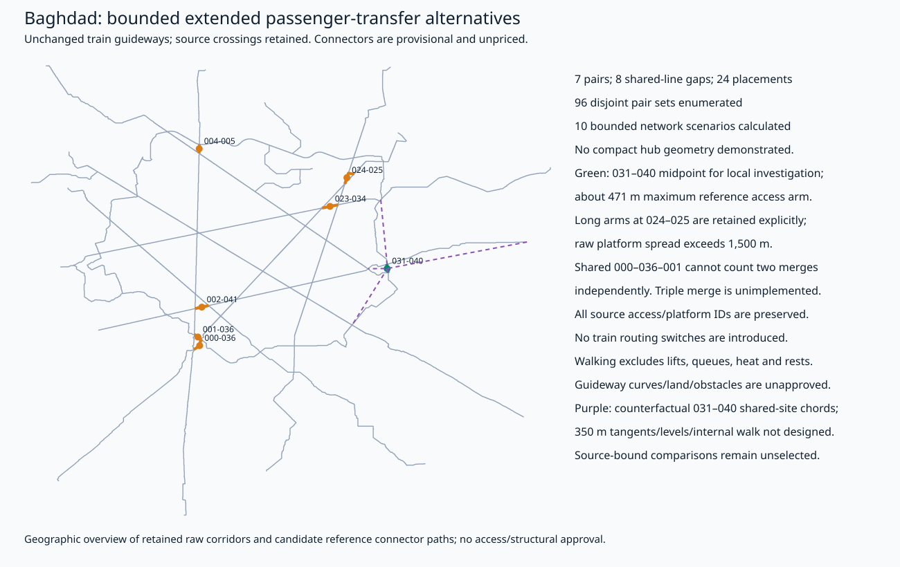

# OpenSourceRail

**OpenSourceRail aims to make useful city-wide urban transport achievable for everyday travel, with systems that communities can build, operate and maintain locally.** Open designs, local production and training are intended to develop lasting productive capability.

The programme links three products under development:

- **[An owner, builder and operator platform](docs/design-engine/ferrite-maglev/planning-platform/README.md):** geographic planning, a design studio, delivery planning and business/operating workflows.
- **[Reference hardware and local manufacturing studies](docs/design-engine/ferrite-maglev/candidate-manufacturing/README.md):** repeated vehicle, guideway and station equipment, with factory processes and procurement scope.
- **[Open train-control software](crates/osr-maglev-control/README.md):** inspectable train and station controls with explicit development, verification and deployment boundaries.

The intended workflow carries a versioned design through consistent CAD, bills of materials and component-level BIM into procurement, construction tasks, resource and cash plans, then quality assurance tied to serial assets, operations, maintenance and staff training. Current digital studies and simulated pilot workflows exercise parts of this chain; complete city-wide integration and physical acceptance remain open. Business approval cannot release railway hardware or authorise train movement.

The retained v0.5.2 comparison configuration uses ferrite permanent-magnet-biased active support, six-car trains and fixed linear motors at stations for launch and receiving braking. Current research also compares onboard neodymium Halbach and mixed-material alternatives. Trains are intended to coast between finite powered zones while independent onboard support, guidance and passenger services remain powered. Longer legs may need separately counted midpoint accelerators.

**All permanent magnets and suspension/guidance control coils stay on the train.** The ordinary guideway is a concrete beam with attached passive steel facings. Its attachments transfer magnetic forces into the concrete; powered station launch/receiving equipment is a separate interface.

The ethos is **simple equipment, low whole-life cost and high normal passenger throughput**. Compare station spacing, acceleration, dwell, charging and frequency at equal service, counting **CAPEX, OPEX and debt repayment together**. Normal-capacity targets are comparison requirements, not demonstrated operating capacity or demand forecasts. Complete equipment, maintenance and recovery must be counted. Complete installed costs remain unknown, and savings are unproven.

The repository contains engineering studies, planning tools and executed digital evidence. The current accounted train still fails magnetic support checks; its complete four-stop electromechanical journey is unexecuted. The [design completion plan](docs/design-engine/ferrite-maglev/research-closure/README.md) records what has been tested, what is proposed and the evidence needed next.


*Illustrative development concept. Baghdad uses six 17 m bodies; complete engineering and physical acceptance remain open.*

**[Calculations, native CAD, images and videos](docs/design-engine/ferrite-maglev/reference/index.html) · [City packages](engineering/ferrite_maglev/city-index.md) · [City map sources](engineering/city_maps/README.md) · [Implementation and open work](engineering/ferrite_maglev/README.md)**

## Why this design

- **Make broad networks affordable over their whole life.** Minimise CAPEX, OPEX and long-term debt repayment together, with explicit attention to imported equipment and foreign-currency borrowing. Every city now shows scope-covering capital sensitivities, operating costs and annual finance schedules; complete estimates and proven savings remain open.
- **Simplify normal GOA4 dispatch around stations.** Fixed launch/receive sites and passenger transfers between independent lines remove mainline switching choices. Following departures use protected authority and resources released behind a verified full train tail; independent support, safe arrival and degraded recovery remain necessary.
- **Deliver passengers, not just top speed.** Compare station spacing, acceleration, dwell, protected headway, charging and fleet at equal passengers per hour per direction. Shorter waits and practical access matter alongside journey time; a capacity reduction must remain visible when a specification changes.
- **Simplify the train.** Fixed wayside linear synchronous motors remove the main propulsion windings, traction inverter and large traction-energy battery from the vehicle. Normal running gear avoids wheelsets, gearboxes and rotating traction motors. Support coils, drives, sensors, cooling, protection, doors, HVAC and emergency systems remain necessary.
- **Reduce noise and wear.** Contactless running removes rolling contact from normal operation. Acoustic performance, magnetic losses, energy use and reliability need measurement.
- **Build more value locally.** Prioritise concrete casting, reinforcement/prestress work, composite panels, carriers, winding cassettes, interiors, wiring, Rust software and integration. Prefer verified British manufacture for UK machinery procurement. Imported cells, semiconductors, sensors and materials retain their actual origin in local-content accounting.
- **Reach constrained city corridors.** Compact viaducts aim to reduce surface occupation and disruption, expanding useful station locations. The planning objective is 99% elevated mainline with straight tangents where rights, buildings, utilities, waterways, wildlife and access permit.
- **Optimise the complete installed system.** Include vehicle mass, station electrical plant, guideway, foundations, factory processes, logistics, erection, maintenance and recovery. Savings in onboard equipment must be compared against the station/booster power equipment and independent rescue facilities added along the route.

The guideway target is one concrete beam per direction, with necessary reaction iron, supports, foundations and connections. Removing a continuous external walkway requires an accepted evacuation alternative. Vertical spiral controlled-descent chutes are the preferred research candidate; safe landings at every stopping location, assisted evacuation, fire, weather, deployment and rescue remain open.


*Illustrative concept; no qualified train installation or walkway-removal approval is claimed.*

<!-- osr-current-engineering:start -->
The [current engineering readiness register](docs/design-engine/ferrite-maglev/engineering-readiness/README.md) connects **504 composed alternatives** to eight explicit evidence gates, equipped-stock accounting, operating-point magnetic studies and hot-weather duty. The [readiness Workbench](docs/workbench/trip/readiness/index.html) shows the same generated records. Complete installed mass, stable multiaxis hover and a physically driven 2 km journey remain open; native-method passes do not qualify a train.
<!-- osr-current-engineering:end -->

The [seat-led comfort study](docs/design-engine/ferrite-maglev/comfort-options/README.md) investigates four-abreast rows, lightweight benches, one-sided doors, coated plastic glazing, sandwich floors/roofs and aluminium structures. Its default fits **44 seats plus two wheelchair users, with no planned standing**; an alternative fits 48 seats plus two wheelchair users by replacing door-zone benches. At a 180-second headway these six-car options provide **5,520–6,000 passengers/hour/direction**. Matching 14,400 would require an unqualified 69–75-second headway. The lower payload improves force-reserve arithmetic; complete installed mass, stable suspension, structural and hot-weather comfort qualification remain open. [Compare layouts, materials and capacity in the Workbench](docs/workbench/trip/readiness/comfort/index.html).

## Current design and evidence

The [larger Halbach and lighter rolling-stock campaign](docs/design-engine/halbach-scaling/README.md) expands onboard neodymium volume from 6 to 24 litres per module and compares segmentation, pole periods, back iron and differential control windings alongside aluminium frames, doors, glazing and HVAC. An enlarged 12-litre differential array reaches **30.8–31.5 kN** in one converged finite 3D calculation at 12 mm and 80°C. Stronger magnetic pull requires counted attachment reinforcement; proposed larger operating gaps, lateral stability, thermal duty and complete installed mass remain unresolved. This is a separate research comparison; the canonical train is unchanged.

The [electropermanent-magnet study](docs/design-engine/electropermanent/README.md) investigates slow bias/load trim and retention/latch candidates. Both rail coupons fail the declared zero-current retention bound at 12 mm. Fast active coils remain needed for stabilisation; no replacement configuration is adopted.

The [finite 3D Halbach confirmation](docs/design-engine/magnetic-confirmation/README.md) reached full-source convergence in three bounded static cases. Mesh and air-contour force differences remain unresolved; these calculations do not establish a complete force map or stable levitation.

The [neodymium and lightweight-vehicle study](docs/design-engine/vehicle-optimisation/README.md) compares named NdFeB grades and full rotating Halbach arrays with ferrite controls, then feeds aluminium-extrusion frames, doors, glazing and HVAC alternatives into the same mass comparison. It retains hot-condition material failures, incomplete control windings and installation uncertainty. Lower magnetic stock mass is promising; a complete replacement configuration remains unadopted.

The [onboard-magnet/passive-facing campaign](docs/design-engine/passive-suspension/README.md) investigates shared lift and lateral alignment, load-dependent low-current operation, damping and simple compliant mounting. Exact counted stock, a transverse finite-element model and map-bound controls share the common candidate contracts. Failed support, unresolved derivatives, curve fit and missing installed equipment remain visible; no replacement train or changed Baghdad service specification is adopted.

The [coordinated candidate campaign](engineering/design_search/README.md) connects physical carrier alternatives, selected guidebeam dimensions, nonlinear magnetic screens and draft manufacturing/construction outputs through one candidate identity. Separate evaluation and selection identities preserve modelling assumptions and ranking policy. The [comparison Workbench](docs/design-engine/design-search/index.html) retains failed calculations, missing installed stock and revision ancestry. A next-experiment selection is a research priority; an integrated design still requires complete inventory, coupled calculations and independent domain confirmation.

The [six-car journey programme](engineering/trip_dynamics/README.md) adds actual Project Chrono benchmarks for 1.5–2 km launch, coast and arrival, strict magnetic/modal interfaces and the existing Rust current controller. Its [source-bound report](docs/design-engine/trip-dynamics/README.md) separates ideal-support method tests from the current candidate's refused launch attempts. Complete equipped GFRP/aluminium body properties, converged nonlinear 3D magnetic maps and moving electrical/thermal coupling remain required.

The [detailed candidate and simulation chain](docs/design-engine/ferrite-maglev/system-detailed/README.md) now follows one revision through dimensioned magnetic stock, accounted mass/inertia, Rust currents, structural loads, quantitative manufacturing, native business records and BIM/field exchange. The new shared-stem research candidate is approximately **25.6t tare /37.6t AW3 per car**. Its thin return rails fail required AW3 lift and its propulsion geometries retain mandatory demagnetisation/convergence failures; it is **not an adopted or completed train design**. The earlier lighter candidate’s actuator pass and finance do not transfer to this geometry.

The [twelve-case redesign study](engineering/assurance/v053-magnetic-redesign-bounds/README.md) quantifies the next iteration. Wider return paths recover conditional static lift, but add substantial guideway steel and still fail the 1.3-load current screen. These hypotheses have separate identities, archived inputs and reproducible calculations; none is adopted into the train or city cost defaults.

The separate [propulsion redesign screen](engineering/assurance/v053-propulsion-redesign-screen/README.md) tests magnetic period and physical corner geometry. A larger chamfer improves sampled demagnetisation margins, while finer analysis invalidates an earlier apparent success. Its conditional thrust, electrical and thermal results do not establish a complete launch profile or an integrated train design.

The [current design round](docs/design-engine/ferrite-maglev/research-closure/README.md) compares changes against simplicity, complete cost and a normal-capacity reference of **14,400 passengers/hour/direction**. Its concrete research alternatives are:

- **Separate lift and guidance circuits:** 30 support modules and six guidance units per car, with 36 wound coils instead of the original 72. Counted stock gives a **54.469 t/car AW3 material-mass floor**. Guidance steel/leakage margins and spatial maps remain unresolved; the static 1.3-load power subtotal exceeds the inherited support allocation. [Support design and counted quantities](docs/design-engine/ferrite-maglev/research-closure/support-architecture.md).
- **Short repeated magnetic carriers:** the 30-module stock fits the tested 150 m terminal curve with five yaw carriers and lateral slides, a proposed 3.0 m underbody clearance and 2 mm reserved geometric tolerance. Bearings, capture/brakes, coolers and guidance still need a complete installed layout and weighed mass. [Carrier geometry](docs/design-engine/ferrite-maglev/research-closure/carrier-geometry.md).
- **Lower speed with explicit capacity accounting:** at that same support mass floor, a 12-car, 209.5 m formation, 1 km stops, 28.8 km/h speed cap and 45 s dwell can calculate about **14,800 normal passengers/hour/direction** under conservative whole-leg protection. It needs long platforms, **7.2 MW/train charging input** and powered zones covering about half the route. Repeated winding cooling, the existing 5% grade case and physical protection remain open. [Service tradeoffs and quantities](docs/design-engine/ferrite-maglev/research-closure/service-envelope.md).

These are source-bound research contracts. Their unweighed mechanisms, repeated duty and full-route interfaces prevent adoption as one complete train. The [versioned research specification](engineering/maglev_research/design-intent.toml) makes the changed speed, spacing, formation and dwell choices explicit; existing city defaults remain preserved. [README introductions and context coverage](docs/design-engine/ferrite-maglev/research-closure/readme-coverage.md) covers every current README while preserving archived scientific evidence.

[Native module image and assembly visibility clip](docs/design-engine/ferrite-maglev/candidate-native/README.md) · [Editable owner/builder planning](docs/workbench/planning/index.html) · [Independent SUMO cross-check](docs/design-engine/ferrite-maglev/operations-crosscheck/README.md). Planning revisions, procurement and business training can progress while engineering acceptance remains open.

The [connected Baghdad pilot](docs/design-engine/ferrite-maglev/pilot-delivery/README.md) joins a controlled equipment ledger, coupled actuator experiments, segmented launch comparisons, a complete pilot-line operating study, procurement/construction cash and a serial-specific native ERPNext/FUXA/Workbench exercise. **Accounted equipment exceeds the earlier mass targets below.** Target overruns, failed removal paths and unselected redesigned alternatives remain visible; published digital packets do not establish a completed or accepted train. The pilot uses its own exact configuration identity, separate from the historical city planning targets.

The historical six-car Baghdad target study retains a **14.2 t/car tare target**, including a **5.2 t equipped GFRP body**, 3 t ferrite and a 30 kWh services battery. Four passenger doors per car are the body-study basis. The wider-profile urban/suburban comparisons use 50 kWh/car: **14.4 t tare and 26.4 t AW3 per car**, with the added pack mass included once. The manufactured design dossier uses this heavier case for hardpoints, passive support, civil loads and the emergency-brake proposal, and retains the 30 kWh case separately. Counted frame members, supported panels, joints and couplers remain provisional. Frame and exact brake growth consume part of the existing 1.8 t/car reserve; they are not free mass. Complete equipment, joined-body strength, fatigue, centre of gravity and inertia remain unqualified.

The historical target study’s ordinary civil candidate is a **25 m, 0.80 m wide closed concrete box**, with 100 mm webs, 150 mm flanges and explicit end infills. Its selected depth, mass and stiffness are recorded in the [target configuration](ferrite-maglev-study.toml) and source-bound report. The new [candidate-specific structural package](docs/design-engine/ferrite-maglev/candidate-structures/README.md) recalculates concrete, reaction rails, prestress, reinforcement, handling and substructure at the heavier accounted loads; its reference span weighs about **61.9 t** before lifting accessories. Ground-dependent selection, connection tests and construction acceptance remain open.

Current city catalogue planning targets **at least 1.5 km spacing and about 2 km on urban lines**, with **4–5 km on suburban lines** and fixed midway acceleration where the calculated trajectory requires it. The separate research alternatives above test different spacing without rewriting those city packages. Junction stations serve **passenger transfers between independent fixed lines**; they do not switch trains between routes. Straight corridors are the planning objective, subject to real land, buildings, utilities, grades and evacuation access. Retained nearby junctions that conflict with the minimum spacing stay visible as exceptions requiring a transfer/access decision.

The new [corridor study](docs/design-engine/ferrite-maglev/corridor/README.md) evaluates longer motion profiles, finite installed motor zones, voltage/current, services charging, protected-resource timing and actual Rust fault responses. It retains capacity shortfalls and missing physical geometry confirmation. The 1 km/88 s/180 s station and moving studies are explicitly retained **component benchmarks**; they do not prove the wider-spacing plan.

The separate [multi-train prototype](docs/design-engine/ferrite-maglev/line-capacity/README.md) executes progressive reservations, full-tail release and conservative stopping envelopes through the Rust ledger. It retains adverse cases and compares exclusive whole-leg operation. It does not approve route-wide protection or change city capacity assumptions.

Longer gaps need explicit services storage and recovery. The [booster/rescue kit study](docs/design-engine/ferrite-maglev/booster-kit/README.md) compares independent accessible rescue nodes at intervals up to 1 km, 0.5/1 m/s winches and 30/50/60 kWh services packs. Rope, drum, portal, foundations, independent power, mass and unquoted cost targets are counted. A midway accelerator is not automatically a rescue facility. Larger packs and faster winches carry their extra mass, electrical rating and cost; located access, certified hardware and essential-load assumptions remain unqualified.

City bills separately show fleet, ordinary and terminal civil work, station electrical plant, conditional footing increments, located booster hardware and rescue kits. Fewer passenger platforms do not establish a complete saving: power zones, transfer hubs, access, recovery, land and physical acceptance still need their full quantities and costs. Complete installed cost remains unknown.

## Baghdad interchange alternatives

The default Baghdad plan remains **273 proposed stops with 10 transfer-spacing conflicts**. The [interchange investigation](docs/design-engine/ferrite-maglev/interchange-hubs/README.md) compares two different ideas: extended passenger links on unchanged train guideways, and coordinated shared-site hub concepts that move the involved guideways. None is selected. Trains continue on independent fixed lines, without routing switches.



Grouping nearby stations does not shorten the physical walk. The extended-link options retain original boarding platforms and calculate reference connector lengths, walking sensitivities, changed operating duties and partial cost credits. The original shared-site concepts draw the involved lines through one location; their 350 m tangents and 100 m compact walk were comparison assumptions. The separate geometry study below now fits powered zones, directional approaches, platforms and passenger routes. Lifts, shade, resting places, peak passenger flows, evacuation and complete access costs must be qualified before a hub can replace a spacing exception. [Inspect the original alternatives and source evidence](docs/design-engine/ferrite-maglev/interchange-hubs/study.json.gz).

The [access engineering study](docs/design-engine/ferrite-maglev/hub-access/README.md) now counts connector modules, supports and access structures and compares passenger pulses and lift outages. A reference path along a train alignment is not itself a buildable pedestrian bridge; the physical access corridor and platform interfaces need their own clearance and site checks. No hub is selected from provisional flow or quantity results.

The [station benchmark](docs/design-engine/ferrite-maglev/station-powered/README.md), [body/civil quantities](docs/design-engine/ferrite-maglev/station-structure/README.md), [manufactured detail dossier](docs/design-engine/ferrite-maglev/manufactured-dossier/README.md), [native details](docs/design-engine/ferrite-maglev/manufactured-native/native-cad.json) and [integrated Rust campaign](docs/design-engine/ferrite-maglev/system-campaign/README.md) retain exact sources and open gates.

The [moving six-car study](docs/design-engine/ferrite-maglev/moving-train/README.md) now runs actual Rust support controllers against six rigid cars, repeated flexible spans and a longitudinal coupler chain. Its [video](docs/design-engine/ferrite-maglev/moving-train/moving-train.mp4) uses calculated motion with declared visual amplification. Ideal independently allocated magnetic forces, linear beams and virtual sensing limit the result; measured maps, shared-field phase, flexible bodies, lateral/soil/contact response and hardware timing remain open. The older stationary single-car demonstration is retained as a separate limited case. Legacy CAD videos show final-position visibility; the assembled-body movie adds illustrative installation translations, without collision-free assembly acceptance.

The adaptive designer generates vehicle/beam/Rust variants and retains failed comparisons and confirmation evidence. Ring-field benchmarks and orientation seeds receive no railway lift or mass-saving credit. The retained integrated benchmark and new corridor campaign exercise protected resources and fault responses through actual Rust, with virtual occupancy; cross-controller handover is still open. Independent friction-brake and station-winch proposals have numerical sizing and structural load-path screens, without qualified stopping or recovery hardware.

**Accepted engineering and physical releases: 0.** Complete production drawings, qualified materials, site investigations, calibrated dynamics, hardware tests and independent acceptance remain necessary. Published [v0.5.1](https://github.com/modernecotech/OpenSourceRail/releases/tag/v0.5.1) is preserved; [v0.5.2 development notes](docs/releases/v0.5.2.md) describe this revision.

The [design completion and optimisation plan](docs/design-engine/ferrite-maglev/research-closure/README.md) retains all 576 qualification tasks and assigns eight workstreams. Follow-up research adds 240 counted magnetic winding/topology cases with zero joint-screen survivors, 28 conditional propulsion duty comparisons and analytical curve-fit optimisation. The canonical candidate remains unchanged; the complete four-stop electromechanical journey is still blocked. The plan includes exact results, dependencies and reproducible checks.

The [qualification programme](docs/design-engine/ferrite-maglev/qualification/README.md) gives every applicable requirement a dependency chain and evidence route, including physical specimen/rig procedures and typed raw measurements. Its assessor rejects stale revisions, substituted data and simulated physical evidence. Prepared protocols do not constitute completed tests. Digital study bundles use numbered, bounded archives with exact committed source hashes and independent verification, rather than dropping evidence to fit one archive.

The [assembled structural candidate](docs/design-engine/ferrite-maglev/assembled-body/README.md) places fitted material regions, mounting holes and fasteners together and derives partial mass and inertia from reopened native solids. It retains the earlier crossmember/guideway interference as a rejected control. Its images and assembly visibility video show the defined structure; omitted equipment, joined-body behavior and physical qualification remain open. The [shared-hub geometry study](docs/design-engine/ferrite-maglev/shared-hub-layout/README.md) fits both directional approaches, powered zones, platforms and door-to-door paths, preserving rejected layouts and counting new geometry without assuming former civil prices.

A [fresh historical 26.2 t/car stiffness sensitivity](engineering/assurance/v053-detailed-body-axial/body-axial-summary.json) records a moving-system hold: the body-derived series stiffness produces about11.4° magnetic phase spread against the existing5° confirmation criterion, although its gap screens pass. The100MN/m reference produces1.75°. These are named component-benchmark rigid-car comparisons, separate from the heavier counted pilot candidate, with complete retained traces and a [source receipt](engineering/assurance/v053-detailed-body-axial/body-axial-receipt.json); they do not qualify flexible bodies or promote the new structure into the operating model.

The [repeatable longitudinal-stock sweep](docs/design-engine/ferrite-maglev/body-stiffness/README.md) tests four steel-spine alternatives after that failure, counting drilled walls, longer crush spacers and added full-AW3 mass. Three alternatives pass the same phase screen. They remain unselected: material, thin-wall joints, heavier structural loads and flexible-body behavior still require verification. The GFRP result and all rejected comparisons remain visible.

## Affordability and city-wide reach

**Low CAPEX, low OPEX and affordable long-term debt repayment are core OpenSourceRail design objectives.** Compact elevated beams, station-launched PM-maglev vehicles, passenger transfers between fixed lines, local production and open repairable controls are intended to make broad networks practical with less imported capital. Compare complete lifetime cash at equal service, including stations, launch power, energy losses, staff, maintenance, renewals and financing.

The [detailed Baghdad brief](cities/catalogue/west-asia/Iraq/Baghdad/README.md) and every generated city now expose network/service tables, manufacturing routes and low/reference/high affordability sensitivities. Each scenario adds explicit scope allowances to the partial quantity bill, then calculates operating expenditure, construction interest, debt repayments, foreign-currency exposure and whole-life cash without counting financed principal twice. Assumed rates, unpriced engineering and an illustrative procurement comparator remain visible; proven savings, local-content percentages and lender commitments remain open.

Station-led GOA4 dispatch prepares a protected receiving path before launch and permits resource release behind verified full-tail clearance. Fixed lines remove mainline switching choices. Independent support control, separation, protected arrival, passenger safety and degraded recovery remain necessary; the city capacity defaults still use exclusive whole-leg protection while the progressive-departure candidate is qualified separately.

## Run it

The [active-control and launch construction package](docs/design-engine/ferrite-maglev/drive-construction/README.md) now spells out the electrical construction. Ferrite provides bias flux; active gap/guidance feedback regulates onboard coil current. A car SBC supervises allocation, proposed local MCU loops regulate current, and independent protection/support power must handle faults. The [BOM](docs/design-engine/ferrite-maglev/drive-construction/bom.csv) counts 432 coils and 288 current circuits per six-car train. Separate wayside three-phase LSM converters launch and receive trains. Winding schedules, connections, voltage/current/thermal alternatives, braking-energy screens and actual Rust coupon tests are retained. The separate [coupled pilot](docs/design-engine/ferrite-maglev/pilot-actuators/README.md) connects voltage, actual Rust current kernels, assumed magnetic forces and moving-body dynamics. Its [counted alternative](docs/design-engine/ferrite-maglev/pilot-variants/README.md) carries its own equipment, energy and finance sensitivity. Measured magnetic maps, core/window reconciliation, electronics, guidance dynamics and physical qualification remain open; historical city targets do not inherit this candidate’s feasibility or prices.

The [offline Rust normal-wrench observer prototype](engineering/ferrite_maglev/observer-prototype/README.md) adds a delayed, virtual-map compensation request before actual coil-current execution. Its standalone package has a bounded C ABI, configuration/sequence/age checks and independent numerical differential tests. It has no device adapter or movement authority; real calibration, sensors and SBC timing remain unqualified.

The compact support winding passes declared depth/packing and current screens; larger-pack and lower-turn failures remain retained. The launch comparison exposes substantial losses: the one-turn urban case reaches about **3.13 MW peak copper heating** when both long fixed groups carry current, with **7.18 kWh terminal winding heat per trip** under the stated hot-resistance assumptions. A current/voltage pass does not select the cheapest or most efficient system. The [segmented launch search](docs/design-engine/ferrite-maglev/launch-optimisation/README.md) compares group length, independent current allocation, conductor area, converter count and lifetime cost. The full coupled candidate uses its own explicit phase-compatible powered sections and costs; it cannot substitute a cheaper analytical optimum. Shared magnetic maps and real thermal duty remain unqualified; existing city electrical targets are unquoted planning allowances.

The [UK procurement supplement](engineering/ferrite_maglev/README.md#uk-power-module-procurement) adds Dynex's British manufacturing capability as the first candidate for launch power modules and custom assemblies, alongside an explicitly imported Infineon comparison. Exact order origins remain unconfirmed; a UK brand or address is not manufacturing evidence for a particular batch.

```bash
./osr build                    # rebuild stale implemented studies and publications
./osr design station           # launch, coast, receive, power and overlap study
./osr design drives            # active coils, current/FOC software, launch construction and BOM
./osr design structure         # GFRP, magnetic seeds, civil and production quantities
./osr design corridor          # wider-spacing fixed-zone trajectories and controls
./osr design booster-kit       # booster quantities and independently equipped rescue alternatives
./osr design line-capacity     # local multi-train reservation and stopping-envelope prototype
./osr design hub-access        # interchange structure, passenger pulse and outage studies
./osr design qualification     # requirement task chains and physical test protocols
./osr design assembled-body    # fitted structural regions, native checks and partial mass
./osr design body-stiffness    # failure-directed stock alternatives at full AW3 mass
./osr design shared-hub-layout # station approaches, platforms and actual passenger paths
./osr design protocol          # offline station launch/reservation checks
./osr design iterate           # bounded vehicle/beam/Rust study and confirmation
./osr city baghdad             # regenerate Baghdad planning and costing
./osr sim baghdad --cycles 2   # offline services-energy replay
./osr trip                     # journey evidence, options and private solver status
./osr trip simulate --mode evidence --output build/trip-dynamics/my-case
./osr workbench                # local review UI and trip job controls
./osr test                     # current automated checks
bash tools/automation/test-maglev-research.sh  # design alternatives, source/mass gates and README coverage
./osr readiness                # source and acceptance gates
./osr book                     # source-bound reader PDF
```

The [stopped-controller recovery study](docs/design-engine/ferrite-maglev/stopped-recovery/README.md) tests local recovery from prepared and committed checkpoints, including two trains and adverse evidence. A new fenced epoch, quarantine and complete fresh stopped proofs are required; old contracts stay retired and fresh prepare/commit is mandatory. Moving recovery, cross-controller handover and installed authentication remain open.

The dependency runner resumes implemented work after interruption and holds downstream output when a prerequisite fails. The Workbench has no live train-control authority. A committed coasting train needs protected receiving capability; a receiver fault, stranded train and stationary recovery each require an engineered response.

The Workbench's **Trip simulations and research tools** page connects the journey programme to selected-case controls, source-bound vehicle/equipment comparisons, private solver setup, fixtures, model imports, progress, logs, results and cancellation. Evidence cases refuse motion when required models are missing; native Chrono benchmarks use explicitly ideal support and prescribed force. See the [commands and interface boundaries](engineering/trip_dynamics/README.md#run-and-verify).

## Find your way

| Task | Start here |
|---|---|
| Understand the design | [Architecture](docs/ARCHITECTURE.md), [overview](docs/open-source-rail-overview.md), [roadmap](docs/ROADMAP.md) |
| Review engineering | [Current report](docs/design-engine/ferrite-maglev/reference/index.html), [configuration](engineering/ferrite_maglev/reference-configuration.toml), [implementation](engineering/ferrite_maglev/README.md) |
| Plan a city | [City catalogue](engineering/ferrite_maglev/city-index.md), [Baghdad package](cities/catalogue/west-asia/Iraq/Baghdad/engineering/maglev/README.md) |
| Review manufacture and costs | [Process model](engineering/ferrite_maglev/manufacturing.py), [body/civil study](engineering/ferrite_maglev/station_structure.py), [planning rates](engineering/ferrite_maglev/data/cost-rates.json) |
| Review controls | [Rust maglev controls](crates/osr-maglev-control/README.md), [offline profile](deployment/maglev.toml) |
| Reproduce evidence | [Capabilities](docs/capabilities/README.md), [reader book](OpenSourceRail-Book.pdf) |

Architecture policy is in [infrastructure.toml](lib/templates/infrastructure.toml). Current inputs and evaluators are in [engineering/ferrite_maglev](engineering/ferrite_maglev/README.md). Each city has a `city.json` input and generated `engineering/maglev` package. Manifests bind source and output bytes; they do not approve engineering.

Software is Apache 2.0, open physical designs use CERN-OHL-S v2, and documentation is CC-BY-SA 4.0. See [LICENSE.md](LICENSE.md) and [LICENSES](LICENSES/README.md).
