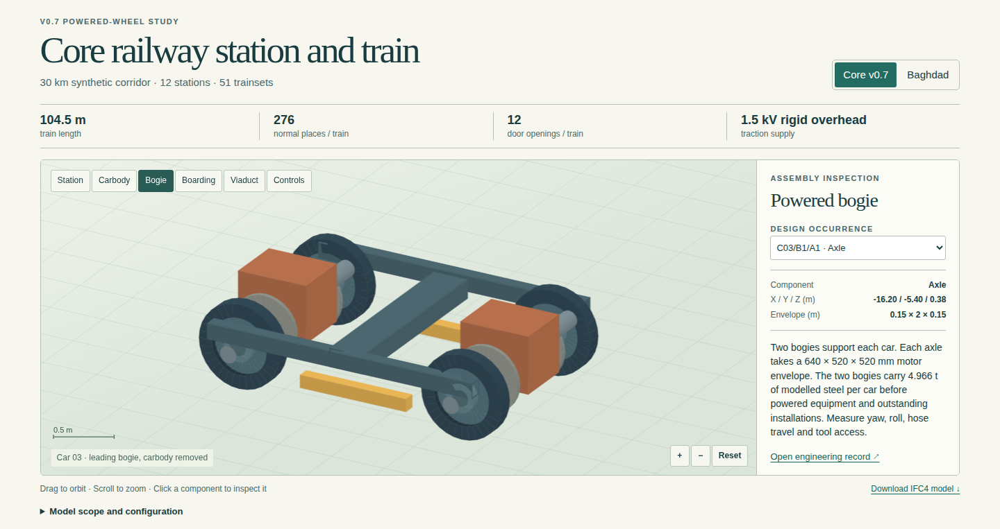
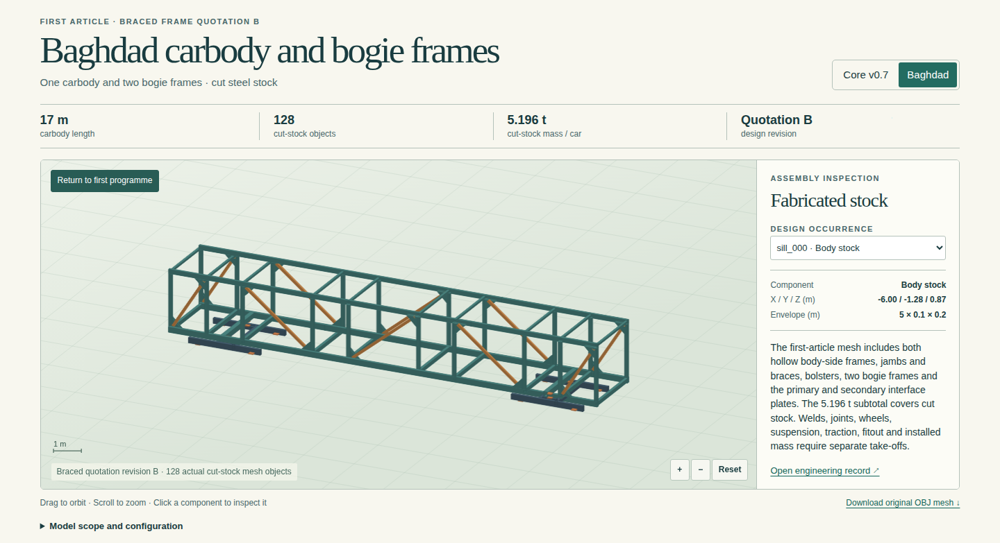
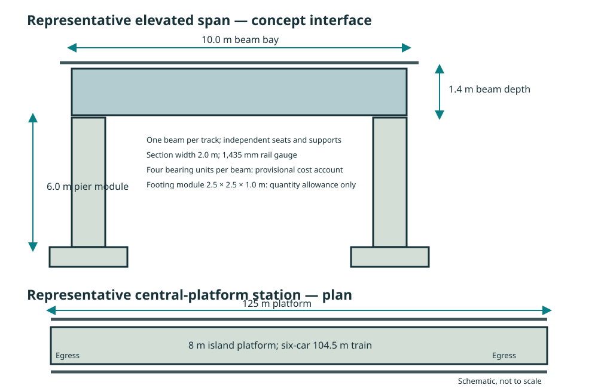
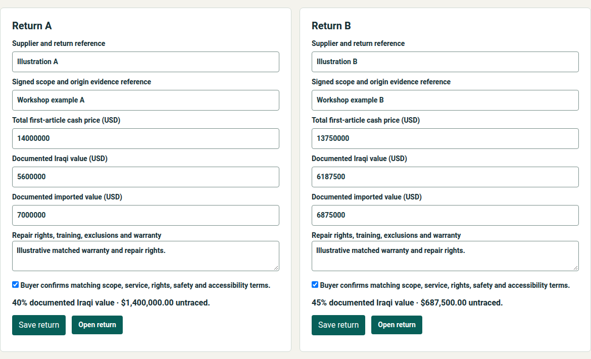
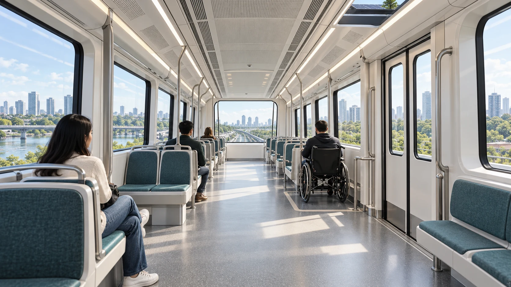
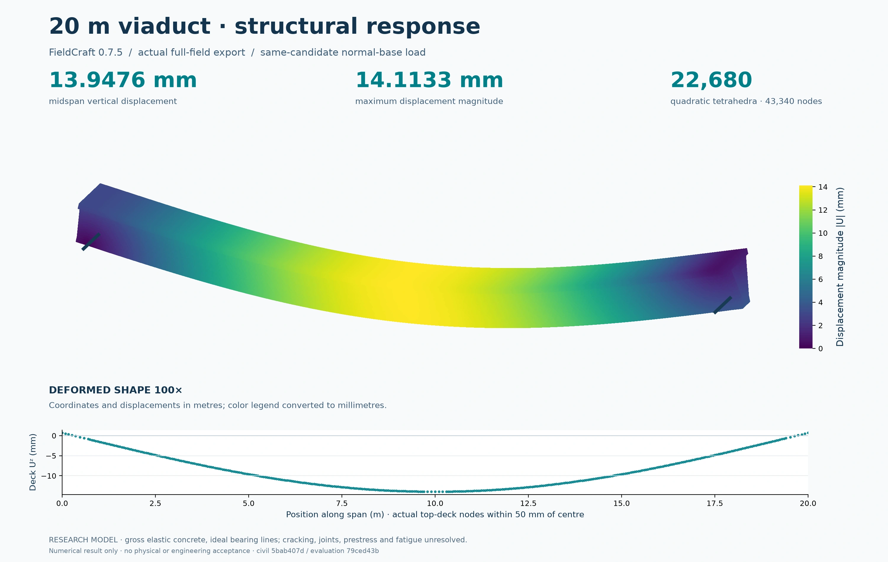
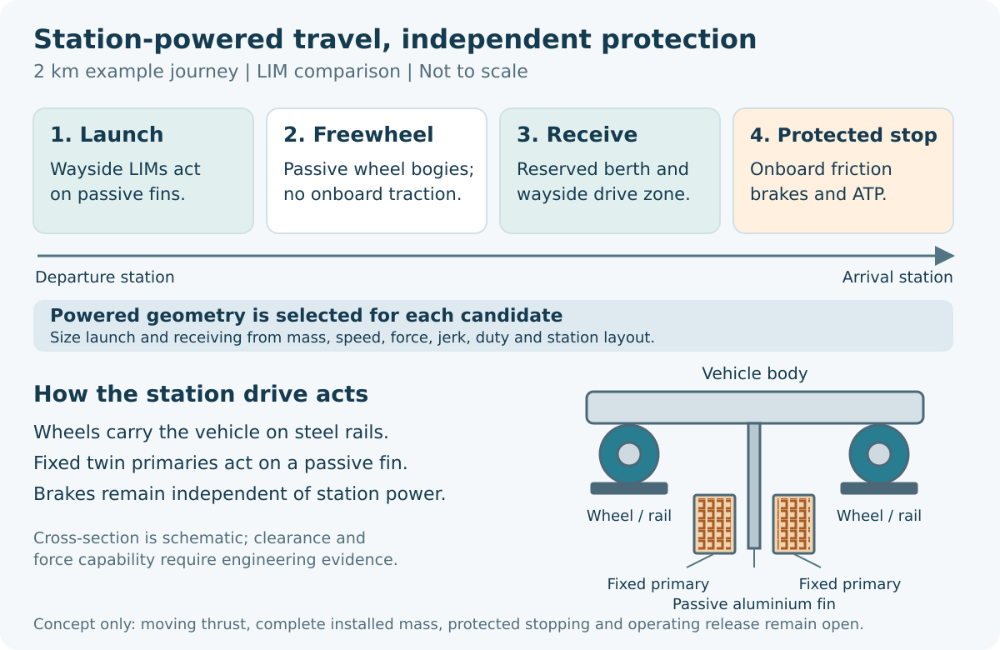
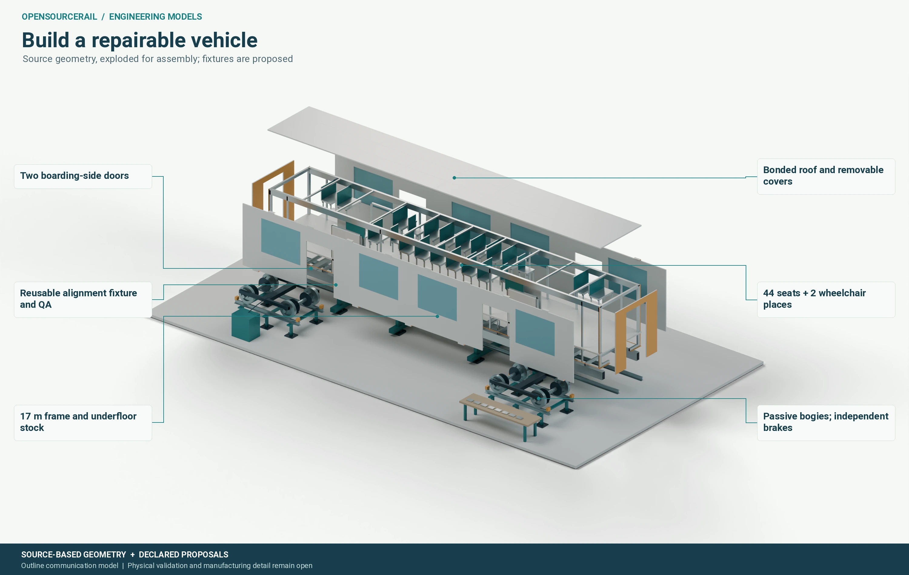
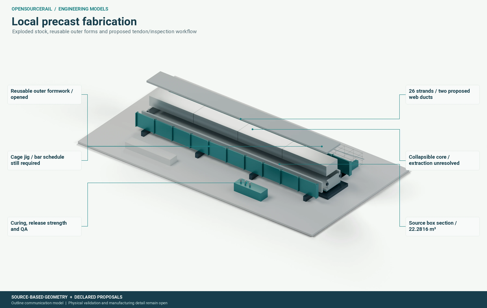

# OpenSourceRail

OpenSourceRail develops affordable urban rail that local companies can design, build and maintain. It brings the route plan, railway hardware, control software and workshop records together. A city can use the open design to buy a railway, build up domestic manufacturing, or obtain better prices and repair rights from an established supplier. Safe operation, accessible travel and passenger protection are requirements throughout.


*The Baghdad station twin shows where the train doors meet the island, where the conductor sits beside the track and how the station spans the viaduct. The operator can select an assembly in the viewer or take the IFC4 model into a design review.*

**[v0.7.2 integration package](docs/releases/v0.7.2/README.md).** The 12 km Baghdad Airport opening links a six-car train, full-day workings, feeder outage tests, supplier quantities and phased public funding. The project also provides the costed 30 km digital reference, city planning tools and an offline operator workshop. These designs support route review and comparable quotations. Fabrication and passenger operation require controlled drawings, physical trials and independent acceptance. [Architecture and design status](docs/ARCHITECTURE.md#which-design-is-current) · [Engineering status](docs/ENGINEERING-STATUS.md)

**Current prototype work.** Inspect the revised Baghdad frame and removable bogies, follow a train through its day, or isolate a traction supply site in the offline twin. The quotation package includes distinct car, beam, pier and platform IFCs, traceable part counts and the records needed from suppliers and trial teams. [Prototype twin and drawings](cities/Baghdad/engineering/prototype/README.md) · [Fourteen-route operating decision](cities/Baghdad/CITYWIDE-SERVICE.md)

**On this page** · [Delivery from brief to operation](#from-a-city-brief-to-a-working-railway) · [Compare the designs](#the-current-designs) · [Plan a corridor](#plan-a-corridor-passengers-can-use) · [Inspect the train](#inside-the-train-and-station) · [Plan construction](#viaducts-construction-and-traction-power) · [Run the service](#run-the-service-and-protect-the-passenger) · [Price and maintain equipment](#purchasing-maintenance-and-renewal) · [Review fares and funding](#people-fares-and-the-public-budget) · [Explore earlier designs and CAD](#design-history-and-evidence) · [Run the tools](#design-build-and-operate-the-railway)

## What OpenSourceRail provides

| Connected product | What a railway team can do with it |
|---|---|
| Design and delivery platform | Place a corridor and stops on a city map. Set the service, follow the effects on fleet, power and construction quantities, and compare whole-life costs. Exchange geometry and quantities with designers and purchasing teams. |
| Reference railway and manufacturing system | Inspect full-size train, station and viaduct models. Break a design into purchased parts, locally made parts, assembly operations and inspections. Price the jigs, test equipment, erection resources and spares needed alongside the railway. |
| Open train and wayside control software | Exercise movement protection, doors, brake holding and dispatch against simulated train and station inputs. Trace the equipment and software involved in a fault. Give operators, suppliers and maintainers a shared interface to demonstrate. |

A design revision follows the work. Changing a bogie or adding a station can affect the train mass, beam loading, timetable and budget. The project associates each drawing and quantity schedule with its physical design, records the assumptions used to evaluate it and identifies the option selected for pricing. A workshop can trace its part back to the drawing revision. An owner can see whether a cost covers installed equipment, a stock subtotal or an allowance awaiting a supplier. [Delivery platform](docs/capabilities/README.md) · [System architecture](docs/ARCHITECTURE.md)

## From a city brief to a working railway

A city can start with two possible corridors and a question about whom they would serve. A depot can start with one troublesome door and a question about whether it can repair the unit locally. Both need the same thread of information between the decision, the drawing, the price and the evidence from the installed equipment.

| Stage | What the team does | What the next team receives |
|---|---|---|
| 1. Write the brief | Map homes, jobs, barriers and transfers. Set normal passenger capacity, journey time, access requirements, climate and service hours. | A dated brief with sources, survey gaps and criteria for comparing routes. |
| 2. Compare alternatives | Vary stops, formation, frequency, traction supply or construction method against the same passenger requirement. | Identified alternatives with journey, fleet and infrastructure consequences. |
| 3. Detail the interfaces | Locate equipment in the vehicle and station. Check wheel loads, braking, platform gaps, feeder demand and maintenance access. | Drawings, quantities and results tied to one design, including the conditions that failed. |
| 4. Revise a design | For example, add a liner to a door opening, then check the clear width, stock, mass and work required to fit it. | A new revision and the reason for it. The earlier drawing remains available to its users. |
| 5. Price the work | Extend stock quantities and process hours at dated rates. Identify tooling, imported equipment, uncertainty and overlapping allowances. | A buyer estimate and comparable enquiries for independent suppliers. |
| 6. Schedule delivery | Match mould and workshop capacity to haulage, lifting windows, installation, inspection and staff training. | A programme with resource needs, opening phases and cash requirements. |
| 7. Procure and commission | Review the offers, inspect first articles and record who witnessed each test against which drawing. | Reviewed orders, serial or batch records, installation positions and acceptance decisions. |
| 8. Operate and learn | Connect a fault to its asset, repair, functional test and authorised handback. Compare actual labour and consumption with the estimate. | A maintenance history and measured inputs for the next design or procurement round. |

The Workbench calculates planning scenarios and produces design and delivery records. The Airport model carries a timetable into fleet, feeder, quantity and budget decisions. An owner adopting the business tools can begin in one workshop with its item master, stores, inspection roles and repair records. Site commissioning and passenger-service authorisation require evidence from the actual installation. [First adoption path](docs/first-adoptable-product.md) · [Cost and delivery method](docs/design-engine/model-based-cost-and-delivery.md)

## The current designs

| Digital design | Passenger service and equipment | Construction estimate in 2026 US dollars |
|---|---|---:|
| Core 30 km reference corridor | Fully elevated double track, 12 stations, 51 six-car trains, 276 normal places per train and 1.5 kV DC overhead supply | **$1.025bn** |
| Baghdad Airport prototype opening, 12 km | Six stops, 15-minute service, three working six-car trains plus three spares. The priced radial supply has 30 sites. | **$1.124bn** central construction estimate ($1.070bn–$1.238bn) |
| Baghdad seven corridors, 148.2 km | 64 stations budgeted, 242 six-car trains, 700 normal places per train and protected conductor rail | **$8.37bn** central Iraqi estimate ($6.12bn–$12.35bn) |
| Baghdad citywide alternative, 605.652 km | 280 stations budgeted, 934 six-car trains and protected conductor rail. The construction scope includes 50.099 km reserved without an assigned passenger path | **$33.00bn** central Iraqi estimate ($24.10bn–$48.83bn) |

The core corridor gives suppliers a common train, station, viaduct and service to price. The seven-corridor and citywide Baghdad programmes are **independent investment choices**, each with its own fleet, yards, operating establishment and funding plan. Both keep the railway above ground and the overhead space free of traction wires. The original $7.866bn and $31.018bn design-rate budgets remain available as common comparisons for tender returns. [Core reference](docs/reference-v07/README.md) · [Baghdad plan and drawings](cities/Baghdad/README.md) · [Iraqi capital by work package](cities/Baghdad/IRAQ-CAPITAL.md)

## Plan a corridor passengers can use

The city catalogue covers 266 places. A planner can inspect proposed lines and stops against streets, rivers, neighbourhoods and barriers, select a station pair and see the waiting, running, transfer and walking assumptions behind a journey. Routes need local passenger counts, ground and utility surveys, and walks from the proposed entrances to homes, jobs and other transport.


*In Samawah, two markers about 80 m apart already belong to one operating station. Merging them at their midpoint changes 26 markers to 25, while the five-line plan still has 25 station complexes and 81 trainsets. The access allowance and journey time change. Removing a map symbol alone saves no station building.* [Samawah worked example](docs/book/38-samawah-practice.md) · [City catalogue](cities/catalogue/README.md)

Baghdad uses the Iraqi National Investment Commission's original seven-corridor plate for the 148.2 km comparison. The separate citywide proposal has a wider map extent. For a smaller opening the Airport study takes off a 12 km, six-stop railway with dedicated depot, control centre and three supply sites. Its central estimate is **$813.7m** for the original 21-set offer. The [15-minute Airport opening and supplier dossier](cities/Baghdad/airport-integration.html) prices a six-set fleet and the additional supply sites required by its outage screen. Location work includes the step-free landside route from the airport terminal and the entrances and transfers serving Sadr City and Jadriya. [Original route plate and citywide map](cities/Baghdad/maps/README.md) · [Airport opening project](cities/Baghdad/AIRPORT-OPENING.md)

| Original seven-corridor investment map | Independent citywide planning network |
|---|---|
|  |  |

**Take a map change through the design.** Download the editable RustGIS project from the selected city's Workbench page, move a stop or change a route in the desktop editor, and import the saved project with the author and reason. The revised study retains the source map and recalculates the affected service, fleet, civil quantities, cost and delivery programme. Compare the two studies before deciding which entrance, river crossing or connection to survey. Map styling alone leaves the engineering revision unchanged. [GIS editing guide](docs/gis/README.md) · [Planning workspace](docs/workbench/planning/README.md)

**Read the citywide offer alongside its map.** Baghdad's revised operating case covers 552.562 km with fourteen connected main routes. It defers five access sections around Jadriya, Sadr City and the eastern spur. A further 50.099 km remains reserved in the construction scope. The tested half-hourly timetable needs 70 working trains. Offering 150-second peak intervals changes the block, junction and terminal requirements and calls for 725 working sets in the peak diagram. The wider construction budget retains its own 934-set fleet. [Route decisions, train counts and timetable tests](cities/Baghdad/CITYWIDE-SERVICE.md)

## Inside the train and station

The core train couples six 17 m cars into a 104.5 m formation. Each car provides 44 fixed seats, two wheelchair places and two 1.4 m door openings on the island side. Its two bogies carry conventional steel wheels. Across the train, 24 driven axles provide traction, six roof collectors draw power, and twelve independent brake modules have a separate stopping duty. Equipment must fit while the bogies turn, springs move, wheels wear and maintainers withdraw a motor or brake assembly.



*The core model locates 8.86 t per car of inherited body, bogie and underframe geometry. Unlocated equipment remains in the mass account. The traction and civil sizing case uses 25.072 t per normally loaded car and 33.622 t in the crowd structural case. Equipment weights, positions and suspension behaviour still need to be measured on an assembled vehicle.* [Vehicle mass and axle-load account](docs/reference-v07/digital/vehicle/README.md)

Baghdad's higher-capacity train uses four 1.3 m openings **on each side** of every car, 48 across the formation. The typical straight station has a 125 m by 8 m island. The drawing allows a 75 mm static platform gap and 10.25 m beyond each end of a centred train. Loaded floor height, suspension travel, curves and stopping tolerance all affect the actual boarding gap. An accessible trial also needs a wheelchair user to travel from street to train and through a transfer or assisted evacuation.



*This earlier Baghdad quotation drawing counts 128 pieces of steel stock weighing 5,196 kg for one body and two bogie frames, before wheelsets, drives, joints, doors and fitout. The quotation drawing lets builders price cutting, joining and inspection, propose a lighter alternative and demonstrate a damaged member's replacement.* [Body and bogie quotation design](cities/Baghdad/engineering/mechanical/vehicle/README.md) · [Station twins and IFCs](docs/operator-review/twins/README.md)

### Inspect the Airport prototype twin

The revised Airport takeoff has **144 stock pieces and 5.273 t per car** for the frame, two bogie structures and door liners. A nominal 1,360 mm bare opening leaves 1,310 mm after the two 25 mm installation allowances. That gives the installer 10 mm above the 1,300 mm requirement. The first article lets the installer fit the real guides and seals, load the car and measure the clear passage against the drawing. The train model still uses 201.55 t as its gross planning load. [Mechanical drawings and inspection sequence](cities/Baghdad/engineering/prototype/mechanical.md)

Open the offline twin to follow the train through a stop or isolate a supply site. The quotation download includes separate car, beam, pier and platform models in IFC4, plus drawings, quantities and field-return forms. Each model names its datum. The car is located relative to rail head, the beam to its soffit, the pier to the underside of its footing and the platform to its top surface. A site survey supplies their actual positions. [Open the prototype viewer](cities/Baghdad/engineering/prototype/review.html) · [Download the first-article package](cities/Baghdad/engineering/prototype/airport-prototype.zip)

## Viaducts, construction and traction power

A wheel load passes through the rail and fastener into the beam, bearings, pier and ground. The core reference uses one precast box per track per 10 m bay. Each box is 2 m wide and 1.4 m deep, with 11.34 m³ of concrete. Moving the assumed equipment mass towards one bogie increased the peak modelled live bending moment from 0.586 to 1.107 MNm. The nine-strand beam exceeded its service tension limit. A thirteen-strand revision met the gross longitudinal check and added about 80 kg of steel per beam. The extra material, cost and lift weight carry through all 6,000 beams.



The bare core beam weighs about 29.96 t. A preliminary lift allows 37.46 t including rigging. The erection contractor needs a load chart at the required radius, haul access, temporary stability, traffic possessions and an inspection before the rails are fastened. A 2 km straight, double-track trial module needs 400 beams, 402 support positions and 1,600 provisional bearings. Curves, crossings and stations need their own quantities. Ground investigation sets the foundation dimensions. [Beam calculation and loads](docs/reference-v07/digital/civil/README.md) · [Civil construction module](docs/reference-v07/civil/README.md)

Power is a route decision too. The core uphill design case calls for at least 3.037 MW DC input per train. Baghdad uses shoes on a protected trackside conductor. Its separate two-train supply study gives 1.344 kV at the collector during coincident acceleration against a 1.350 kV planning floor. Feed spacing, hot conductor resistance, return current, section isolation and the ability to reach a stranded train matter to the substation bid. [Baghdad train and supply calculation](cities/Baghdad/engineering/mechanical/vehicle/SECTION-POWER.md)

On the **revised Airport train**, the priced 30-site radial design clears its hot-circuit voltage floor by only 0.57 V. A 1% source-voltage reduction combined with 5% more loop resistance and 5% more load takes it below the floor. A six-site option with paired conductor paths clears that combined test and falls short when both a path pair and a site are lost. A supplier can price either circuit against its own drawing. The utility and trial team still need to establish supply impedance, fault clearance, isolation and safe access for evacuation. [Circuit comparisons and witnessed trials](cities/Baghdad/engineering/commissioning/COMMISSIONING.md)

## From factory floor to finished corridor

The core order needs 306 cars. The proposed factory moves each car through six positions for body joining, bogies and drives, doors and interior, heating and ventilation, wiring and collection, then final assembly, weighing and static test. The allowance is 720 direct hours per core car and 1,000 per Baghdad car. A factory bid also needs incoming inspection, a repair road and pit, a static formation road and a separate connection for dynamic tests. A buyer can watch the first car progress through the jigs and time a repeat build before relying on the output rate.


| Production planning quantity | Core 30 km | Baghdad seven corridors | Baghdad citywide |
|---|---:|---:|---:|
| Cars ordered | 306 | 1,452 | 5,604 |
| Proposed parallel car lines | 5 | 12 | 20 |
| Casting yards / erection fronts | 2 / 2 | 6 / 6 | 10 / 10 |
| Standard running beams | 6,000 | 29,640 | 121,156 |
| Day-shift posts at full production for the listed activities | 202 | 624 | 1,040 |

Precast production and erection have to meet in time as well as in quantity. The core 43-month programme starts beam production in month 8 and erection in month 15. Two yards delivering eight beams each per working day can reach the volume. The early stock build-up needs at least 440 places per yard against 180 in the drawn yard. Changing the start dates, securing storage or changing the delivery method is a real contract decision. [Factory, yard and inspection plan](docs/operator-review/delivery/README.md) · [Core production handoff](docs/reference-v07/digital/production/README.md)


For the 36-car Airport opening, the equipment schedule gives a smaller workshop its own production case. One guarded saw prepares 3,168 RHS and liner pieces. A subcontractor can supply 2,016 nested plate blanks. Two body jigs and one bogie jig serve the assumed 250-day vehicle window. The precast yard follows a separate two-year delivery calendar. Buyers can quote each required resource, including hire and shared capacity, against the same drawing and procurement edition. [Airport factory specification](cities/Baghdad/engineering/prototype/FACTORY-SPECIFICATION.md) · [Repository review and open technical decisions](docs/PROJECT-REVIEW-2026-11-23.md)

A workshop can now download the Airport buyer issue, open `START.html` offline and follow a part from drawing to quotation. A fabricator gets four plate profiles, nested sheets and a saw list. A precast yard can compare two stock lengths against all 280 reinforcing blanks per beam. A buyer gets unit prices and a common return sheet for 41 machines and services. The instructor guide and browser exercises cover how to check the issue, record a discrepancy and hand work to the next role. [Download the workshop and buyer issue](cities/Baghdad/engineering/prototype/airport-enquiries.zip) · [CAM handoff](cities/Baghdad/engineering/prototype/cam/CAM.md) · [Workshop costs](cities/Baghdad/engineering/prototype/SHOP-COSTS.md) · [Training](cities/Baghdad/engineering/prototype/training/INSTRUCTOR.md)

### Build up a price from the drawing

For a fabricated member, begin with the length of stock the shop must buy, the cutting layout and the usable yield. Add preparation, jig time, joining, machining, inspection, finish and rework. For a bought assembly, record the specified quantity, delivered price, lead time, spares and who can repair it. Keep a one-off jig or lifting fixture on its own line so the buyer can see how the first article differs from the hundredth. The manufacturing bill and routing translate those quantities into material issues, operations and inspection points. [Vehicle parts and manufacturing catalogue](docs/design-engine/vehicle-parts/README.md) · [Airport manufacturing guide](cities/Baghdad/engineering/prototype/manufacturing-guide.md)

For a beam, the delivered cost includes mould use, reinforcement and strand, casting, curing, inspection, storage and haulage. The installed cost also depends on lifting, temporary restraint, bearings, access and possessions. A smaller concrete section may need more lifts or a more expensive support. Compare alternatives over the same passenger service, including fleet, energy, maintenance, replacement and downtime. Show borrowing and the owner's annual cash obligations separately. [Construction and factory quantities](docs/operator-review/delivery/README.md) · [Whole-life price method](docs/design-engine/model-based-cost-and-delivery.md)

## Run the service and protect the passenger

On the core 30 km corridor, both terminals dispatch from 06:00 to midnight. Four hours at two-minute intervals and fourteen hours at five-minute intervals give 288 departures from each end and 6.307 million passenger train-km per year. A peak train offers 276 places, or 8,280 places per hour in one direction. The first train departs at 06:00 and arrives at the other end at 06:40:06. The timetable allows a three-minute turn. Forty-four sets cover the peak workings and seven form the reserve. Closing one of the three planned berth positions at the far terminal leaves eight scheduled occupation intervals that cannot start on time. [Core timetable and disruption cases](docs/reference-v07/integration/TIMETABLE.md)


*Airport-001 leaves at 06:00, calls at Al Amiriya, reaches Al Qadisiya at 06:18:57 and starts its return at 06:21:57. The operator can trace the same set across the day, inspect where the proposed block layout conflicts with the peak interval and check how long transferring passengers would actually have to walk.* [Baghdad working diagrams](cities/Baghdad/SERVICE-DIAGRAMS.md)

**Boarding and departure.** The Baghdad replay takes the train from protected approach into a verified berth. At standstill, with the train secured by the parking and independent brake holds, traction stays inhibited as the correct 24 platform-side doors release. To leave, the train must close and prove all 48 locks, retain its route and train proofs, and establish starting effort before releasing the hold. An unexpected loss of a lock in motion calls for emergency braking. On each train, two end groups house the protection channels, radios and inverter supervisors. Each of six car nodes has eight door controllers and two bogie brake controllers. The budget allows 299 kg and 3.68 kW for train controls including common harnesses and enclosures. The next trial needs a real door, independent brake feedback, calibrated force and displacement measurements, and witnessed rollback limits on a gradient. [Control software and crate interfaces](crates/README.md) · [Train, station and brake interfaces](cities/Baghdad/engineering/controls/README.md) · [Control equipment schedule](control-electronics/README.md)


**The control room.** The gateway reads equipment observations and supplies alarms and history to FUXA. In the replay below, a traction section trips, then stops updating. At 08:00:38 its reading is 33 seconds old. The display marks the value unavailable and keeps the trip active. At 08:00:40 a fresh simulated clear reading changes the alarm. A controller can see the difference between an electrical fault and loss of telemetry. Movement authority comes from the train protection and wayside systems. [Gateway and FUXA deployment](deployment/supervision/README.md) · [Replay and screens](docs/operator-review/screens/README.md)


## Purchasing, maintenance and renewal

The core production handoff maps 52 manufacturing bill-of-material lines and 23 routing steps into fourteen capital scopes. Each bidder receives the same service, geometry, scope and first-article requirements. An offer should separate recurring unit cost from tooling, factory setup, qualification, freight and commissioning. The owner can then compare the cost of the first article, the repeated production run and later overhaul. For Baghdad, central prices put Iraqi contract awards at $3.36bn on the seven corridors and estimated domestic value within those awards at $1.84bn. The comparison asks each bidder to trace imported inputs, name the work done locally and demonstrate a repair with Iraqi staff. [Matched bids and local value](cities/Baghdad/BUYER-COMPARISON.md)



*The supplier screen uses illustrative returns. To compare real offers, the buyer records the issued drawing revision, cash and financing terms, parts provenance, spares lead times, diagnostic access, training and ownership of tooling. Another vendor can win the contract on these common terms.*

**Invite competing offers for the Airport opening.** The register covers 54 lots across construction, vehicles, commissioning, operations and renewals. Fifty-three have low, central and high planning estimates. Customs and taxes await the buyer's import and contract details. The central case allows $1,124.32m for opening construction and $13.09m for first-full-year operations. First-article and alternative enquiries identify overlaps with the parent budgets so a buyer can seek a price for one car without adding it to the six-train fleet price twice.

Issue the same lot revision, quantity, unit and delivery boundary to each supplier. The ERPNext portal takes separate offers with terms and exclusions. The buyer can compare each with the estimate and the other returns, including the consequences for 30-year costs. The demonstration uses illustrative suppliers. A real offer, an award and a paid invoice each have their own record. [Buyer estimate, portal and worked comparison](cities/Baghdad/engineering/prototype/PROCUREMENT-PLAN.md)

**Follow one door through its life.** The book's separate door-operator study counts 694 pieces per opening. Of those, 97 are proposed for local fabrication, 568 for standard purchase and 29 for qualified purchase. A guide made in-house needs a drawing, work order and inspection. A bought drive needs a supplier, receipt and serial or batch. When a technician replaces the unit, the maintenance record can tie the removed serial, replacement, installation position, functional test and handback to the same equipment revision. That history helps distinguish a repeated installation fault from a failing supplier batch. [Door manufacturing study](docs/book/40-door-design.md) · [Manufacture and maintenance records](docs/book/42-lifecycle-custody.md)


The image is a native ERPNext record from the earlier magnetic-equipment pilot. The powered-wheel railway currently prepares draft item groups and manufacturing routes. An operator must establish its own stores, assets, serials, access permissions, incoming inspections and approval roles to use these workflows in production. Frappe HR can hold employees, training and authorisations alongside the work they are qualified to perform. [ERPNext and Frappe HR](deployment/erpnext/README.md)

**Rehearse a fault and a repair.** A separate v0.6 software trial takes one synthetic HVAC kit through native ERPNext purchase, receipt, a rejected inspection, rework, manufacture and serialised installation. A simulated condition then triggers an issue, replacement and independent review. During an ERP outage the gateway retains the event for delivery after restart. FUXA displays the equipment observation, while Frappe HR records a training programme. A depot adopting the workflow supplies its own equipment bindings, competency records, measured tests and authorised handback. [Native ERP, HR and supervision trial](docs/integration/v06-platform.md)

## People, fares and the public budget

Unattended operation still requires station assistance, security, cleaning, continuous control-room cover, depot maintenance, track and power response, training and stores. The roster prices three policies separately. For the Baghdad first network it gives **1,526 full-time equivalents** for unattended operation, **1,938** with supervised commissioning annualised, and **1,629** with onboard assistance for a quarter of train-duty hours. The unattended core case has 312 posts on the same full-time-equivalent basis. The employer must qualify staff for their tasks, including assisted boarding, electrical isolation, fault recovery and evacuation.


The Baghdad training budget allows 160 paid learner-hours per person for the initial intake, split evenly between class and supervised practice. The first-network estimate is $1.29m for learners, instructors and mentors within commissioning. Repeat-car final assembly labour at Iraqi central rates is about $10,975 per car, included in the fleet purchase. The buyer can change staffing and rosters, credit wages already embedded in operating contracts and carry the difference into its funding model. [Workforce, wages and training basis](docs/operator-review/delivery/README.md)

| Central budget, constant 2026 US dollars | Construction | Annual operations | Annual fare receipts |
|---|---:|---:|---:|
| Core 30 km | $1.025bn | $30.5m | Enter paid journeys and net yield for the chosen city |
| Airport original comparison, 21 sets / 3 sites | $813.7m | $16.25m | $1.56m |
| Airport at the v0.7.2 tag, before the revised frame, 6 sets / 30 sites | $1.123bn | $13.08m | $1.56m |
| Baghdad seven corridors | $8.37bn | $185.7m | $79.5m |
| Baghdad citywide, full service | $33.00bn | $738.7m | $188.6m |

For the seven corridors, the central case assumes a posted **IQD 750** ticket, **188.4m paid journeys** in the first full year, and an average **IQD 637.5** received after paid discounts and collection. With half the construction capital borrowed at 4% real for 20 years, first-year operations and repayments require **$414.1m** from public funds after fares. The planning range is $201.0m–$640.8m as construction prices, wages, power costs and fare income vary. At a 4% real discount rate the central 30-year present cost of construction, operations and scheduled renewals is **$12.33bn** for the seven corridors and **$48.65bn** citywide. Surveyed demand, supplier prices and loan offers will change these budgets. [Iraqi price and fare assumptions](cities/Baghdad/IRAQ-ESTIMATES.md) · [Funding schedules](docs/operator-review/finance/README.md)


**What does local ownership buy?** A workshop with access to the drawings, tooling, diagnostics and appropriate inspection procedures can bid to make a replacement or overhaul a unit. To test the economic case, distinguish the Iraqi contract price, the imported content inside that contract, the domestic work and the currency needed for each payment. An earlier worked example assumed a $100m local programme and a $200m foreign turnkey offer for the same scope. Its assumed price and import shares illustrate how to do the comparison. The Baghdad buyer now has lot quantities and terms against which actual firms can bid. [Historical worked example and assumptions](https://github.com/modernecotech/OpenSourceRail/blob/898eab2b57a739863a542cb13e7de70f47dfd9e5/README.md#the-economic-case) · [Baghdad matched-bid terms](cities/Baghdad/BUYER-COMPARISON.md)

## Design history and evidence

The repository's **v0.6 development baseline** investigates a simpler train with passive wheel bogies, a passive aluminium secondary, onboard service power and independent brakes. Its six 17 m cars each have 44 fixed seats, two wheelchair places, no planned standing and two doors on one side. The normal vehicle carries no traction motor, traction battery or permanent magnets. The research question is whether stations can supply enough energy for the train to coast between them. The grade, stop spacing, protected stopping distance, repeated launch duty and recovery method determine which routes can use the idea. A station launch, limited booster or small onboard drive each needs its own equipment, mass, operating and cost account. [Development baseline](engineering/development-baseline.toml) · [v0.6 engineering findings](docs/design-engine/v06-design-closure/README.md)

| Passive-wheel cabin concept | Native joint and assembly detail |
|---|---|
|  |  |
| The illustration communicates the comfort and boarding policy of the earlier design. | The model lets a fabricator examine weld and fixture access. The joint still needs process qualification and physical tests. |



*The colour scale gives displacement on the earlier 20 m structural model. The display magnifies deformation 100 times so a reader can see its shape. That experiment and the 10 m core beam use separate geometry, loads and support conditions.*

[v0.4 conventional rail](https://github.com/modernecotech/OpenSourceRail/tree/v0.4.0) and [v0.5 maglev](https://github.com/modernecotech/OpenSourceRail/tree/v0.5.1) are historical designs.

The [v0.6.1 software release](docs/releases/v0.6.1/README.md) preserves its own planning and control workflows. Original design images, CAD assemblies and structural results have their design identities and evidence limits in the [engineering gallery](docs/engineering-gallery.md) and [current engineering record](docs/design-engine/current/README.md).

### How the station-powered research train works

The v0.6 reference places twelve passive two-axle bogies under an aluminium/GFRP vehicle. Its wheels support the train throughout the trip. One experiment puts a linear induction motor at the wayside and a passive aluminium secondary on the train. Another uses a cable arrestor to capture arrival energy in a stationary hydraulic store, then a rear shuttle to launch the departing vehicle. An optional capstan drive adds energy. Onboard service power still supplies the doors, ventilation and protection. Independent brakes, a protected stop and recovery outside a powered zone are part of each proposal. [Launch alternatives and route limits](docs/design-engine/practical-launch/README.md) · [Station and vehicle models](docs/engineering-models/README.md)



The retained-stop study caps launch at 72 km/h. A named two-minute service case carries 276 normal passengers per train, or 8,280 per hour in one direction. The earlier 120-person-per-car case gives 14,400 per hour at the same interval. The 160-person-per-car crowd case sets a separate structural load. Changes to seating, propulsion or frequency require their own boarding, braking, fleet, access and cost checks. [Reference configuration](engineering/development-baseline.toml) · [Archive of the earlier passenger basis](docs/archives/pre-comfort-default/manifest.json)

### Read the drawings and numerical results

| Vehicle assembly in the workshop | Precast fabrication and erection |
|---|---|
|  |  |
| The exploded view separates 2,482 located source parts for inspection. Downloadable CAD retains their assembly positions. | The yard study shows what must be cast into a beam. Its crane and overhead-gantry variants address transport, lifting and temporary restraint. |

The model gallery includes rotatable GLB and STL files and editable FreeCAD and STEP geometry. Inspect the [arrestor and station store](docs/engineering-models/images/arrestor-storage.webp), [launch shuttle and booster](docs/engineering-models/images/launcher-booster.webp), [crane erection](docs/engineering-models/images/viaduct-crane.webp) or [gantry erection](docs/engineering-models/images/viaduct-gantry.webp). The companion concept illustrations show the intended passenger and workshop experience. [Model downloads and build notes](docs/engineering-models/README.md) · [Original concept illustrations](docs/images/v06/README.md)

The CAD and finite-element gallery records which question each model can answer. The bogie cradle locates 34 stock solids. The terminal side frame shows four aluminium plates, two endplates and weld deposits that a fabricator can inspect for tool access. The direct-floor chair coupon shows sleeves, backing pads and fasteners at the mounting feet. Its mating floor is still required to check installed fit. Likewise, the earlier beam displacement plot uses ideal bearing lines and a continuous elastic beam. Applying that result to an assembled viaduct would require its joints, reinforcement and support conditions. [CAD, STEP and structural results](docs/engineering-gallery.md) · [Civil alternatives and load cases](docs/design-engine/viaduct-backends/README.md)

### Trace a design change through the evidence

A change to the door sill can affect step-free boarding, door obstruction detection and emergency egress. Record the applicable requirements, hazards, drawing revision, test procedure, result and reviewer together so the next designer can see which checks need repeating. The earlier digital standards workflow linked publisher records, requirements, evidence and review decisions. Its IFC information checks tested whether specified data reached a model. The owner still needs approved limits, as-built measurements and independent review for the installation. [Earlier standards workflow and evidence model](https://github.com/modernecotech/OpenSourceRail/blob/298d4e15fbcbcd923d7fcf7e519ebc4915ef7e1b/docs/certification/digital-standards-adherence.md) · [Current engineering status](docs/ENGINEERING-STATUS.md)

### Compare a new design with the reference

Use the coordinated railway study to follow a physical revision through inventory, propulsion, braking, civil loads and manufacturing cost. The adaptive search explores alternatives against passenger and engineering requirements. The generative study varies structural members and their joints. Each study identifies the geometry, the evaluation assumptions and the decision being made. A changed force assumption can produce a new journey estimate for the same vehicle. A changed bogie or body needs its own quantities and downstream checks. Failed calculations and unresolved interfaces stay available to the next designer. [Coordinated study](docs/design-engine/coupled-railway/README.md) · [Design search and experiments](engineering/design_search/README.md) · [Candidate delivery records](docs/design-engine/coupled-railway/delivery-index.json)

## Present the railway

For an operator meeting, use the illustrated briefing or extract the entire offline workshop ZIP and open **START.html** in a browser. Follow a scheduled train through a turnback, inspect the platform and brake equipment, review a sample control-room alarm, then vary the staffing and funding assumptions. The drawings and IFC files accompany the screens so design and commercial teams can discuss the same component. [14-page operator briefing](docs/operator-review/OpenSourceRail-Operator-Brief.pdf) · [Download the offline workshop kit](https://raw.githubusercontent.com/modernecotech/OpenSourceRail/main/docs/operator-review/OpenSourceRail-Operator-Kit.zip) · [Illustrated project book](OpenSourceRail-Book.pdf)

The first twelve weeks of an owner-led project can produce a signed service brief, a surveyed opening proposal, matched prices for prototype components and an acceptance plan. The next decision is whether to fund that demonstration. Full-service opening also needs witnessed braking and evacuation trials, accessible stations, validated protection, trained teams and an independent review of the installed railway. [Core and Baghdad delivery workplan](docs/operator-review/WORKPLAN.md)

## Design, build and operate the railway

To use the Workbench locally, run the following from the repository root. Choose a city to inspect its map, or open **Operator review** for train and station models, funding, staffing and control-room views. The synthetic reference command reports the selected train, civil quantities, cost and delivery assumptions. [Installation and tools](tools/README.md) · [v0.7 release checks](docs/RELEASE-v0.7.md)

```sh
./install.sh
./osr status
./osr readiness
./osr workbench
./osr reference v07
```

The editable Workbench source is in `engineering/development_baseline/web/`. The repository also includes broader research builds and tests through `./osr build` and `./osr test`. [Workbench](docs/workbench/current/index.html) · [Roadmap](docs/ROADMAP.md) · [Adoption path](docs/first-adoptable-product.md) · [Documentation index](docs/INDEX.md)

### Find the source for a change

| If you work on… | Edit or inspect… | How to follow the result |
|---|---|---|
| A city route or station | [City inputs and dossiers](cities/catalogue/README.md), [Baghdad studies](cities/Baghdad/README.md) | Compare the edited alignment, timetable and accessible transfers in the planning workspace. |
| Vehicle, civil or traction alternatives | [Development selector](engineering/development-baseline.toml), [engineering generators](engineering/station_rail/README.md), [campaign definitions](campaigns) | Follow the physical revision into its drawings, evaluation and [delivery manifest](docs/design-engine/current/exports/manifest.json). |
| Train protection and equipment | [Rust controls](crates/README.md), [electronics](control-electronics/README.md) | Trace a sensor, command and feedback through the matching train or station scenario. |
| Buying, staffing or maintenance | [ERPNext and Frappe HR](deployment/erpnext/README.md), [equipment gateway and FUXA](deployment/supervision/README.md) | Match the item revision, serial, observation, inspection and repair to the operator's records. |
| A release or historical result | [Release record](docs/releases/v0.7.2/README.md), [platform guide](docs/platform-guide.md), [documentation index](docs/INDEX.md) | Use the recorded inputs and version to reproduce the result. Update its source and regenerate the affected output. |

From an installed checkout, these commands check three scopes independently. The first checks the selected reference publication, the second checks the Airport prototype, and the third displays a worked comparison of illustrative supplier bids.

```sh
./osr verify
./osr design railway prototype --check
./osr design railway sourcing --demo
```

An earlier administrative experiment explored letting several AI models prepare administrative proposals, such as a maintenance request. It collected separate finance, operations and risk views, checked the proposal and ballot records, and required human attestation before ERPNext could receive a draft. Its versioned example covers that experiment. Purchasing authority, engineering release and train protection remain with their respective owners. [Historical administrative workflow and worked scenarios](https://github.com/modernecotech/OpenSourceRail/blob/898eab2b57a739863a542cb13e7de70f47dfd9e5/README.md#step-by-step-use-cases)

## Contribute

City teams can contribute surveyed entrances, measured journey times and passenger counts. Workshops can supply tooling plans, local quotations, weighed assemblies, inspection results and repair methods. Operators and accessibility groups can document boarding, recovery and training needs. A useful contribution names the design revision, source, units, scope and what was actually measured or assumed. [Contributing](CONTRIBUTING.md) · [Governance](GOVERNANCE.md) · [Repository engineering instructions](AGENTS.md)

### About the author

**Hayder Aziz** initiated OpenSourceRail. His work on collaborative engineering and design knowledge examined how distributed teams could share product data, manufacturing knowledge and open standards. Here, those ideas give a city a practical way to retain the design knowledge needed to build and repair its railway. The early papers cover shared design knowledge during concept development (2003), open tools for collaborative product development (2005) and design knowledge in decentralised enterprises (2008). [Collaborative conceptual design](https://researchportal.northumbria.ac.uk/en/publications/new-technologies-and-standards-for-design-knowledge-management-in) · [Open standards and product development](https://gala.gre.ac.uk/id/eprint/17781/) · [Design knowledge in decentralised enterprises](https://gala.gre.ac.uk/id/eprint/2623/)

### Licensing

Software uses **Apache 2.0**, physical designs use **CERN-OHL-S v2**, and documentation uses **CC-BY-SA 4.0**, subject to file-specific and upstream notices. [Project licence](LICENSE.md) · [Licences and notices](LICENSES/README.md)
