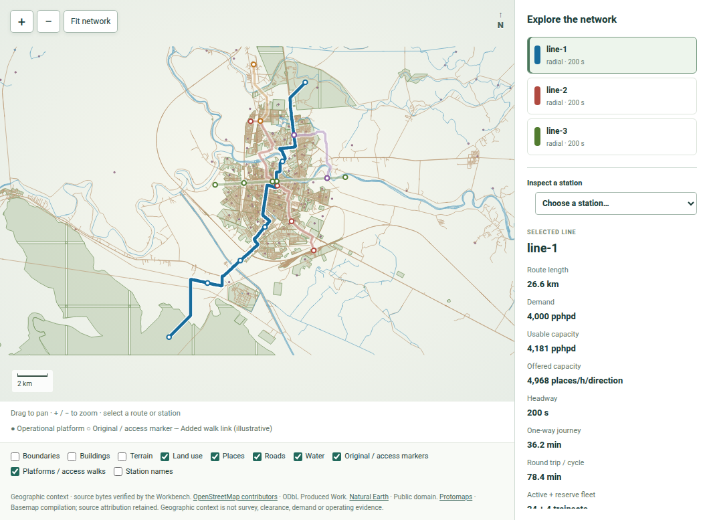

# OpenSourceRail

OpenSourceRail helps a city **plan, price, build and maintain an urban railway with local industry**. It connects three products: a design and delivery platform, open railway hardware and manufacturing records, and train and wayside control software. Together they let a transport planner ask which service a corridor needs, a fabricator identify what to make or buy, and an operator trace an installed part back to its drawing, inspection and repair history.

**Published release: [v0.7.2](docs/releases/v0.7.2/README.md).** It includes a reproducible Baghdad opening study and supplier dossier. Development on `main` has since corrected the route-length assumptions and joined service, installed vehicle loads, electrical failures, civil quantities and supplier pricing. **v0.8 production preparation is open.** The six first-article packages can support enquiries. Fabrication and passenger operation need further engineering, measurements and independent review. [Current decision results](cities/Baghdad/engineering/simulation/AUDIT-RESULTS.md) · [First-article readiness by package](cities/Baghdad/engineering/prototype/PRODUCTION-READINESS.md)

## Start here

| What you want to do | Where to start |
|---|---|
| Explore without installing software | Download the [offline operator workshop](https://raw.githubusercontent.com/modernecotech/OpenSourceRail/main/docs/operator-review/OpenSourceRail-Operator-Kit.zip), extract it and open **START.html**. It contains maps, models, operating screens, factory exercises and purchasing worksheets. There is also an [illustrated briefing](docs/operator-review/OpenSourceRail-Operator-Brief.pdf). |
| Plan a line for a city | Open the [planning guide](docs/workbench/planning/README.md) and [city catalogue](cities/catalogue/README.md). The 266 city entries provide starting geography and study material. The [Samawah exercise](docs/book/38-samawah-practice.md) shows how station access changes when the map is edited. |
| Evaluate an engineering choice | Start with the [design decision register](docs/DESIGN-DECISIONS.md). It links each service, vehicle and load case to the calculations behind it. For the passive-wheel development vehicle, open its [engineering record](docs/design-engine/current/README.md). |
| Prepare a quotation, factory or training session | Open the [supplier and factory guide](cities/Baghdad/engineering/simulation/audit-production-guide.md), [digital twins](docs/operator-review/twins/README.md) or [workshop instructor guide](cities/Baghdad/engineering/prototype/training/INSTRUCTOR.md). |
| Understand the project end to end | Read the [illustrated project book](OpenSourceRail-Book.pdf), [system architecture](docs/ARCHITECTURE.md) or [documentation index](docs/INDEX.md). |



From a full Linux checkout, install the project tools and launch the local Workbench:

```sh
./install.sh
./osr workbench
```

The Workbench opens at `http://127.0.0.1:8090`. For a command-line review, run the following from the repository root. The audit checks the corrected operating and purchasing case. The packet command exports the paired-feed enquiry for a supplier. [Installation options](tools/README.md) · [Audit inputs and worked examples](cities/Baghdad/engineering/simulation/ASSUMPTION-AUDIT.md)

```sh
./osr design railway audit --check
./osr design railway audit --layout paired6 --packet build/supplier-enquiry.zip
```

## From passenger demand to whole-life cost

| Decision | What OpenSourceRail connects |
|---|---|
| **Where should the line go and whom should it serve?** | RustGIS route edits, station entrances, walking access, transfers and passenger demand feed comparisons of formations, waiting times, dwell, terminal occupation and fleet size. Proposed centrelines, surveyed geometry and observed demand carry different evidence. [GIS workflow](docs/gis/README.md) · [Route, demand and service inputs](cities/Baghdad/engineering/simulation/ALIGNMENT-DEMAND.md) |
| **Can the train and infrastructure provide that service?** | The installed-car model carries floor allocations, passengers, equipment mass, positions and axle reactions into motion, braking, feeder loads and viaduct calculations. Compare simultaneous trains and outages, survey the stop overlap, and price a girder together with its piers, ground, bearings, transport and lift at working radius. [Fitted-car comparison](cities/Baghdad/engineering/simulation/ASSUMPTION-AUDIT.md#compare-a-fitted-train-on-the-same-railway) · [Span and erection alternatives](cities/Baghdad/engineering/mechanical/civil/SPAN-FAMILIES.md) |
| **What can local workshops manufacture and repair?** | Inspect IFC assemblies, CAD and removal envelopes. Follow a part into its BOM, stock cut, machining or welding operations, fixtures, inspection and installation. Factory models count machines, crews and moulds and test late deliveries, long curing cycles and rework. [Assembly and model downloads](docs/engineering-models/README.md) · [Factory specifications](cities/Baghdad/engineering/prototype/FACTORY-SPECIFICATION.md) · [CamCraft and FreeCAD comparison](cities/Baghdad/engineering/simulation/CAM-COMPARISON.md) |
| **What will the owner pay?** | Buyers can issue the same revision and quantities to multiple suppliers, compare offers and carry an explicit award into capital, operations and dated renewals. Factory, fleet and civil allowances are reconciled to prevent double counting. Financing studies cover phased opening, fares, staffing, debt service and local value added. [Purchasing and finance](docs/operator-review/finance/README.md) · [Iraqi market and capital assumptions](cities/Baghdad/IRAQ-CAPITAL.md) |
| **How will operators run and maintain it?** | Rust train protection, train management and door software exercise station arrival, boarding-side permission, brake holding, traction release and fault response. The gateway and FUXA support supervision. ERPNext and Frappe HR connect purchasing, serials, workforce skills, maintenance, inspections and authorised handback. [Control software](crates/README.md) · [Station bench procedure](cities/Baghdad/engineering/controls/STATION-BENCH.md) · [ERPNext and HR](deployment/erpnext/README.md) · [Equipment gateway and FUXA](deployment/supervision/README.md) |

## How to read the designs

**Start with the requirements of the corridor.** Baghdad studies use an elevated, zero-tunnel design and examine catenary-free traction. Span, train length, propulsion, headway and construction method are choices to test against passenger needs, safe operation, accessibility, local production and whole-life cost. Each candidate carries its own geometry, load cases, timetable and price boundary.

The Airport example shows why the distinction matters. The earlier 12 km schematic falls short of the 15.09 km minimum through five named places. The revised 17.46 km horizontal study contains 10.74 km of proposed connections and still needs a survey. Its default paired-supply case completes 72 of 72 booked trips at a 30-minute headway. A train can finish the day and still miss a traction-force or emergency-energy requirement. The review shows the failed limits alongside the journeys delivered and the quantities a supplier can price. The [citywide investment proposal](cities/Baghdad/README.md) has its own corridors, services and finances. [Operating results and outstanding evidence](cities/Baghdad/engineering/simulation/AUDIT-RESULTS.md)

Two other references serve specific engineering jobs. The [synthetic digital corridor](docs/reference-v07/README.md) is a reproducible software and design comparison. The [development vehicle selector](engineering/development-baseline.toml) retains a six-car passive-wheel research vehicle with 44 seats and two wheelchair places per car. Its propulsion studies have their own load and service assumptions. Use `./osr status` and `./osr readiness` to inspect that reference, and `./osr build` and `./osr test` for its development checks. [Coordinated design search](docs/design-engine/coupled-railway/README.md)

## Find the right files

| Location | Responsibility |
|---|---|
| [cities/](cities) | City inputs, maps, service studies, local prices and enquiries. Baghdad's maintained engineering and simulation work lives with its city design. |
| [engineering/](engineering/README.md) and [campaigns/](campaigns) | Shared design, numerical evaluation, evidence and reproducible research configurations. The physical design, calculation revision and selection decision have separate identities. |
| [crates/](crates/README.md), [control-electronics/](control-electronics/README.md), [services/](services) and [deployment/](deployment/README.md) | Railway software, device interfaces, services and deployment adapters. |
| [docs/](docs/README.md), [tools/](tools/README.md) and [tests/](tests) | Guides, Workbench, published drawings and packages, build tools and regression checks. [Archive index and exact historical editions](docs/archives/README.md) |

Historical editions preserve the [conventional rail](https://github.com/modernecotech/OpenSourceRail/tree/v0.4.0), [maglev](https://github.com/modernecotech/OpenSourceRail/tree/v0.5.1) and [station-powered vehicle studies](docs/design-engine/v06-design-closure/README.md). Earlier work also documented [standards and evidence traceability](https://github.com/modernecotech/OpenSourceRail/blob/298d4e15fbcbcd923d7fcf7e519ebc4915ef7e1b/docs/certification/digital-standards-adherence.md) and [human-attested administrative proposals](https://github.com/modernecotech/OpenSourceRail/blob/898eab2b57a739863a542cb13e7de70f47dfd9e5/README.md#step-by-step-use-cases).

## Contribute and reuse

City teams can contribute surveyed stops and counts, workshops can return itemised offers and first-article measurements, and operators can supply observed service and maintenance data. Include the design revision, units, source, date and scope so the next team can check the result. Hayder Aziz initiated OpenSourceRail to keep design knowledge, manufacturing capability and repair skills accessible to railway owners and their local suppliers. [Contributing](CONTRIBUTING.md) · [Governance](GOVERNANCE.md) · [Engineering workflow](AGENTS.md) · [Research background](https://gala.gre.ac.uk/id/eprint/17781/)

Software uses **Apache 2.0**, hardware designs use **CERN-OHL-S v2**, and documentation uses **CC-BY-SA 4.0**. File-specific and upstream notices take precedence. [Licensing and notices](LICENSE.md)
