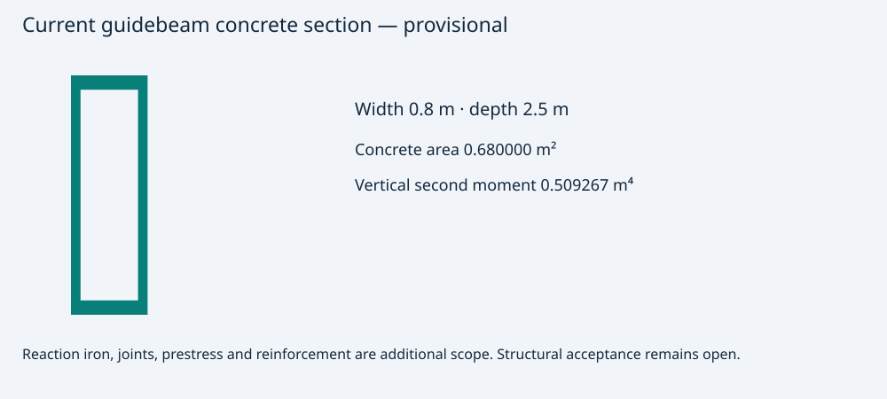
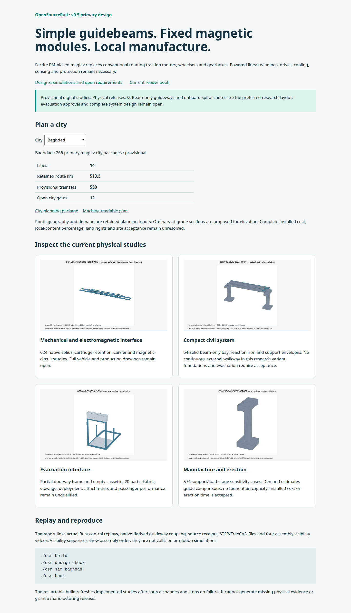

# OpenSourceRail

**v0.5 — fewer moving parts, more local manufacture, and rail access across more of the city.** OpenSourceRail develops ferrite maglev to simplify the train and the structures that carry it. Fixed magnetic running modules, compact elevated guidebeams and open Rust controls are the basis for a quieter railway that cities can manufacture, maintain and extend themselves, with lower construction and operating costs as central design objectives.


*Development concept — station layout and magnetic interfaces under study.*

**[Maglev study and images](docs/design-engine/ferrite-maglev/reference/index.html) · [Current configuration](ferrite-maglev-study.toml) · [Implementation roadmap](engineering/ferrite_maglev/README.md#implementation-roadmap)**

**nobody should be priced out of dignity**

## Why this design

- **Eliminate conventional moving running gear.** Replace wheelsets, axles, gearboxes and rotating traction motors with fixed magnetic modules and electromagnetic propulsion. Reduce mechanical complexity, wear items and maintenance work.
- **Reduce noise at its source.** Contact-free normal running removes wheel–rail rolling contact as a source of noise and wear.
- **Keep more of the railway's value in the country that builds it.** Prioritise local guidebeam casting, structural fabrication, ferrite-cartridge assembly, coil winding, body panels, wiring and integration. Open designs and Rust controls on off-the-shelf computers support local repair and supplier choice. Local-content accounting retains the origin of bought-in cells, semiconductors, sensors and materials.
- **Reach neighbourhoods that large infrastructure struggles to serve.** Compact viaducts aim to open routes along constrained urban corridors and through dense neighbourhoods, residential districts, industrial areas and outer suburbs. Carrying the train above ground can preserve movement underneath, reduce surface occupation and demolition, and widen the choice of useful station locations.
- **Make a broad city network affordable to build and extend.** Repeat simple beams, supports, vehicle modules and station kits; manufacture and test offsite, then assemble quickly with fewer site operations. Optimise foundations, piers, beams, transport and erection together so that simplification can reduce the complete installed cost and disruption, opening more areas of the city to rail investment.

**The aim is useful rail access across as much of the city as practical, with a small physical footprint and a high share of locally created value.** Cost, noise, local-content and access benefits are development objectives; their achieved levels depend on the completed design, supply chain and route evidence. [Current calculations and evidence](docs/design-engine/ferrite-maglev/reference/index.html) · [Work needed to complete the design](engineering/ferrite_maglev/README.md#implementation-roadmap).

**Default optimisation direction:** predominantly elevated mainlines (99% planning objective), with all ordinary sections proposed on repeatable viaduct kits. Prefer straight tangents where buildings, road/utility clearances, wildlife/water passage, foundations and station access permit. Optimise installed cost per dual-direction route-km together with vehicle mass, construction effort, moving mechanisms and imported content. Required passenger, emergency and support systems remain in scope. [Executable joint search and assumptions](engineering/ferrite_maglev/optimisation.py) · [controlled search bounds](engineering/ferrite_maglev/optimisation.toml).

**Minimal guideway target:** one integrated beam per direction with no continuous external walkway, conditional on an accepted onboard/route evacuation alternative. Necessary iron reaction faces, structural supports, foundations and connections remain. Vertical controlled-descent spiral/cell chutes are the preferred research candidate, with inclined slides retained for comparison. Both are being screened for height, landing space, accessibility, fire/weather/fault conditions and lifetime cost; current walkway removal and net savings remain unapproved. [Beam-only evacuation study](engineering/ferrite_maglev/evacuation.py). Manufacturer-listed monorail applications and variable-height zippered outlets inform seven open installation requirements; driverless deployment and every-stop ground access still need validation.


*Illustrative concept only: chute packaging, descent control, anchorage and landing areas require design and validation.*

The implemented v0.5 development tools now cover:

| Area | Available work | Acceptance still needed |
|---|---|---|
| Full transition inventory | 414 explicit item dispositions, including 69 additional Baghdad records; 63 legacy packages and 72 requirements mapped to 11 maglev packages | Configuration-specific engineering, manufactured parts and independent acceptance; allocation is not completion |
| City planning | Separate provisional maglev packages for [266 cities / 1,565 lines](engineering/ferrite_maglev/city-index.md), with formation, fleet, charging and partial cost recalculation | Surveyed topology, platforms, route duty, recovery, complete programme cost and physical qualification |
| Native geometry | A partial 624-solid magnetic interface and a two-direction 25 m civil bay; FreeCAD solids, FCStd/STEP export and reopening checks | Complete vehicle/rail design, material/process qualification, loads and the full gap/tolerance budget |
| Magnetic field | 2D variable-reluctivity solver with manufactured-equation/refinement controls and artificial nonlinear material hypotheses | Coupon force mesh convergence, actual material grades, 3D force/loss maps and rig correlation |
| Control and guideway | 24-module Rust control and an actual two-way replay with a flexible vertical beam | Actual electromagnetic plant, torsion/lateral/soil/moving-load dynamics, physical I/O and measured SBC timing |

**Latest linked design increment:** [doorway/entry CAD, compact support variants and Rust egress](engineering/ferrite_maglev/README.md#linked-mechanical-civil-and-software-increment) add 20 physical entry parts, four stand-off alternatives, 576 support-demand cases, negative-control software runs and a beam/control replay using native-derived line mass. [Review the geometry, videos and data](docs/design-engine/ferrite-maglev/reference/index.html). Complete deployment mechanics, structural/ground capacity and physical acceptance remain open. [Executed tests and source evidence](engineering/assurance/v05-linked-system-development/summary.json).

**Accepted engineering/physical releases: 0.** The [implementation and closure details](engineering/ferrite_maglev/README.md) keep numerical, native-model, manufacturing and physical evidence separate.

## Give your city a railway it can own

OpenSourceRail is an open urban-rail reference platform for countries that want to retain design authority, software, fabrication, integration, operations and maintenance capability in-country. It connects city planning, GIS, CAD/IFC, simulation, project controls, local manufacturing, ERP, equipment supervision and assurance around the same city, asset and engineering-revision identities.

> [!IMPORTANT]
> Repository outputs are planning and engineering-screening evidence—not bids, construction releases, safety certificates, approvals or endorsements. Open topography and water data do not replace survey, geotechnical or hydraulic evidence. Simulation and formal checks do not authorize live railway command.

**Platform navigation:** [one-page overview](docs/open-source-rail-overview.md) · [shared software architecture](docs/ARCHITECTURE.md) · [platform roadmap](docs/ROADMAP.md#primary-maglev-closure-queue). Earlier physical documents are grouped under [v0.4 wheel/rail references](#v04-wheelrail-references).

**AI CAD and BIM workflow:** [October 2026 tool review and completion programme](docs/design-engine/ai-cad-bim-workflow-2026-10-17.md) compares editable CAD agents and BIM tools, and provides a resumable proposal → native geometry → solver/IFC checks → feedback loop. Research examples retain the full work-order backlog; complete railway specification and physical acceptance remain open.

**Retained wheel/rail research runner:** [run mechanical, civil, software and integration lanes](docs/design-engine/continuous-runner-2026-10-17.md) with crash-safe follow-ups, fair bounded AI proposals, native/beam-FEM promotion, a research-champion dashboard and benchmarked capability worktrees. Verification levels and exact revisions remain separate from manufacturing and physical acceptance.

**Retained Baghdad wheel/rail assembly development:** [sourced requirements and first assembly campaign](docs/design-engine/assembly-design/index.html) separates 69 Baghdad reference parts from legacy configurations, runs cassette/bearing-seat alternatives and executable interface tests, and starts isolated capability development with independent research review. [Workflow and limits](engineering/assembly_design/README.md). Complete railway design and manufacturing acceptance remain open.

## Shared platform and retained function comparison

The tooling below retains its original configuration and evidence scope; it does not establish completed maglev engineering.

**Native part generation:** generate drilled steel cleats and RHS/I-section civil beams through FreeCAD → Gmsh → CalculiX, then use native feedback to choose subsequent designs. Deterministic bounded search retains failed cases, provenance, geometry and solver files. Best-design claims cover the declared, fully tested numerical domain; physical qualification remains open. [Run the recursive workflow](engineering/design_engine/README.md) · [Review twelve related design systems](docs/design-engine/generative-systems-review.md). OpenSourceRail connects corridor choices to engineering revisions, local production, delivery costs and maintenance evidence. Its planning portfolio covers **265 cities in 44 developing countries**, plus one European comparison model. This table compares published functions, not performance, price or railway acceptance. **Reviewed 12 October 2026:** linked primary sources; capabilities depend on edition/configuration. “Integrated” means an existing OSR component; “workflow” means a tool used with OSR; “benchmark” implies no connector.

| Tool / suite | Availability / relationship | Main functions | OpenSourceRail's corresponding value and limits |
|---|---|---|---|
| **[OpenSourceRail](docs/operating/integration-status.md)** | Open source; connected reference platform | City GIS, service/energy simulation, CAD/IFC, quantities, local manufacture, finite-resource CPM, procurement/cashflow, ERP, supervision and maintenance evidence | Common city/asset/revision identities connect planning through repair; reproducible demonstrations exist, while physical railway qualification and live control acceptance remain open. |
| Siemens [TPS.plan](https://www.mobility.siemens.com/global/en/portfolio/digital-solutions-software/train-planning/schedule-creation.html), [TPS.live](https://www.mobility.siemens.com/global/en/portfolio/digital-solutions-software/train-planning/dispatching.html), [TPS.trackworks](https://www.mobility.siemens.com/global/en/portfolio/digital-solutions-software/train-planning/track-work-coordination.html) | Commercial; benchmark | Infrastructure-aware timetables, traffic forecasts/conflicts, dispatching and track-work windows | OSR schedules declared physical routes around possessions and resource conflicts, with fleet/energy and staff recovery; search is bounded and live dispatch acceptance remains open. |
| Alstom [Urbalis Vision](https://www.alstom.com/supervision-advanced-urban-network-control) / ICONIS supervision | Commercial; benchmark | Integrated urban traffic supervision, regulation, SCADA, incident and depot management | OSR joins OCC, simulator and **observation-only** FUXA views to asset/work records; its management stack is not an accepted live ATS/CBTC product. |
| Alstom [HealthHub / FlexCare digital services](https://www.alstom.com/solutions/services/digital-railway-solutions-unlock-higher-asset-availability-reliability-and-performance) | Commercial; benchmark | Fleet, infrastructure and signalling condition monitoring, predictive maintenance and service support | OSR joins condition-to-repair and serial/parts history to exposure/fault trends and held-out degradation/RUL validation; measured calibration and predictive deployment remain open. |
| Hitachi Rail [HMAX](https://www.hitachirail.com/products-and-solutions/digital-asset-management/) | Commercial; benchmark | Digital asset management, harmonised health data, condition/predictive maintenance and digital twins | OSR exposes engineering provenance and condition-to-repair evidence in an adaptable owner-held stack; deployed predictive depth and support equivalence are unproven. |
| Hitachi Energy [EAM / FSM / APM](https://www.hitachienergy.com/markets/transportation/rail/enterprise-software-for-rail) | Commercial; benchmark | Rail asset registers, track defects, work orders, field service and asset performance | OSR links assets, work and independent handback to revisions, with offline typed/photo work packs, durable synchronisation and native-state revalidation; operator commissioning remains open. |
| Dassault [DELMIA Quintiq](https://www.3ds.com/products/delmia/quintiq/rail-service-fleet-crew-planning) | Commercial; benchmark | Coupled service, fleet and crew planning, constraint optimisation and disruption replanning | OSR proposes possession-aware service/fleet/energy recovery and bounded staff rosters, retaining deadheads, charging and fixed maintenance; unrestricted optimisation depth remains unproven. |
| Tracsis [ATTUne / TRACS / TRACS Enterprise](https://tracsis.com/products/operations/attune-tracs-trent) | Commercial; benchmark | Timetables, vehicle/crew diagrams, rostering, personnel and on-day operations | OSR proposes rosters across operating and maintenance roles, checking competence, travel, rest, breaks and workload; native assignment and deployed rostering acceptance remain separate. |
| Wabtec [RailConnect](https://www.wabteccorp.com/digital-intelligence/transportation-management/railconnect) | Commercial; freight benchmark | Railcar movement, switching, mobile work, freight revenue/billing and industry exchanges | OSR's current reference is urban passenger rail with engineering-to-maintenance continuity; freight settlement and car-hire workflows would require a separate profile. |
| Petrosoft [RAILSoft](https://petrosoft.pl/en/railsoft-news/focus-on-efficiency-how-railsoft-manages-record-passenger-traffic-in-poland/) / [mRails](https://petrosoft.pl/aktualnosci-railsoft/mrails-mobilna-aplikacja-dla-pracownikow-terenowych-kolei/) | Commercial; benchmark | Fleet planning, maintenance intervals, parts/history and mobile field execution, including offline work | OSR joins ERP asset/parts/people records to offline field evidence, operational/GTFS exchange and configured operator identity adapters; national transport integrations remain deployment-specific. |
| IBM [Maximo Application Suite](https://www.ibm.com/products/maximo/travel-transportation) | Commercial; benchmark | Asset/work management, inspection, reliability, monitoring and predictive maintenance | OSR connects comparable asset/work record categories to public railway definitions and engineering changes; equivalent operating scale, analytics and service support require proof. |
| Bentley [OpenRail Designer](https://www.bentley.com/software/openrail-designer/) | Commercial; benchmark | Specialist alignment, cant, turnouts/yards, corridor modelling and design documentation | OSR carries screening geometry into quantities, IFC, procurement and cashflow; it does not claim equivalent detailed alignment design or issued-for-construction capability. |
| [OSRD](https://github.com/OpenRailAssociation/osrd) | Open source; benchmark | Railway infrastructure, train simulation, timetables, capacity and short-term path requests | OSR extends the workflow into vehicle/civil references, manufacture, delivery and maintenance; breadth does not establish equivalent timetable/capacity depth. |
| [Eclipse SUMO](https://eclipse.dev/sumo/) | Open source; workflow | Microscopic multimodal simulation: road, rail, public transport and pedestrians | OSR uses SUMO for independent screening and adds rail engineering, asset and delivery context; numerical agreement requires matched inputs and declared tolerances. |
| [QGIS](https://github.com/qgis/QGIS) | Open source; workflow | Raster/vector GIS, spatial analysis, cartography and geospatial exchange | OSR supplies city/route revisions, demand and terrain/water screening connected to service, civil quantities and delivery outputs. |
| [FreeCAD](https://www.freecad.org/features.php) | Open source; workflow | Parametric solid modelling, assemblies, drawings and extensible engineering tools | OSR supplies controlled train/station/civil families, product interfaces, BOMs and manufacturing/evidence gates around native CAD. |
| [Bonsai / IfcOpenShell](https://bonsaibim.org/) | Open source; workflow | Native IFC authoring, model review, coordination and programmable BIM | OSR supplies railway asset identities, IFC4.3 packages, quantities, 4D states and executable information requirements linked to revisions. |
| [ERPNext](https://github.com/frappe/erpnext) / [Frappe HR](https://github.com/frappe/hrms) | Open source; integrated | Procurement, stock, manufacturing, quality, projects, assets, finance, employees and payroll | These hold OSR's native business records; OSR adds railway context, engineering-change disposition, competence/resource checks and independent inspection/handback. |
| [FUXA](https://github.com/frangoteam/fuxa) | Open source; integrated | Web SCADA/HMI, process displays and industrial protocol connectivity | OSR supplies versioned observations, durable history/alarms and ERP maintenance linkage; the installed OSR gateway carries no railway command authority. |
| [OpenProject Community](https://www.openproject.org/community-edition/) | Open source core; benchmark | Project/work-package tracking, collaboration, Gantt schedules and dependencies | OSR adds finite-resource CPM, railway quantities/BOM demand, supplier order-by dates and local/import cashflow; no OpenProject connector is claimed. |
| [CalculiX](https://calculix.de/) / [OpenSees](https://opensees.berkeley.edu/index.php) | CalculiX GPL; OpenSees [use restrictions](https://opensees.berkeley.edu/OpenSees/copyright.php); workflow | Finite-element analysis; structural/geotechnical nonlinear and dynamic research | OSR drives source-bound beam–pier–foundation comparisons and retains failed cases, tradeoffs and model limits; solver convergence does not qualify a railway structure. |

**Why use OSR?** A corridor or component change can be reviewed alongside its asset quantities, manufacturing work, procurement, cash needs and maintenance consequences, with inspectable source and retained evidence. Start with the [owner/operator platform](docs/first-adoptable-product.md); use the [competitive position and proof roadmap](docs/competitive-position-and-proof-roadmap.md) to judge maturity. The [six-item operations implementation](engineering/operations/README.md) adds bounded resource/fleet/staff planning, offline evidence, reliability validation and operational exchange; measured/operator commissioning remains separate.

The retained v0.4 wheel/rail physical comparator is a 49.5 m, three-car driverless light metro with **360 AW2 / 480 AW3** capacity and **675 kWh gross / 540 kWh usable** LFP storage, integrated battery/cabin thermal control, seven station archetypes and reusable civil families. A welded steel safety frame, non-structural GFRP cladding and supplier-neutral COTS subsystem interfaces support local fabrication, assembly and repair. Its **120 LM3 product rows, 26 assembly nodes, 30 tooling/mould families and 146 native FreeCAD models with matching split IFC4.3 files** connect that make/buy strategy to BOMs, tooling and qualification gates.

The retained v0.4 city geography uses **elevated land sections in its controlled central study areas**, radial tangents and curved ring connections where terrain and water permit; retained shore detours and priced bridge candidates replace long lake crossings. Outer approaches retain their actual at-grade, elevated and special-crossing mix, with no tunnels. Each city reports its current civil quantities, one full-fleet planning depot per line, graded staffing and an 18-month factory-readiness plan. These are planning concepts: property, survey, supplier, structural and operational releases remain open. [Catalogue design review](docs/catalogue-current-design-review.md) · [Water and interchange checks](engineering/assurance/catalogue-geography/README.md) · [Baghdad’s dedicated proposal and funding](cities/catalogue/west-asia/Iraq/Baghdad/README.md).

## Civil engineering — primary maglev



The [primary joint search](docs/design-engine/ferrite-maglev/reference/index.html) compares 432 reference vehicle/beam/span combinations and 432 conditional no-walkway alternatives. It reports separate lowest indexed ordinary-viaduct allowance and lowest counted concrete mass choices, with Pareto tradeoffs. Fastest construction remains unknown until a maglev-specific factory/erection schedule exists. The USD8.346 million reference allowance is for an ordinary dual-direction route-km; stations, special crossings, land, depots and complete financing remain additional scope.

Each candidate now carries a whole-system comparison scorecard: indexed allowances, tare/loaded mass, matched hot no-regeneration energy/charging and bare lift mass, alongside explicit unknowns for complete installed/factory-gate costs, transport shipment mass, labour, unique/moving parts, imported value and repair/recovery times. Actual magnetic force/loss and candidate-specific control coupling remain open. New chute mass is unselected, so no-walkway energy and net savings are held. The [implementation roadmap](engineering/ferrite_maglev/README.md#implementation-roadmap) identifies the evidence needed to close these measures.

## v0.4 wheel/rail references

These retained physical designs document earlier engineering and manufacturing work. Their costs, route mix, CAD and tests do not qualify the new maglev configuration.

- [Two-page v0.4 brochure](OpenSourceRail-Brochure.pdf) and [archived v0.4 PDF book](https://github.com/modernecotech/OpenSourceRail/blob/9246e11d92267c25d90c5cd336e3e4c6945ded94/OpenSourceRail-Book.pdf).
- [LM3 rolling-stock reference](docs/rolling-stock/light-metro-3car/README.md), [CAD and IFC](engineering/models/bim/reference/README.md) and [buildable trainset](design/component-catalogue/catalog/buildable-trainset/README.md).
- [Vehicle assembly video](engineering/models/digital-twins/fabrication-assembly/fabrication-assembly-digital-twin.mp4) and [civil IFC sequence](engineering/models/bim/reference/civil-construction-sequence.mp4).

## Inspect the current design

The [primary Workbench](docs/workbench/maglev/index.html) joins city plans, native geometry, control replays, images and assembly videos. Start it with `./osr workbench`.



The shared [ERPNext](deployment/erpnext/README.md), [supervision](deployment/supervision/README.md) and [assurance](docs/certification/README.md) platform remains available. Existing wheel/rail asset, supplier, manufacturing and operating records retain their original configuration; they do not accept a maglev replacement.

## The economic case

The primary v0.5 study retains explicit low/base/high budgets and adds local-manufacture optimisation targets. Its base repeat three-car train is $872,197 and ordinary elevated dual-route-km is $8,345,876, conditional on unresolved design and procurement inputs. [Review scopes, targets, localisation and open gates](docs/design-engine/ferrite-maglev/reference/index.html). The existing economics below describe retained wheel/rail comparators; they are not maglev project budgets.

Local fabrication and integration aim to reduce imported finished equipment, retain repair authority and build national capability. Achieved local value and external-capital requirements need a complete origin-traced MBOM, installed scope and financing terms. The [retained portfolio comparison](docs/portfolio-summary.md) and [Iraq funding programme](cities/catalogue/west-asia/Iraq/IRAQ-FUNDING-PROGRAMME.md) describe earlier wheel/rail scenarios and are not maglev funding commitments.

## Run it

Install the toolchain, build the primary v0.5 study and run its control replay:

```bash
./install.sh
./osr build
./osr design check
./osr readiness
./osr capabilities
./osr catalogue plan --city baghdad
./osr test
./osr
cargo run -p osr-maglev-control --release --example multimodule_replay
./osr city baghdad
./osr sim baghdad --cycles 2
# Explicit retained wheel/rail comparator:
./osr sim legacy --duration 3600 --status-every 300
```

The primary review is [generated here](docs/design-engine/ferrite-maglev/reference/index.html). Use `./osr workbench` for the primary maglev UI at <http://127.0.0.1:8090/>; `./osr workbench legacy` explicitly launches the retained platform GUI. The [current reader book](OpenSourceRail-Book.pdf) covers the primary design. The [shared design workflow](docs/design-engine/README.md) adds local jobs, validated installed BOMs, guided manufacturing/site/foundation inputs, independently reviewed revisions, broader civil/vehicle alternatives and scoped evidence verification; see the [36-package acceptance status](docs/design-engine/plan-status.md) and [capability directory](docs/capabilities/README.md). The local server is not an authenticated public deployment. The installer reports existing tools before changing anything and offers larger engineering applications separately. Disposable output goes under `build/` and `target/release/`; public review artifacts remain tracked outside those trees.

## Find Your Way

| If you are… | Start with… |
|---|---|
| A city or transport planner | [Primary maglev city plans](engineering/ferrite_maglev/city-index.md), retained [City Studio](docs/city-studio.md), [city catalogue](cities/catalogue/README.md), [cost model](docs/cost-model.md) and [portfolio](docs/portfolio-summary.md) |
| A civil/BIM engineer | [Civil system](docs/civil/README.md), [Bonsai IFC workflow](docs/civil/bonsai-ifc-workflow.md), [BIM reference package](engineering/models/bim/reference/README.md) and [survey gates](cities/catalogue/west-asia/Iraq/Samawah/engineering/survey/field-evidence-brief.md) |
| A rolling-stock, supplier or manufacturing engineer | [Primary maglev implementation and closure](engineering/ferrite_maglev/README.md), retained [LM3 reference](docs/rolling-stock/light-metro-3car/README.md), [buildable trainset](design/component-catalogue/catalog/buildable-trainset/README.md), [supplier technical-support package](docs/commercial/supplier-technical-support-package.md), [CAD models](design/component-catalogue/models/cad/README.md) and [factory readiness](design/component-catalogue/catalog/buildable-trainset/factory-release-readiness.md) |
| Researching component and system best practice | [Source-backed handbook](docs/best-practice/handbook.md), [installed design twin](engineering/models/digital-twins/best-practice/index.html), [design expansion review](docs/best-practice/digital-twin-design-expansion.md), [component mapping](engineering/best_practice/component-guidance.csv) and [OSR-BP-001](docs/standards/OSR-BP-001.md) |
| An operator or maintainer | [Operations](docs/operations/README.md), [Workbench](docs/workbench/README.md), [connected lifecycle](docs/lifecycle/README.md) and [example-city deployment](deployment/example-city/README.md) |
| An ERP/SCADA integrator | [Operating platform](docs/operating/README.md), [ERPNext setup](deployment/erpnext/README.md), [supervision gateway](deployment/supervision/README.md) and [embedded contract](docs/lifecycle/embedded-integration.md) |
| A software or assurance reviewer | [Rust workspace](crates/README.md), [software architecture](docs/software-architecture-diagrams.md), [formal results](engineering/assurance/formal/results/README.md), [safety case](docs/safety-case/README.md), [assurance/authorization framework](docs/certification/README.md), [manufactured viaduct review](docs/baghdad-manufactured-viaduct-review-2026-10-04.md), [controls and financial review](docs/baghdad-ci-controls-review-2026-10-04.md) and [historical codebase review](docs/codebase-and-iraq-review-2026-10-03.md) |
| A public owner, funder or delivery partner | [Primary Baghdad maglev planning and cost gaps](cities/catalogue/west-asia/Iraq/Baghdad/engineering/maglev/README.md), retained [October 5 cost and demand reconciliation](docs/baghdad-cost-and-demand-review-2026-10-05.md), [latest Baghdad staffing, depot, local-production and funding recalculation](cities/catalogue/west-asia/Iraq/Baghdad/engineering/programme-recalculation/README.md), [complete Baghdad proposal](cities/catalogue/west-asia/Iraq/Baghdad/README.md), [Baghdad-only original reference funding programme](cities/catalogue/west-asia/Iraq/IRAQ-FUNDING-PROGRAMME.md), [competitive position and proof roadmap](docs/competitive-position-and-proof-roadmap.md), [owner–builder–operator plan](docs/owner-builder-operator-setup.md), [mobilisation status](docs/owner-builder-operator-mobilisation-status.md), [JV/development framework](docs/commercial/joint-development-framework.md), [partnership status](docs/commercial/partnership-readiness.md) and [supplier-support status](docs/commercial/supplier-technical-support-readiness.md) |
| A contributor | [Contributing guide](CONTRIBUTING.md), [governance](GOVERNANCE.md), [change log](CHANGELOG.md) and [release checklist](docs/releases.md) |

## Source Of Truth

**Source-locked inputs → validated candidate and deterministic generators → content-addressed Git-reviewable revision → GIS/OSR-ALN/CAD/IFC/cost/simulation/project-twin outputs → independent evidence, named approval and operational baseline.**

This root README is the only human-facing front door. A hash proves which bytes were reviewed; it does not approve them. Generated city packages still require survey, calibrated demand, utility and ground data, supplier qualification, first-article manufacture and testing, competent engineering review and national authorization. The principal editable sources are:

| Concern | Source of truth | Generated/review output |
|---|---|---|
| Architecture and decisions | [`lib/templates/infrastructure.toml`](lib/templates/infrastructure.toml), [`docs/ARCHITECTURE.md`](docs/ARCHITECTURE.md), accepted [`docs/rfcs/`](docs/rfcs/README.md) | Diagrams, guides and summaries |
| Primary maglev city/vehicle/civil planning | [`engineering/ferrite_maglev/`](engineering/ferrite_maglev/README.md), [`ferrite-maglev-study.toml`](ferrite-maglev-study.toml) | Maglev city plans, native studies, partial costs, simulations and open gates |
| Primary SBC development | [`deployment/maglev.toml`](deployment/maglev.toml), [`osr-maglev-control`](crates/osr-maglev-control/README.md) | Offline replay only; hardware interfaces and physical timing remain open |
| Rust behavior and simulation | [`crates/`](crates/README.md) and tests | Applications, traces and coverage evidence |
| Retained wheel/rail synthesis and inputs | [`design/city-generation/`](design/city-generation/README.md), [`lib/templates/`](lib/templates/), [`lib/recipes/`](lib/recipes/), [`lib/city-batches/world-sample.toml`](lib/city-batches/world-sample.toml) | City catalogue, service, finance and engineering packages |
| Retained Iraqi wheel/rail funding | [`lib/templates/baghdad-programme-recalculation.toml`](lib/templates/baghdad-programme-recalculation.toml), [`lib/templates/iraq-funding.toml`](lib/templates/iraq-funding.toml), controlled procurement schedules and [`lib/templates/city-publication.toml`](lib/templates/city-publication.toml) | [Retained Baghdad summary](cities/catalogue/west-asia/Iraq/Baghdad/README.md), [reference scope and funding cases](cities/catalogue/west-asia/Iraq/Baghdad/engineering/programme-recalculation/README.md); original catalogue appraisals are labelled separately |
| Interactive city revisions | [`cities/workspaces/`](cities/workspaces/README.md) | Content-addressed candidates and exports |
| Retained wheel/rail geometry | [`design/component-catalogue/src/osr_mech/`](design/component-catalogue/src/osr_mech/) | FreeCAD, IFC, BOM, traveler and image artifacts |
| Component and system practice research | [`engineering/best_practice/data/`](engineering/best_practice/data/), linked to existing standards controls | Reproducible handbook, catalogue coverage and open verification/backlog plans |
| ERP and supervision integration | [`deployment/erpnext/`](deployment/erpnext/README.md), [`deployment/supervision/`](deployment/supervision/README.md), [`services/integration/`](services/integration/) | ERP workflows, FUXA views, history and maintenance evidence |
| Survey and released alignment | Accepted deployment GIS and OSR-ALN sources | QGIS, GeoPackage, corridor and IFC alignment evidence |
| Assurance and approval | [`docs/certification/`](docs/certification/README.md), [`docs/safety-case/`](docs/safety-case/README.md), [`engineering/assurance/formal/`](engineering/assurance/formal/README.md) | Proof records, verification status and acceptance reports |

The [local validation workflow](docs/local-validation.md) keeps compute on your machine and GitHub for source and reviewed artifacts; GitHub Actions are disabled. Start with `./osr validate run --profile quick`. The [artifact policy](docs/repository-artifact-policy.md) retains useful CAD, IFC, PDF, image and animation evidence with a 50 MiB per-file ceiling.

## License

Software is Apache 2.0. Control electronics and open physical designs use CERN-OHL-S v2. Documentation is CC-BY-SA 4.0. See [LICENSE.md](LICENSE.md) and [LICENSES/](LICENSES/README.md) for the full texts.
