# OpenSourceRail

OpenSourceRail develops affordable urban rail and open tools to **plan, design, build, operate and renew it**, keeping design knowledge, manufacture and repair capability in-country.

The **v0.6 reference** uses comfort cars on passive steel-wheel bogies, conventional rails and precast concrete. Station propulsion alternatives remain under comparison; no installed architecture or powered length is selected. **This is a research and prototype design, without manufacturing or operating release.**

**Start here:** [city designs and maps](cities/catalogue/README.md) · [engineering Workbench](docs/workbench/current/index.html) · [3D engineering gallery](docs/engineering-models/README.md) · [illustrated reader](OpenSourceRail-Book.pdf) · [detailed platform guide](docs/platform-guide.md).


*Concept. The [source-bound vehicle geometry](docs/design-engine/current/vehicle-overview.svg) and [engineering models](docs/engineering-models/README.md) carry the detailed geometry and its limits.*

## What the project provides

| Connected product | What it is for | Available today |
|---|---|---|
| Design and delivery tools | Turn a city brief into alternatives, engineering checks, costs and delivery records | Planning editor, calculated outlines, engineering Workbench and candidate exports |
| Reference railway and manufacturing system | Develop vehicles, stations, civil works, tooling, assembly and repair methods | Physical candidate definitions, CAD/BIM and numerical studies; physical qualification remains open |
| Open GoA4 control software | Develop protection, interlocking, station-led dispatch and train supervision | Rust research software, simulation and formal/method checks; no live railway or safety approval |

Compare the **whole installed system**: vehicles, stations, civil works, factories, energy, maintenance and service availability. Comfort, safety and accessibility remain requirements.

Local capability includes precasting, fabrication, panels, interiors, wiring, assembly, inspection and repair. Local content requires origin evidence. Open drawings and records let owners change suppliers.

See the [adoption path](docs/first-adoptable-product.md), [capabilities](docs/capabilities/README.md) and [roadmap](docs/ROADMAP.md).

## From a city brief to a working railway

| Step | What to do | Where to start |
|---|---|---|
| **1. Define the brief** | Record demand, routes, access, climate, safety and local capability | [City catalogue](cities/catalogue/README.md), [planning workspace](docs/workbench/planning/index.html) |
| **2. Compare alternatives** | Vary vehicles, propulsion, civil works, service and production under common requirements | [Workbench](docs/workbench/current/index.html), [coordinated design workflow](docs/design-engine/coupled-railway/README.md) |
| **3. Check service and cost** | Calculate journeys, capacity, fleet, energy and low/base/high lifecycle costs | [Demand-led outline](docs/design-engine/demand-outline/README.md), [cost and delivery method](docs/design-engine/model-based-cost-and-delivery.md) |
| **4. Plan delivery** | Inspect CAD/IFC, BOM, process hours, procurement, construction and schedules | [Delivery exports](docs/design-engine/current/exports/manifest.json), [candidate packages](docs/design-engine/coupled-railway/delivery-index.json) |
| **5. Review, build and learn** | Validate independently; configure production, commissioning, maintenance and measured feedback | [ERPNext/Frappe HR](deployment/erpnext/README.md), [FUXA/gateway](deployment/supervision/README.md), [platform guide](docs/platform-guide.md#delivery-records-and-operations-integrations) |

Revisions update one candidate through geometry, mass, checks, quantities and cost. Missing parts, hours and prices remain unknown or bounded.

The [reconciled research pilot](docs/design-engine/reconciled-pilot/README.md) connects a proposed installed vehicle, axle loads, guideway, counted fleet, causal station energy recovery and fourteen-scope costs. A [separately identified no-store alternative](docs/design-engine/reconciled-pilot-no-store/README.md) provides a whole-life comparison. Failed structural alternatives and unresolved engineering tests remain visible; the passive reference and city prices are unchanged.

[Recovery cost comparison](docs/design-engine/recovery-economics/README.md) · [Detailed bogie fit and assembly](docs/design-engine/powered-bogie-detail/README.md) · [Candidate-linked factory tasks](docs/design-engine/reconciled-pilot/delivery/README.md). These research comparisons preserve unresolved physical interfaces and do not change the passive development reference.

**Calculation, validation and release are separate.** Calculations declare their assumptions. Validation needs physical evidence and independent review; manufacture and operation need their own acceptance.

## Explore a city

<!-- BEGIN city outline completion -->
The [priced city and design outlines](docs/design-engine/outline-completion/README.md) cover **266 mapped city networks and 1565 lines**, plus 112 railway bundles, 54 bodies and 18 civil spans. The Workbench compares original, straighter and rounded square-ring proposals, joins close stop markers into operational complexes, and exposes fleet, manufacturing, construction and fourteen whole-life cost scopes. The local workflow edits and re-costs an outline, then exports a resource-leveled delivery plan and disabled business-system drafts. These are completed calculated outlines under explicit demand, site and rate assumptions; physical approval remains separate.
<!-- END city outline completion -->

Start with **[Baghdad](cities/catalogue/west-asia/Iraq/Baghdad/README.md)** or **[Samawah](cities/catalogue/west-asia/Iraq/Samawah/README.md)** for maps, service, fleet, energy, construction resources, costs and finance scenarios. Inspect routes, stations and calculations in the [city railway atlas](docs/design-engine/city-atlas/README.md).

In the Workbench, choose a priced city and calculate a scenario. **Edit this outline and recalculate** changes routes, stops and headways, updating map and figures together. Planning handoffs contain proposals. Site surveys, demand, ground, utilities, power, rescue and physical approval remain project work.

Worked costs: [demand-led project](docs/design-engine/demand-outline/README.md), [30 km / 12 station benchmark](docs/design-engine/line30-benchmark/README.md) and [project-volume supply comparison](docs/design-engine/supply-economics/README.md). Compare these Class C estimates at equal service and compatible rates.

## v0.6 reference vehicle

| Item | Development basis |
|---|---|
| Formation and comfort | Six 17 m cars; 44 fixed seats + two wheelchair places/car; 276 places/train; no planned standing |
| Layout and body | Two passenger doors on one side; aluminium/GFRP architecture, sandwich floor/roof and lightweight interiors |
| Running gear and guideway | Twelve unpowered two-axle bogies, conventional rails and fastenings on concrete; box, twin-beam and U-beam comparisons |
| Propulsion and services | Passive aluminium secondary interface for LIM comparisons; separately sized service batteries, roof solar, HVAC, doors and emergency loads |
| Protection | Continuous onboard ATP, independent mechanical brakes and protected recovery/evacuation arrangements requiring qualification |
| Named service control | 72 km/h launch cap, 120-second headway and 8,280 nominal places/hour/direction; this is a comparison case, not a required operating design |

The [reference selector](engineering/development-baseline.toml) excludes onboard traction motors, traction batteries and permanent magnets. Choose architecture, powered length, acceleration, braking and service per candidate against demand, physical constraints and whole-life cost. Neither 900 m nor 100 m is mandatory.

The [current dossier](docs/design-engine/current/README.md) records open mass, force, thermal, stopping, structural and installation evidence. The LIM interface supports comparison with [mechanical launch and energy recovery](docs/design-engine/station-regenerative-launch/README.md) and [other launch alternatives](docs/design-engine/practical-launch/README.md).

Research may challenge the reference under the [architecture campaign](campaigns/whole-railway-architecture-search.toml) and [transport-goal policy](engineering/outline/transport-goal.toml), with separate identities and complete system consequences. The former **120-person/car / 14,400 passengers/hour/direction** comparison and **160-person/car crowd structural control** remain named alternatives; seated service does not remove crowd, evacuation or accidental-load checks.

## Models from CAD and analysis

These views come from recorded engineering geometry and native analysis results. Click a model for its design dossier. They show **separate research candidates**, with proposed stock and equipment envelopes identified; they do not select a combined installed railway.

| Located vehicle cutaway | Bogie frame and drive cradle |
|---|---|
| [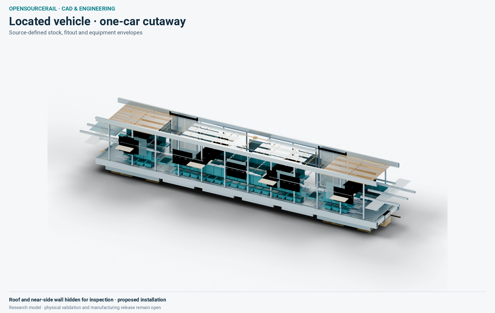](docs/design-engine/reconciled-pilot-bogie-detail/README.md) | [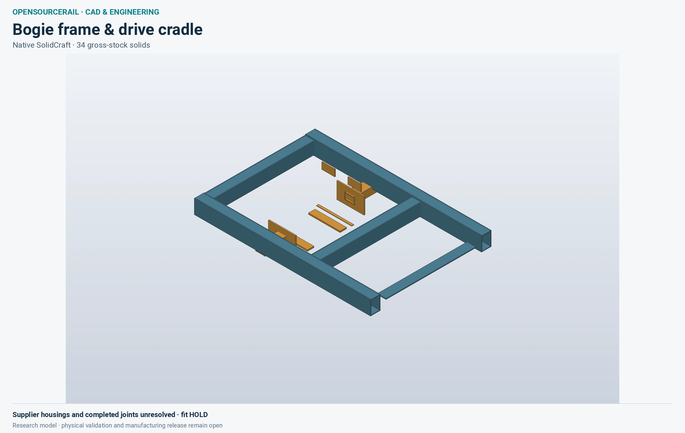](docs/design-engine/powered-bogie-detail/README.md) |
| Stock and bounded equipment from the located research body; display-only cutaway. | Gross stock, with supplier housings and finished interfaces unresolved; fit **HOLD**. |
| **Controlled-launch shuttle** | **Coupling subassembly** |
| [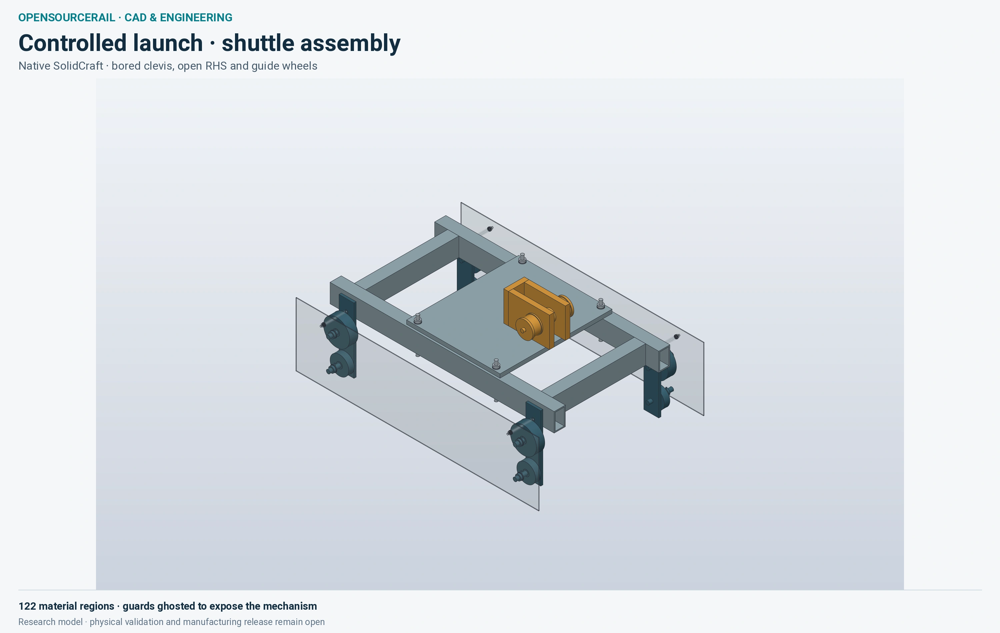](docs/design-engine/launch-detail/README.md) | [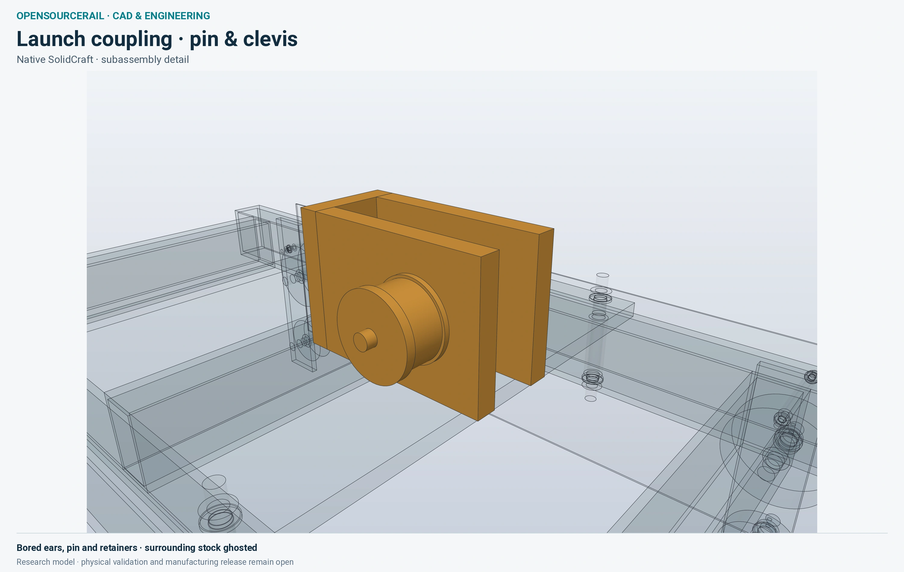](docs/design-engine/launch-detail/README.md) |
| Actual 122-region CAD assembly; guards ghosted for inspection. | Pin, ears and retainers; contact, weld and fatigue checks remain open. |
| **Proposed viaduct assembly** | **FieldCraft structural response** |
| [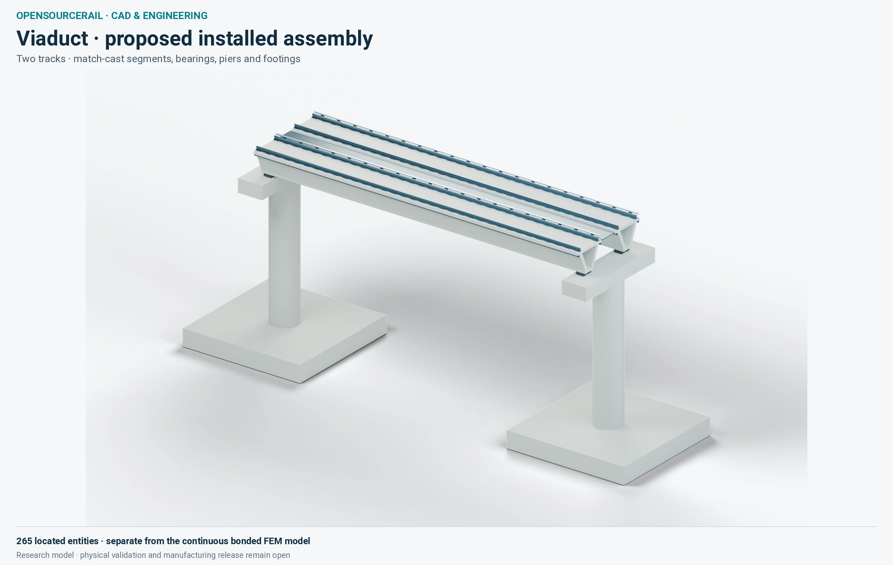](docs/design-engine/reconciled-pilot-bogie-detail/README.md) | [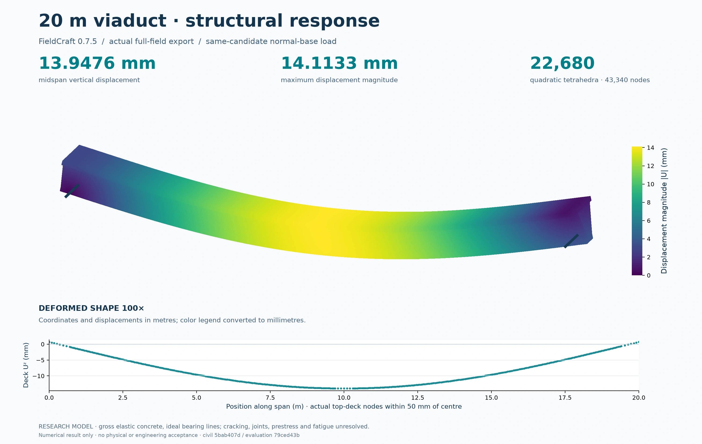](docs/engineering-gallery.md) |
| Located segment, rail and support proposal; joints and installed fit remain unverified. | Separate continuous elastic beam: **13.9476 mm** midspan vertical displacement; shape exaggerated **100×**. |

[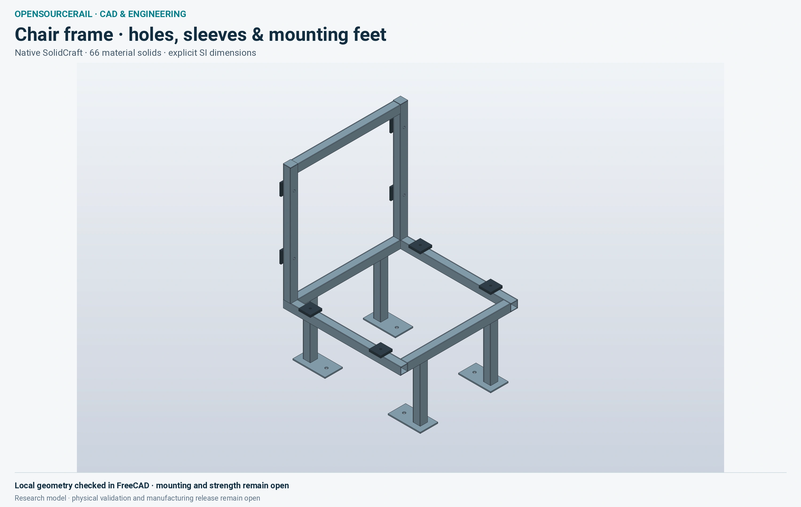](docs/engineering-gallery.md#chair-frame)

**Chair-frame detail:** 66 proposed material solids, with independent FreeCAD geometry correspondence. Mounting, access, strength and the seat-height reconciliation remain open. [Download CAD and inspect the checks](docs/engineering-gallery.md#chair-frame).

The [full-resolution FEM image](docs/assets/engineering-gallery-v06/civil-fem.webp) uses the full native nodal field, including quadratic midside nodes, under one declared normal-base load and ideal bearing lines. It does not verify the segmented assembly. [Render recipes, numerical data and reproduction commands](docs/engineering-gallery.md) include the vehicle image’s render-resource hold and preserve the distinction between a calculated result and physical acceptance.

## The railway in pictures

| Passenger cabin | Modular vehicle assembly |
|---|---|
|  |  |
| **Precast guideway construction** | **Station LIM comparison** |
|  |  |


*The [original renders and illustration brief](docs/images/v06/README.md) explain the concept. The LIM picture and schematic select no installed system or powered length.*

The [3D engineering gallery](docs/engineering-models/README.md) provides **rotatable STL, coloured GLB, editable FreeCAD and STEP models**, source identities and export checks.

The [detailed launch-shuttle assembly](docs/design-engine/launch-detail/README.md) adds bored clevises, a revised pin, hollow frame members, wheel/axle parts, guards and fasteners, with matching component FEM and fabrication estimates. The [city price audit](docs/design-engine/city-price-review/README.md) explains corrected energy accounts and separate civil-cost alternatives.

| Vehicle and workshop assembly | Rail and running-gear workshop |
|---|---|
| [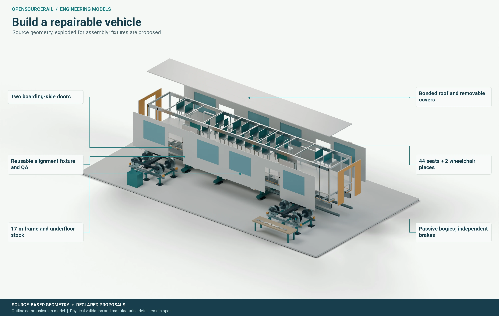](docs/engineering-models/README.md) | [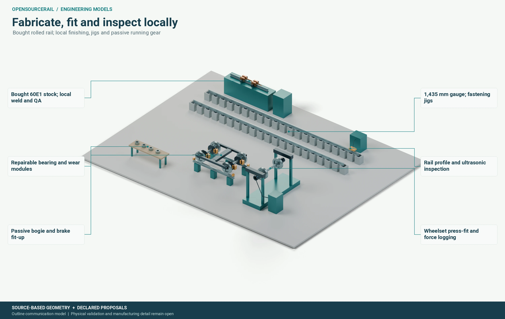](docs/engineering-models/README.md) |
| **Capture braking energy** | **Controlled launch and acceleration** |
| [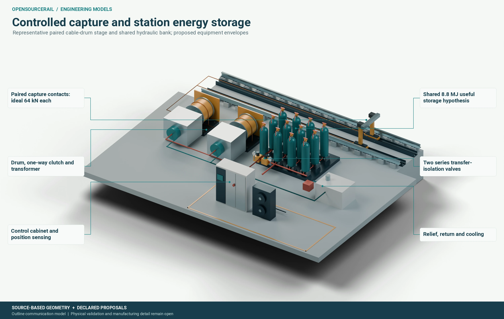](docs/engineering-models/README.md#controlled-capture-and-station-energy-storage) | [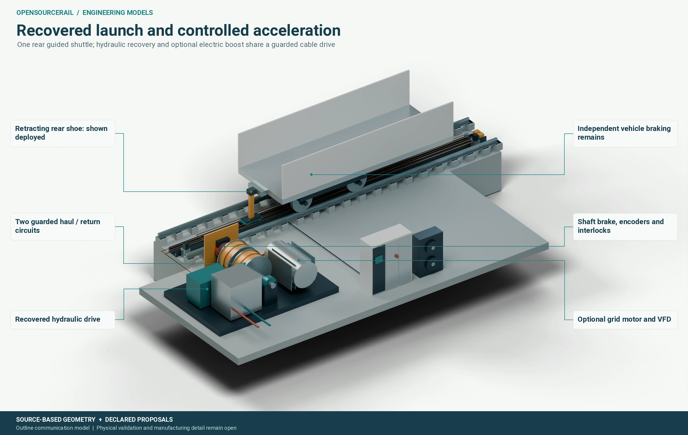](docs/engineering-models/README.md) |
| **Viaduct erection** | **Precast manufacture** |
| [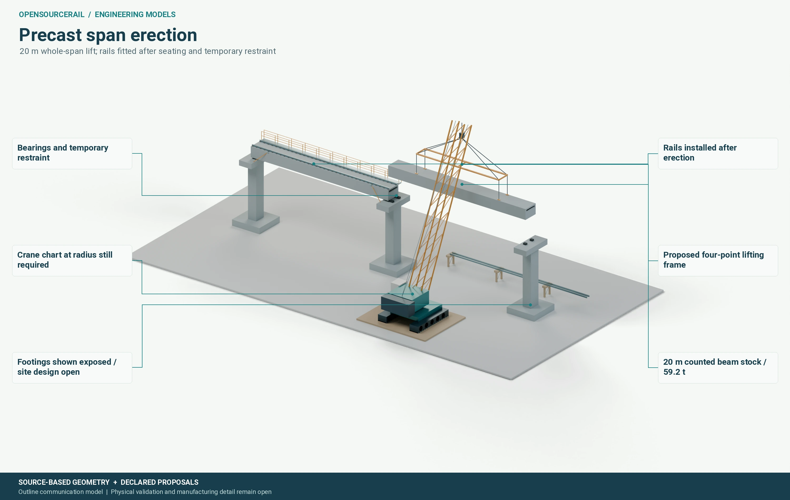](docs/engineering-models/README.md) | [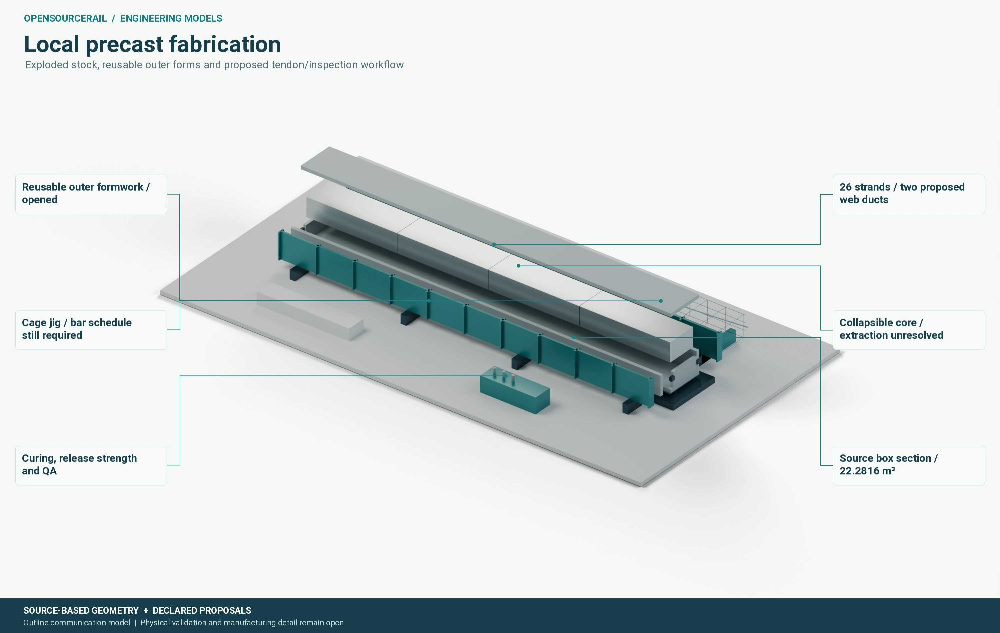](docs/engineering-models/README.md) |

*The gallery distinguishes source geometry, equipment envelopes and proposed tooling. CAD agreement does not establish complete installed mass or physical acceptance.*

## Delivery and operations tools

The [vehicle parts catalogue](docs/design-engine/vehicle-parts/README.md) breaks a separate six-car detail proposal into **605 named part types and 40 assemblies**: bogies, frames, panels, roofs, chairs, doors, glazing, simple LED lighting, couplers and gangways. Browse materials, counted fixings, fabrication and assembly routes, inspection and scoped estimates through the **Vehicle parts** link in the Workbench. Detailed drawings, installed fit and release evidence remain open.

Candidate exports connect CAD/BIM, BOM, manufacturing, procurement, assembly, civil and controls records. Hours and costs remain provisional. The [detailed guide](docs/platform-guide.md#manufacturing-civil-works-and-affordability) explains process costing, factories, construction and whole-life scope.

**[ERPNext and Frappe HR](deployment/erpnext/README.md)** provide configurable draft project, purchasing, stock, workforce, manufacturing, quality and maintenance workflows. **[FUXA and the gateway](deployment/supervision/README.md)** provide equipment observation, trends, alarms and review-linked lifecycle records through the [integration service](services/integration/osr_integration/). Organisations, calendars, masters, equipment bindings and commissioning need configuration. Generated handoffs remain disabled drafts until reviewed.

The [current native acceptance scenario](docs/integration/v06-platform.md) has exercised QA, serialized manufacture, installation, gateway defect, outage recovery, repair and independent business review on disposable ERPNext/HR/FUXA services. It uses simulation assets; full workforce assignment, production handback enforcement and physical commissioning remain separate work.

See the [capability register](docs/capabilities/README.md) for current functions and the [platform guide](docs/platform-guide.md) for detailed methods, integration boundaries and research sources.

## Run locally

```bash
./install.sh
./osr status
./osr readiness
./osr workbench
```

See [setup](tools/README.md) for dependencies. Create and check a planning/factory handoff:

```bash
./osr plan compile edits.json --output build/my-plan
./osr plan verify build/my-plan
./osr twin factory-draft compile build/my-plan --output build/factory-plan
./osr twin factory-draft verify build/my-plan build/factory-plan
./osr twin export
```

`edits.json` is your proposal. Factory drafts require verified handoffs and remain unreleased. For bounded engineering and publication checks:

```bash
./osr design railway plan
./osr design railway run --max-bundles 2 --native-jobs 1
./osr design railway publish
./osr design railway verify
./osr build
./osr verify
./osr book --check
./osr test
```

Native workers need declared FEM/CAD tools and resources; runs retain failures and pending work. `./osr build` refreshes publications and drafts. `./osr sim baghdad` reports a city-evaluation hold. The UI has no live train-control authority.

## About the author

**Hayder Aziz** initiated OpenSourceRail. His research since the early 2000s connects product data management, manufacturing knowledge, open standards and collaborative software, bringing manufacturability and knowledge exchange into conceptual design.

His publications include *[New Technologies and Standards for Design Knowledge Management in Collaborative Conceptual Design](https://researchportal.northumbria.ac.uk/en/publications/new-technologies-and-standards-for-design-knowledge-management-in)* (2003, with James Gao, Paul Maropoulos and Wai Ming Cheung), *[Open standard, open source and peer-to-peer tools and methods for collaborative product development](https://gala.gre.ac.uk/id/eprint/17781/)* (2005, *Computers in Industry*), and *[Engineering design knowledge management in de-centralised virtual enterprises](https://gala.gre.ac.uk/id/eprint/2623/)* (2008, *Computer-Aided Design and Applications*).

OpenSourceRail carries this research into a traceable transport design toolchain. Read the [full biography and research context](docs/platform-guide.md#about-the-author).

## Contribute and learn more

Follow [CONTRIBUTING](CONTRIBUTING.md), [GOVERNANCE](GOVERNANCE.md) and [project instructions](AGENTS.md). Contribute city data, supplier evidence, physical models, manufacturing/repair methods, controls or documentation. Edit sources and regenerate derived artifacts.

For deeper reading: [platform guide](docs/platform-guide.md) · [architecture](docs/ARCHITECTURE.md) · [design engine](engineering/design_search/README.md) · [Rust controls](crates/README.md) · [sourcing evidence](docs/design-engine/sourcing/README.md) · [documentation index](docs/INDEX.md).

Software uses **Apache 2.0**, open physical designs use **CERN-OHL-S v2**, and documentation uses **CC-BY-SA 4.0**, subject to more-specific and upstream notices. See [LICENSE.md](LICENSE.md) and [LICENSES/](LICENSES/README.md).
