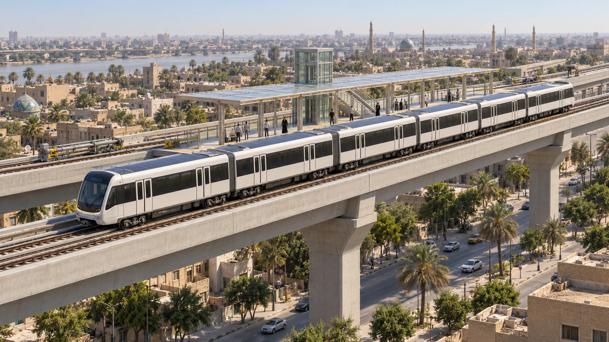
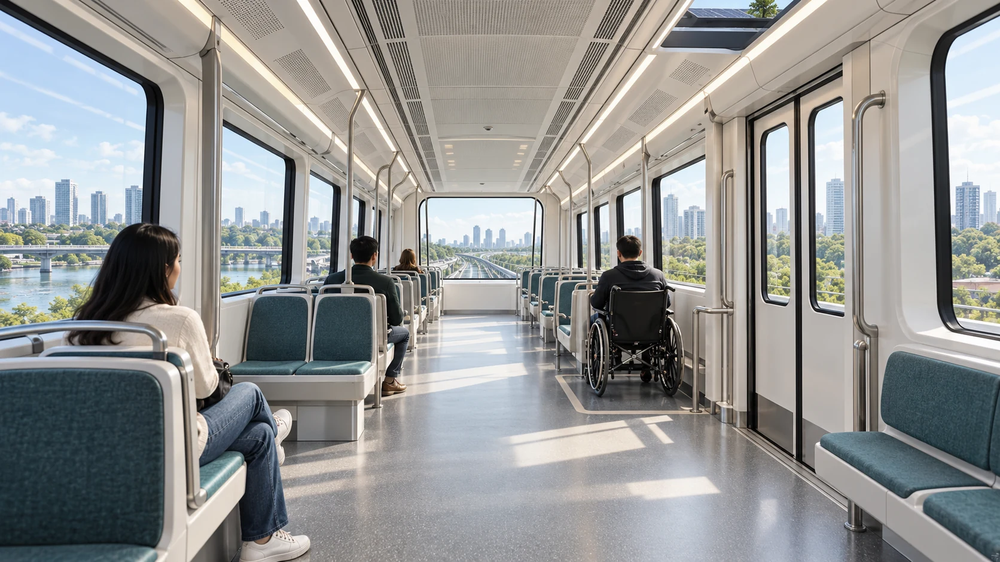
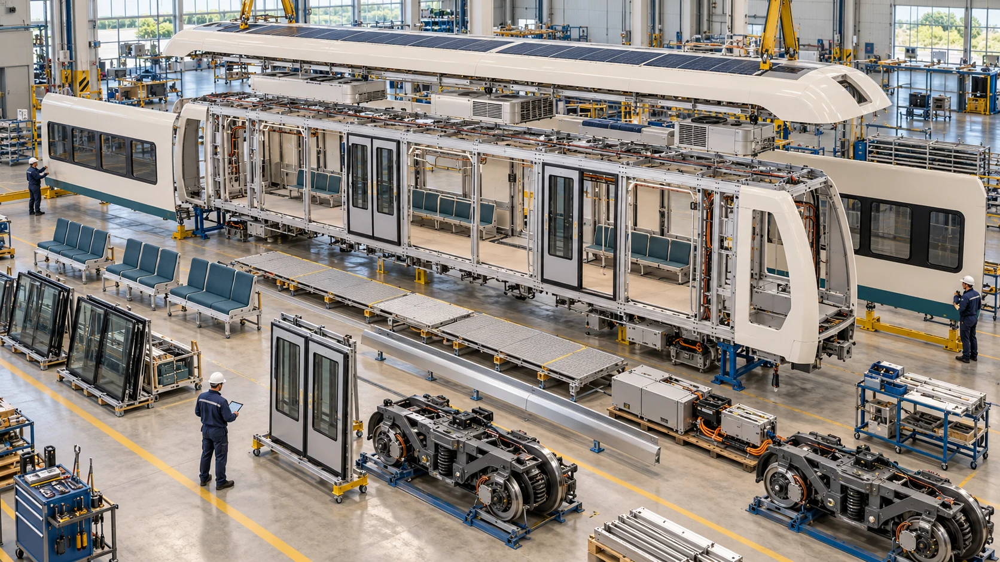
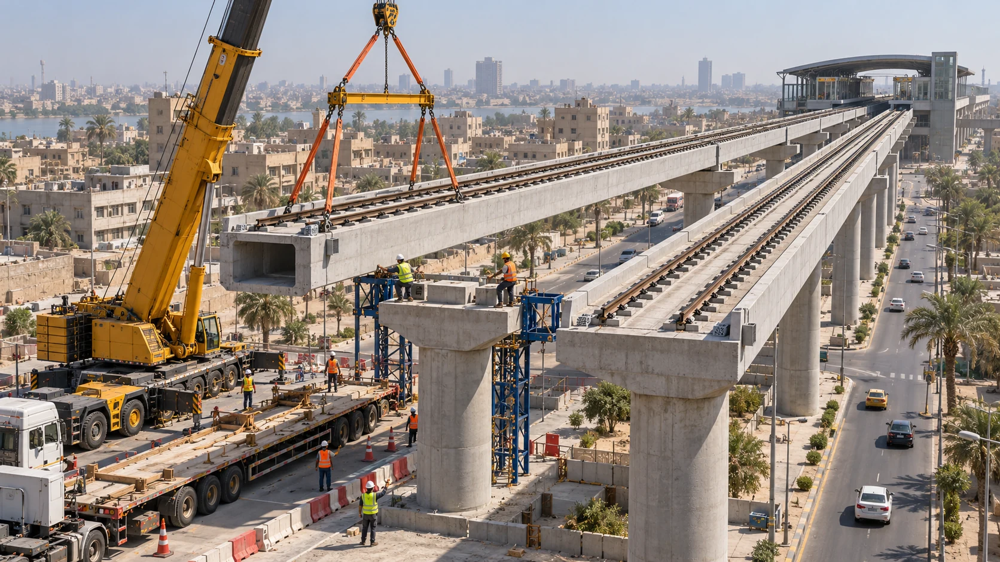
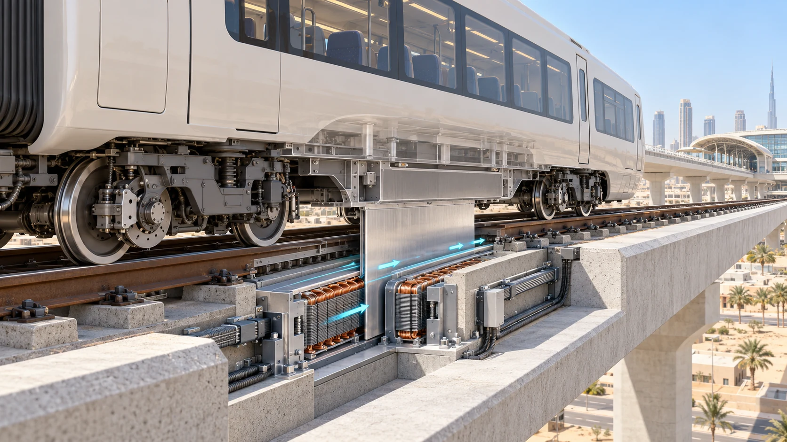
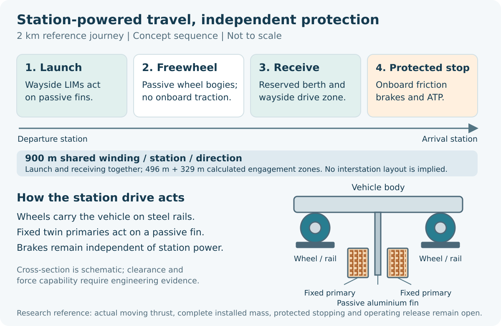

# OpenSourceRail

OpenSourceRail develops affordable urban rail and the open tools needed to **plan, design, procure, manufacture, construct, operate, maintain and renew it**. The aim is to retain design authority, software, fabrication, integration and repair capability in-country, with competitive sourcing of specialist components.

**v0.6 is the station-powered freewheeling reference railway:** lightweight comfort cars run on passive steel-wheel bogies and conventional rails on precast concrete structures. Wayside linear-induction motors launch and receive the train through passive onboard reaction elements. Normal-service traction motors, traction batteries and levitation magnets are absent from the train; passenger services, essential power, protection and independent brakes remain.

The wider project still includes city planning, CAD/BIM, manufacturing, business execution, equipment supervision and open controls. Changing the reference vehicle does not remove that remit. **The railway is a research and prototype design, without manufacturing or operating release.**

**Start here:** [illustrated reader](OpenSourceRail-Book.pdf) · [project overview](docs/open-source-rail-overview.md) · [current engineering](docs/design-engine/current/README.md) · [city geography](docs/design-engine/current/cities.json) · [roadmap](docs/ROADMAP.md).



*Architectural concept, not approved geometry: six 17 m cars, passive steel-wheel bogies, flush roof solar panels, conventional rails on repeatable precast beams and a compact station. [Inspect the source-bound counted vehicle geometry](docs/design-engine/current/vehicle-overview.svg); that geometry and its retained supplier accounts do not establish a complete installed train or manufacturing release.*

## Why OpenSourceRail

- **Build useful capability locally.** Develop concrete precasting, structural fabrication, GFRP panels, interiors, winding, wiring, assembly, inspection and maintenance alongside the railway. Qualify local suppliers rather than assuming every component can already be made locally.
- **Keep ownership of the design and information.** Open software, drawings, interfaces, component identities and maintenance records let an owner change suppliers and repair equipment without depending on one closed turnkey provider.
- **Simplify the complete installed system.** Compare vehicle mass, bogies, station power, beams, piers, foundations, equipment, factory tooling and erection together. A cheaper train that requires more expensive stations is not automatically a cheaper railway.
- **Serve constrained urban corridors.** Mostly elevated, prefabricated construction and compact stations aim to reduce surface occupation and site disruption. Land, utilities, buildings, ground conditions, drainage, access and evacuation still govern each route.
- **Offer comfortable, frequent travel.** The reference prioritises seated accommodation, wheelchair spaces and a two-minute service target. Capacity, dwell, safe separation, transfers and whole-system cost must be evaluated together.

Local content means **origin-traced domestic value added**, not the address of a distributor. Imported cells, semiconductors, bearings, sensors, materials and machinery retain their actual origin. No local-content percentage or cost saving is established until the installed BOM, processes and supplier evidence support it.

## Three connected products

| Product | Purpose | Present boundary |
|---|---|---|
| Design and delivery platform | City inputs, design alternatives, engineering evidence, quantities, procurement, manufacturing and project records | Executable research workflows and retained deployment software; complete city-specific delivery integration remains open |
| Reference railway and manufacturing system | Lightweight vehicles, stations, civil works, tooling, assembly and repair methods | v0.6 physical candidates and numerical studies; equipment, drawings, suppliers and physical qualification are incomplete |
| Open GoA4 control platform | ATP, interlocking, station-led dispatch, train supervision and fault response | Rust research software, simulation and formal/method checks; no live railway or safety approval |

The [first adoption path](docs/first-adoptable-product.md) is controlled planning, workshop/depot records, training and evidence management. An owner can develop those capabilities before a new train is qualified. The configured business and supervision services have their own permissions and commissioning requirements.

## v0.6 development basis

[development-baseline.toml](engineering/development-baseline.toml) selects one reference vehicle, body, running gear and propulsion configuration. Research alternatives receive separate identities and do not silently replace it.

| Design choice | Reference basis |
|---|---|
| Formation | Six 17 m cars; approximately 104.5 m including gaps |
| Comfort | 44 fixed seats + two wheelchair places/car; 276/train; no planned standing |
| Layout | Four abreast where structure permits, wall benches at doors; two passenger doors on one side |
| Body | Aluminium/GFRP architecture, sandwich floor/roof, lightweight benches and retained glazing |
| Running gear | Twelve unpowered two-axle bogies: 24 axles, 48 wheels |
| Propulsion | Station double-sided LIM reference; passive aluminium secondary on each car |
| Ordinary guideway | Conventional rails and fastenings on precast concrete; box, twin-beam and U-beam comparisons |
| Services | Flush solar roof and a separately sized auxiliary battery; HVAC, doors, ATP and emergency loads remain |
| Automation | Station-led GoA4 architecture, continuous onboard ATP and independent mechanical brakes |
| Network | Passenger transfers between fixed lines; no mainline switches, with depot exceptions explicit |
| Service targets | 72 km/h, 0.4 m/s² acceleration, 0.6 m/s² service deceleration, 35 s dwell, 120 s headway |
| Capacity arithmetic | 8,280 passengers/hour/direction at 30 departures/hour; protected headway remains unqualified |

The normal passenger cap is a comfort and load-management choice; it does not remove crowd, evacuation or accidental-load checks. The retained 160-person/car structural case remains explicit. The earlier 120-person/car, 14,400 passengers/hour/direction comparison is a separate capacity alternative, not this 46-person/car reference. One-sided doors require compatible platforms, accessible boarding and emergency exits.

Loss of station propulsion leaves the vehicle supported on its wheels. Independent braking must remain available, and a train stopped outside a powered zone needs a protected recovery/towing and evacuation arrangement. Walkway removal or a proposed escape device is not treated as approved.

A separate [practical launch comparison](docs/design-engine/practical-launch/README.md) examines station-charged wheel traction, conductor-fed wheel drive, friction rollers, cable haulage and gravity. It distinguishes powered travel, peak power, energy storage and service constraints; the selected wheel/LIM reference remains unchanged.

**The active propulsion direction is [passive bogies with short wayside accelerators](docs/design-engine/station-accelerators/README.md): no onboard traction motors or traction store.** All traction equipment stays near stations and their launch approaches; an optional energy buffer would also be wayside. Five aligned 20 m banks are the lead geometric experiment, with shorter-bank alternatives retained. Available thrust, safe stopping, recovery and installed price remain open.

The earlier [powered-bogie and supercapacitor study](docs/design-engine/propulsion-layout/README.md) remains a secondary research comparison. It does not add powered bogies or a traction capacitor bank to the active vehicle proposal.

The [end-to-end digital twin generator and validator](docs/design-engine/digital-twin/README.md), available through `./osr-twin`, carries the short-bank configuration through a federated train/infrastructure inventory, actual stock geometry, BOM, mass, propulsion requirements, journey/braking calculations, civil quantities, manufacturing, construction, controls and cost coverage. Semantic replay and actual native geometry reopening distinguish a consistent research package from a complete physical design; strict completion fails until its engineering and evidence obligations are closed. [Executed validation](docs/design-engine/digital-twin/validation.md) records six family/distance packages and one actual native federation. The [current engineering closure](docs/design-engine/engineering-closure/README.md), through `./osr-complete`, adds authenticated evidence ingestion, installed-equipment/structure/brake/site/cost evaluators, actual 20 m field/circuit experiments and complete candidate propagation for winding revisions. Recorded calculations remain separate from physical acceptance.

### v0.6 illustrated: a different approach to building a railway

| Passenger-focused lightweight car | Locally assembled, modular construction concept |
|---|---|
|  |  |
| Seated comfort, level circulation, wheelchair provision and passenger services remain even without onboard traction motors. | Structural shells, window/door modules, service conduits, roof solar, equipment and unpowered bogies are conceived for repeatable offsite assembly and inspection. |
| **Rapidly placed, minimal precast guideway** | **Station-powered LIM interface** |
|  |  |
| Two conventional rails per direction on slender repeatable precast beams, with site access, containment, drainage and erection requirements to be engineered. | Power equipment is beside the track in the launch/receiving approaches; the vehicle carries a passive aluminium secondary and independent friction braking. |



*All five rendered images are concept illustrations; visual attachments, finishes and site arrangements are not qualified CAD or construction details. The drive diagram is an explanatory schematic, not a simulated trajectory. The present reference allocates **900 m of shared winding per station and direction**, covering the calculated launch and receiving zones together, rather than a short motor confined to the passenger platform. This allowance does not establish the powered or coasting distances between stations. Actual moving-entry LIM thrust, full vehicle mass, protected stopping, civil structures and whole-life costs remain unverified. [See the current moving-LIM evidence](docs/design-engine/moving-lim-method/README.md) and [candidate-to-journey closure work](docs/design-engine/railway-closure/README.md).*

The [illustration brief](docs/images/v06/README.md) records the supplied prompts, source images and display-copy recipe.

## The connected delivery and operating platform

The project links physical product revisions to the people, assets and records needed to deliver and maintain them. The current implementation and retained examples have different scopes:

| Capability | Where to inspect it | What remains necessary |
|---|---|---|
| City geography and planning | [266-city geographic register](docs/design-engine/current/cities.json), [editable planning workspace](docs/workbench/planning/index.html) | Survey, demand, grades, route fit and current-family service evaluation |
| Engineering Workbench | `./osr workbench`, [current UI](docs/workbench/current/index.html), [coordinated design experiment](docs/design-engine/coupled-railway/README.md) | Available physical models, complete equipment and independently confirmed designs |
| CAD, BIM and quantities | [Current CAD/IFC and delivery records](docs/design-engine/current/exports/manifest.json), [candidate body-stock IFC packages](docs/design-engine/coupled-railway/delivery-index.json) | Complete installed geometry, tolerances, full civil federation and surveyed interfaces |
| ERPNext and Frappe HR | [Business deployment and native app](deployment/erpnext/README.md) | Configured legal entities, roles, calendars, masters, reviewed imports and production procedures |
| Equipment supervision | [FUXA/gateway deployment](deployment/supervision/README.md), [integration source](services/integration/osr_integration/) | Authenticated device bindings, current equipment models and deployment-specific commissioning |
| Manufacturing and procurement | [Reference manufacturing/procurement exports](docs/design-engine/current/exports/manifest.json), [coupled EBOM/MBOM and assembly records](docs/design-engine/coupled-railway/README.md#manufacturing-economics-and-evidence) | Supplier configurations, prices, tooling, labour, QA, inspection and release |
| Maintenance and evidence | [Lifecycle application](deployment/erpnext/apps/osr_erpnext/osr_erpnext/), [retained native lifecycle demonstration](docs/design-engine/ferrite-maglev/pilot-lifecycle/README.md) | Real serials, measurements, approved procedures and independent handback |
| Train protection and supervision | [Rust crates](crates/README.md), [v0.6 control adapter](engineering/station_rail/controls.py) | Physical braking, localisation, timing, hardware and operating assurance |

ERPNext retains project, procurement, stock, workforce, manufacturing, quality and maintenance functions. FUXA and the gateway retain observation, trends, alarms and review-linked lifecycle integration. Business case closure, an alarm reset or a completed repair cannot approve manufactured hardware or grant movement authority.

The earlier [native ERPNext/FUXA/Workbench exercise](docs/design-engine/ferrite-maglev/pilot-lifecycle/README.md) records an executed **maglev-era simulation example**, not a commissioned v0.6 installation. Current body delivery packages contain disabled ERPNext drafts; the design runner does not submit purchases, activate equipment or invent acceptance evidence.

### A delivery twin follows the work

```text
transport requirements + city/site inputs
                    ↓
candidate geometry + materials + installed equipment
                    ↓
physics / interfaces / quantities / manufacturing evidence
                    ↓
EBOM + MBOM → suppliers + assembly + inspection tasks
                    ↓
project schedule + resource plan + local/import cash requirements
                    ↓
reviewed business records + serial installation + maintenance history
```

This is the connected delivery objective. The current v0.6 coordinator executes the candidate/engineering/inventory portion and generates research delivery drafts. Complete site construction schedules, priced cashflows, approved production data and operating records still require their own evidence. The [v0.4 project-twin and operating-platform descriptions](https://github.com/modernecotech/OpenSourceRail/tree/205e8dc158c83fcdc2dca9ceb8bad0a7e8b3f61e/docs) remain accessible for capabilities no longer exposed by the current front end.

## Manufacturing, civil works and affordability

The manufacturing objective is a repeatable system a local builder can fabricate, assemble, inspect and repair. The design search compares frames, sandwich panels, honeycombs, material arrangements, joints, inserts, floors, roofs and integrated service supports. Joining, fire/thermal behaviour, tooling, access and replacement matter alongside stock mass.

Civil alternatives must include rails and fastenings, beam stiffness and torsion, bearings, piers, foundations, containment, drainage, emergency access, transport and erection. Common precast parts and offsite inspection should reduce site operations; minimum concrete volume alone does not identify the least-cost structure.

The economic comparison covers **rolling stock + guideway + stations and power + factories and construction + energy + maintenance and renewals + service availability**. Passenger capacity, headway, fleet size and travel time belong in the same comparison. Local/foreign-currency procurement and financing sensitivity matter, but financing terms are separate from physical resource cost.

Earlier LM3 factory targets, the v0.4 $100M localisation illustration and v0.5 city budgets belong to their original configurations. They are retained in the [v0.4 front page](https://github.com/modernecotech/OpenSourceRail/blob/205e8dc158c83fcdc2dca9ceb8bad0a7e8b3f61e/README.md) and [v0.5 archive](docs/archives/v0.5-maglev/README.md); they are not prices or savings estimates for v0.6. Installed supplier prices and whole-life economic superiority remain open.

## Current engineering and the next working-system milestone

The [current dossier](docs/design-engine/current/README.md), [coordinated experiment](docs/design-engine/coupled-railway/README.md) and [roadmap](docs/ROADMAP.md) separate executed methods from physical qualification.

| Workstream | Implemented evidence | Remaining gap |
|---|---|---|
| Unified design loop | Architecture, adaptive diagnosis and generative bodies share one bundle and dependency graph; **14 bodies, 112 bundles, 784 downstream stage records** | Broader validated topology/material evaluators and converged whole-system physics |
| Structural redesign | Five initial recipes, mechanism-driven physical rewrites, four solid-method fixtures and seven 3D metal-body cases | Strength, buckling, fatigue, joints, thermal/fire/crash behaviour and composite qualification; frame refinement remains unresolved |
| Propulsion | Current-excited LIM studies and six bounded nonlinear transient method controls | A validated available-force map over actual position, speed, current, frequency, gap, temperature and sectional overlap |
| Equipped vehicle | Counted stock, retained equipment accounts, EBOM/MBOM and mass propagation | Complete located equipment, installed mass, CG, inertia and interference closure |
| Delivery and economics | Matching CAD/IFC stock, assembly/procurement tasks, disabled ERP drafts and scoped Pareto comparisons | Production data, installed prices, labour/tooling/maintenance evidence and a whole-life-cost winner |
| Journey and operations | Required 1.5–2 km profiles, braking hypotheses and three precast alternatives receive the same candidate mass | Actual motor-driven launch–coast–arrival, qualified stopping, recovery and protected headway |
| Verification | Source/payload checks, independent method comparisons, CI contract/browser tests and separately scheduled native methods | Physical correlation and independent engineering/manufacturing/operating acceptance |

Changing a body now triggers downstream inventory, motor demand, braking, civil and economic reevaluation. New solver evidence also invalidates dependent cached evaluations. Numerical failure creates a model/resource task; a genuine design shortfall creates a physical revision. Missing evidence stays pending rather than becoming zero or an invented pass.

**No complete installed vehicle mass, available operating LIM map, physically supported end-to-end journey or qualified economic winner is demonstrated.** The practical milestone remains five structurally different equipped vehicles, automatically revised where necessary, feeding the same force-driven 2 km journey and guideway comparison.

The component experiments remain reproducible: [bounded wheel/LIM iterations](docs/design-engine/v06-optimisation/README.md), [expanded materials/design space](docs/design-engine/v06-design-space/README.md), [architecture alternatives](docs/design-engine/v06-architecture/README.md), [102-variable adaptive search](docs/design-engine/v06-adaptive-design/README.md) and [structural grammar](docs/design-engine/generative-structure/README.md). Their original assumptions and unsuccessful results remain retained.

## Cities, service and deployment

All **266 retained city geographies** remain available as starting inputs, including their maps, routes and stops. **v0.6 city performance regeneration is held** until the drive, braking, complete vehicle, civil and economic evidence is sufficient. Old fleet, winding, energy, CAPEX and OPEX figures describe historical candidates.

Each corridor still needs its own demand, terrain, climate, geotechnical, utility, accessibility, transfer, power, rescue and procurement assessment. A common vehicle and precast family can reduce manufacturing complexity without proving that every city needs the same formation or service pattern.

The [planning workspace](docs/workbench/planning/index.html) retains local geographic/service editing and proposal exports over historical planning packets. Its older compile action is not connected to v0.6; the current CLI holds it rather than publishing an unevaluated railway. Its historical engineering link also points to the maglev UI. Planning revisions and timetable/resource calculations are not an interlocking or live movement authority. The current CLI and Workbench show city geography and the explicit evaluation hold.

## Run and reproduce

```bash
./install.sh
./osr status
./osr readiness
./osr workbench
./osr design railway plan
./osr design railway run --max-bundles 2 --native-jobs 1
./osr design railway publish
./osr design railway verify
./osr build
./osr verify
./osr book --check
./osr test
./osr sim baghdad
```

The coordinated run is bounded and restartable; it preserves pending work and failed executions. Native FEM/CAD workers need the relevant installed tools and declared resources. `./osr sim baghdad` reports the city hold; it does not regenerate or reuse historical fleet results. `./osr build` refreshes the current source-bound dossier, delivery drafts, Workbench and reader. The local review UI has no live train-control authority.

## Find your way

| I want to… | Start here |
|---|---|
| Understand the whole project | [Overview](docs/open-source-rail-overview.md), [architecture](docs/ARCHITECTURE.md), [first adoption path](docs/first-adoptable-product.md) |
| Review the selected train and open engineering | [Current dossier](docs/design-engine/current/README.md), [implementation](engineering/station_rail/README.md), [roadmap](docs/ROADMAP.md) |
| Generate and compare new designs | [Coupled experiment](docs/design-engine/coupled-railway/README.md), [design engine](engineering/design_search/README.md) |
| Inspect city geography or planning proposals | [Current city register](docs/design-engine/current/cities.json), [city catalogue](cities/catalogue/README.md), [planning UI](docs/workbench/planning/index.html) |
| Review CAD, BIM, BOM and manufacturing | [Reference exports](docs/design-engine/current/exports/manifest.json), [candidate delivery packages](docs/design-engine/coupled-railway/delivery-index.json) |
| Configure business and people workflows | [ERPNext/Frappe HR deployment](deployment/erpnext/README.md) |
| Inspect supervision and maintenance integration | [FUXA/gateway deployment](deployment/supervision/README.md), [native lifecycle example](docs/design-engine/ferrite-maglev/pilot-lifecycle/README.md) |
| Work on controls or electronics | [Rust packages](crates/README.md), [v0.6 interfaces](engineering/station_rail/controls.py), [retained electronics research](control-electronics/README.md) |
| Set up tools or contribute | [Tools](tools/README.md), [CONTRIBUTING](CONTRIBUTING.md), [GOVERNANCE](GOVERNANCE.md), [project instructions](AGENTS.md) |
| Recover older project details | [v0.4 full introduction](https://github.com/modernecotech/OpenSourceRail/blob/205e8dc158c83fcdc2dca9ceb8bad0a7e8b3f61e/README.md), [v0.5.1 introduction](https://github.com/modernecotech/OpenSourceRail/blob/2617b04e722ca24b7ad9120f94610fe869f27053/README.md), [v0.5 source/payload archive](docs/archives/v0.5-maglev/README.md) |

## Sources, revisions and contributions

| Concern | Source to change |
|---|---|
| Selected v0.6 requirements and assembly | [Development selector](engineering/development-baseline.toml), [station-rail inputs and generators](engineering/station_rail/README.md) |
| Functional remit, design grammar and campaign budgets | [Design-search source](engineering/design_search/), [campaign definitions](campaigns/) |
| City inputs and geographic proposals | Each city's `city.json` under [cities/catalogue/](cities/catalogue/); current service outputs remain held |
| Controls and simulation behaviour | [Rust crates](crates/), their tests and candidate-specific physical adapters |
| Business and equipment integration | [ERPNext app](deployment/erpnext/), [supervision deployment](deployment/supervision/), [integration service](services/integration/osr_integration/) |
| System boundaries and remaining work | [Architecture](docs/ARCHITECTURE.md), [roadmap](docs/ROADMAP.md), [engineering instructions](AGENTS.md) |

Regenerate derived artifacts from their sources. Physical candidate, evaluation and selection identities are distinct; a source hash identifies bytes and does not approve engineering. Historical results remain tied to their original revision. `./osr legacy verify` checks the retained archives; reproduce old calculations in a separate checkout.

Contributions can improve supplier/material evidence, structural and motor models, complete equipment, manufacturing and repair methods, city data, controls, tests and documentation. Follow [CONTRIBUTING.md](CONTRIBUTING.md) and [GOVERNANCE.md](GOVERNANCE.md). The [documentation index](docs/INDEX.md) is a search aid; it is not another engineering authority.

Software uses **Apache 2.0**, open physical designs use **CERN-OHL-S v2**, and documentation uses **CC-BY-SA 4.0**, subject to more-specific and upstream notices. See [LICENSE.md](LICENSE.md) and [LICENSES/](LICENSES/README.md).
