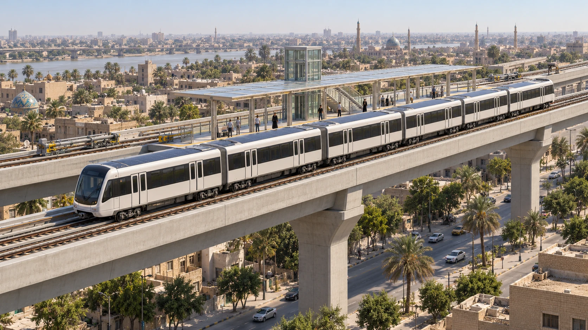
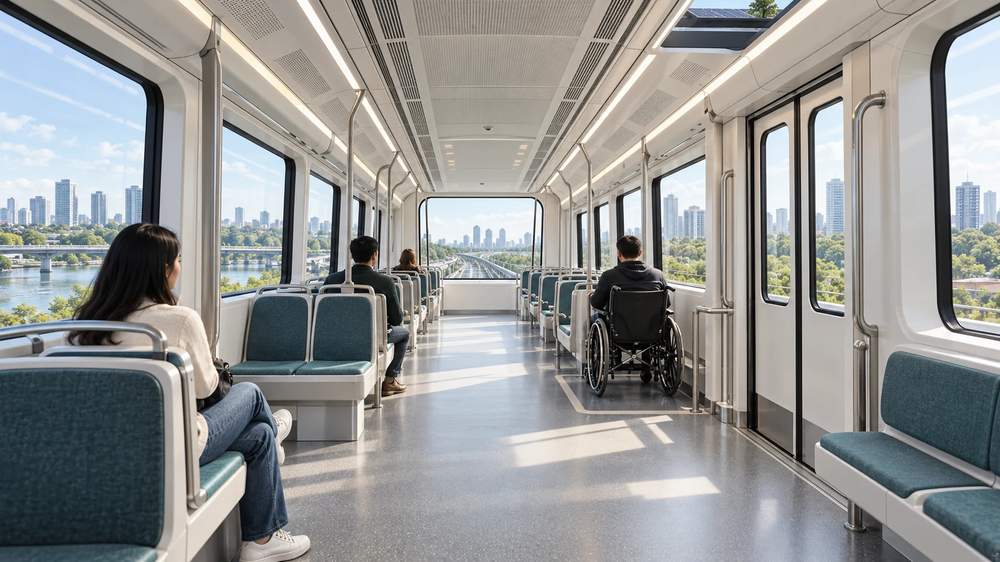
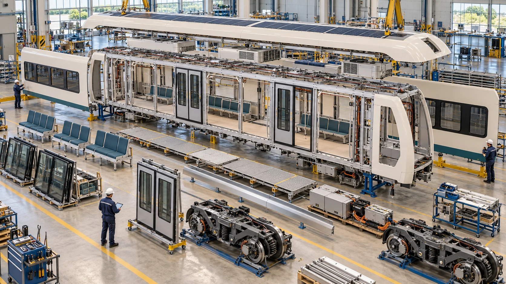
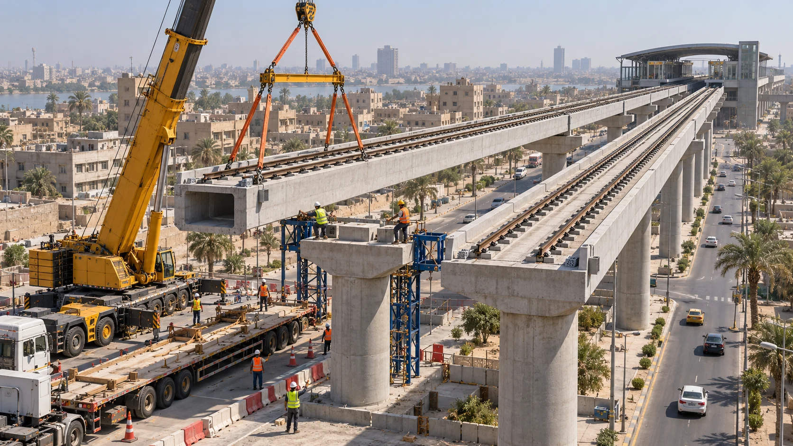
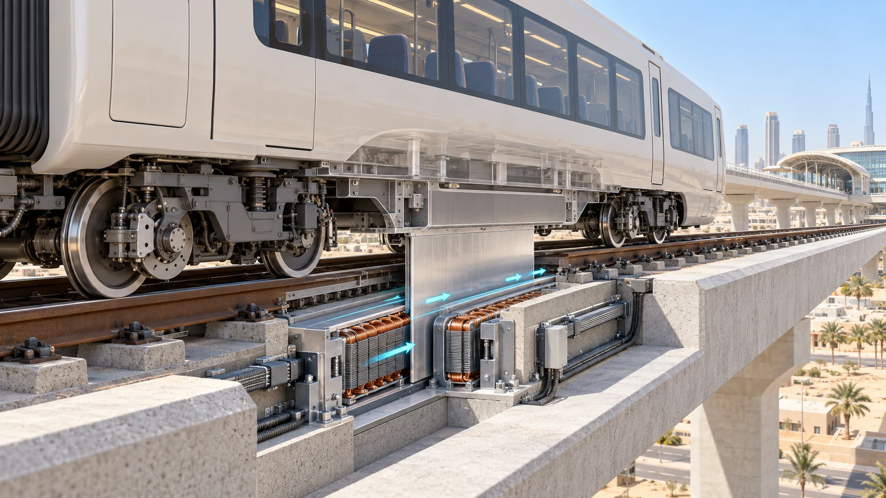
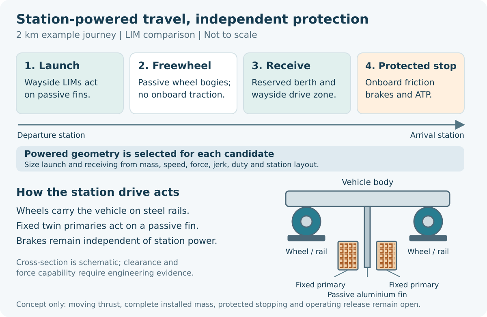

# OpenSourceRail

OpenSourceRail develops affordable urban rail and the open tools needed to **plan, design, procure, manufacture, construct, operate, maintain and renew it**. The aim is to retain design authority, software, fabrication, integration and repair capability in-country, with competitive sourcing of specialist components.

**v0.6 is the station-powered freewheeling reference railway:** lightweight comfort cars run on passive steel-wheel bogies and conventional rails on precast concrete structures. Wayside linear-induction motors launch and receive the train through passive onboard reaction elements. Normal-service traction motors, traction batteries and levitation magnets are absent from the train; passenger services, essential power, protection and independent brakes remain.

The wider project still includes city planning, CAD/BIM, manufacturing, business execution, equipment supervision and open controls. Changing the reference vehicle does not remove that remit. **The railway is a research and prototype design, without manufacturing or operating release.**

**Start here:** [how the whole system works](#from-a-city-brief-to-a-working-railway) · [illustrated reader](OpenSourceRail-Book.pdf) · [project overview](docs/open-source-rail-overview.md) · [current engineering](docs/design-engine/current/README.md) · [sourcing and cost evidence](docs/design-engine/sourcing/README.md) · [city geography](docs/design-engine/current/cities.json) · [roadmap](docs/ROADMAP.md).



*Architectural concept, not approved geometry: six 17 m cars, passive steel-wheel bogies, flush roof solar panels, conventional rails on repeatable precast beams and a compact station. [Inspect the source-bound counted vehicle geometry](docs/design-engine/current/vehicle-overview.svg); that geometry and its retained supplier accounts do not establish a complete installed train or manufacturing release.*

## Why OpenSourceRail

- **Build useful capability locally.** Develop concrete precasting, structural fabrication, GFRP panels, interiors, winding, wiring, assembly, inspection and maintenance alongside the railway. Qualify local suppliers rather than assuming every component can already be made locally.
- **Keep ownership of the design and information.** Open software, drawings, interfaces, component identities and maintenance records let an owner change suppliers and repair equipment without depending on one closed turnkey provider.
- **Simplify the complete installed system.** Compare vehicle mass, bogies, station power, beams, piers, foundations, equipment, factory tooling and erection together. A cheaper train that requires more expensive stations is not automatically a cheaper railway.
- **Serve constrained urban corridors.** Mostly elevated, prefabricated construction and compact stations aim to reduce surface occupation and site disruption. Land, utilities, buildings, ground conditions, drainage, access and evacuation still govern each route.
- **Offer comfortable, frequent travel.** The reference prioritises seated accommodation, wheelchair spaces and a two-minute service target. Capacity, dwell, safe separation, transfers and whole-system cost must be evaluated together.

Local content means **origin-traced domestic value added**, not the address of a distributor. Imported cells, semiconductors, bearings, sensors, materials and machinery retain their actual origin. No local-content percentage or cost saving is established until the installed BOM, processes and supplier evidence support it.

## Three connected products

| Product | Purpose | Present boundary |
|---|---|---|
| Design and delivery tools | City inputs, design alternatives, engineering evidence, quantities, procurement, manufacturing and project records | Current v0.6 Workbench, planning editor, candidate exports and integration components; complete city-specific delivery remains open |
| Reference railway and manufacturing system | Lightweight vehicles, stations, civil works, tooling, assembly and repair methods | v0.6 physical candidates and numerical studies; equipment, drawings, suppliers and physical qualification are incomplete |
| Open GoA4 control software | ATP, interlocking, station-led dispatch, train supervision and fault response | Rust research software, simulation and formal/method checks; no live railway or safety approval |

The [first adoption path](docs/first-adoptable-product.md) is controlled planning, workshop/depot records, training and evidence management. An owner can develop those capabilities before a new train is qualified. The configured business and supervision services have their own permissions and commissioning requirements.


## From a city brief to a working railway

**The intended end-to-end loop is: define the transport need → generate competing designs → calculate and test them → plan their manufacture and construction → estimate complete costs → revise and compare → approve, build and operate.** Every revision should flow through the *same* vehicle, station, civil, factory, service and financial models. A change to a panel, bogie, beam, winding or service assumption must automatically update all affected quantities, analyses, tasks and costs.

| Stage | What the platform should do | Output and next decision |
|---|---|---|
| **1. Define the remit** | Record city geography, passengers, station locations, comfort, speed, climate, accessibility, safety, local manufacturing capability and target cost | One versioned requirements and site scenario; distinguish mandatory requirements from preferences |
| **2. Generate alternatives** | Explore vehicle materials/shapes, structures, bogies, propulsion, stations, beams, foundations and production methods—not just small parameter changes | Several fully identified competing physical candidates |
| **3. Detail and check** | Produce CAD/BIM, part-by-part installed BOM, weight/CG/inertia, joints, service routes and manufacturing interfaces; run structural, motor, braking, thermal and fault models | Explicit pass, fail or missing-evidence records for every candidate |
| **4. Repair and iterate** | On failure, revise geometry, material, component, assembly method or entire architecture; rerun dependent calculations without relaxing safety requirements | New candidate generations with ancestry and Pareto comparisons |
| **5. Calculate build costs** | Derive gross material quantities, labour/process hours, machine time, tooling and QA from each design; use dated rates or declared engineering assumptions even where no quote exists | Low/base/high factory, delivered, installed and whole-life **planning estimates**, with confidence and exclusions |
| **6. Plan production and construction** | Generate EBOM/MBOM, assembly order, precast and vehicle factory throughput, workstations, crews, inspections, haulage, cranes/launchers and site sequence | Capacity, workforce, construction duration and cashflow scenarios |
| **7. Review and execute** | Compare equal-service candidates and independently check the preferred design; prepare procurement, production, project, QA and training records in ERPNext/Frappe HR | Reviewed handoffs; purchasing, fabrication, installation and commissioning require human approval |
| **8. Operate and improve** | Integrate approved equipment, GoA4 protection, FUXA monitoring, maintenance, serial records and actual measured hours/consumption | Real performance and cost evidence fed back into new design revisions |

**This is the target workflow, not a claim that every stage is already commissioned.** The current generator, engineering Workbench, component registry, numerical models and preliminary manufacturing/cost outputs cover much of stages 2–5. City-specific production schedules, complete costed equipment, physical proof, approved business transactions and operating integration remain incomplete. See the [step-by-step cost and delivery implementation plan](docs/design-engine/model-based-cost-and-delivery.md).

A failed design is not the end of the process. The coordinator should diagnose *why* it failed, propose a larger change where necessary, and rerun that candidate through weight, simulation, factory work, construction and whole-life economics. Missing prices can trigger calculated estimate ranges; missing safety-critical physical evidence must still block physical approval.

Candidate completion is reported in three separate levels: **simulation complete** for a named scope with measured or explicitly assumed inputs; **engineering validated** with credible physical evidence and independent review; and **approved for manufacture or operation** under the applicable safety, accessibility and release requirements. A completed provisional cost scenario does not imply an integrated journey simulation, engineering validation or release. The current counts and evidence rules are in the [coordinated railway report](docs/design-engine/coupled-railway/README.md).

The separate [conditional P1 journey study](docs/design-engine/conditional-journey-study/README.md) runs low/base/high assumed force maps through the reduced journey model for the 28 coordinated campaign variants and the exact selected v0.6 vehicle. The selected vehicle keeps its physical identity while its P1 route remains a separate evaluation. These cases are assumption-only; they do not change the coordinated report's count of completed physical journeys.

The [current mesh resource preflight](docs/design-engine/current-mesh-preflight/README.md) compares exact nested directional refinements for one unchanged body/load case. It stops before native deck generation while the available resource boundary is insufficient for another fine solve.

The [selected vehicle mass reserve sensitivity](docs/design-engine/mass-reserve-sensitivity/current/README.md) turns the existing positive mass-account residuals into provisional low/base/high tare scenarios by replacing each residual once. It does not label the vehicle's installed mass complete.


## v0.6 development basis

[development-baseline.toml](engineering/development-baseline.toml) selects one reference vehicle, body, running gear and propulsion configuration. Research alternatives receive separate identities and do not silently replace it.

| Design choice | Reference basis |
|---|---|
| Formation | Six 17 m cars; approximately 104.5 m including gaps |
| Comfort | 44 fixed seats + two wheelchair places/car; 276/train; no planned standing |
| Layout | Four abreast where structure permits, wall benches at doors; two passenger doors on one side |
| Body | Aluminium/GFRP architecture, sandwich floor/roof, lightweight benches and retained glazing |
| Running gear | Twelve unpowered two-axle bogies: 24 axles, 48 wheels |
| Propulsion | Station double-sided LIM reference; passive aluminium secondary on each car |
| Ordinary guideway | Conventional rails and fastenings on precast concrete; box, twin-beam and U-beam comparisons |
| Services | Flush solar roof and a separately sized auxiliary battery; HVAC, doors, ATP and emergency loads remain |
| Automation | Station-led GoA4 architecture, continuous onboard ATP and independent mechanical brakes |
| Network | Passenger transfers between fixed lines; no mainline switches, with depot exceptions explicit |
| Service targets | 72 km/h, 0.4 m/s² acceleration, 0.6 m/s² service deceleration, 35 s dwell, 120 s headway |
| Capacity arithmetic | 8,280 passengers/hour/direction at 30 departures/hour; protected headway remains unqualified |

The normal passenger cap is a comfort and load-management choice; it does not remove crowd, evacuation or accidental-load checks. The retained 160-person/car structural case remains explicit. The earlier 120-person/car, 14,400 passengers/hour/direction comparison is a separate capacity alternative, not this 46-person/car reference. One-sided doors require compatible platforms, accessible boarding and emergency exits.

Loss of station propulsion leaves the vehicle supported on its wheels. Independent braking must remain available, and a train stopped outside a powered zone needs a protected recovery/towing and evacuation arrangement. Walkway removal or a proposed escape device is not treated as approved.

A separate [practical launch comparison](docs/design-engine/practical-launch/README.md) applies the same 1.5 km and 2 km analytical route matrix to 12 station-LIM, wheel, roller, cable and gravity concepts. It exposes required effort, peak mechanical power, route bounds and open force-map, thermal, stopping, recovery, grid and headway evidence; it does not produce a physical journey. The selected wheel/LIM reference remains unchanged.

**The selected v0.6 reference uses passive bogies with station LIM propulsion and no onboard traction motors or traction store.** Its reference dossier retains a 900 m winding allocation per station and direction. The separate [station-accelerator research](docs/design-engine/station-accelerators/README.md) investigates five aligned 20 m banks (100 m active length) as a distinct alternative; that geometry is not the selected reference. In either configuration, available thrust, safe stopping, recovery and installed price remain open.

The 900 m reference and 100 m research geometry require separate force maps, electrical/thermal duty, plant and civil quantities, procurement BOMs and installed costs. Their lengths and results are not combined or transferred between candidates. The five-bank candidate now has [unsent, candidate-bound bank RFQ scope drafts](docs/design-engine/sourcing/rfq-drafts/station-drive-banks-2026-10/README.md) with a common 1.5/2 km duty matrix, sourced local fabrication leads and explicit converter, cooling, protection and installation holds; no supplier response or physical force map has been obtained.

The earlier [powered-bogie and supercapacitor study](docs/design-engine/propulsion-layout/README.md) remains a secondary research comparison. It does not add powered bogies or a traction capacitor bank to the active vehicle proposal.

The current [candidate export manifest](docs/design-engine/current/exports/manifest.json) and [coupled delivery index](docs/design-engine/coupled-railway/delivery-index.json) expose candidate-bound CAD/IFC, engineering BOM, manufacturing, procurement, assembly and controls records. `./osr twin export` inspects these outputs. They do not establish complete installed equipment, a physically supported journey, approved production instructions or operating acceptance. The [cost and delivery model](docs/design-engine/model-based-cost-and-delivery.md) calculates provisional factory, delivery, installation and lifecycle ranges when supplier quotes are unavailable; assumptions, uncertainty and evidence status remain attached.

### v0.6 illustrated: a different approach to building a railway

| Passenger-focused lightweight car | Locally assembled, modular construction concept |
|---|---|
|  |  |
| Seated comfort, level circulation, wheelchair provision and passenger services remain even without onboard traction motors. | Structural shells, window/door modules, service conduits, roof solar, equipment and unpowered bogies are conceived for repeatable offsite assembly and inspection. |
| **Rapidly placed, minimal precast guideway** | **Station-powered LIM interface** |
|  |  |
| Two conventional rails per direction on slender repeatable precast beams, with site access, containment, drainage and erection requirements to be engineered. | Power equipment is beside the track in the launch/receiving approaches; the vehicle carries a passive aluminium secondary and independent friction braking. |



*All five rendered images are concept illustrations; visual attachments, finishes and site arrangements are not qualified CAD or construction details. The drive diagram is an explanatory schematic, not a simulated trajectory. The present reference allocates **900 m of shared winding per station and direction**, covering the calculated launch and receiving zones together, rather than a short motor confined to the passenger platform. This allowance does not establish the powered or coasting distances between stations. A separate five-bank research layout uses five 20 m drive banks (100 m active length); it is not a shortened BOM or a performance variant of the 900 m reference. It requires separate force, electrical/thermal, civil, equipment-quantity and cost calculations, and results do not transfer between the configurations. Actual moving-entry LIM thrust, full vehicle mass, protected stopping, civil structures and whole-life costs remain unverified. [See the current moving-LIM evidence](docs/design-engine/moving-lim-method/README.md) and [candidate-to-journey closure work](docs/design-engine/railway-closure/README.md).*

The [illustration brief](docs/images/v06/README.md) records the supplied prompts, source images and display-copy recipe.

## Delivery records and operations integrations

The v0.6 workflow links candidate revisions to engineering and delivery records. The Workbench exposes current candidate exports and links to the separately configured business and supervision components:

| Capability | Where to inspect it | What remains necessary |
|---|---|---|
| City geography and planning | [266-city geographic register](docs/design-engine/current/cities.json), [editable planning workspace](docs/workbench/planning/index.html) | Survey, demand, grades, route fit and current-family service evaluation |
| Engineering Workbench | `./osr workbench`, [current UI](docs/workbench/current/index.html), [coordinated design experiment](docs/design-engine/coupled-railway/README.md) | Available physical models, complete equipment and independently confirmed designs |
| CAD, BIM and quantities | [Current CAD/IFC and delivery records](docs/design-engine/current/exports/manifest.json), [candidate body-stock IFC packages](docs/design-engine/coupled-railway/delivery-index.json) | Complete installed geometry, tolerances, full civil federation and surveyed interfaces |
| ERPNext and Frappe HR | [Business deployment and integration app](deployment/erpnext/README.md) | Configured legal entities, roles, calendars, masters, reviewed imports and production procedures |
| Equipment supervision | [FUXA/gateway deployment](deployment/supervision/README.md), [integration source](services/integration/osr_integration/) | Authenticated device bindings, current equipment models and deployment-specific commissioning |
| Manufacturing and procurement | [Reference manufacturing/procurement exports](docs/design-engine/current/exports/manifest.json), [coupled EBOM/MBOM and assembly records](docs/design-engine/coupled-railway/README.md#manufacturing-economics-and-evidence) | Supplier configurations, prices, tooling, labour, QA, inspection and release |
| Maintenance and evidence | [ERPNext lifecycle app](deployment/erpnext/apps/osr_erpnext/osr_erpnext/), [FUXA and gateway integration](deployment/supervision/README.md) | Real serials, measurements, approved procedures and independent handback |
| Train protection and supervision | [Rust crates](crates/README.md), [v0.6 control adapter](engineering/station_rail/controls.py) | Physical braking, localisation, timing, hardware and operating assurance |

The ERPNext app provides draft project, procurement, stock, workforce, manufacturing, quality and maintenance workflows when deployed and configured. FUXA and the gateway provide observation, trends, alarms and review-linked lifecycle integration when connected to authenticated equipment. Business case closure, an alarm reset or a completed repair cannot approve manufactured hardware or grant movement authority.

The current v0.6 candidate exports carry candidate-bound CAD/IFC, engineering BOM, manufacturing, procurement, assembly, civil and controls records. They provide scoped research handoffs; unlocated equipment, compatible supplier prices, complete installed quantities and physical acceptance remain open. ERPNext/Frappe HR and FUXA/gateway handoffs use their own configured permissions; generated business records remain disabled drafts until reviewed.

### Candidate delivery records follow the work

```text
transport requirements + city/site inputs
                    ↓
candidate geometry + materials + installed equipment
                    ↓
physics / interfaces / quantities / manufacturing evidence
                    ↓
EBOM + MBOM → suppliers + assembly + inspection tasks
                    ↓
project schedule + resource plan + local/import cash requirements
                    ↓
reviewed business records + serial installation + maintenance history
```

The current v0.6 coordinator binds the selected candidate through engineering, inventory and delivery drafts. Planning handoffs carry route, stop, service and OD proposals only; they are verified with `./osr plan verify`. Candidate-specific construction schedules, complete priced cashflows, approved production data and measured operating records remain open until their inputs are available.

## Manufacturing, civil works and affordability


### Cost a design from its parts and production process

OpenSourceRail calculates provisional prices for panels, chassis members, bogie parts, electrical equipment, LIM banks, precast beams and installation activities even when no finished product or supplier quotation exists. The [candidate-bound cost model](engineering/design_search/model_cost.py) connects [material and supplier evidence](docs/design-engine/sourcing/README.md) to manufacturing, civil, delivery, operations and lifecycle estimates. Each scope records its inputs, assumptions, uncertainty and exclusions.

A simple first estimate is **(gross material quantity × material rate + direct labour hours × hourly wage) × 1.20**. The 20% is a *declared illustrative allowance* for a quick fabrication screen, not an approved market margin. A fuller estimate adds separately counted machine hours, energy, mould/tooling amortisation, consumables, inspection, scrap and rework, with any overhead applied **once** to a stated cost base. Delivery, cranes/erection, foundations, wiring/connection and testing are then added to obtain installed cost; fleet, staffing, electricity, maintenance, replacements and downtime form the whole-life model.

For example, a **GFRP panel** should be priced from ply areas, glass/resin/core quantities, inserts and fasteners, mould preparation, layup/infusion, curing, trimming, assembly and inspection hours. A **20 m precast span** should include concrete, reinforcement, prestress, mould cycles, curing, crew, transport, lifting, bearings, rail equipment, piers and foundations. Changing the part shape, material, section or method should regenerate **both** its cost and its engineering checks.

Cost records need explicit *low/base/high scenarios*, quantities, source dates, currency, locality, labour and yield assumptions, and one of three statuses: **model-cost complete** (internally estimated), **procurement ready** (reviewed real purchasing basis), or **physically accepted** (separate engineering and safety evidence). A Class C estimate is sufficient for provisional economic ranking, **not** for a supplier commitment, a certified design or passenger operation. Missing parts and costs are never silently valued at zero. [See the detailed implementation and regression plan](docs/design-engine/model-based-cost-and-delivery.md).


The manufacturing objective is a repeatable system a local builder can fabricate, assemble, inspect and repair. The design search compares frames, sandwich panels, honeycombs, material arrangements, joints, inserts, floors, roofs and integrated service supports. Joining, fire/thermal behaviour, tooling, access and replacement matter alongside stock mass.

Civil alternatives must include rails and fastenings, beam stiffness and torsion, bearings, piers, foundations, containment, drainage, emergency access, transport and erection. Common precast parts and offsite inspection should reduce site operations; minimum concrete volume alone does not identify the least-cost structure.

The economic comparison covers **rolling stock + guideway + stations and power + factories and construction + energy + maintenance and renewals + service availability**. Passenger capacity, headway, fleet size and travel time belong in the same comparison. Local/foreign-currency procurement and financing sensitivity matter, but financing terms are separate from physical resource cost.

The current model-cost scenarios support preliminary comparison with declared assumptions. Compatible supplier prices, complete factory-to-installed costs and equal-service whole-life superiority remain open.

## Current engineering and the next working-system milestone

The [current dossier](docs/design-engine/current/README.md) records the selected
candidate and its evidence. The [coordinated railway campaign](docs/design-engine/coupled-railway/README.md)
passes one candidate identity through geometry, mass, analysis, delivery and
costing. A research scenario may use explicit assumptions to complete a
calculation; physical validation and release remain separate gates.

| Workstream | Current capability | Open evidence |
|---|---|---|
| Candidate design | Composable body and system alternatives with ancestry and candidate-bound downstream evaluations | Broader validated evaluators and independently confirmed Pareto selections |
| Installed inventory | Component identities, geometry-linked stock and explicit mass reserves | Located equipment, complete installed mass, centre of gravity, inertia and interfaces |
| Propulsion and journey | Candidate-specific LIM, braking, electrical and conditional journey calculations | Available motor force and thermal maps, validated stopping and a physically supported protected journey |
| Production and civil works | Candidate CAD/IFC, BOM, process, assembly, procurement and provisional construction quantities | Complete installation scope, site data, qualified processes and supplier evidence |
| Cost and service | Provisional low/base/high factory-to-installed and lifecycle estimates | Complete quantities, compatible prices, operating performance and independently reviewed equal-service comparison |
| Business and supervision | Candidate-linked draft ERPNext/Frappe HR and FUXA/gateway handoffs | Configured organisations, reviewed records, authenticated devices and commissioned procedures |
| Verification | Source-bound publications, independent numerical checks and software workflows | Prototype correlation and physical engineering, manufacturing and operating acceptance |

Current cost scenarios use two 8-hour production shifts and two 8-hour civil
shifts. Operating costs cover two shifts for 16/18-hour service and a three-shift
24-hour case. These staffing and shift premiums are planning assumptions, not an
approved local roster.

The highest-return next milestone is one automatically completed and internally
costed candidate with a complete accounting structure, visible assumptions,
manufacturing routes, installed-cost coverage and a specific list of physical
validation work. The current software can calculate provisional costs without
waiting for supplier quotations; it must continue to show which values are
assumed, sourced or supplier-confirmed.

## Cities, service and deployment

All **266 city geographies** remain available as planning inputs, including maps, route proposals and stops. **v0.6 city performance regeneration is held** until candidate-specific drive, braking, complete vehicle, civil and economic evidence is sufficient.

Each corridor still needs its own demand, terrain, climate, geotechnical, utility, accessibility, transfer, power, rescue and procurement assessment. A common vehicle and precast family can reduce manufacturing complexity without proving that every city needs the same formation or service pattern.

The [planning workspace](docs/workbench/planning/index.html) supports local geographic, stop, service and OD proposals. `./osr plan compile edits.json --output build/my-plan` creates an immutable handoff bound to the selected v0.6 candidate; verify it with `./osr plan verify build/my-plan`. The handoff contains proposals only. Route performance, procurement quantities, construction schedules and full city costs remain held until candidate-specific evidence exists. Planning revisions do not grant movement authority.

## Run and reproduce

```bash
./install.sh
./osr status
./osr readiness
./osr workbench
./osr plan --help
./osr design railway plan
./osr design railway run --max-bundles 2 --native-jobs 1
./osr design railway publish
./osr design railway verify
./osr build
./osr verify
./osr book --check
./osr test
./osr sim baghdad
```

The coordinated run is bounded and restartable; it preserves pending work and failed executions. Native FEM/CAD workers need the relevant installed tools and declared resources. `./osr sim baghdad` reports the current city-evaluation hold. `./osr build` refreshes the current source-bound dossier, delivery drafts, Workbench and reader. The local review UI has no live train-control authority.

## Find your way

| I want to… | Start here |
|---|---|
| Understand the whole project | [Overview](docs/open-source-rail-overview.md), [architecture](docs/ARCHITECTURE.md), [first adoption path](docs/first-adoptable-product.md) |
| Review the selected train and open engineering | [Current dossier](docs/design-engine/current/README.md), [implementation](engineering/station_rail/README.md), [roadmap](docs/ROADMAP.md) |
| Generate and compare new designs | [Coupled experiment](docs/design-engine/coupled-railway/README.md), [design engine](engineering/design_search/README.md) |
| Inspect city geography or planning proposals | [Current city register](docs/design-engine/current/cities.json), [city catalogue](cities/catalogue/README.md), [planning UI](docs/workbench/planning/index.html) |
| Review CAD, BIM, BOM and manufacturing | [Reference exports](docs/design-engine/current/exports/manifest.json), [candidate delivery packages](docs/design-engine/coupled-railway/delivery-index.json) |
| Follow the end-to-end workflow and calculated costing | [Workflow above](#from-a-city-brief-to-a-working-railway), [cost formula above](#cost-a-design-from-its-parts-and-production-process), [implementation plan](docs/design-engine/model-based-cost-and-delivery.md) |
| Inspect current candidate delivery exports | [Current export manifest](docs/design-engine/current/exports/manifest.json), [candidate delivery packages](docs/design-engine/coupled-railway/delivery-index.json), `./osr twin export` |
| Configure business and people workflows | [ERPNext/Frappe HR deployment](deployment/erpnext/README.md) |
| Inspect supervision and maintenance integration | [FUXA/gateway deployment](deployment/supervision/README.md), [ERPNext lifecycle app](deployment/erpnext/apps/osr_erpnext/osr_erpnext/) |
| Work on controls or electronics | [Rust packages](crates/README.md), [v0.6 interfaces](engineering/station_rail/controls.py), [retained electronics research](control-electronics/README.md) |
| Set up tools or contribute | [Tools](tools/README.md), [CONTRIBUTING](CONTRIBUTING.md), [GOVERNANCE](GOVERNANCE.md), [project instructions](AGENTS.md) |

## About the author

**Hayder Aziz** initiated OpenSourceRail. His published work on engineering design systems dates back more than 20 years. Beginning in the early 2000s, he researched how product data management, manufacturing knowledge, open standards and collaborative software could be joined into a coherent design process, enabling engineering teams to assess manufacturability and exchange design knowledge from the conceptual stage rather than treating design and production as separate activities.

Among his research publications are *[New Technologies and Standards for Design Knowledge Management in Collaborative Conceptual Design](https://researchportal.northumbria.ac.uk/en/publications/new-technologies-and-standards-for-design-knowledge-management-in)* (2003, with James Gao, Paul Maropoulos and Wai Ming Cheung), *[Open standard, open source and peer-to-peer tools and methods for collaborative product development](https://gala.gre.ac.uk/id/eprint/17781/)* (2005, *Computers in Industry*), and *[Engineering design knowledge management in de-centralised virtual enterprises](https://gala.gre.ac.uk/id/eprint/2623/)* (2008, *Computer-Aided Design and Applications*). These works investigated reusable engineering knowledge, distributed product-development systems and the integration and automation of design-related workflows.

OpenSourceRail carries that research direction into an ambitious open transport-system project. The aim is to connect requirements, alternative generation, material selection, CAD/BIM, weight and cost calculations, supplier evidence, assembly methods, operational simulation and safety analysis in a traceable toolchain. This is the project's design philosophy and research ambition; the current railway candidates remain in development, without completed physical validation or certification for passenger operation.

## Sources, revisions and contributions

| Concern | Source to change |
|---|---|
| Selected v0.6 requirements and assembly | [Development selector](engineering/development-baseline.toml), [station-rail inputs and generators](engineering/station_rail/README.md) |
| Functional remit, design grammar and campaign budgets | [Design-search source](engineering/design_search/), [campaign definitions](campaigns/) |
| City inputs and geographic proposals | Each city's `city.json` under [cities/catalogue/](cities/catalogue/); current service outputs remain held |
| Controls and simulation behaviour | [Rust crates](crates/), their tests and candidate-specific physical adapters |
| Business and equipment integration | [ERPNext app](deployment/erpnext/), [supervision deployment](deployment/supervision/), [integration service](services/integration/osr_integration/) |
| System boundaries and remaining work | [Architecture](docs/ARCHITECTURE.md), [roadmap](docs/ROADMAP.md), [engineering instructions](AGENTS.md) |

Regenerate derived artifacts from their current sources. Physical candidate, evaluation and selection identities are distinct; a source hash identifies bytes and does not approve engineering. `./osr verify` checks the current source-bound publication, and `./osr twin export` verifies the selected candidate's delivery exports. Neither command grants engineering, manufacturing or operating acceptance.

Contributions can improve supplier/material evidence, structural and motor models, complete equipment, manufacturing and repair methods, city data, controls, tests and documentation. Follow [CONTRIBUTING.md](CONTRIBUTING.md) and [GOVERNANCE.md](GOVERNANCE.md). The [documentation index](docs/INDEX.md) is a search aid; it is not another engineering authority.

Software uses **Apache 2.0**, open physical designs use **CERN-OHL-S v2**, and documentation uses **CC-BY-SA 4.0**, subject to more-specific and upstream notices. See [LICENSE.md](LICENSE.md) and [LICENSES/](LICENSES/README.md).
