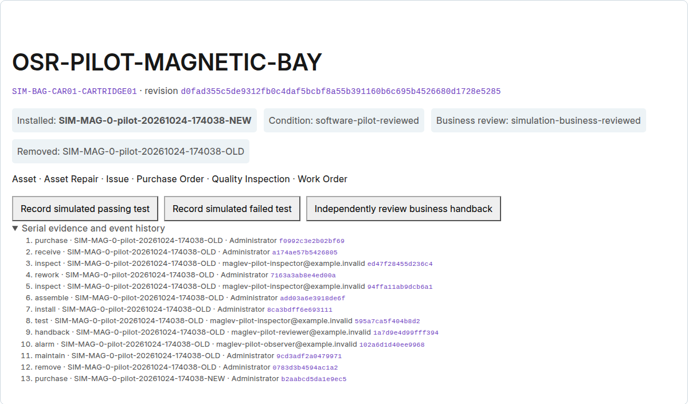

# OpenSourceRail

OpenSourceRail helps a city **plan, price, build, operate and maintain an urban railway with local industry**. It brings together three products that railway owners usually encounter separately. Planners get an open design and delivery platform. Manufacturers get railway hardware designs, drawings and production records. Operators get train and wayside software with links to the people, parts and inspections that keep a service running. A city or workshop can use any of the three and follow the assumptions behind its results. [How the three products fit together](docs/book/47-three-products.md)

**[Download the interactive workshop](https://raw.githubusercontent.com/modernecotech/OpenSourceRail/main/docs/operator-review/OpenSourceRail-Operator-Kit.zip)** · **[Read the illustrated project book](OpenSourceRail-Book.pdf)** · **[Browse the city catalogue](cities/catalogue/README.md)** · **[Install the Workbench](#run-the-workbench)**

| Plan a passenger railway | Inspect what needs building |
|---|---|
| [](docs/operator-review/screens/route-inspector.png) | [](docs/operator-review/twins/baghdad-station.png) |
| Select a line in Samawah to see its stops, journey time and fleet. | Orbit a typical Baghdad first-programme station and inspect the train, platform and supports together. |

**Project status.** [v0.7.2](docs/releases/v0.7.2/README.md) is the published software release. It includes a reproducible opening study and enquiry dossier. Development on `main` adds a corrected route study, moving-train power and service calculations, and factory and procurement tools. The earlier prototype packages cover the car, powered bogie, viaduct, station, power and controls, and local production. Use the corrected enquiry for current Airport quantities. **v0.8 production preparation remains open.** The packages identify what can be priced today and which interfaces still need supplier data, measurements or independent review. [Current decision results](cities/Baghdad/engineering/simulation/AUDIT-RESULTS.md) · [Readiness by package](cities/Baghdad/engineering/prototype/PRODUCTION-READINESS.md)

## Choose a starting point

| If you are here to… | Start with… |
|---|---|
| Explore the project for the first time | Extract the **interactive workshop** linked above and open **START.html** in a browser. Try a route, a train model and a funding case. The [illustrated operator brief](docs/operator-review/OpenSourceRail-Operator-Brief.pdf) works for a meeting or printed handout. |
| Plan a service or compare cities | [Maps and passenger journeys](#maps-and-passenger-journeys) and [timetables and train motion](#timetables-and-train-motion) |
| Design a train, station or viaduct | [Vehicles, stations and civil engineering](#vehicles-stations-and-civil-engineering) and [how to read an engineering result](#how-to-read-an-engineering-result) |
| Equip a factory, train a team or quote for work | [Manufacturing and training](#manufacturing-and-training) and [purchasing and whole-life cost](#purchasing-and-whole-life-cost) |
| Operate trains or maintain assets | [Train control, supervision and maintenance](#train-control-supervision-and-maintenance) |
| Run, extend or reproduce the software | [Run the Workbench](#run-the-workbench), [find the right files](#find-the-right-files) and [contribute](#contribute-and-reuse) |

## Maps and passenger journeys

Start with a trip people need to make. In the city Workbench, select a line, choose two stations and inspect access, expected waiting, time on board and transfers. The 266 city entries are planning outlines. City teams can replace provisional geometry and demand with local evidence. In the Samawah exercise, merge two nearby station markers and inspect the changed walking access and station count. For GIS work, take the route into RustGIS and bring the edited plan back through the planning workflow. [Planning guide](docs/workbench/planning/README.md) · [Samawah worked exercise](docs/book/38-samawah-practice.md) · [GIS import and export](docs/gis/README.md)

| Edit a plan | Read the journey as a passenger |
|---|---|
| [](docs/book/images/gui-samawah-merge.png) | [](docs/operator-review/screens/passenger-journey.png) |
| Compare route edits before adopting a revised plan. | The original Samawah example gives 10.7 minutes for the selected journey under its published assumptions. |

For a different planning question, compare how Amman’s terrain and Karachi’s network scale affect route choices, or how a team in Cuenca might choose its first corridor. Each city example identifies the geography and passenger information needed to improve the outline. [Amman and Karachi](docs/book/53-amman-karachi.md) · [Nairobi and Lusaka](docs/book/54-nairobi-lusaka.md) · [Cuenca and San Salvador](docs/book/55-cuenca-san-salvador.md)

## Timetables and train motion

A line on a map still needs a train that can reach each stop, turn around and start its next trip. Follow an individual working through its outward and return calls. Inspect the time reserved at the terminal and the interval available between successive trains. In the coupled operating study, changes in waiting and riding time affect requested journeys. The simulation records which booked trips finish under the selected service, motion and supply assumptions. [Train diagrams and outstanding connections](cities/Baghdad/SERVICE-DIAGRAMS.md) · [Route, demand and service inputs](cities/Baghdad/engineering/simulation/ALIGNMENT-DEMAND.md)

| Follow one train through its day | Compare how a train moves |
|---|---|
| [](docs/operator-review/screens/baghdad-service.png) | [](docs/operator-review/screens/train-movement.png) |
| The metropolitan timetable shows the Airport-001 working and flags a separation shortfall under its assumed signalling arrangement. | A separate 1.5 km research exercise compares cable launch and powered wheels on the same leg. Its assumed forces and stopping cases are available for inspection. |

## Vehicles, stations and civil engineering

Open the digital twin, choose an assembly and select a part. A station reviewer can inspect the boarding face, opposite-side doors, collector position and electrical cabinet envelopes. A fabricator can switch to **Frame quotation** to identify individual pieces of steel. IFC downloads let another team open the straight-station assemblies in its own viewer. The register identifies which train, revision and quantity schedule belongs with each model. [Model viewer guide and IFC downloads](docs/operator-review/twins/README.md) · [Engineering models and drawings](docs/engineering-models/README.md)

| Identify the parts to fabricate | Inspect the boarding interface |
|---|---|
| [](docs/operator-review/twins/baghdad-steel-frame.png) | [](docs/operator-review/twins/baghdad-boarding.png) |
| This quotation model contains 128 pieces and about 5.2 tonnes of cut stock. Wheelsets, drives, connections and fitout have their own take-offs. | The model locates the train at a typical straight island. Installed clearances require the vehicle movement and platform tolerances for the actual site. |

The fitted-train exercise connects seating, wheelchair places, door approaches and installed mass allocations to axle loads, traction and stopping. The civil comparison follows a change of span through beams, bearings, foundations, transport, lifting at working radius and upkeep. A price advantage can tell a precaster which option is worth quoting. A lift still needs the equipment chart and ground support for the proposed site. [Fitted-train exercise](cities/Baghdad/engineering/simulation/ASSUMPTION-AUDIT.md#compare-a-fitted-train-on-the-same-railway) · [Span and erection alternatives](cities/Baghdad/engineering/mechanical/civil/SPAN-FAMILIES.md) · [Design decision register](docs/DESIGN-DECISIONS.md)

## Manufacturing and training

Follow a component from the drawing and bill of materials through stock preparation, cutting, assembly, inspection and removal for repair. The factory specification identifies machines, tooling, workstations and quantities for the prototype packages. The CAM material includes plate profiles, nesting, stock cuts and a practice machining job. A shop can use these to estimate hours and fixtures, then return its own machine limits, process review and trial results. [Factory specification](cities/Baghdad/engineering/prototype/FACTORY-SPECIFICATION.md) · [CAD and CAM handoff](cities/Baghdad/engineering/prototype/cam/CAM.md) · [CamCraft and FreeCAD comparison](cities/Baghdad/engineering/simulation/CAM-COMPARISON.md)

| Inspect a serviceable mechanism | Lay out the factory |
|---|---|
| [](docs/operator-review/screens/door-workshop.png) | [](docs/operator-review/delivery/vehicle-works.svg) |
| The Samawah door exercise follows the running guide through manufacture, inspection and removal. | The vehicle-works drawing lets a bidder trace material flow from receiving through assembly to the formation road. |

For a team session, assign buyer, technician, fabricator, precast planner, electrical integrator or maintenance roles. Use the offline exercise to pass a part and its evidence from one role to the next. Try doubling mould occupancy from 24 to 48 hours while holding output at eight beams a day. The required mould positions rise from eight to sixteen. Workshops can replace that assumption with timed production evidence. [Instructor guide and handover exercises](cities/Baghdad/engineering/prototype/training/INSTRUCTOR.md) · [Factory, yard and staffing layouts](docs/operator-review/delivery/README.md)

## Purchasing and whole-life cost

Give competing suppliers the same drawing revision, quantities, fault cases and maintenance period. Compare price, exclusions, lead time, local work and renewals before recording an award. In the finance workshop, choose a funding term and inspect annual construction draws, operating costs, fares, debt service and replacements. The staffing worksheet lets an operator change coverage, pay and headcount and pass the revised operating cost into the funding calculation. [Supplier enquiry guide and downloads](cities/Baghdad/engineering/simulation/audit-production-guide.md) · [Funding and fares workbook](docs/operator-review/finance/README.md) · [Iraqi capital price basis](cities/Baghdad/IRAQ-CAPITAL.md)

| Compare two supplier returns | Find the years the owner needs cash |
|---|---|
| [](docs/operator-review/finance/supplier-returns.png) | [](docs/operator-review/finance/baghdad-funding.png) |
| The worked offers are hypothetical. The buyer can inspect scope and enter supplier terms for the enquiry. | Change fares or financing and inspect the effect on public funding through construction and operation. |

| Plan the construction yard | Staff the service you intend to run |
|---|---|
| [](docs/operator-review/delivery/precast-yard.svg) | [](docs/operator-review/delivery/workforce.png) |
| Use the dimensioned yard layout to price land, lifting equipment and storage for beams awaiting erection. | Edit the staffing case before carrying its annual operating budget into the funding worksheet. |

## Train control, supervision and maintenance

The Rust software covers automatic train protection, train management and door control. The station bench exercises arrival, boarding-side permission, holding brake feedback and departure. Try the supervision replay in the offline kit. Step through **Section trips**, **Section signal stale** and **Signal restored and trip cleared** to see why an operator needs both alarm state and reading age. The deployment guides describe the gateway and FUXA supervision setup and the ERPNext and Frappe HR connections for purchasing, staffing, serialised parts and maintenance. [Rust software](crates/README.md) · [Station bench procedure](cities/Baghdad/engineering/controls/STATION-BENCH.md) · [Gateway and FUXA](deployment/supervision/README.md) · [ERPNext and HR](deployment/erpnext/README.md)

| Respond to an equipment alarm | Trace an installed part |
|---|---|
| [](docs/operator-review/screens/section-alarm.png) | [](docs/operator-review/screens/erp-serial-history.png) |
| In the simulated incident the trip stays active while the reading is stale. A fresh clear reading changes its state. | The ERPNext pilot shows how a maintainer can trace a replacement through serial records and work orders. |

## How to read an engineering result

The design engine lets engineers change a body structure or propulsion arrangement and trace which results need recalculating. A change in stock or material alters the mass and axle loads that travel into motion, braking, civil, production and cost calculations. Each evaluation records its assumptions and checks. The results distinguish a design worth another experiment, an option ready for a budgetary quotation and a design with evidence for its intended use. [Coordinated design search](docs/design-engine/coupled-railway/README.md) · [Capability and evidence guide](docs/capabilities/README.md)

Every comparison needs an identifiable route, vehicle, service and price boundary. Baghdad’s elevated, zero-tunnel studies examine catenary-free supply. Span, propulsion, train length and frequency remain choices to test against demand, accessibility, protection, local manufacturing and whole-life cost. A published drawing, a numerical screen, a supplier return and a measured first article answer different questions.

The Airport study illustrates how to read a result. The release’s 12 km schematic was shorter than the 15.09 km geographic minimum through five named places. The revised 17.46 km horizontal study contains 10.74 km of proposed connections and still needs a survey. On the paired supply the 30-minute service completes **72 of 72** booked trips. The 15-minute service completes **103 of 144**. The review shows the limiting cases, including traction-force and emergency-energy shortfalls, alongside what a supplier can price. The [citywide investment proposal](cities/Baghdad/README.md) has separate routes and finances. [Operating results and outstanding evidence](cities/Baghdad/engineering/simulation/AUDIT-RESULTS.md)

Two further references support development. The [synthetic digital corridor](docs/reference-v07/README.md) provides a repeatable software and design comparison. The [development vehicle selector](engineering/development-baseline.toml) describes a six-car passive-wheel research vehicle with 44 seats and two wheelchair places per car. Its engineering record carries its own load cases, equipment and service assumptions. [Current engineering record](docs/design-engine/current/README.md)

## Run the Workbench

From a full Linux checkout, install the tools and start the local Workbench. Open `http://127.0.0.1:8090` in your browser. [Installation options](tools/README.md) · [Workbench walkthrough](docs/book/44-workbench-journey.md)

```sh
./install.sh
./osr workbench
```

To reproduce the corrected operating and purchasing case, run the audit from the repository root. The second command writes a supplier enquiry ZIP for the six-site paired supply layout. [Audit inputs, commands and packet contents](cities/Baghdad/engineering/simulation/ASSUMPTION-AUDIT.md)

```sh
./osr design railway audit --check
./osr design railway audit --layout paired6 --packet build/supplier-enquiry.zip
```

Use `./osr status` and `./osr readiness` to inspect the development reference. Run `./osr build` and `./osr test` to regenerate and verify its development outputs. The [system architecture](docs/ARCHITECTURE.md) and [documentation index](docs/INDEX.md) link to the underlying modules.

## Find the right files

| Location | Responsibility |
|---|---|
| [cities/](cities) | City inputs, maps, service studies, local prices and enquiries. Baghdad's maintained engineering and simulation work lives with its city design. |
| [engineering/](engineering/README.md) and [campaigns/](campaigns) | Shared design, numerical evaluation, evidence and reproducible research configurations. The physical design, calculation revision and selection decision have separate identities. |
| [crates/](crates/README.md), [control-electronics/](control-electronics/README.md), [services/](services) and [deployment/](deployment/README.md) | Railway software, device interfaces, services and deployment adapters. |
| [docs/](docs/README.md), [tools/](tools/README.md) and [tests/](tests) | Guides, Workbench, published drawings and packages, build tools and regression checks. [Archive index and exact historical editions](docs/archives/README.md) |

Historical editions preserve the [conventional rail](https://github.com/modernecotech/OpenSourceRail/tree/v0.4.0), [maglev](https://github.com/modernecotech/OpenSourceRail/tree/v0.5.1) and [station-powered vehicle studies](docs/design-engine/v06-design-closure/README.md). Earlier work also documented [standards and evidence traceability](https://github.com/modernecotech/OpenSourceRail/blob/298d4e15fbcbcd923d7fcf7e519ebc4915ef7e1b/docs/certification/digital-standards-adherence.md) and [human-attested administrative proposals](https://github.com/modernecotech/OpenSourceRail/blob/898eab2b57a739863a542cb13e7de70f47dfd9e5/README.md#step-by-step-use-cases).

## Contribute and reuse

City teams can contribute surveyed stops and counts, workshops can return itemised offers and first-article measurements, and operators can supply observed service and maintenance data. Include the design revision, units, source, date and scope so the next team can check the result. Hayder Aziz initiated OpenSourceRail to keep design knowledge, manufacturing capability and repair skills accessible to railway owners and their local suppliers. [Contributing](CONTRIBUTING.md) · [Governance](GOVERNANCE.md) · [Engineering workflow](AGENTS.md) · [Research background](https://gala.gre.ac.uk/id/eprint/17781/)

Software uses **Apache 2.0**, hardware designs use **CERN-OHL-S v2**, and documentation uses **CC-BY-SA 4.0**. File-specific and upstream notices take precedence. [Licensing and notices](LICENSE.md)
