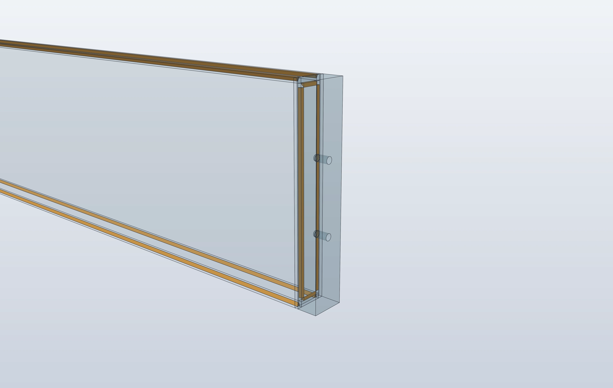

# OpenSourceRail

OpenSourceRail develops affordable urban rail that local companies can design, build and maintain. It brings the route plan, railway hardware, control software and workshop records together. A city can use the open design to buy a railway, build up domestic manufacturing, or obtain better prices and repair rights from an established supplier. Safe operation, accessible travel and passenger protection are requirements throughout.

**Start with the journeys the city needs to serve.** Map two possible alignments, enter the passenger demand and maximum wait, and compare what each would take to build and operate. Train length, supply equipment and pier spacing are decisions for that corridor. [Plan a corridor](docs/workbench/planning/README.md) · [Review the design choices](docs/DESIGN-DECISIONS.md) · [Open the Workbench](docs/workbench/current/index.html)


## What OpenSourceRail provides

| Connected product | What a railway team can do with it |
|---|---|
| Design and delivery platform | Place a corridor and stops on a city map. Set the service, follow the effects on fleet, power and construction quantities, and compare whole-life costs. Exchange geometry and quantities with designers and purchasing teams. |
| Reference railway and manufacturing system | Inspect full-size train, station and viaduct models. Break a design into purchased parts, locally made parts, assembly operations and inspections. Price the jigs, test equipment, erection resources and spares needed alongside the railway. |
| Open train and wayside control software | Exercise movement protection, doors, brake holding and dispatch against simulated train and station inputs. Trace the equipment and software involved in a fault. Give operators, suppliers and maintainers a shared interface to demonstrate. |

A design revision follows the work. Changing a bogie or adding a station can affect the train mass, beam loading, timetable and budget. The project associates each drawing and quantity schedule with its physical design, records the assumptions used to evaluate it and identifies the option selected for pricing. A workshop can trace its part back to the drawing revision. An owner can see whether a cost covers installed equipment, a stock subtotal or an allowance awaiting a supplier. [Delivery platform](docs/capabilities/README.md) · [System architecture](docs/ARCHITECTURE.md)

## From a city brief to a working railway

A city can start with two possible corridors and a question about whom they would serve. A depot can start with one troublesome door and a question about whether it can repair the unit locally. Both need the same thread of information between the decision, the drawing, the price and the evidence from the installed equipment.

| Stage | What the team does | What the next team receives |
|---|---|---|
| 1. Write the brief | Map homes, jobs, barriers and transfers. Set normal passenger capacity, journey time, access requirements, climate and service hours. | A dated brief with sources, survey gaps and criteria for comparing routes. |
| 2. Compare alternatives | Vary stops, formation, frequency, traction supply or construction method against the same passenger requirement. | Identified alternatives with journey, fleet and infrastructure consequences. |
| 3. Detail the interfaces | Locate equipment in the vehicle and station. Check wheel loads, braking, platform gaps, feeder demand and maintenance access. | Drawings, quantities and results tied to one design, including the conditions that failed. |
| 4. Revise a design | For example, add a liner to a door opening, then check the clear width, stock, mass and work required to fit it. | A new revision and the reason for it. The earlier drawing remains available to its users. |
| 5. Price the work | Extend stock quantities and process hours at dated rates. Identify tooling, imported equipment, uncertainty and overlapping allowances. | A buyer estimate and comparable enquiries for independent suppliers. |
| 6. Schedule delivery | Match mould and workshop capacity to haulage, lifting windows, installation, inspection and staff training. | A programme with resource needs, opening phases and cash requirements. |
| 7. Procure and commission | Review the offers, inspect first articles and record who witnessed each test against which drawing. | Reviewed orders, serial or batch records, installation positions and acceptance decisions. |
| 8. Operate and learn | Connect a fault to its asset, repair, functional test and authorised handback. Compare actual labour and consumption with the estimate. | A maintenance history and measured inputs for the next design or procurement round. |

## Plan a corridor passengers can use

The planning tools cover 266 cities. Check where passengers can enter a station on foot, which transfers they can make, and how queues and accessible boarding change the dwell. In the Samawah example, merging two nearby map markers changes the access calculation while leaving the number of operating stations unchanged. The editable RustGIS project records the geometry, author and reason for each change. [City catalogue](cities/catalogue/README.md) · [GIS editing guide](docs/gis/README.md) · [Samawah worked example](docs/book/38-samawah-practice.md)

## Inside the train and station

Choose formation and frequency together. A shorter train can serve the same hourly demand with more departures if the blocks, platforms, traction supply and turnbacks can handle them. Price both offers at the waiting time, peak load and spare cover the operator can accept. The installed-car account includes passengers, doors, brakes, wheelsets, cabling and cooling. Weighing and locating that equipment determines what each axle, bearing and beam must carry. [Train and station models](docs/operator-review/twins/README.md) · [Installed equipment and fits](cities/Baghdad/engineering/prototype/fitout-guide.md)

## Viaducts, construction and traction power

Choose a span together with its section, tendons, pier layout and erection method. At 20 m spacing a double-track tangent needs about 100 independent support positions per kilometre, or about 50 if the two tracks share crossheads, before end effects and station exceptions. A shared crosshead carries a different load and needs its own footing. A shorter beam is easier to move through a constrained street. Longer spans can repay more expensive lifts by clearing utilities, avoiding foundations and reducing future bearing changes. [Span families and installed-cost comparisons](cities/Baghdad/engineering/mechanical/civil/SPAN-FAMILIES.md) · [Shared civil engineering studies](docs/design-engine/viaduct-backends/README.md)

For power, compare the full vehicle and wayside package under the same timetable, temperature and outages. A battery needs replacement and rescue provision. A protected conductor needs isolation, current return and a safe evacuation route. A train that stays in the depot can give excellent collector voltages on the rest of the line. Read the completed passenger journeys together with the electrical results. [Supply and service study](cities/Baghdad/engineering/simulation/MOTION-POWER.md)

## From factory floor to finished corridor

A fabricator can follow a drawing through the stock order, cutting layout, jig, joining sequence and inspection. A precaster needs mould occupancy, curing conditions, yard space, haulage and a lifting window. The manufacturing records include machine quantities, shop rates, supplier returns and exercises for operators. The installation programme tests late material, reduced capacity and a rejected first article. [Factory and workforce guide](docs/operator-review/delivery/README.md) · [Machines and costs](cities/Baghdad/engineering/prototype/SHOP-COSTS.md) · [Workshop training](cities/Baghdad/engineering/prototype/training/INSTRUCTOR.md)

### Build up a price from the drawing

Price the stock purchased, yield, shop hours, consumables, fixtures, first-off inspection, installation and maintenance. Credit work already included in a fleet or civil contract before adding an offer to the project budget. Give competing suppliers the same item revision, quantity, period and delivery boundary. [Machine quotation and ERP procedure](cities/Baghdad/engineering/prototype/PROCUREMENT-PLAN.md) · [CAM tools tested on the same part](cities/Baghdad/engineering/simulation/CAM-COMPARISON.md)

## Run the service and protect the passenger

Follow a train from the depot through a full day of station calls, turnbacks and its return to stabling. During boarding the software checks the berth, permitted door side, traction inhibition and independent brake hold. The station replay exercises the handover back to traction and failures such as stale signals and lost brake feedback. Equipment trials must demonstrate those handovers with the real doors, drives, brake actuators and sensors. [Timetable and terminal studies](cities/Baghdad/CITYWIDE-SERVICE.md) · [Station bench procedure](cities/Baghdad/engineering/controls/STATION-BENCH.md)

## Purchasing, maintenance and renewal

ERPNext links the quoted revision, order, serial, inventory, inspection and repair. Frappe HR records the people and competencies required for the work. Equipment observations pass through the gateway to FUXA for supervision. A repair ends with a functional check and an authorised handback. The repository includes a software rehearsal of that lifecycle and draft procurement records for the powered-wheel railway. Local operators supply their site masters, actual prices, equipment and authorities. [ERPNext and HR](deployment/erpnext/README.md) · [Gateway and FUXA](deployment/supervision/README.md) · [Operator workflow](docs/operator-review/delivery/README.md)

## People, fares and the public budget

Compare annual cash as the line opens in phases. Include staff, debt service, energy, service interruptions, spare parts and scheduled renewals. Record who pays, how many paid journeys the service carries and how much of a locally awarded contract pays for domestic work. Supplier invoices, payroll and subcontract declarations establish domestic value. [Finance and fare models](docs/operator-review/finance/README.md) · [Matched-bid terms](cities/Baghdad/BUYER-COMPARISON.md) · [Historical local-industry example](https://github.com/modernecotech/OpenSourceRail/blob/898eab2b57a739863a542cb13e7de70f47dfd9e5/README.md#the-economic-case)

## The current designs

| Use a worked case to… | Where to go |
|---|---|
| Reproduce the same drawings, BOM and cost calculation after a software change | [Synthetic 30 km digital reference](docs/reference-v07/README.md) |
| Trace service, train, supply and civil quantities into a supplier enquiry and factory programme | [Design decisions and open evidence](cities/Baghdad/engineering/simulation/AUDIT-RESULTS.md) · [Download a budgetary supplier enquiry](cities/Baghdad/engineering/simulation/audited-enquiry.zip) · [Earlier schematic comparison](cities/Baghdad/engineering/simulation/SIMULATION.md) · [First-article packages](cities/Baghdad/engineering/prototype/README.md) |
| Compare a metropolitan investment and its construction and operating budgets | [Seven corridors and citywide alternative](cities/Baghdad/README.md) · [Iraqi capital by work package](cities/Baghdad/IRAQ-CAPITAL.md) |
| Inspect the development vehicle and open propulsion choices | [Development baseline](engineering/development-baseline.toml) · [Current engineering record](docs/design-engine/current/README.md) |

The examples keep their own passengers, equipment and price assumptions. For a new city, begin with its brief and compare alternatives against the same service. [v0.7.2 integration release](docs/releases/v0.7.2/README.md) · [Production-readiness decisions](cities/Baghdad/engineering/prototype/PRODUCTION-READINESS.md)

## Design history and evidence

The repository's **v0.6 development baseline** investigates a simpler train with passive wheel bogies, a passive aluminium secondary, onboard service power and independent brakes. Its six 17 m cars each have 44 fixed seats, two wheelchair places, no planned standing and two doors on one side. The normal vehicle carries no traction motor, traction battery or permanent magnets. The research question is whether stations can supply enough energy for the train to coast between them. The grade, stop spacing, protected stopping distance, repeated launch duty and recovery method determine which routes can use the idea. A station launch, limited booster or small onboard drive each needs its own equipment, mass, operating and cost account. [Development baseline](engineering/development-baseline.toml) · [v0.6 engineering findings](docs/design-engine/v06-design-closure/README.md)

| Passive-wheel cabin concept | Native joint and assembly detail |
|---|---|
|  |  |
| The illustration communicates the comfort and boarding policy of the earlier design. | The model lets a fabricator examine weld and fixture access. The joint still needs process qualification and physical tests. |


*The colour scale gives displacement on the earlier 20 m structural model. The display magnifies deformation 100 times so a reader can see its shape. Compare results using the geometry, loads and supports identified in each record.*

[v0.4 conventional rail](https://github.com/modernecotech/OpenSourceRail/tree/v0.4.0) and [v0.5 maglev](https://github.com/modernecotech/OpenSourceRail/tree/v0.5.1) are historical designs.

The [v0.6.1 software release](docs/releases/v0.6.1/README.md) preserves its own planning and control workflows. Original design images, CAD assemblies and structural results have their design identities and evidence limits in the [engineering gallery](docs/engineering-gallery.md) and [current engineering record](docs/design-engine/current/README.md).

### How the station-powered research train works

The v0.6 reference places twelve passive two-axle bogies under an aluminium/GFRP vehicle. Its wheels support the train throughout the trip. One experiment puts a linear induction motor at the wayside and a passive aluminium secondary on the train. Another uses a cable arrestor to capture arrival energy in a stationary hydraulic store, then a rear shuttle to launch the departing vehicle. An optional capstan drive adds energy. Onboard service power still supplies the doors, ventilation and protection. Independent brakes, a protected stop and recovery outside a powered zone are part of each proposal. [Launch alternatives and route limits](docs/design-engine/practical-launch/README.md) · [Station and vehicle models](docs/engineering-models/README.md)


The retained-stop study caps launch at 72 km/h. A named two-minute service case carries 276 normal passengers per train, or 8,280 per hour in one direction. The earlier 120-person-per-car case gives 14,400 per hour at the same interval. The 160-person-per-car crowd case sets a separate structural load. Changes to seating, propulsion or frequency require their own boarding, braking, fleet, access and cost checks. [Reference configuration](engineering/development-baseline.toml) · [Archive of the earlier passenger basis](docs/archives/pre-comfort-default/manifest.json)

### Read the drawings and numerical results

| Vehicle assembly in the workshop | Precast fabrication and erection |
|---|---|
|  |  |
| The exploded view separates 2,482 located source parts for inspection. Downloadable CAD retains their assembly positions. | The yard study shows what must be cast into a beam. Its crane and overhead-gantry variants address transport, lifting and temporary restraint. |

The model gallery includes rotatable GLB and STL files and editable FreeCAD and STEP geometry. Inspect the [arrestor and station store](docs/engineering-models/images/arrestor-storage.webp), [launch shuttle and booster](docs/engineering-models/images/launcher-booster.webp), [crane erection](docs/engineering-models/images/viaduct-crane.webp) or [gantry erection](docs/engineering-models/images/viaduct-gantry.webp). The companion concept illustrations show the intended passenger and workshop experience. [Model downloads and build notes](docs/engineering-models/README.md) · [Original concept illustrations](docs/images/v06/README.md)

The CAD and finite-element gallery records which question each model can answer. The bogie cradle locates 34 stock solids. The terminal side frame shows four aluminium plates, two endplates and weld deposits that a fabricator can inspect for tool access. The direct-floor chair coupon shows sleeves, backing pads and fasteners at the mounting feet. Its mating floor is still required to check installed fit. Likewise, the earlier beam displacement plot uses ideal bearing lines and a continuous elastic beam. Applying that result to an assembled viaduct would require its joints, reinforcement and support conditions. [CAD, STEP and structural results](docs/engineering-gallery.md) · [Civil alternatives and load cases](docs/design-engine/viaduct-backends/README.md)

### Trace a design change through the evidence

A change to the door sill can affect step-free boarding, door obstruction detection and emergency egress. Record the applicable requirements, hazards, drawing revision, test procedure, result and reviewer together so the next designer can see which checks need repeating. The earlier digital standards workflow linked publisher records, requirements, evidence and review decisions. Its IFC information checks tested whether specified data reached a model. The owner still needs approved limits, as-built measurements and independent review for the installation. [Earlier standards workflow and evidence model](https://github.com/modernecotech/OpenSourceRail/blob/298d4e15fbcbcd923d7fcf7e519ebc4915ef7e1b/docs/certification/digital-standards-adherence.md) · [Current engineering status](docs/ENGINEERING-STATUS.md)

### Compare a new design with the reference

Use the coordinated railway study to follow a physical revision through inventory, propulsion, braking, civil loads and manufacturing cost. The adaptive search explores alternatives against passenger and engineering requirements. The generative study varies structural members and their joints. Each study identifies the geometry, the evaluation assumptions and the decision being made. A changed force assumption can produce a new journey estimate for the same vehicle. A changed bogie or body needs its own quantities and downstream checks. Failed calculations and unresolved interfaces stay available to the next designer. [Coordinated study](docs/design-engine/coupled-railway/README.md) · [Design search and experiments](engineering/design_search/README.md) · [Candidate delivery records](docs/design-engine/coupled-railway/delivery-index.json)

## Present the railway

The illustrated operator briefing and offline workshop cover route planning, digital twins, staffing, factory capacity, maintenance and finance. Extract the complete kit and open **START.html**. [Operator briefing](docs/operator-review/OpenSourceRail-Operator-Brief.pdf) · [Download the offline workshop kit](https://raw.githubusercontent.com/modernecotech/OpenSourceRail/main/docs/operator-review/OpenSourceRail-Operator-Kit.zip) · [Illustrated project book](OpenSourceRail-Book.pdf)

## Design, build and operate the railway

From the repository root, open the Workbench and enter your corridor requirements or choose a city map. Use the status and readiness commands to see the engineering evidence for the development reference.

```sh
./install.sh
./osr workbench
./osr status
./osr readiness
```

Use `./osr design railway spans --route-km 18 --soil-kpa 200` to compare span families on an 18 km example using Iraqi planning rates. Set the soil pressure and route length for the site. Leave crane capacity blank until a contractor supplies a working load at radius. The Workbench also lets you change service hours, availability and the speeds, headways and dwell times to examine. For development, `./osr build` refreshes the reference engineering and `./osr test` runs its checks.

[Installation and tools](tools/README.md) · [Roadmap](docs/ROADMAP.md) · [First adoption path](docs/first-adoptable-product.md) · [Documentation index](docs/INDEX.md)

### Find the source for a change

| If you work on… | Edit or inspect… | How to follow the result |
|---|---|---|
| A city route or station | [City inputs and dossiers](cities/catalogue/README.md), [Baghdad studies](cities/Baghdad/README.md) | Compare the edited alignment, timetable and accessible transfers in the planning workspace. |
| Vehicle, civil or traction alternatives | [Development selector](engineering/development-baseline.toml), [engineering generators](engineering/station_rail/README.md), [campaign definitions](campaigns) | Follow the physical revision into its drawings, evaluation and [delivery manifest](docs/design-engine/current/exports/manifest.json). |
| Train protection and equipment | [Rust controls](crates/README.md), [electronics](control-electronics/README.md) | Trace a sensor, command and feedback through the matching train or station scenario. |
| Buying, staffing or maintenance | [ERPNext and Frappe HR](deployment/erpnext/README.md), [equipment gateway and FUXA](deployment/supervision/README.md) | Match the item revision, serial, observation, inspection and repair to the operator's records. |
| A release or historical result | [Release record](docs/releases/v0.7.2/README.md), [platform guide](docs/platform-guide.md), [documentation index](docs/INDEX.md) | Use the recorded inputs and version to reproduce the result. Update its source and regenerate the affected output. |

An earlier administrative experiment explored letting several AI models prepare administrative proposals, such as a maintenance request. It collected separate finance, operations and risk views, checked the proposal and ballot records, and required human attestation before ERPNext could receive a draft. Its versioned example covers that experiment. Purchasing authority, engineering release and train protection remain with their respective owners. [Historical administrative workflow and worked scenarios](https://github.com/modernecotech/OpenSourceRail/blob/898eab2b57a739863a542cb13e7de70f47dfd9e5/README.md#step-by-step-use-cases)

## Contribute

City teams can contribute surveyed entrances, measured journey times and passenger counts. Workshops can supply tooling plans, local quotations, weighed assemblies, inspection results and repair methods. Operators and accessibility groups can document boarding, recovery and training needs. A useful contribution names the design revision, source, units, scope and what was actually measured or assumed. [Contributing](CONTRIBUTING.md) · [Governance](GOVERNANCE.md) · [Repository engineering instructions](AGENTS.md)

### About the author

**Hayder Aziz** initiated OpenSourceRail. His work on collaborative engineering and design knowledge examined how distributed teams could share product data, manufacturing knowledge and open standards. Here, those ideas give a city a practical way to retain the design knowledge needed to build and repair its railway. The early papers cover shared design knowledge during concept development (2003), open tools for collaborative product development (2005) and design knowledge in decentralised enterprises (2008). [Collaborative conceptual design](https://researchportal.northumbria.ac.uk/en/publications/new-technologies-and-standards-for-design-knowledge-management-in) · [Open standards and product development](https://gala.gre.ac.uk/id/eprint/17781/) · [Design knowledge in decentralised enterprises](https://gala.gre.ac.uk/id/eprint/2623/)

### Licensing

Software uses **Apache 2.0**, physical designs use **CERN-OHL-S v2**, and documentation uses **CC-BY-SA 4.0**, subject to file-specific and upstream notices. [Project licence](LICENSE.md) · [Licences and notices](LICENSES/README.md)
