# OpenSourceRail

OpenSourceRail helps a city **plan, price, build, operate and maintain an urban railway with local industry**. It brings together three products that railway owners usually encounter separately. Planners get an open design and delivery platform. Manufacturers get railway hardware designs, drawings and production records. Operators get train and wayside software with links to the people, parts and inspections that keep a service running. A city or workshop can use any of the three and follow the assumptions behind its results. [How the three products fit together](docs/book/47-three-products.md)

Initiated by **Hayder Aziz**, building on research into collaborative engineering and open standards. [About the author](#about-the-author)

**[Download the interactive workshop](https://raw.githubusercontent.com/modernecotech/OpenSourceRail/main/docs/operator-review/OpenSourceRail-Operator-Kit.zip)** · **[Read the illustrated project book](OpenSourceRail-Book.pdf)** · **[Browse the city catalogue](cities/catalogue/README.md)** · **[Install the Workbench](#run-the-workbench)**

| Plan a passenger railway | Inspect what needs building |
|---|---|
| [](docs/operator-review/screens/route-inspector.png) | [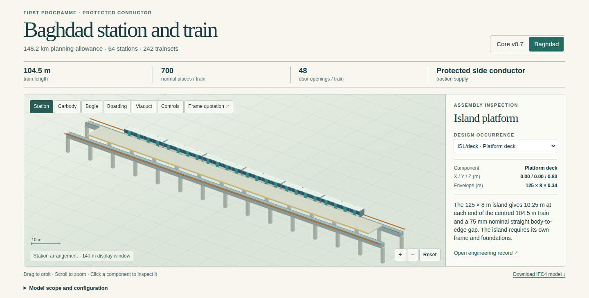](docs/operator-review/twins/baghdad-station.png) |
| Select a line in Samawah to see its stops, journey time and fleet. | Orbit a typical Baghdad first-programme station and inspect the train, platform and supports together. |

**Project status.** [v0.7.2](docs/releases/v0.7.2/README.md) is the published software release, with a reproducible opening study and enquiry dossier. Development on `main` includes editable city studies, coupled train and power simulation, rapid vehicle production, deck-fed viaduct delivery, standards traceability and supplier comparison. **v0.8 production preparation remains open.** The car, powered bogie, viaduct, station, power and controls, and local production packages identify which work can be priced and which interfaces need supplier data, measurements or independent review. [Current engineering decisions](docs/DESIGN-DECISIONS.md) · [Readiness by package](cities/Baghdad/engineering/prototype/PRODUCTION-READINESS.md)

**For prospective partners.** Bring one local service or maintenance question to a two-week operator trial. The partnership plan explains what cities, passengers, workshops and funders can contribute, what the trial costs and how to decide whether to continue. [Stakeholder partnership plan](docs/operator-review/PARTNERSHIP-PLAN.md)

## What you can do with OpenSourceRail

Start with the **interactive workshop** linked above. Extract it, open **START.html** in a browser and try a route, a train model and a funding case. For a meeting or printed handout, use the [illustrated operator brief](docs/operator-review/OpenSourceRail-Operator-Brief.pdf).

| Work | What you can do | What it helps you decide |
|---|---|---|
| [Plan a city railway](#maps-and-passenger-journeys) | Edit routes, stops, connections, service and origin–destination assumptions. Exchange mapped proposals with RustGIS. | Which stops and transfers improve access, and which corridor deserves survey and demand work. |
| [Design the passenger service](#timetables-and-train-motion) | Compare headways and formations. Check waiting, boarding, fleet diagrams, turnbacks and separation. Export a planning timetable in GTFS. | How many trains, platform positions and depot moves the service needs. |
| [Compare traction and power](#compare-traction-and-power) | Run moving-train cases with collector voltage, feeder failures, braking, energy and auxiliary loads. | Which supply arrangements merit a like-for-like equipment enquiry and what limits their degraded service. |
| [Design vehicles, stations and viaducts](#vehicles-stations-and-civil-engineering) | Inspect CAD and IFC, compare mass and axle loads, check boarding and assembly envelopes, and trace a part to its bill of materials. | Which dimensions, interfaces and loads must change together when a design changes. |
| [Build and staff the works](#build-the-viaduct-from-both-ends) | Compare methods, yard and machine capacity, construction windows and resource reuse. Price staff by role and shift and test coverage in Rust with Arrow and Parquet outputs. | Where a second workfront, spare equipment or more skilled staff would change cost, schedule or disruption. |
| [Manufacture and train locally](#manufacturing-and-training) | Use stock cuts, CAM exercises, fixture and machine layouts, production simulations, inspection records and training guides. | Which jobs to make locally, which to buy and what a shop must demonstrate before repeat production. |
| [Buy and finance the railway](#purchasing-and-whole-life-cost) | Compare supplier returns, installation and renewal scope, local work, fares, operating costs and annual funding. | Which offers cover the same work and what the owner and operator must fund over time. |
| [Run and maintain the railway](#train-control-supervision-and-maintenance) | Exercise Rust train and wayside logic and replay faults. Follow a serialised asset through observation, replacement, inspection and handback. | What a controller, maintainer or assurance reviewer needs at each handoff. |
| [Check and reproduce the evidence](#standards-and-evidence-traceability) | Trace requirements to drawings, tests and decisions. Run the Workbench, compare candidates and inspect versioned assumptions and review holds. | What the evidence supports and which results need to be rerun after a change. |

## Why keep railway capability local?

- **Buy on comparable terms.** Issue the same service requirements, quantities and maintenance boundary to turnkey, vendor-led and local integration bidders. Identify where imported equipment, licences or specialist servicing affect the city's obligations. [Matched-bid terms](cities/Baghdad/BUYER-COMPARISON.md)
- **Make and repair more locally.** Give workshops the drawings, part revisions, fixtures, process routes and inspection points they need to quote for a component or overhaul. Compare local work content with supplier evidence and train teams for repeat work. [Factory specification](cities/Baghdad/engineering/prototype/FACTORY-SPECIFICATION.md) · [Training exercises](cities/Baghdad/engineering/prototype/training/INSTRUCTOR.md)
- **Keep the information needed for a long service life.** Open CAD and IFC exchanges, source code, inspection records and serial histories let a later supplier or depot team understand which parts fit, which tests apply and who approved the change. [Twin register](docs/operator-review/twins/README.md) · [First adoption path](docs/first-adoptable-product.md)
- **Plan for passengers and the city around the line.** Test step-free access, waiting and capacity alongside land needs, construction occupation, energy use, renewals and operating costs. Baghdad's zero-tunnel studies illustrate how these requirements drive an elevated design. [Passenger movement and summer cooling](cities/Baghdad/engineering/simulation/passenger-guide.md) · [Baghdad planning and procurement](cities/Baghdad/README.md)

## Maps and passenger journeys

Use public elevation, soil texture and historical water layers to turn a route trace into a costed planning case. The Baghdad Airport example carries its estimated rail grades into the train and power replay, and prices variable pier heights, footing sensitivities and feeder renewals over 30 years. The GIS layers, unit assumptions and cash flows are available for review and reuse. [Airport GIS simulation and costs](cities/Baghdad/engineering/simulation/GIS-SIMULATION.md)

The **Airport digital project reference** connects the same route, train, power and priced civil quantities to a Rust train-protection replay. Read the completed trip counts alongside the failed vehicle checks and open protection limits. [Digital project reference and evidence](cities/Baghdad/engineering/simulation/PROJECT-REFERENCE.md)

Start with a trip people need to make. In the city Workbench, select a line, choose two stations and inspect access, expected waiting, time on board and transfers. The 266 city entries are planning outlines. City teams can replace provisional geometry and demand with local evidence. In the Samawah exercise, merge two nearby station markers and inspect the changed walking access and station count. For GIS work, take the route into RustGIS and bring the edited plan back through the planning workflow. [Planning guide](docs/workbench/planning/README.md) · [Samawah worked exercise](docs/book/38-samawah-practice.md) · [GIS import and export](docs/gis/README.md)

| Edit a plan | Read the journey as a passenger |
|---|---|
| [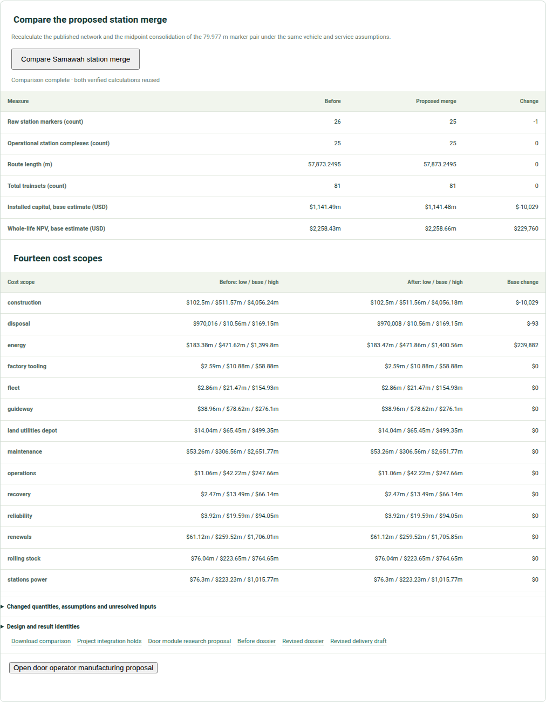](docs/book/images/gui-samawah-merge.png) | [](docs/operator-review/screens/passenger-journey.png) |
| Compare route edits before adopting a revised plan. | The original Samawah example gives 10.7 minutes for the selected journey under its published assumptions. |

For a different planning question, compare how Amman’s terrain and Karachi’s network scale affect route choices, or how a team in Cuenca might choose its first corridor. Each city example identifies the geography and passenger information needed to improve the outline. [Amman and Karachi](docs/book/53-amman-karachi.md) · [Nairobi and Lusaka](docs/book/54-nairobi-lusaka.md) · [Cuenca and San Salvador](docs/book/55-cuenca-san-salvador.md)

A planning team can export route, stop, service and origin–destination edits, then compile and verify the proposal against its input revision. A separate city calculation carries the revised plan into fleet, section capacity, civil quantities and cost. Compare propulsion or construction assumptions while keeping demand and service fixed, or change the service and compare the fleet and capacity it requires. [Proposal and recalculation commands](docs/workbench/planning/README.md) · [City atlas and source data](docs/design-engine/city-atlas/README.md)

Baghdad’s active proposal joins a central ring and a metropolitan ring with two near-straight Tigris through services. Each new line crosses both rings and shares stations with each. The study compares 1.3 km street-walking access and trips from housing to named centres with up to two changes. The same route register drives the fleet, power, yards, construction, labour and costs. [Illustrated Baghdad study](cities/Baghdad/STRAIGHT-THROUGH-NETWORK.md) · [Delivery and costs](cities/Baghdad/STRAIGHT-THROUGH-DELIVERY.md) · [Curved-girder drawings and work orders](cities/Baghdad/engineering/mechanical/civil/CURVED-BEAM-PROGRAMME.md)

Baghdad’s three-ring study fits the rings to population and streets. It compares separate suburb-to-ring services with routes that carry those passengers through Baghdad and across the Tigris. It shows which central destinations Basmaya, Nahrawan and Tajiyat can reach without changing trains, alongside 1.3 km walking coverage, construction quantities, labour and costs. [Population-led network study](cities/Baghdad/THREE-RING-STUDY.md) · [Shared metropolitan planning method](docs/design-engine/current/METROPOLITAN-NETWORKS.md)

[](cities/Baghdad/THREE-RING-STUDY.md)

New automatic city studies check directness, river crossings and shared ring stations against available maps. The same policy runs in Workbench and under `./osr design railway city-study`. The study report identifies where the local data supports only a corridor revision.

## Timetables and train motion

A line on a map still needs a train that can reach each stop, turn around and start its next trip. Follow an individual working through its outward and return calls. Inspect the time reserved at the terminal and the interval available between successive trains. In the coupled operating study, changes in waiting and riding time affect requested journeys. The simulation records which booked trips finish under the selected service, motion and supply assumptions. [Train diagrams and outstanding connections](cities/Baghdad/SERVICE-DIAGRAMS.md) · [Route, demand and service inputs](cities/Baghdad/engineering/simulation/ALIGNMENT-DEMAND.md)

Use the passenger ledger to distinguish completed journeys, capacity queues and passengers affected by an incomplete trip. The Airport example also exports a dated GTFS timetable for interchange with other planning tools. [Passenger and timetable inputs and outputs](cities/Baghdad/engineering/simulation/PLAN.md)

| Follow one train through its day | Compare how a train moves |
|---|---|
| [](docs/operator-review/screens/baghdad-service.png) | [](docs/operator-review/screens/train-movement.png) |
| The metropolitan timetable shows the Airport-001 working and flags a separation shortfall under its assumed signalling arrangement. | A separate 1.5 km research exercise compares cable launch and powered wheels on the same leg. Its assumed forces and stopping cases are available for inspection. |

The station-pair model exposes simulated quantities including speed, stopping position and grid energy. Compare a fixed braking point with distance feedback under the same scenarios, then inspect the cases that miss their target. The station-cycle study also follows capture, storage and relaunch across repeated arrivals. [Motion traces and braking comparisons](docs/design-engine/station-pair/README.md) · [Station energy and repeated duty](docs/design-engine/station-cycle/README.md)

[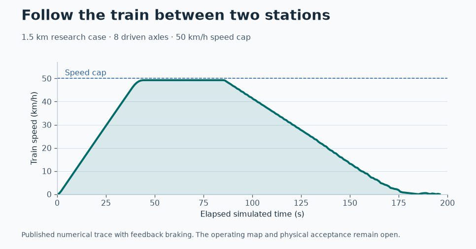](docs/assets/front-page/station-pair-speed.png)

<details>
<summary>Watch the simulated train travel from departure to the berth target</summary>

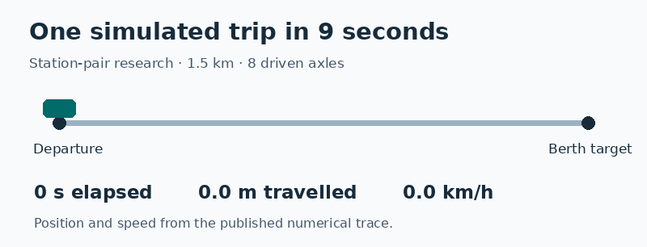

[Open the animation on its own](docs/assets/front-page/station-pair-motion.gif) · [Read the underlying case](docs/design-engine/station-pair/README.md)

</details>

### Compare traction and power

Choose the service first, then compare what it asks of the train and supply. The coupled study uses train position, speed and demand to evaluate collector voltage, available traction and trip completion under specified conditions. The electrical trials cover simultaneous starts, lost feeds, hot conductors, recovery and regenerative energy. Separate studies cover station charging, onboard storage, protected conductors and an overhead comparator. The outputs support matched quotations for equipment ratings, fault protection, isolation, replenishment and maintenance. [Moving-train and feeder simulation](cities/Baghdad/engineering/simulation/MOTION-POWER.md) · [Feeder options](cities/Baghdad/engineering/simulation/FEEDER-OPTIONS.md) · [Supplier enquiry packets](cities/Baghdad/engineering/simulation/ASSUMPTION-AUDIT.md)

Review independent **SUMO** train-motion cases and **pandapower** grid-side cases against the declared model inputs. The results retain missed stops and braking warnings so a completed trip count can be checked against how the train actually ran in the simulation. [Independent solver runs and limits](cities/Baghdad/engineering/simulation/MOTION-POWER.md#independent-tool-executions)

## Vehicles, stations and civil engineering

Open the digital twin, choose an assembly and select a part. A station reviewer can inspect the boarding face, opposite-side doors, collector position and electrical cabinet envelopes. A fabricator can switch to **Frame quotation** to identify individual pieces of steel. IFC downloads let another team open the straight-station assemblies in its own viewer. The register identifies which train, revision and quantity schedule belongs with each model. [Model viewer guide and IFC downloads](docs/operator-review/twins/README.md) · [Engineering models and drawings](docs/engineering-models/README.md)

| Identify the parts to fabricate | Inspect the boarding interface |
|---|---|
| [](docs/operator-review/twins/baghdad-steel-frame.png) | [](docs/operator-review/twins/baghdad-boarding.png) |
| This earlier quotation model contains 128 pieces. The assembly film below uses the later lined-jamb revision with 144 frame pieces per car and nominal gross stock of 5.27 t. | The model locates the train at a typical straight island. Installed clearances require the vehicle movement and platform tolerances for the actual site. |

The fitted-train exercise connects seating, wheelchair places, door approaches and installed mass allocations to axle loads, traction and stopping. The civil comparison follows a change of span through beams, bearings, foundations, transport, lifting at working radius and upkeep. A price advantage can tell a precaster which option is worth quoting. A lift still needs the equipment chart and ground support for the proposed site. [Fitted-train exercise](cities/Baghdad/engineering/simulation/ASSUMPTION-AUDIT.md#compare-a-fitted-train-on-the-same-railway) · [Span and erection alternatives](cities/Baghdad/engineering/mechanical/civil/SPAN-FAMILIES.md) · [Design decision register](docs/DESIGN-DECISIONS.md)

The coordinated design search carries a change in structure, installed mass or propulsion through braking, civil loading, production and cost, while keeping each candidate's results together. Compare body arrangements and joints, inspect stress and displacement, and review where independent solver results apply to a particular load or geometry. [Coordinated railway design](docs/design-engine/coupled-railway/README.md) · [CAD and solver comparison](docs/design-engine/craft-backends/README.md) · [Viaduct model comparison](docs/design-engine/viaduct-backends/README.md)

[](cities/Baghdad/engineering/mechanical/civil/LIVE-STOCK.md)

The metropolitan beam register follows each route through standard stock, short closures, inside and outside curved pieces and interfaces that need their own designs. It connects quantities, concrete, bar and strand, mould changes, flatbed runs and crew shifts to the same map. [Viaduct specification and checks](cities/Baghdad/engineering/mechanical/civil/LIVE-STOCK.md)

### Build the viaduct from both ends

[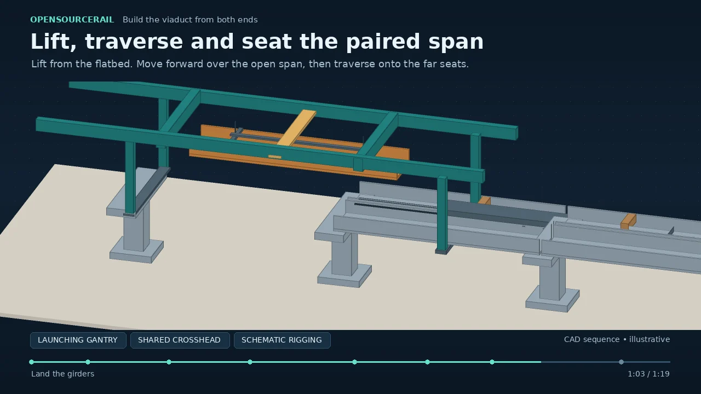](https://raw.githubusercontent.com/modernecotech/OpenSourceRail/main/docs/assets/assembly-animations/viaduct.mp4)

**[Watch the viaduct construction animation](https://raw.githubusercontent.com/modernecotech/OpenSourceRail/main/docs/assets/assembly-animations/viaduct.mp4)** · [Geometry and chapter guide](docs/assets/assembly-animations/GUIDE.md)

[](docs/assets/assembly-animations/viaduct-placement.jpg)

See the footing and pier cages, bearing stack, mould and prestressing components, flatbed running gear, gantry and lifting gear, and the final track and access installation. The [assembly bill of materials and workplans](docs/assets/assembly-animations/GUIDE.md#parts-cost-and-shifts) distinguish one repeatable bay from the shared production and erection plant. [Completed viaduct render](docs/assets/assembly-animations/viaduct-completed.jpg)

The current Baghdad delivery plan uses **20 m U-girders on shared piers** for
standard bays. Two terminal precast yards feed two inward-moving gantries on
an open main line. Each yard has **16 moulds**, **24 released-beam positions**
and a proposed **216 × 164 m** footprint. Each line can start independently,
or share gantries with later lines. The citywide ring, short branches and
reserved connections carry their own access and delivery assumptions.
[Metropolitan quantities, shifts and lifecycle costs](cities/Baghdad/STRAIGHT-THROUGH-DELIVERY.md)

The standard-stock comparison allocates **three paired launcher crews and
two road teams** across **eight concurrent yards**. Deck feed reduces
modelled loaded girder trips on public roads from **78,440 to 22,934** and
booked erection lane-hours from **314,304 to 93,568**. Ground works,
starter and closure lifts, and special structures carry separate access
and design duties. [Civil stock and construction scope](cities/Baghdad/engineering/mechanical/civil/LIVE-STOCK.md)

| Deliver beams behind the advancing fronts | Lay out each terminal yard |
|---|---|
| [](cities/Baghdad/engineering/mechanical/civil/rail-fed/two-fronts.png) | [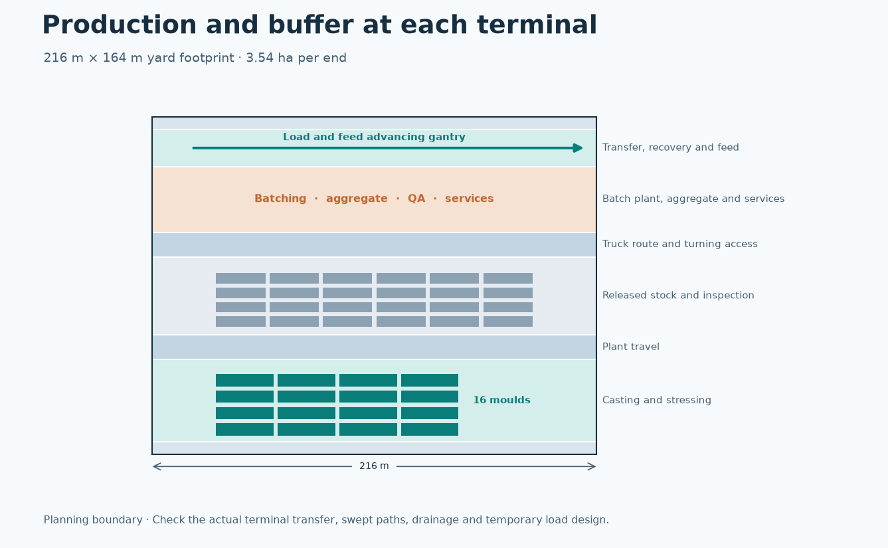](cities/Baghdad/engineering/mechanical/civil/rail-fed/terminal-yard.png) |
| [Close-up of the placement envelopes](cities/Baghdad/engineering/mechanical/civil/rail-fed/launch-section.png) · [3D concept mesh](cities/Baghdad/engineering/mechanical/civil/rail-fed/rail-fed-launch.obj) · [Gantry DXF](cities/Baghdad/engineering/mechanical/civil/rail-fed/rail-fed-launch.dxf) | [Terminal yard DXF](cities/Baghdad/engineering/mechanical/civil/rail-fed/terminal-yard.dxf) · [Geometry basis](cities/Baghdad/engineering/mechanical/civil/rail-fed/CONCEPT-GEOMETRY.md) |

In the 12 km trial, three-shift deck feed takes **164 days** and **$8.98m**
for erection, versus **220 days** and **$12.14m** for day-shift road cranes.
Booked erection lane-hours fall from **4,800 to 352**. A second independent
feed path per end shortens the deck-fed trial to **150 days** at higher cost.
Two road shifts take **145 days**. The site still needs ground works, and
the finished deck needs verified temporary-load and access limits.
[Shift, transport and downtime sensitivity](cities/Baghdad/engineering/mechanical/civil/RAIL-FED-ERECTION.md)

The detailed workplan carries erection, haul and casting crew hours into the same Rust and Arrow workforce simulator used for factory, training and operating rosters. Test attendance and capacity loss while holding booked payroll fixed, then take the gaps and priced shifts to the contractor or staffing lead. [Deck crew and workforce commands](docs/operator-review/WORKPLAN.md#compare-street-access-and-deck-fed-erection) · [Rust workforce model](docs/operator-review/delivery/WORKFORCE-RUST.md)

## Manufacturing and training

Follow a component from the drawing and bill of materials through stock preparation, cutting, assembly, inspection and removal for repair. The factory specification identifies machines, tooling, workstations and quantities for the prototype packages. The CAM material includes plate profiles, nesting, stock cuts and a practice machining job. A shop can use these to estimate hours and fixtures, then return its own machine limits, process review and trial results. [Factory specification](cities/Baghdad/engineering/prototype/FACTORY-SPECIFICATION.md) · [CAD and CAM handoff](cities/Baghdad/engineering/prototype/cam/CAM.md) · [CamCraft and FreeCAD comparison](cities/Baghdad/engineering/simulation/CAM-COMPARISON.md)

| Inspect a serviceable mechanism | Lay out the factory |
|---|---|
| [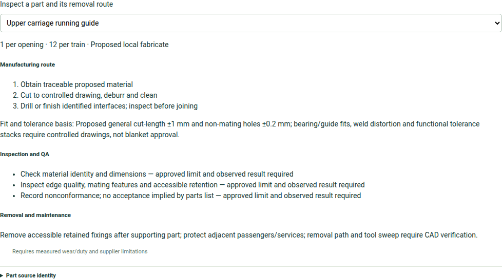](docs/operator-review/screens/door-workshop.png) | [](docs/operator-review/delivery/vehicle-works.svg) |
| The Samawah door exercise follows the running guide through manufacture, inspection and removal. | The vehicle-works drawing lets a bidder trace material flow from receiving through assembly to the formation road. |

For a team session, assign buyer, technician, fabricator, precast planner, electrical integrator or maintenance roles. Use the offline exercise to pass a part and its evidence from one role to the next. Try doubling mould occupancy from 24 to 48 hours while holding output at eight beams a day. The required mould positions rise from eight to sixteen. Workshops can replace that assumption with timed production evidence. [Instructor guide and handover exercises](cities/Baghdad/engineering/prototype/training/INSTRUCTOR.md) · [Factory, yard and staffing layouts](docs/operator-review/delivery/README.md)

The counted parts catalogue records stock, assembly and draft business data. The delivery compiler carries a selected revision into part occurrences, process routes, inspection holds and installation proposals. A shop can review which jobs belong in-house, which need a specialist supplier and what evidence the next workstation needs. The factory drafts and ERPNext handoffs show where reviewed item mappings and actual inspection records enter. [Vehicle parts catalogue](docs/design-engine/vehicle-parts/README.md) · [Pilot delivery compiler](engineering/pilot_delivery/README.md) · [ERPNext deployment and business records](deployment/erpnext/README.md)

### Produce car and bogie frames in flexible workcells

[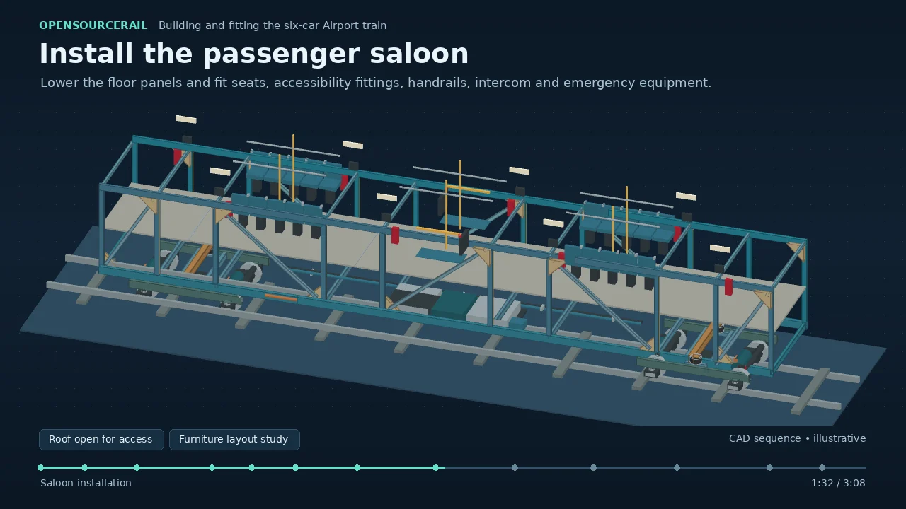](https://raw.githubusercontent.com/modernecotech/OpenSourceRail/main/docs/assets/assembly-animations/train.mp4)

**[Watch the train fabrication and assembly animation](https://raw.githubusercontent.com/modernecotech/OpenSourceRail/main/docs/assets/assembly-animations/train.mp4)** · [Geometry and chapter guide](docs/assets/assembly-animations/GUIDE.md)

[](docs/assets/assembly-animations/train-exterior.jpg)

| Fit out the passenger car | Connect two cars | Look through the passenger end |
|---|---|---|
| [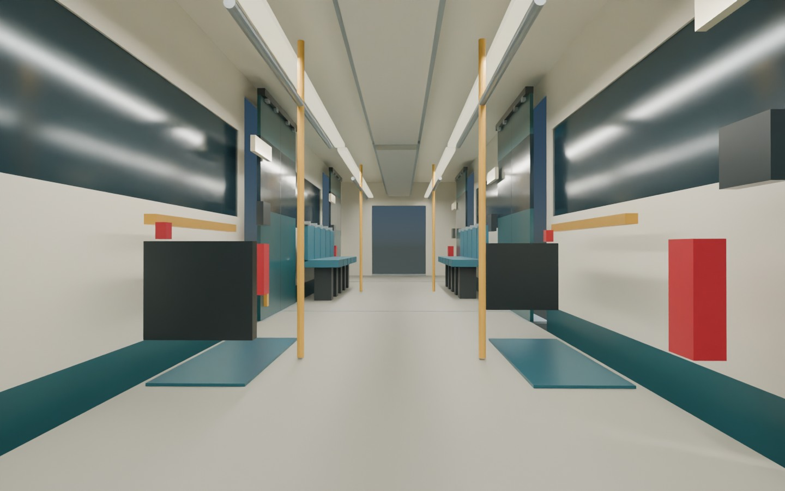](docs/assets/assembly-animations/train-saloon.jpg) | [](docs/assets/assembly-animations/train-connector.jpg) | [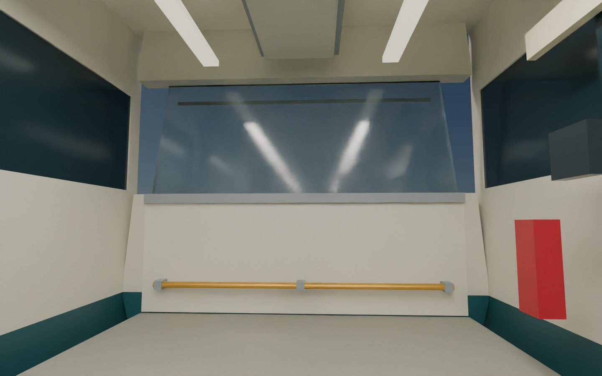](docs/assets/assembly-animations/train-terminal.jpg) |

The Baghdad Airport train concept uses unattended GoA4 operation. The two glazed ends extend the passenger saloon, with rescue couplings below the floor and five gangways between cars. Use the parts register to review geometry, mass and purchasing allowances alongside the installation work. Supplier interface dimensions and installed weights remain separate evidence fields. [Assembly BOM, geometry and costed shifts](docs/assets/assembly-animations/GUIDE.md#parts-cost-and-shifts)

Group the steel frame into cutting, keyed fit-up, welding, finishing and
inspection work. A shared CNC cell and reusable jigs can feed multiple manual
or automated assembly stations. In the 36-car steel-frame comparison,
shared CNC reduces modelled staffed shift days from **208 to 176** and direct
local shop hours from **4,825 to 3,795**. Base fabrication cost rises from
**$22,981 to $23,355 per frame set** for 36 cars and falls from **$18,956
to $17,799** for 180 cars. The dedicated laser and robotic route
requires its own utilisation, workholding, seam qualification and recosting.
Aluminium extrusion and friction stir welding remain a separate carbody
comparison with their own mass and load paths.
[Rapid production, CAM and cost comparison](cities/Baghdad/engineering/prototype/rapid-production/README.md)

[](cities/Baghdad/engineering/prototype/rapid-production/workcells.png)

The factory replay links the asset, part serial, fixture and drawing revision
to the exact FreeCAD CAM practice file. It exercises stale or disconnected
machine observations, wrong setup and missing or failed inspection. ERPNext
can hold the draft work and evidence. Local certified safety equipment and
responsible production staff own machine control and article release.
[Workcell OBJ](cities/Baghdad/engineering/prototype/rapid-production/workcell-envelopes.obj) · [DXF layout](cities/Baghdad/engineering/prototype/rapid-production/workcell-plan.dxf) · [Software, embedded interfaces and replay](cities/Baghdad/engineering/prototype/rapid-controls/README.md)

## Purchasing and whole-life cost

Give competing suppliers the same drawing revision, quantities, fault cases and maintenance period. Compare price, exclusions, lead time, local work and renewals before recording an award. In the finance workshop, choose a funding term and inspect annual construction draws, operating costs, fares, debt service and replacements. The staffing worksheet lets an operator change coverage, pay and headcount and pass the revised operating cost into the funding calculation. [Supplier enquiry guide and downloads](cities/Baghdad/engineering/simulation/audit-production-guide.md) · [Funding and fares workbook](docs/operator-review/finance/README.md) · [Iraqi capital price basis](cities/Baghdad/IRAQ-CAPITAL.md)

Start the estimate with a dated quantity and rate, then attach each supplier's return to its lot and drawing revision. Compare buying, hiring and subcontracting machinery or specialist work. The procurement workflow carries reviewed offers and item mappings toward ERPNext draft records. The buyer can distinguish budget estimates, actual quotations and costs carried within another contract before updating the cash schedule. [Machinery and supplier offers](cities/Baghdad/engineering/prototype/PROCUREMENT-PLAN.md) · [Shop prices and equipment allowances](cities/Baghdad/engineering/prototype/SHOP-COSTS.md)

| Compare two supplier returns | Find the years the owner needs cash |
|---|---|
| [](docs/operator-review/finance/supplier-returns.png) | [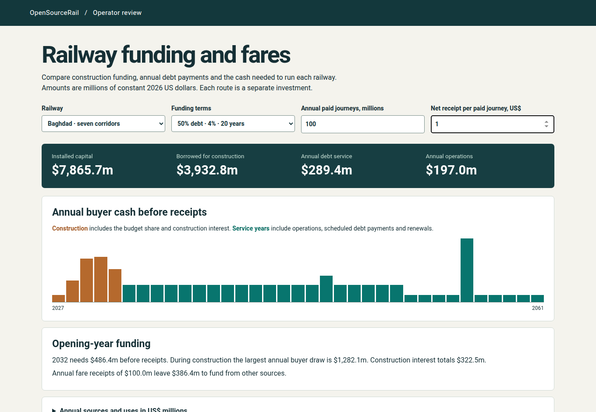](docs/operator-review/finance/baghdad-funding.png) |
| The worked offers are hypothetical. The buyer can inspect scope and enter supplier terms for the enquiry. | Change fares or financing and inspect the effect on public funding through construction and operation. |

[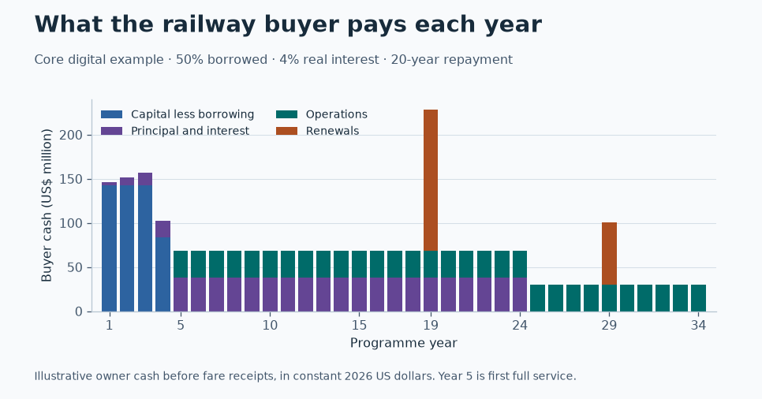](docs/assets/front-page/annual-funding.png)

The annual schedule lets a funder distinguish construction contributions, repayment, routine operations and years when replacements are due. The chart uses the core digital example. The purchasing workflow compares terms and renewal scope against a particular offer, including local work and its evidence. [Financing workbook and assumptions](docs/operator-review/finance/README.md) · [Buyer comparison](cities/Baghdad/BUYER-COMPARISON.md)

| Plan the construction yard | Staff the service you intend to run |
|---|---|
| [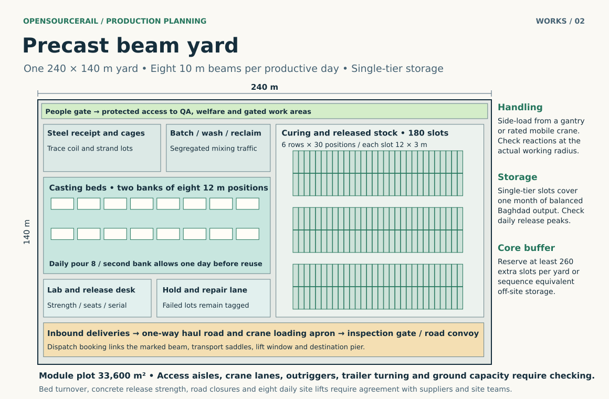](docs/operator-review/delivery/precast-yard.svg) | [](docs/operator-review/delivery/workforce.png) |
| Use the dimensioned yard layout to price land, lifting equipment and storage for beams awaiting erection. | Edit the staffing case before carrying its annual operating budget into the funding worksheet. |

## Train control, supervision and maintenance

The Rust workspace covers automatic train protection, interlocking, train management, station dispatch, door control, train-to-ground communication, passenger information and event records. The station bench exercises arrival, boarding-side permission, holding brake feedback and departure. Try the supervision replay in the offline kit. Step through **Section trips**, **Section signal stale** and **Signal restored and trip cleared** to see why an operator needs both alarm state and reading age. [Rust software](crates/README.md) · [Control equipment and interfaces](control-electronics/README.md) · [Station bench procedure](cities/Baghdad/engineering/controls/STATION-BENCH.md)

The gateway feeds equipment observations, alarms and history to FUXA. ERPNext ties purchase, inventory, inspection, work order and repair back to an asset or serial number. Frappe HR keeps the training and competency records needed to staff those jobs. A railway operator can start with one depot or workshop and supply its own equipment bindings, access permissions, reviewed item masters and handback procedure. [Gateway and FUXA](deployment/supervision/README.md) · [ERPNext and HR](deployment/erpnext/README.md) · [First adoption path](docs/first-adoptable-product.md)

| Respond to an equipment alarm | Trace an installed part |
|---|---|
| [](docs/operator-review/screens/section-alarm.png) | [](docs/operator-review/screens/erp-serial-history.png) |
| In the simulated incident the trip stays active while the reading is stale. A fresh clear reading changes its state. | The ERPNext pilot shows how a maintainer can trace a replacement through serial records and work orders. |

The supervision and ERPNext fixtures cover equipment observations, alarm delivery through an interruption, repair review and serial replacement. The native rehearsal shows which record follows each handoff and which whole-site recovery work remains for a deployment. [Native integration and recovery guide](docs/integration/v06-platform.md) · [Open train, interlocking and platform-door software](crates/README.md)

<details>
<summary>Watch a simulated protection trip persist through a stale reading</summary>

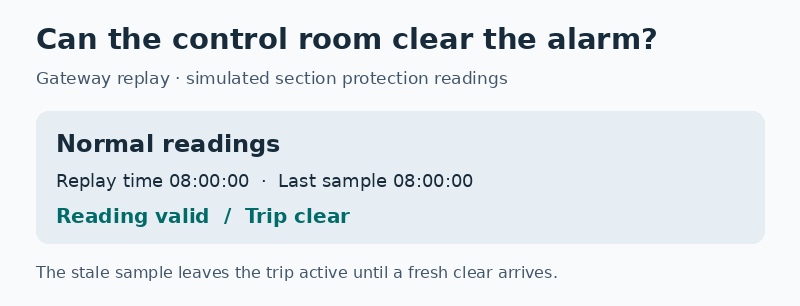

[Open the animation on its own](docs/assets/front-page/section-alarm-replay.gif) · [Step through the replay](docs/operator-review/screens/README.md)

</details>

## Standards and evidence traceability

An operator, buyer or independent assessor can trace a control from its standard and edition to the railway risk, requirement, design revision and verification evidence. The register identifies whose design each record describes and what still needs a supplier, a site test or an assessor's decision. [Standards crosswalk](docs/certification/compliance-matrix.md) · [Machine-readable report](docs/certification/digital-assurance-report.json)

| What the reader can check | How OpenSourceRail supports the review |
|---|---|
| **Railway safety and signalling** | IEC 62278 and IEC 62425 are mapped to requirement ownership, operating assumptions and safety evidence. The station bench records the door, brake and departure cases to verify on target hardware. [Station bench](cities/Baghdad/engineering/controls/STATION-BENCH.md) |
| **Boarding, electrical protection and structures** | The crosswalk identifies evidence for EN 14752 door interfaces, IEC 62128-1 traction isolation and return, and the EN 1990 series structural basis. It assigns site measurements, protective checks and independent review to their responsible teams. [Standards crosswalk](docs/certification/compliance-matrix.md) |
| **Quality and supplier control** | ISO 9001 and ISO 22163 are mapped to revision-controlled offers, traceable manufacturing and first-article inspection. The buyer still needs evidence of the supplier's actual quality processes. [Factory specification](cities/Baghdad/engineering/prototype/FACTORY-SPECIFICATION.md) |
| **Asset and information handover** | ISO 55001 and ISO 19650 are mapped to lifecycle records, model identities and the information needed by an operator. IFC4 samples illustrate data exchange within the ISO 16739 family. [Twin register and downloads](docs/operator-review/twins/README.md) |
| **Evidence changes and assessment** | The impact command reports whose controls need reassessment when a file, mapping or publisher reference changes. The deployment workflow records applicable clauses, test limits and decisions. [Review procedure and commands](docs/certification/README.md) |

## How to read an engineering result

The design engine lets engineers change a body structure or propulsion arrangement and trace which results need recalculating. A change in stock or material alters the mass and axle loads that travel into motion, braking, civil, production and cost calculations. Each evaluation records its assumptions and checks. The results distinguish a design worth another experiment, an option ready for a budgetary quotation and a design with evidence for its intended use. [Coordinated design search](docs/design-engine/coupled-railway/README.md) · [Capability and evidence guide](docs/capabilities/README.md)

Every comparison needs an identifiable route, vehicle, service and price boundary. Baghdad’s elevated, zero-tunnel studies examine catenary-free supply. Span, propulsion, train length and frequency remain choices to test against demand, accessibility, protection, local manufacturing and whole-life cost. A published drawing, a numerical screen, a supplier return and a measured first article answer different questions.

The 17.46 km Airport study contains 10.74 km of proposed connections and still needs a survey. On the paired supply the 30-minute service completes **72 of 72** booked trips. The 15-minute service completes **103 of 144**. The review shows the limiting cases, including traction-force and emergency-energy shortfalls, alongside what a supplier can price. The metropolitan plan uses a separate network and costing service. [Current Baghdad proposal](cities/Baghdad/README.md) · [Airport operating results and outstanding evidence](cities/Baghdad/engineering/simulation/AUDIT-RESULTS.md)

The [development vehicle selector](engineering/development-baseline.toml) describes a six-car passive-wheel research vehicle with 44 seats and two wheelchair places per car. Its engineering record carries its own load cases, equipment and service assumptions. [Current engineering record](docs/design-engine/current/README.md)

The synthetic 30 km case checks that a change to route length or station count flows through fleet sizing, construction quantities and costs. [Retained v0.7 regression example and evidence](docs/reference-v07/README.md)

## Run the Workbench

From a full Linux checkout, install the tools and start the local Workbench. Open `http://127.0.0.1:8090` in your browser. [Installation options](tools/README.md) · [Workbench walkthrough](docs/book/44-workbench-journey.md)

```sh
./install.sh
./osr workbench
```

To reproduce the corrected operating and purchasing case, run the audit from the repository root. The second command writes a supplier enquiry ZIP for the six-site paired supply layout. [Audit inputs, commands and packet contents](cities/Baghdad/engineering/simulation/ASSUMPTION-AUDIT.md)

```sh
./osr design railway audit --check
./osr design railway audit --layout paired6 --packet build/supplier-enquiry.zip
```

Use `./osr status` and `./osr readiness` to inspect the development reference. Run `./osr build` and `./osr test` to regenerate and verify its development outputs. The [system architecture](docs/ARCHITECTURE.md) and [documentation index](docs/INDEX.md) link to the underlying modules.

Other useful entry points from the repository root include these commands.

| Command | What you get |
|---|---|
| `./osr plan verify build/my-plan` | Check a compiled planning proposal against its source revision. [Planning workflow](docs/workbench/planning/README.md) |
| `./osr coherence` | Check live specs, code, output records and reader claims without a full simulation. |
| `./osr twin export` | Inspect the selected candidate's linked geometry, BOM, civil, purchasing and controls outputs. [Export index](docs/design-engine/current/exports/manifest.json) |
| `./osr design railway spans --route-km 20` | Compare installed civil and erection assumptions for a 20 km example. [Span-family basis](cities/Baghdad/engineering/mechanical/civil/SPAN-FAMILIES.md) |
| `./osr workplan --output build/workforce` | Price role-by-shift workloads, test coverage and export a CSV and Arrow-compatible Parquet table. [Workforce and delivery plan](docs/operator-review/delivery/WORKFORCE-SIMULATION.md) |
| `./osr design railway baghdad-delivery` | Read the live metropolitan plan, quantities, shifts, fleet and costs. Add `--json` for the machine record. [Current programme](cities/Baghdad/STRAIGHT-THROUGH-DELIVERY.md) |
| `./osr design railway rail-fed --route-km 20` | Compare road delivery with deck-fed gantries, including costs, shift hours and street occupation. [Erection comparison](cities/Baghdad/engineering/mechanical/civil/RAIL-FED-ERECTION.md) |
| `python3 -m engineering.assurance.standards --impact` | Identify controls affected by changes since the published standards evidence report. [Evidence review](docs/certification/README.md) |

The [chart and animation generator](docs/assets/front-page/render.py) reads published inputs for the station-pair and supervision demonstrations. Run it with Python, Matplotlib and Pillow to reproduce the figures.

## Find the right files

| Location | Responsibility |
|---|---|
| [cities/](cities) | City inputs, maps, service studies, local prices and enquiries. Baghdad's maintained engineering and simulation work lives with its city design. |
| [engineering/](engineering/README.md) and [campaigns/](campaigns) | Shared design, numerical evaluation, evidence and reproducible research configurations. The physical design, calculation revision and selection decision have separate identities. |
| [crates/](crates/README.md), [control-electronics/](control-electronics/README.md), [services/](services) and [deployment/](deployment/README.md) | Railway software, device interfaces, services and deployment adapters. |
| [docs/](docs/README.md), [tools/](tools/README.md) and [tests/](tests) | Guides, Workbench, published drawings and packages, build tools and regression checks. [Archive index and exact historical editions](docs/archives/README.md) |

Historical editions preserve the [conventional rail](https://github.com/modernecotech/OpenSourceRail/tree/v0.4.0), [maglev](https://github.com/modernecotech/OpenSourceRail/tree/v0.5.1) and [station-powered vehicle studies](docs/design-engine/v06-design-closure/README.md).

The [current standards and evidence register](docs/certification/README.md) draws on the earlier [digital standards workflow](https://github.com/modernecotech/OpenSourceRail/blob/298d4e15fbcbcd923d7fcf7e519ebc4915ef7e1b/docs/certification/digital-standards-adherence.md). The earlier [administrative proposal walkthrough](https://github.com/modernecotech/OpenSourceRail/blob/898eab2b57a739863a542cb13e7de70f47dfd9e5/README.md#step-by-step-use-cases) explains the draft workflow that the gateway and ERPNext still test.

## About the author

**Hayder Aziz** initiated OpenSourceRail. Since the early 2000s, his published work with collaborators has explored how engineering teams can share design knowledge, product data and manufacturing information across organisations using open standards and collaborative software. OpenSourceRail applies that approach to railways so owners, local suppliers and maintainers can use the same engineering knowledge from the first design through fabrication and repair.

- **2003** · Hayder Aziz, James Gao, Paul Maropoulos and Wai Ming Cheung. [New Technologies and Standards for Design Knowledge Management in Collaborative Conceptual Design](https://researchportal.northumbria.ac.uk/en/publications/new-technologies-and-standards-for-design-knowledge-management-in/).
- **2005** · Hayder Aziz, James Gao, Paul Maropoulos and Wai Ming Cheung, *Computers in Industry*. [Open standard, open source and peer-to-peer tools and methods for collaborative product development](https://gala.gre.ac.uk/id/eprint/17781/).
- **2008** · Hayder Aziz, James Gao and Zheng-Xi Li, *Computer-Aided Design and Applications*. [Engineering Design Knowledge Management in De-centralised Virtual Enterprises](https://www.cad-journal.net/files/vol_5/CAD_5%286%29_2008_787-800.pdf).

See the [repository contributors](https://github.com/modernecotech/OpenSourceRail/graphs/contributors) and the [project governance](GOVERNANCE.md) for the wider work and its stewardship.

## Contribute and reuse

City teams can contribute surveyed stops and counts, workshops can return itemised offers and first-article measurements, and operators can supply observed service and maintenance data. Include the design revision, units, source, date and scope so the next team can check the result. [Project operating rules](AGENTS.md) · [Contributing](CONTRIBUTING.md) · [Governance](GOVERNANCE.md)

Software uses **Apache 2.0**, hardware designs use **CERN-OHL-S v2**, and documentation uses **CC-BY-SA 4.0**. File-specific and upstream notices take precedence. [Licensing and notices](LICENSE.md)
