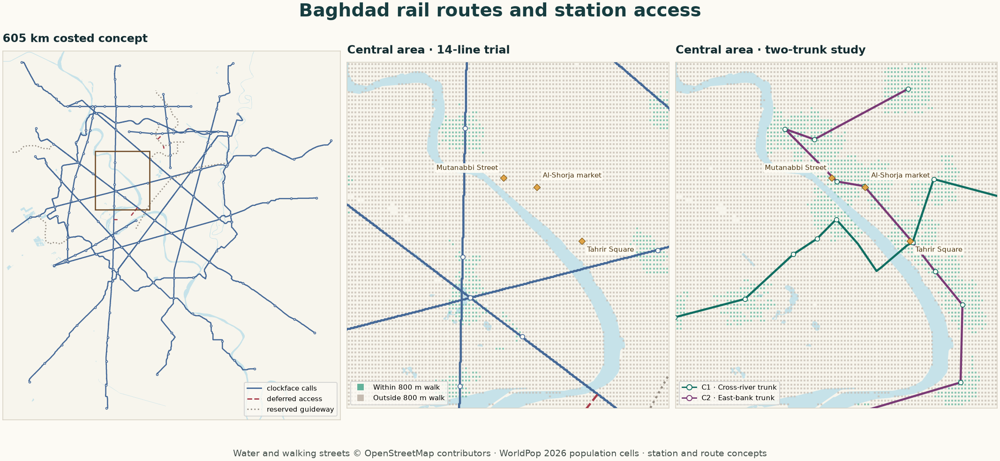

# Central Baghdad passenger access review

The 605.652 km citywide concept is a comparison case. Only 552.562 km enters the connected clockface trial. The citywide map combines operating paths, disconnected branches and guideway reserved for future use. The central access review tests actual station calls and introduces a separate two-trunk concept.

## Which routes run end to end?

| Scope | Result |
|---|---|
| Original 14-group estimate | 51.97m connected and 40.50m unresolved train-km per year |
| 14-route clockface trial | 552.562 km, 30-minute headway, 1,008 booked trips/day and 70 working sets |
| Track still costed outside that timetable | 2.990 km deferred access and 50.099 km reserved across 11 sections |

Both Sadr City branches on M04 miss their main line by 2.323 km and 2.710 km. The two Jadriya branches on M01 and M02 attach mid-line. The M09 access spur leaves the loop. The clockface trial keeps M05 to the airport and leaves those five access sections outside passenger service.

## How far is central Baghdad from a station?

Compare street-graph walks to a scheduled stop within the same central study window. The model tests 800 m and 1,200 m, allowing up to 100 m at each street connection. The population is estimated from native grid cells, counted once per case. These are residential access estimates. The station markers, street crossings, steps and entrance details still affect the actual journey.

The fixed comparison window runs from 44.350° to 44.430° E and 33.293° to 33.365° N. It includes parts of Karkh, Rusafa and Karrada on both banks. [OpenStreetMap extract](https://download.geofabrik.de/asia/iraq.html) · [WorldPop](https://hub.worldpop.org/geodata/summary?id=73856) · [JRC GHS-POP](https://human-settlement.emergency.copernicus.eu/downloadWizard.php)

| Population layer | People in study window | Original connected groups · ≤800 m | 14-line clockface · ≤800 m / ≤1,200 m | Two central trunks · ≤800 m / ≤1,200 m |
|---|---:|---:|---:|---:|
| 2026 WorldPop | 543,876 | 1.9% | 5.2% / 12.2% | 21.1% / 40.6% |
| 2025 JRC GHS-POP | 834,484 | 1.2% | 4.1% / 10.4% | 20.0% / 37.8% |

| Central destination | Walk to 14-line trial | Walk to central concept |
|---|---:|---:|
| Al-Kilani | 2,533 m | 59 m |
| Al-Mustansiriya | 2,941 m | 14 m |
| Al-Rasheed | 1,998 m | 301 m |
| Al-Saadoun | 1,707 m | 105 m |
| [Al-Shorja market](https://ijs.uobaghdad.edu.iq/index.php/eijs/article/download/11263/6254/135730) | 2,423 m | 30 m |
| Bab al-Muadham | 1,631 m | 936 m |
| Karkh | 2,317 m | 141 m |
| Karradat Maryam | 3,130 m | 2,509 m |
| Medical City area | 361 m | 556 m |
| [Mutanabbi Street](https://www.wikidata.org/wiki/Q2562384) | 1,729 m | 188 m |
| [Tahrir Square](https://www.openstreetmap.org/node/7894353482) | 2,111 m | 432 m |

## Test a central service before extending the network

The 28.21 km concept uses 19 distinct stops, a 15-minute headway and 9 working trainsets. The fleet allowance is 11 sets. The two services have independent tracks and share a passenger interchange at Tahrir Square.

The 10-minute trial failed the conservative shared Tahrir conflict check. The 15-minute scenario cleared the modelled timing constraints. The cross-river alignment assumes an independent elevated rail crossing near the Republic Bridge corridor.

| Line | End-to-end station sequence | One-way km | Booked one-way min |
|---|---|---:|---:|
| C1 | Al Mansour → Al Zawraa / Damascus Street → Baghdad Central Station / Allawi → Iraq Museum / Karkh → Karkh / Haifa Street → Tahrir Square → Al Kilani / Al Mutasim Street → Al Muthanna Street → Zayouna / Palestine Street | 13.10 | 27 |
| C2 | Al Mustansiriya / Turkmen Club Square → Bab al-Muadham bus interchange → Medical City / Ibn Sina Street → Mutanabbi Street / Old Rusafa → Al Shorja market / Republic Street → Tahrir Square → Al Saadoun → Firdos Square → Central Karrada → Jadriya / Al Wuzara Street → University of Baghdad approach | 15.11 | 34.5 |

Take the two trunks forward for comparison with central station infill and an improved bus network. Check each crossing and interchange on the ground and retain through routes only where train and passenger paths work together. Compare passenger access, waits and total cost before extending the suburban network. The older 605 km construction and operating rates belong to their original scope.

[Connected 14-route timetable](CITYWIDE-SERVICE.md) · [GIS layers](maps/central-access.geojson) · [Timetables, walking metrics and source record](central-access.json)

Reproduce this issue with `./osr design railway central-access --check`.

Evaluation `55d2cf9406acd3fba24e0c4a9bd4b2ea1bd04d26cbbc493b0de117d1bed54fab`.
