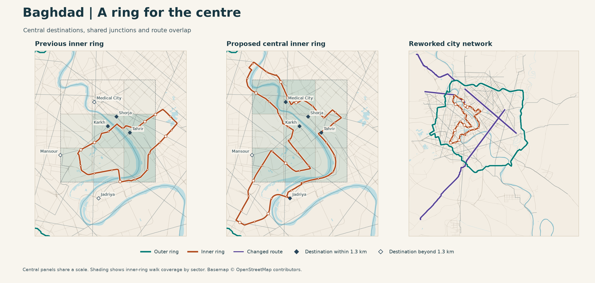

# Baghdad central ring, junctions and parallel routes

The **46.91 km** inner ring puts **5 of 6** named central destinations and **54.94%** of the central study population within a **1.3 km street walk** of an inner-ring station. The previous wider ring reaches 3 destinations and 33.74% of central residents.

**6 of 6** named destinations lie within a 1.3 km walk of the ring or a line that directly interchanges with it.

In the least-served central sector, walking coverage using any line rises from **59.62% to 65.24%**. In the southern sector it changes from 59.62% to 79.35%.

The inner ring follows mapped road corridors at Al-A’imma Bridge and Al-Jadriya Bridge. It has 36 station sites, including 8 shared interchanges, and the direct services joining both rings are **C1, G02, G07, G09, M01, M08, RG1-92**. The minimum mapped gap is **0.84 km**. The alignment search uses the central catchment, mapped crossings and connections. The two ring traces are simple, nested and disjoint.

[Full route and station GIS](maps/baghdad-central-ring-network.geojson) · [Machine results](central-ring-network.json) · [Previous wider-rings network](RING-NETWORK.md) · [Published city network](NETWORK.md)

## Central destinations and districts

The retained central study area spans 44.35° to 44.43° E and 33.293° to 33.365° N. The six named destinations are reported separately, including those beyond the box. The nine-sector screen uses the same central bounds and the WorldPop population cells in each sector.

| Destination | Previous walk to inner ring | Proposed walk to inner ring | Proposed walk to ring or connecting line |
|---|---:|---:|---:|
| Tahrir Square | 982 m | 560 m | 432 m |
| Al-Shorja market | 1,289 m | 1,046 m | 30 m |
| Medical City area | 3,373 m | 658 m | 361 m |
| Karkh / Haifa Street | 630 m | 1,155 m | 0 m |
| Al Mansour | 2,125 m | 2,111 m | 182 m |
| University of Baghdad approach | 2,863 m | 827 m | 0 m |

| Central sector | Inner-ring walk coverage, previous → proposed | Proposed coverage using any line |
|---|---:|---:|
| Southwest | 46.20% → 66.31% | 83.52% |
| South | 34.40% → 68.55% | 79.35% |
| Southeast | 71.87% → 46.87% | 91.60% |
| West | 17.52% → 29.02% | 65.24% |
| Centre | 60.91% → 57.42% | 96.03% |
| East | 75.49% → 56.33% | 92.55% |
| Northwest | 0.00% → 74.72% | 88.10% |
| North | 0.00% → 69.87% | 90.83% |
| Northeast | 10.58% → 24.60% | 89.46% |

Distances follow retained mapped paths and station-to-street connections. The machine results also contain the GHSL population check, the number of residents in each sector and the 1.2 km sensitivity.

The alternative **Central-coverage ring · more concentrated junctions** reduces parallel running to 18.51 pair-km, with 49.51% southern-sector coverage. The displayed alignment gives more even central access.

## Station consolidation and line changes

The displayed layout has **609 station sites** and **22 pairs within 280 m**, compared with 629 sites and 16 close pairs on the previous layout. Screened close parallel running changes from **22.71 to 20.60 pair-km**.

The junction pass takes the same route layout from 640 to 609 station sites, using replacement walks up to 800 m. Its audit records 7 shared-site merges, 24 adjacent calls removed and 26 mapped walking interchanges.

The consolidation retains the inner-ring calls that provide the shortest qualifying street walks for 5 named destinations.

- **G09** changes at X-G09-M01-9ae1c6a498, removing 4.75 route-km and 5 unique station sites.
- **M06** changes at X-T23-M06-ccc6895978, removing 3.11 route-km and 2 unique station sites.
- **M04** changes at M-135 and X-M01-M04-01, removing 3.94 route-km and 3 unique station sites.

The following constraints held part of the search.

- C2 needs a shared M15 interchange between M02 and University.

Shared junctions use common physical station coordinates on the affected alignments. Separate platforms keep their own site and a measured pedestrian interchange when mapped paths support it. The line cuts retain interchange terminuses. Turnbacks and accessible platform structures require design.

## Matched passenger and efficiency comparison

Every journey model uses **266,505 daily running train-km**, the same synthetic trip weights and walks of up to 1.3 km at each end. Housing journeys can use up to two changes. The route-km and station registers use the same geometry as the cost model.

| Layout | Lines | Route km | Close station pairs | Parallel pair-km | Metropolitan walk 1.2 km / 1.3 km | Central ring walk 1.3 km | Outer trips served | Housing to centre ≤2 changes |
|---|---:|---:|---:|---:|---:|---:|---:|---:|
| Published city network | 37 | 740.29 | 18 | 40.85 | 74.88% / 77.56% | 0.00% | 67.61% | 77.77% |
| Previous reworked wider rings | 33 | 731.12 | 16 | 22.71 | 73.51% / 76.35% | 33.74% | 64.56% | 74.47% |
| Central-coverage ring | 33 | 756.64 | 20 | 28.94 | 73.77% / 76.54% | 56.89% | 64.56% | 74.72% |
| Central-coverage ring · junctions 650 m | 33 | 756.64 | 16 | 28.94 | 73.77% / 76.54% | 55.97% | 64.56% | 74.72% |
| Central-coverage ring · junctions 500 m | 33 | 756.64 | 17 | 28.94 | 73.77% / 76.54% | 56.85% | 64.56% | 74.72% |
| Central-coverage ring · M06 turns back at T23 | 33 | 753.53 | 16 | 26.14 | 73.72% / 76.52% | 55.97% | 64.56% | 74.72% |
| Central-coverage ring · M06 turns back at T23 with an M04 gap | 34 | 749.59 | 16 | 23.15 | 73.53% / 76.34% | 55.97% | 64.56% | 74.47% |
| Central-coverage ring · G09 to C2 and M06 to T23 | 33 | 750.26 | 16 | 21.50 | 73.68% / 76.49% | 55.97% | 64.56% | 74.72% |
| Central-coverage ring · G09 to M01 and M06 to T23 | 33 | 748.78 | 16 | 21.50 | 73.68% / 76.49% | 55.97% | 64.56% | 74.72% |
| Central-coverage ring · G09 and M06 turnbacks with an M04 gap | 34 | 744.84 | 16 | 18.51 | 73.49% / 76.32% | 55.97% | 64.56% | 74.47% |
| Central-coverage ring · more concentrated junctions | 34 | 744.84 | 14 | 18.51 | 73.01% / 75.98% | 55.97% | 64.56% | 74.47% |
| Central-coverage ring · central stops protected | 34 | 744.84 | 15 | 18.51 | 73.01% / 75.98% | 56.85% | 64.56% | 74.47% |
| Central interchange ring | 33 | 755.67 | 24 | 33.29 | 73.70% / 76.52% | 54.88% | 64.56% | 74.47% |
| Central interchange ring · junctions 650 m | 33 | 755.67 | 24 | 33.29 | 73.69% / 76.52% | 54.63% | 64.56% | 74.35% |
| Central interchange ring · M06 turns back at T23 | 33 | 752.56 | 24 | 30.49 | 73.65% / 76.50% | 54.63% | 64.56% | 74.35% |
| Central interchange ring · M06 turns back at T23 with an M04 gap | 34 | 748.62 | 24 | 27.50 | 73.45% / 76.32% | 54.63% | 64.56% | 74.35% |
| Central interchange ring · G09 to C2 and M06 to T23 | 33 | 749.29 | 22 | 23.59 | 73.59% / 76.46% | 54.63% | 64.56% | 74.35% |
| Central interchange ring · G09 to M01 and M06 to T23 | 33 | 747.81 | 22 | 23.59 | 73.56% / 76.43% | 54.63% | 64.56% | 74.35% |
| Central interchange ring · G09 and M06 turnbacks with an M04 gap | 34 | 743.87 | 22 | 20.60 | 73.37% / 76.26% | 54.63% | 64.56% | 74.35% |
| Central interchange ring · more concentrated junctions | 34 | 743.87 | 21 | 20.60 | 72.87% / 75.90% | 54.63% | 64.56% | 74.35% |
| **Central interchange ring · central stops protected** | 34 | 743.87 | 22 | 20.60 | 72.87% / 75.90% | 54.94% | 64.56% | 74.47% |

The displayed layout clears the matched-access screen and improves inner-ring reach and overlap.
Among candidates that preserve network reach and reduce both the station count and parallel running, the selection favours coverage in the least-served central sector.
The screen allows drops of up to 0.5 points in central and metropolitan walk coverage, 0.5 points in housing reach and 0.75 points in outer-district reach.

## Delivery and cost

The selected layout and the greatest parallel-cut alternative are priced at the same six-minute costing basis with 2026 unit rates. Track-km count both tracks. The programme reports standard-deck handover from mobilisation.

| Layout | Track-km | Paid casting, haul and erection hours | Deck handover day | Installed US$bn | 30-year present US$bn |
|---|---:|---:|---:|---:|---:|
| Published city network | 1,480.50 | 6,427,544 | 3,384 | 41.90 | 64.39 |
| Previous reworked wider rings | 1,461.65 | 6,005,800 | 3,154 | 40.50 | 62.34 |
| Central interchange ring · central stops protected | 1,485.68 | 5,898,216 | 3,202 | 40.62 | 62.28 |
| Central-coverage ring · more concentrated junctions | 1,487.62 | 5,902,032 | 3,233 | 40.74 | 62.38 |

Rail curves, grades, junction capacities, step-free station routes and river structures remain open. Estimates exclude special river-crossing premiums.

Reproduce with `OPENBLAS_NUM_THREADS=1 tools/automation/osr-python -m cities.Baghdad.central_ring_publication --check`.

Comparison `e9d515dad8523f5746b0e6cdf23c763af9a7c1a5b816c46b80af314926898848`.
