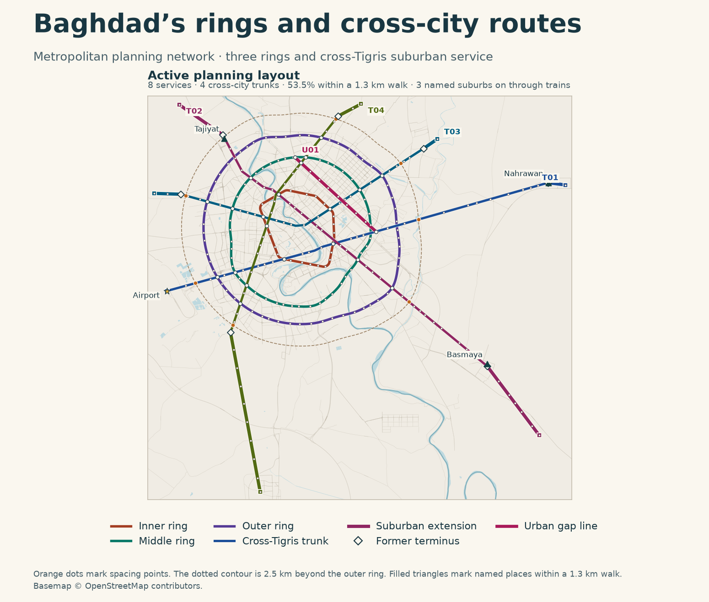

# Baghdad metropolitan railway

The active planning network has **8 services, 350.25 route-km and 256 station sites**. The 3 rings connect 4 cross-Tigris trunks. The table gives named suburban access to through trains.

[Proposal](PROPOSAL.md) · [Delivery, labour and cost](METROPOLITAN-DELIVERY.md) · [Editable routes and stations](maps/baghdad-metropolitan-network.geojson) · [Machine results](metropolitan-network.json) · [Options and journey comparison](THREE-RING-STUDY.md)

Within a 1.3 km street walk, the layout reaches **53.52%** of WorldPop and **52.77%** of GHSL residents. This is the planning choice for connected through service and a simpler route set. The broader two-ring benchmark covers more residents. The remaining gaps inform the next station and route refinements.

| Suburb | Through train | Tested centres reachable without a change | Within two changes |
|---|---|---:|---:|
| Basmaya | T02 | 3 | 5 |
| Nahrawan | T01 | 0 | 5 |
| Tajiyat | T02 | 3 | 5 |

The service comparison uses a fixed train-km budget. The delivery estimate uses a six-minute costing offer. Land, structures, operating safety, accessibility and procurement approvals remain open.

## Open service and coverage checks

- WorldPop walk coverage is below the two-ring reference.
- GHSL walk coverage is below the two-ring reference.
- Housing reach with up to two changes falls below the existing tolerance.
- At least one named central destination loses too much access.
- Wide outer-district journeys with up to two changes fall below the service tolerance.

Candidate `baghdad-network-adbde6609af7332f` · publication `b9ed32b34392a7b0e79ac7dd113fcd0a7454e8c299ab887d8560ba40cb1b49ff`.
