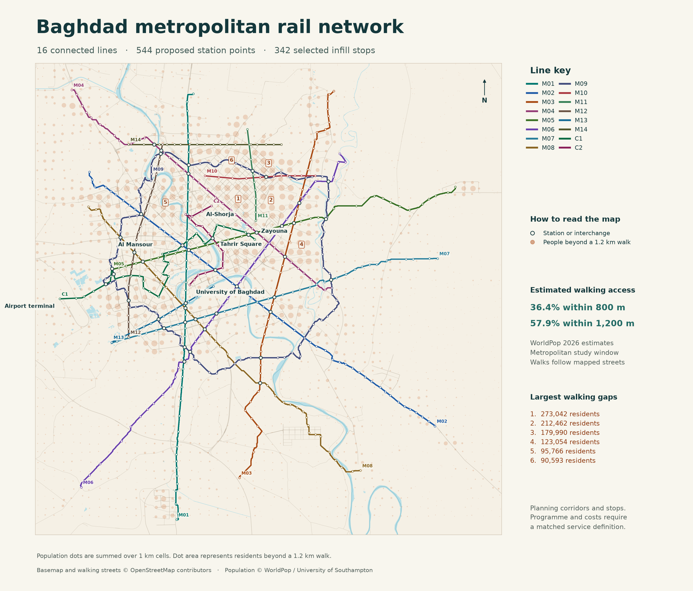

# Baghdad metropolitan rail network

This is one connected planning network for Baghdad, with 16 lines and 544 station points. It includes the Airport terminal approach and the routes through central Baghdad, alongside the links to the outer districts. A station belongs to an ordered rail line, and transfers use explicit interchange records.

[Open the full map](maps/baghdad-network.png) · [Rail lines, stations and transfers in GeoJSON](maps/baghdad-network.geojson) · [Engineering input, coverage and gap data](baghdad-network.json)

## Walk to a station

| Source and area | Estimated residents | Earlier trial within 800 m / 1,200 m | Integrated network before infill | Integrated network with infill |
|---|---:|---:|---:|---:|
| worldpop-2026 · metropolitan | 8,597,980 | 12.66% / 27.53% | 15.96% / 32.54% | 36.39% / 57.92% |
| worldpop-2026 · central | 543,876 | 5.19% / 12.25% | 25.49% / 48.18% | 43.83% / 70.03% |
| ghsl-2025 · metropolitan | 7,347,247 | 11.18% / 24.62% | 15.06% / 31.25% | 37.76% / 59.41% |
| ghsl-2025 · central | 834,484 | 4.09% / 10.44% | 23.51% / 44.74% | 43.16% / 68.9% |

The metropolitan denominator covers the retained study window from 44.20° to 44.75° E and 33.05° to 33.50° N, including outlying settlements. The central denominator uses the earlier walking study window. The two population grids estimate residents independently. Street snaps up to 100 m are included in the walking distance. 36 mapped station points have no street snap in that range. Land access, crossing safety and station entrance positions still require local verification.

The orange population layer shows where the rail plan still leaves walks longer than 1,200 m or where the retained street data cannot establish a path. The geographic record provides the estimated remaining population by 1 km cell.

## Largest remaining walking gaps

The numbered areas on the map rank 4 × 4 km areas by the number of WorldPop residents beyond a 1,200 m walk. Nearby rail links are shown by straight-line proximity for alignment review.

| Map rank | Approximate gap centre | Residents beyond 1,200 m | Nearest rail alignments |
|---:|---|---:|---|
| 1 | 33.3662° N, 44.4392° E | 273,042 | M04 (1,451 m), M11 (1,937 m) |
| 2 | 33.3649° N, 44.4779° E | 212,462 | M11 (1,664 m), M09 (2,473 m) |
| 3 | 33.4014° N, 44.4751° E | 179,990 | M09 (1,417 m), M10 (1,476 m) |
| 4 | 33.3211° N, 44.5139° E | 123,054 | M03 (1,425 m), M04 (2,182 m) |
| 5 | 33.3627° N, 44.3534° E | 95,766 | M12 (1,798 m), M01 (2,429 m) |
| 6 | 33.4042° N, 44.4314° E | 90,593 | M09 (85 m), M14 (1,758 m) |

## How the network is generated

1. Assemble the timed alignments into ordered passenger lines. Incorporate the corrected geographic Airport approach and retain the central station calls as part of the same network. Show only lines with a complete route.
2. Establish explicit transfer locations. A crossing on the map alone carries no transfer. Check that every line and station can be reached through a single passenger graph.
3. Test station locations along the rail lines every 300 m. Screen new stops within 650 m of another stop on the same line, over mapped water or beyond the street snap. The spacing and sampling interval are editable planning settings.
4. Repeatedly choose the location that reaches the most additional WorldPop residents within 800 m over the street graph. Break ties by 1,200 m gain, then line and chainage. Continue while a feasible candidate can improve either distance or until an explicit cap is reached.
5. Recalculate both thresholds against WorldPop and GHS-POP for the final locations, including the revised stops and transfers. Check each rail line's chainages and verify the network after infill.

## End-to-end routes

| Line | First stop | Last stop | Route km | Station points |
|---|---|---|---:|---:|
| M01 | محطة قطار المحمودية | كراج بوب الشام | 49.14 | 44 |
| M02 | كلية المدائن الجامعة | ذات السلاسل | 52.88 | 53 |
| M03 | قرية الثوار ( قرية شيخ محمد كشكول ) | مركز صحي الشاعورة | 49.56 | 44 |
| M04 | الحي العسكري | Near Husain al Latif · M-073 | 41.96 | 41 |
| M05 | Al Amiriya | Near Nahrawan · M-089 | 43.50 | 42 |
| M06 | اليوسفية | صيد ديالى | 52.55 | 46 |
| M07 | مجمع الأنوار الطبي | Ishan Abu Khalifah | 39.96 | 38 |
| M08 | المدائن | مركز صحي | 48.17 | 43 |
| M09 | مستوصف الكريعات | Returns to first stop | 97.75 | 97 |
| M10 | Near Hay alBinouk · M-160 | Near حي النصر · M-168 | 12.12 | 12 |
| M11 | Sadr north–south · M-169 | Near سبع قصور · M-175 | 10.08 | 11 |
| M12 | Karkh north–south · M-187 | Karkh north–south · M-200 | 21.63 | 28 |
| M13 | Southwest cross-city · M-201 | Southwest cross-city · M-209 | 12.75 | 16 |
| M14 | Northern cross-city · M-210 | Northern cross-city · M-220 | 16.75 | 19 |
| C1 | Baghdad Airport terminal | Zayouna / Palestine Street | 34.34 | 36 |
| C2 | Al Mustansiriya / Turkmen Club Square | University of Baghdad approach | 15.13 | 18 |

The revised routes and stops need their own running times, depot and turnback design, protection, fleet and cost evaluation. The earlier budgets and timetables belong to their original studies.

Run `./osr design railway baghdad-network --check` to reproduce the published map and coverage. Use `--output build/baghdad-network-trial` when testing other station spacing or candidate intervals.

Publication `575aef0b12e4d0ada34dae693ac2e83f40f6ce7bebd8c68b858c86b3c47c2d80`.
