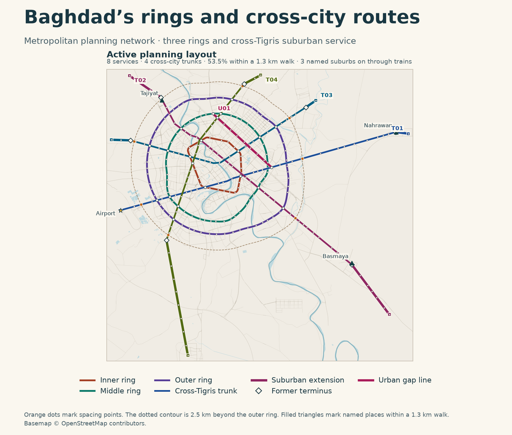
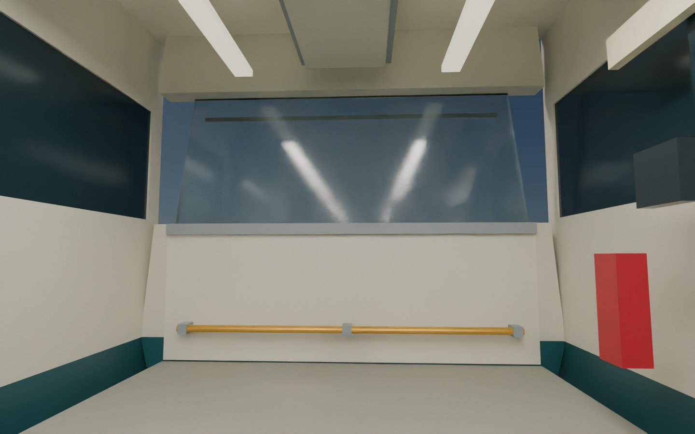
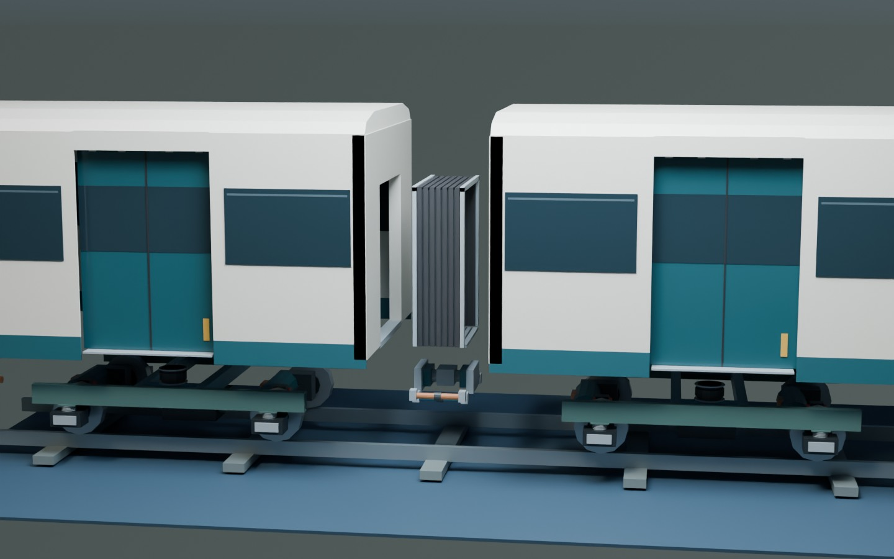
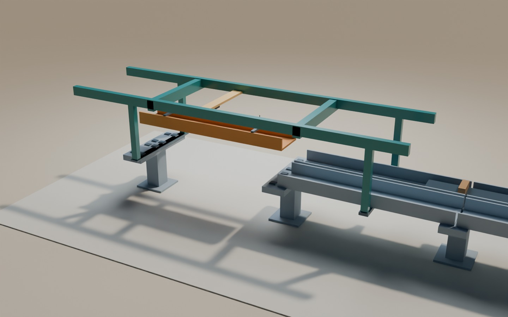
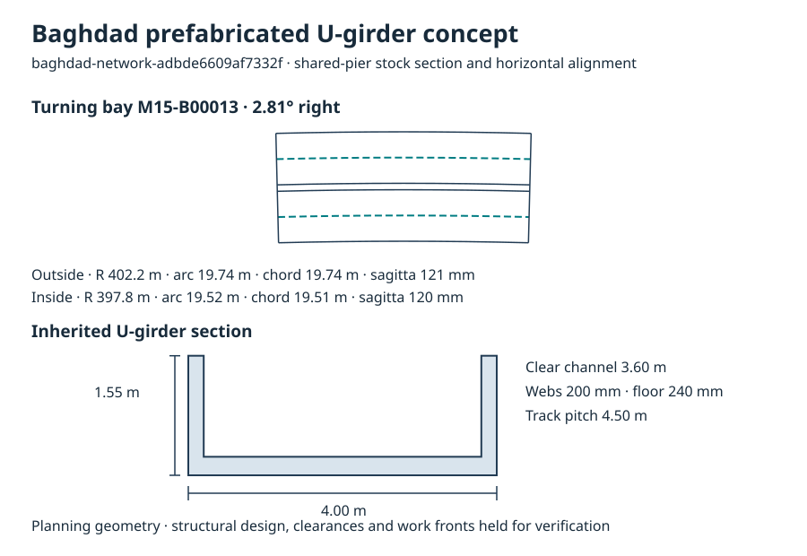
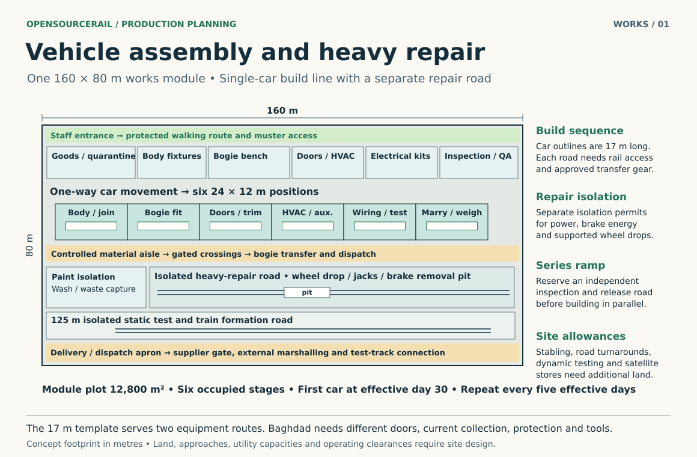

# OpenSourceRail Baghdad metropolitan railway

**Proposal to Amanat Baghdad · 26 November 2026 · planning prices in 2026 US dollars**

<!-- current housing budget -->

**Current metropolitan planning case.** 350.25 km of distinct mapped guideway, 700.51 running-track km and 256 station sites. The base installed planning allowance is **US$17.53bn**. Standard casting, haul and erection account for 2.82 million paid hours. [Quantities, labour and costs](METROPOLITAN-DELIVERY.md) · [Network and map](METROPOLITAN-NETWORK.md)

<!-- end current housing budget -->

## The railway and its passengers

The planning network joins three rings and four cross-Tigris trunks at shared passenger stations. It carries suburban passengers through the city from Basmaya, Nahrawan and Tajiyat. The access comparison tests a 1.3 km street walk at each end and up to two changes for trips to named centres. [Network, journeys and GIS](METROPOLITAN-NETWORK.md) · [Layout and access comparisons](THREE-RING-STUDY.md)

*T01 runs between the Airport and Nahrawan. T02 serves Tajiyat and Basmaya. The three named suburbs are within a 1.3 km street walk of a through service. Coverage and access gaps remain in the planning study.*

## Programme, service and lifecycle costs

<!-- current route programme -->

The active layout has 4 cross-Tigris trunks and 3 rings. The planning inventory identifies **1,560 curved girder pieces** and **34.68 service-route km** of interfaces that need detailed geometry and engineering.

| 2026 planning scope | Low | Base | High |
|---|---:|---:|---:|
| Installed allowance | US$12.28bn | US$17.53bn | US$26.82bn |
| Annual operation | US$0.43bn | US$0.49bn | US$0.54bn |
| 30-year present cost | US$20.56bn | US$27.11bn | US$37.88bn |

The six-minute costing offer uses 227 trainsets including reserves, 104 nominal supply sites and 978.3 GWh per year. The project opening date depends on the complete construction and commissioning programme. [Delivery programme](METROPOLITAN-DELIVERY.md) · [Beam designs and work orders](engineering/mechanical/civil/CURVED-BEAM-PROGRAMME.md)

<!-- end current route programme -->

The city should confirm continuous accessible street and station paths with people using wheelchairs and airport passengers with luggage. Verify crossing times, lift availability, gradients, emergency egress and the boarding gap with the vehicle and station teams. The priced service offer supplies a fleet and energy allowance. Timetables, junction occupation and peak loads need their own verification.

## Trains and accessible stations

The Baghdad pricing reference uses a six-car powered-wheel train with six 17 m cars, a 700-place normal load and four passenger door openings per side per car. The train is designed for unattended GoA4 operation, with glazed passenger ends and separate rescue couplings. The straight island interface allows 125 m of clear platform. Confirm vehicle limits, body motion, suspension travel, doors and platform gaps in the same model. [Vehicle and station specification](TRAIN-AND-STATION.md)

*The vehicle concept shows the glazed passenger end, window band and accessible doors.*

*The open saloon continues to the end glazing. The rescue coupling mounts below the floor.*

[Saloon seating and accessible areas](../../docs/assets/assembly-animations/train-saloon.jpg)

*The end connections include the passage floor, draft gear, air and electrical connections. Test curvature movement, cable and hose allowance, safe uncoupling and rescue.*

*The platform and rail structures carry different loads. Their relative movement must fit the boarding tolerance.*

## Viaduct construction from both ends

Recurring bays use **20 m U-girders on shared piers**. Two terminal yards feed two inward-moving gantries on an eligible open line. Each nominal yard needs **16 moulds**, **24 released-stock positions** and a **216 × 164 m** site. The works comparison allows **three paired launcher crews, two road teams and eight concurrent yards**. Foundation and column access, station works, bridges, starters and special lifts have separate scopes. [Live stock and yard specification](engineering/mechanical/civil/LIVE-STOCK.md) · [Route-level work orders](METROPOLITAN-DELIVERY.md)

*The flatbed carries a released beam over completed guideway. Verify the temporary deck and trailer loads, lift radius, rigging, bearings and method of access at the site.*

*The girder register records both track paths, different mould settings, materials and shift allowances. River crossings and constrained geometry carry their own design and pricing holds.*

## Power, protection and maintenance

Protected conductor supply keeps collection beside the running rail. The 17.46 km Airport simulation compares moving loads and outages on that corridor. Its six-site paired case completes 72 scheduled trips under the specified 30-minute trial. The procurement cases require matched source ratings, return circuits, switching, fault clearance, thermal duty and safe access. [Airport evidence and enquiries](engineering/simulation/AUDIT-RESULTS.md)

The stops, braking curves and available adhesion set separation and recovery requirements. Measure independent brake duty and hot-weather service battery performance on the selected train. The station bench exercises proved berth, correct-side door enable, parking hold and protected departure. [Controls and protection](engineering/controls/STATION-BENCH.md) · [Passenger, cooling and emergency duty](engineering/simulation/passenger-guide.md)

*The supervision display indicates stale data and active alarms. Safety-related commands and feedback need their own engineered interfaces.*

## Iraqi fabrication and supply

Request local tenders for civil stock, carbody work, stations, installation, inspection and repair. Use controlled geometry, bills of material, tooling, process routes, timed operations and first-article evidence. Confirm when the yard, factory or repair road can sustain the promised output, including maintenance, rework and material delays. [Rapid production workcells](engineering/prototype/rapid-production/README.md) · [Fabrication and assembly drawings and films](../../docs/assets/assembly-animations/GUIDE.md)

*The module shows separated production, inspection and repair routes. Validate plant, staffing and material flow against the requested production volume.*

## Delivery, funding and procurement

### What the city would need to pay

Use the installed, recurring and present-cost results above as planning allowances. Construction cash depends on land and utility release, route phasing, common equipment commitments, supplier payment terms, training and the safely deliverable opening sequence. Assess fare and public-service contributions using locally measured demand. [Current scope and price cases](METROPOLITAN-DELIVERY.md)

Ask each bidder for a delivered cash price and a financed price against the same components, service, renewals, warranty, imported scope and domestic content. Require editable interfaces, tooling rights and a witnessed local repair trial where these are part of the offer. [Matching bidder returns](PROCUREMENT.md)

| Decision | Evidence to request |
|---|---|
| Confirm the corridor | Surveyed geometry, land and utility releases, street access, site-specific crossings and terminal arrangements |
| Develop one repeatable construction package | Shared-pier and curved stock drawings, approved material and lifting limits, actual yard and contractor returns |
| Confirm the operating envelope | Route-specific stopping, degraded power, clearances, access, egress, staffing and maintainable interfaces |
| Match industry and financing | Dated items, annual resources and cash draws, training, renewals, supplier origin and local repair obligations |

The Airport corridor provides a bounded opening candidate for further development. Align the route, local prices, utility duty and tests before comparing phased procurements. [Airport digital reference](engineering/simulation/PROJECT-REFERENCE.md) · [OpenSourceRail standards and evidence](../../docs/certification/README.md)
