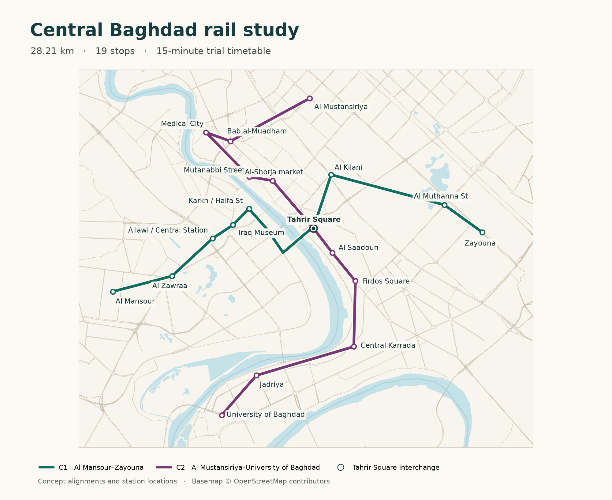
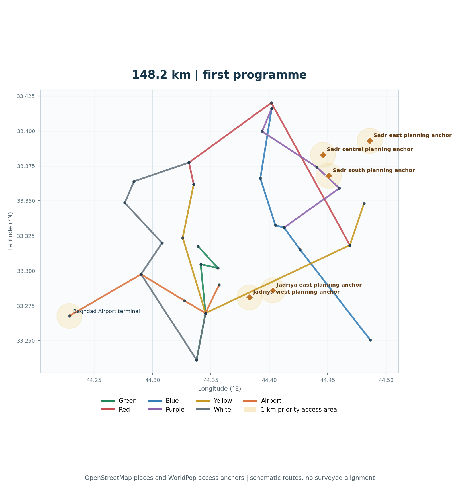
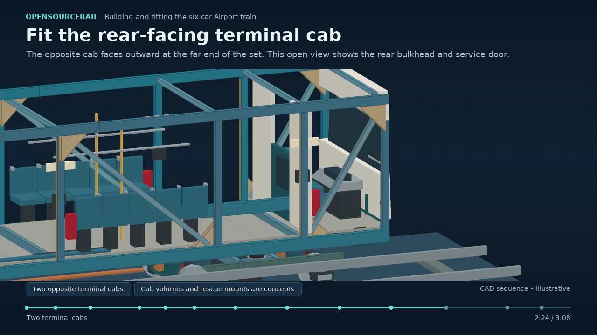
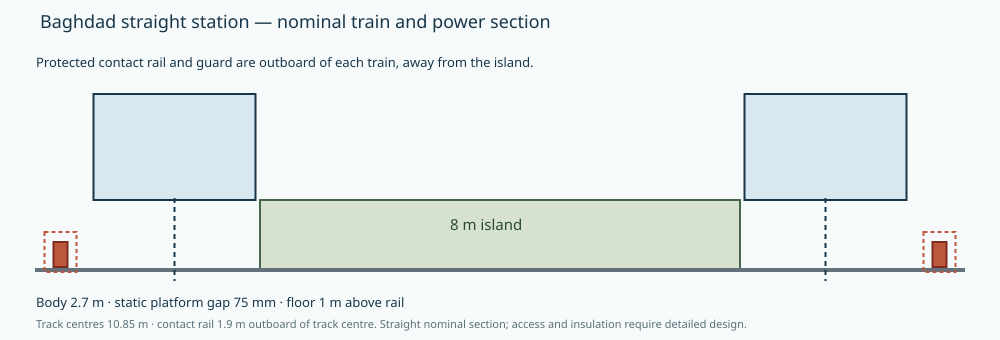
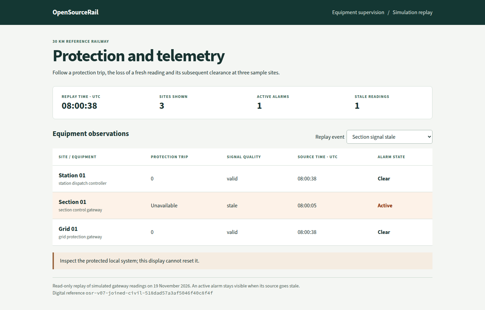

# OpenSourceRail Baghdad metropolitan railway

**Proposal to Amanat Baghdad · 20 November 2026 · planning prices in 2026 US dollars**

**Iraqi construction budget.** The seven corridors cost an estimated **$8.37bn** centrally, with a **$6.12bn–$12.35bn** planning range. The independent citywide alternative costs **$33.00bn** centrally, with a **$24.10bn–$48.83bn** range. The common design-rate estimates of $7.866bn and $31.018bn remain available for matching vendor returns. At the Iraqi central prices, estimated domestic value within Iraqi-awarded contracts is **$1.84bn** and **$7.36bn**, respectively. [Capital by work package and year](IRAQ-CAPITAL.md) · [Operating costs, fares and debt payments](IRAQ-ESTIMATES.md)

## Brief

Baghdad needs a railway that serves daily trips across the city, reaches the airport passenger terminal, and can grow with its population. OpenSourceRail proposes a locally buildable, repairable electric railway on standardised elevated structures. The passenger lines have **no tunnels or underground stations**. Trains draw power from a protected conductor beside the track, so the preferred design has **no overhead wires**. Iraqi factories and contractors would take an increasing share of precast concrete, vehicle bodies, stations, assembly and maintenance.

The earlier investment process did not secure a contractor to deliver the metro. Amanat Baghdad’s spokesperson told Al-Mada that the investment offers fell short of the government’s requirements. Two days later, the National Investment Commission’s deputy chair told NINA that a new study and updated plans were being prepared for fresh investment opportunities. [Al-Mada interview with Amanat Baghdad, 25 October 2026](https://almadapaper.net/458226/) · [NINA interview with the National Investment Commission, 27 October 2026](https://ninanews.com/website/News/Details?key=1322248)

OpenSourceRail is preparing for new ideas in **late 2026 to early 2027**. The authority has yet to publish a submission date in the sources reviewed. The seven corridors provide a historical comparison while Baghdad revisits its routes, service and financing.

The original planning work priced **two independent comparison cases**. The **148.2 km concept** follows the seven corridors named in the Iraqi investment brief. The **605.652 km citywide concept** has its own nine cross-city and ring corridors, six infill corridors and proposed links. Its 2035 construction allowance covers the complete guideway plan, including six sections reserved without passenger paths. The planning service assigns access branches to through trains. The route design must resolve their connections before the timetable can be set.

| Programme | Costed guideway | Stations budgeted | Train fleet | Central Iraqi capital | Modelled completion |
|---|---:|---:|---:|---:|---:|
| Seven-corridor concept | 148.2 km | 64 | 242 six-car trains | **US$8.37bn** | 2031 |
| Independent citywide concept | 605.652 km | 280 | 934 six-car trains | **US$33.00bn** | 2035 |

The 2027 capital draws and 2031/2035 completion years are scenario dates. Rebase them on the new procurement timetable once published. Each estimate records its original track, fleet and station allowances. The central redesign has its own scope and will need its own estimate. The detailed [cost and delivery schedule](COST-AND-DELIVERY.md) names every quantity, rate, annual operating cost and renewal.

## Earlier idea and present planning design

OpenSourceRail began with a light, wheel-supported train accelerated at stations, then coasting between them. That remains a useful cost-reduction question. The Baghdad planning design uses motors on the train and a protected conductor alongside the rail because its longer, graded journeys need sustained traction. Both ideas retain open design, local fabrication, accessible stations and independent braking. They are distinct physical candidates: the powered Baghdad train's fleet price and energy cannot be assigned to a passive train.

| Design decision | Station-launch, passive-wheel idea | Present Baghdad planning design |
|---|---|---|
| Train propulsion | Station equipment provides launch force; train coasts between stations | Wheel motors provide launch, acceleration and hill-climbing throughout the trip |
| Line power | Local launch equipment and service power; powered length depends on each stop | Guarded, sectionalised conductor on both tracks; no overhead wires |
| Train equipment | Passive bogies, independent service battery and brakes | 24 driven axles, converters and contact shoes; separate 65 kWh service battery and brakes |
| Civil and stations | Track, launch/braking equipment, power and interfaces sized for the selected route | Elevated double track, wayside protection, grid sites and accessible stations |
| Cost and status | Research option; no matched Baghdad installed cost or service timetable | Integrated 148.2 km and independent 605.652 km planning estimates below |

The earlier coast calculation cannot carry a crowded train through every long or uphill Baghdad section at the desired speed. A cheaper station-launch design would need a route-specific mix of shorter gaps, booster sections or small onboard motors and storage, plus a full stopping and recovery case. The **station-charged battery** row later in this proposal is a *powered-bogie train*, not that passive station-launch idea. It must not be presented as its cost.

The present plan also changes the older tunnel and overhead assumptions: **zero passenger tunnels and zero underground stations** are fixed planning requirements, while the conductor is the lowest priced supply under the current assumptions, not a supplier-proven winner. A no-catenary system remains the preferred procurement outcome. A tender can test overhead, limited-conductor and battery alternatives against identical service, safety and 30-year cost duties.

## The city and the routes

### Current central rail study

The central concept runs two end-to-end services over 28.21 km with 19 proposed stops and a transfer at Tahrir Square. Both termini and every proposed call are shown below. The concept has its own timetable. Its route and price scope remain separate from the 605.652 km comparison. [Central timetable and walking access](CENTRAL-ACCESS.md) · [Central routes GIS](maps/central-service.geojson)

*Central Baghdad rail study. C1 crosses the Tigris. C2 connects Old Rusafa and Karrada. The two lines meet at Tahrir Square.*

### Earlier guideway comparisons

The independent 605.652 km scheme is a comparison case. The central access review finds gaps at the east-bank markets and Tahrir Square even after the main routes are timed. Reconsider service through the centre before using its construction and operating totals for an investment decision. [Station coverage and central trunk study](CENTRAL-ACCESS.md)

The [seven-line map](maps/Baghdad-148km.png) reproduces the Iraqi National Investment Commission’s February 2024 proposal. Its original satellite background shows the airport approach, route bends and crossings of the Tigris. The route table prints 148 km overall and the seven line items sum to 148.2 km. The independent OpenSourceRail citywide map uses a wider geographic extent and its own GIS linework. [NIC map and route table, page 4](https://mofa.gov.iq/paris/wp-content/uploads/sites/55/2024/02/Baghdad-PDF.pdf#page=4)

*Seven-corridor alternative. The Airport line starts in the west. The published lengths in the table below price 148.2 km. Source: National Investment Commission, February 2024, page 4.*

| Line | Length | Principal places served |
|---|---:|---|
| Green | 19 km | Al Alawi, Mansour, Yarmouk, Bayaa, Doura |
| Red | 27.7 km | Al Alawi, Kadhimiya, Adhamiya, Mustansiriya, Maisaloun |
| Blue | 22 km | Al Shaab, Waziriya, Khallani, Tayaran, Zuafaraniya |
| Purple | 14.5 km | Tayaran, Hamza, Ur, Al Shaab and Sadr City approaches |
| Yellow | 30 km | Baladiyat, Maisaloun, Chadriya/Jadriya, Bayaa, Adan |
| White | 23 km | Kadhimiya, Shulah, Gazaliya, Khadhraa, Amiriya, Bayaa |
| Airport | 12 km | Airport passenger-terminal area, Amiriya, Aamil, Bayaa, Qadisiya |

**Airport service** is part of the railway, not a feeder bus assumption. The NIC plate marks the western end at Baghdad Airport. The station must connect to the landside entrance by a step-free, protected walking route, with the operating and security boundary agreed with the airport. The separate GIS access study uses a terminal-building point.

The independent citywide network gives the **airport terminal** an access section on service M05; it assigns the three **Sadr City** anchors to M04 and M09 through branches and the two **Jadriya** anchors to M01 and M02. The Sadr cross-city services M10 and M11 and the southwest service M13 add direct capacity through those catchments. These are schematic railway corridors to the named access areas, not approved platform sites or walking routes.

The [citywide comparison map](maps/Baghdad-606km.png) shows 26 schematic physical sections, grouped by their status in the 14-route trial. The costed layout includes nine principal corridors, five shared links, six infill corridors and six access branches. All are included in the citywide guideway-length and capital controls. The **14 named service groups** cover 20 sections; six are reserved non-revenue corridors without a train path. The station budget is 280. The two maps' lengths are declared planning controls; their drawn polylines are not measured construction centre lines. The [map guide](maps/README.md) provides the editable GIS layers and sources.

*Earlier citywide comparison. The train plan covers 552.562 km. The map distinguishes deferred access and reserved guideway. The original prices cover all 605.652 km.*

| Through-service groups | Citywide role |
|---|---|
| M01–M03 | Cross-city spines with Jadriya west assigned to M01 and Jadriya east to M02 |
| M04–M06 | Northwest–southeast and east–west spines with Sadr south and centre assigned to M04 and the airport terminal to M05 |
| M07–M09 | East–west, southeast–northwest and orbital services with Sadr east assigned to M09 |
| M10–M11 | Sadr City east–west and north–south services |
| M12–M14 | Karkh north–south, southwest cross-city and northern cross-city services |

The 14 named service groups have passenger-path assignments on **555.553 km** of the 605.652 km costed guideway. Five shared connectors and the east inner arc total **50.099 km** and are reserved without scheduled trains or station openings. The capital estimate includes **$1.122bn** in identifiable construction and related allowances for those sections. Annual operations include **$2.004m/year** in conductor upkeep. A decision to build or defer the reserve would require a new network design and estimate. See the [reserve cost breakdown](COST-AND-DELIVERY.md#reserved-citywide-guideway), [network input](system.toml) and [GIS layer](maps/network-606km.geojson).

### What the maps establish

The [geographic review](maps/corridor-review.geojson) locates 39 of 52 named corridor occurrences. Its Red line uses the Adhamiya quarter, 6.9 km from the district centroid used previously. The named-place GIS layer leaves gaps at 13 unresolved occurrences. The earlier schematic connected known points across gaps and drew 138.395 km. The seven lengths in the investment brief sum to 148.2 km and supply the cost allowance. The citywide linework draws 608.460 km and is normalized to a 605.652 km cost control. The [mapped station screen register](station-register.json) lists 37 first-network named access points and 220 citywide stop screens against budgets of 64 and 280 stations. These are planning points, not approved platform sites. Connected junction paths and individual stops are still needed for a dispatchable timetable and location-specific land budget. The six reserved sections have declared purposes but no passenger movement.

The junction screen finds **2.323 km and 2.710 km** between the nearest ends of the two M04 Sadr City access branches and their assigned main line. The airport branch in M05 meets the drawn end of its main line. Other access branches meet the interior of a drawn line or loop. M04 needs a revised route connection. All six access branches need an explicit track layout and train path before the service assignments can establish a timetable. See the [junction screen](system-results.json).

The GIS background and district names support public discussion, utility searches and corridor screening. Bridge clearances, foundation ground, property rights and platform entrances require project investigation. The cost estimate includes allowances for these scopes.

### From a map point to an accessible entrance

At the airport, walk from the landside terminal door to the proposed platform with airport operations and a passenger using a wheelchair. Record the kerbs, gradients, crossings, shade, security boundary and lift location. At Al Amiriya, walk the proposed transfer between the Airport and White lines in both directions. If crossing the street takes longer than the timetable allows, revise the connection or the entrance before promising a journey time.

Keep the entrance, platform centre and passenger walking route as separate survey records. Moving an entrance can change land requirements, lifts and walking time without moving the track. Moving the railway can change span locations, utilities, train running time and fleet needs. Give the city both the earlier and revised quantities when it compares a site. This applies the book’s passenger journey and mapping method to locations Baghdad can inspect. [Passenger access](../../docs/book/02-passenger.md) · [Working with Baghdad route changes](../../docs/book/45-baghdad-next.md)

## Trains and passenger service

The Baghdad train has **six 17 m cars**, a coupled length of about 104.5 m and a **125 m clear platform**. Each car has four 1.3 m clear double-leaf door openings on each side, 20 fixed seats and two wheelchair places. The train carries about **700 people** at its normal urban-service cap, including planned standing. Step-free access, platform gaps, evacuation width and independent stopping are design duties, not cost-saving options.

Powered wheel bogies give the train sustained traction between stations. The protected conductor design has **24 driven axles**, a **201.092 t** crowd-load train mass and a **5.004 MW** input sizing request at the stated uphill acceleration duty. It does not carry a traction battery or a roof collector. Each train's independent 65 kWh nominal service battery supplies controls, lighting, braking and egress duty for the declared two-hour outage case; its mass, recharge power and price are included in the existing train allowances. Baghdad summer cooling is included in the vehicle and energy allowances. The [vehicle and station section](VEHICLE.md) gives the car layout, platform gap, protected conductor position and replacement interfaces.

A **150-second peak interval** offers **16,800 places per hour per direction on one service**. The declared 06:00–24:00 offer uses four hours at 24 trains/hour/direction, eight hours at 12 and six hours at 6 on each assigned passenger path. That is 228 departures per service and direction daily, about **2.234 million offered places/day** across the seven corridors and **4.469 million** across the independent citywide plan. These are offered places, not forecast passengers. The plans cost **24.666 million** and **92.466 million train-km/year**, respectively. A three-minute layover at each terminal gives peak cycle requirements of **208 and 742** trainsets; the fleet budgets retain **210 active/242 total** and **812 active/934 total**. The reserved citywide sections have no train service.

The passenger offer includes step-free entry, wheelchair spaces, clear door signs, audible and visible next-stop information, Arabic and English wayfinding, line maps, disruption displays and staffed assistance. Station equipment needs a local information feed so a power or communications interruption cannot silently leave misleading departure or evacuation messages. Platform crowd handling, transfer walking distances, individual stop dwell and junction capacity need a location-specific service design; no daily ridership or fare revenue is assumed in the financial totals.

*One 17 m Baghdad car. Four openings on each side serve a high-turnover urban service. The operator can use the drawing to rehearse boarding with luggage, mobility devices and passengers waiting to alight.*

### Timetable from the earlier Airport comparison

In the earlier schematic study, Airport-001 departs at 06:00, reaches Al Amiriya at 06:03:19 and leaves 35 seconds later. It reaches Al Qadisiya at 06:18:57 and starts its return at 06:21:57. A five-minute accessible walk at Al Amiriya would leave 5 minutes 48 seconds before the 06:14:07 White-line departure. The connection is a specific walking-time test for the station team. At peak, a single signalling block between successive stations cannot accommodate the proposed 150-second interval in this timetable. The corrected alignment needs its own timetable, separation and transfer calculations. [Current Airport simulation and pricing](engineering/simulation/AUDIT-RESULTS.md)

*Timetable screen for the seven-corridor operating study. Arrival, departure and return belong to the same trainset. Times are planned workings.*

### The train an Iraqi workshop can price

The lined-jamb first article uses 120 body parts and 24 parts across two powered-bogie frames, with about 5.27 t of gross cut stock per car set. The shop needs to quote welding, distortion control, machining, coatings, joint inspection and scrap. Equipment suppliers then add the wheelsets, suspension, drives, brakes, doors, wiring, cooling and interior. Procurement needs both the stock return and a separately reconciled installed weight for axle loads and traction duty. [Installed general arrangement and mass evidence](engineering/prototype/vehicle-factory/INSTALLED-GA.md)

*An earlier braced frame comparison. Bracing reduced the idealised gravity-case deflection from 61.44 mm to 8.61 mm. The newer frame and the fitted concept require their own torsion, joint fatigue and doorway checks.*

*The bogie supplier and body builder share the spring and mounting datums. A depot trial must establish where a technician disconnects the harness and brake interfaces and how the bogie clears the body during replacement.*

### The finished train and its connections

The fitted concept carries the steel frame datums into a six-car formation with a cab end at each extremity and five walk-through inner connections. The images show the proposed glazing, passenger door modules, seats, wheelchair spaces, handrails and onboard services. The connector view exposes the draft gear and the air and electrical jumpers under the gangway. For automatic operation the outer cab space represents a supervised recovery and service interface. Supplier returns need to define the actual coupling envelope, articulation, stopping and rescue loads, electrical isolation, fire performance and replacement access. [Train assembly film, geometry, weight and workplans](../../docs/assets/assembly-animations/GUIDE.md)

For one set, the frame schedule carries 31.64 t of gross stock and a $181,000 base stock and fabrication allowance. The modeled running equipment and fitout carry a separate 55.58 t and $1.949m at base. These are scope allowances for supplier comparison. The parts and shift schedules record the prices and labour overlap for each package. [Train and civil assembly cost schedule](../../docs/assets/assembly-animations/GUIDE.md#parts-cost-and-shifts)

*The fitted concept at the scale of its 17 m car modules. The illustration uses the first-article frame datums and concept body finishes.*

*Rear-facing cab and equipment access, shown before closing the outer envelope. Both train ends have provision for recovery and towing.*

*Saloon fitout study. The model provides 20 seats and two wheelchair places per car. Measured approach clearances and loaded floor and suspension behaviour still need to be demonstrated. [Cutaway of the entire car interior](../../docs/assets/assembly-animations/train-interior.jpg)*

*Inter-car interface study. The gangway and floor bridge provide the passenger passage. The draw gear and service connections sit below it and have separate installation, test and inspection steps.*

## Viaducts, stations and street works

The current delivery comparison uses **20 m precast U-girders and shared piers** on standard bays. Two terminal yards supply two inward-moving launching gantries on each suitable open line. Flatbeds bring girders along the installed deck behind each gantry, reducing the need for beam deliveries and routine lifts from the street. Foundations, support construction, starters and closure bays retain their own access and temporary works. Request prices on the actual railway, crossing, temporary-load and ground scope. [20 m construction quantities, cost and cash](engineering/mechanical/civil/rail-fed/network-delivery.md)

*Rail-fed placement concept. The illustration locates the launcher support and lifting gear, the deck flatbed and the pier bearing interface. Their rated equipment and temporary stability need a matched erection study.*

[Completed paired viaduct bay with permanent track and service routes](../../docs/assets/assembly-animations/viaduct-completed.jpg)

Accessible stations provide clear passenger routes, lifts or ramps where required, protected platform edges, fire and evacuation provisions, equipment access and safe transfer to streets and buses. A station's structural and electrical modules should be replaceable without redesigning the whole line. The capital estimate counts **64 stations** first and **280** for the independent citywide network, at a common planning rate of **US$13m each**.

The seven-corridor delivery study counts **14,820 girders, 7,417 shared support positions and 14 terminal yards**. Each typical yard has 16 moulds and 24 released-beam storage positions. Direct civil scope is **$1.350bn** for deck feed and **$1.406bn** for road erection of the same 20 m stock. The headline historic capital and cash tables reproduce their **10 m separate-pier allowance**. The two estimates retain their own structures, equipment and schedule. [Earlier civil basis and comparisons](COST-AND-DELIVERY.md#viaduct-and-construction)

The assembly film follows excavation and cage placement, footing and pier pours, cap and bearing fit-up, girder prestressing and casting, deck transport, placement, closure, and installation of the permanent railway interfaces. The assembly records connect these steps to part quantities, crew time and allowance accounts. The illustrative three-shift deck-feed trial took 164 days for erection, against 220 days for one-shift road erection. Night access, curing and inspection time, starter and closure access and foundation release govern the actual calendar. [Viaduct film, assembly parts and workplan](../../docs/assets/assembly-animations/GUIDE.md)

For one paired repeat bay and its attributed shared support, the geometry and sourced girder mass account for 279.5 t at base. Known materials and bearing supply amount to $34,910. The ledger carries separate support and permanent works accounts and shows the two-front yard and plant provision independently of the per-bay quantity. [Civil assembly cost schedule](../../docs/assets/assembly-animations/GUIDE.md#parts-cost-and-shifts)

The [bogie, body, station and viaduct study](engineering/mechanical/README.md) gives lifting and removal interfaces, door positions, bearing reactions and a dimensioned bogie drawing. On a hypothetical 250 m inner curve the straight-platform setting would overlap the body by 6.9 mm before suspension movement. Confirm station curvature and swept clearance before fixing the platform edge.

### A station bay, from rail seat to street

*Straight-station digital twin. The island is 125 m long and 8 m wide. Platform panels and track beams have separate supports. Relative movement between them changes the boarding gap.*

*Platform and train interface. Check the boarding edge under passenger load, suspension movement and civil settlement, including the effect of curvature at each site.*

*Sections for supplier pricing. A 5 m platform bay uses four panel pitches across the island. A trial panel contains 2.761 m³ of concrete and about 243 kg of straight reinforcement.*

A 10 m trial running beam contains 13.404 m³ of concrete and weighs approximately 34.17 t before rigging. The strength check follows wheel loads through the rail seat and beam, bearings, pier and foundation. At one trial footing the calculated soil pressure is 207.43 kPa. The 150 and 200 kPa comparison soils both fall short. Boreholes, groundwater and utility surveys decide which foundation to price at a real pier. Request a lift study at the actual radius, bearing inspection access and a replacement method with the street and railway occupied. [Civil dimensions and load cases](engineering/mechanical/civil/README.md) · [Construction method from the book](../../docs/book/10-civil.md)

## Power, operations and maintenance

Protected conductor rail gives each train power throughout its journey without continuous overhead equipment or a large traction battery. The budget counts **296.4 track-km** of guarded conductor and **30 grid sites** in the seven-corridor alternative; the independent citywide network counts **1,211.304 track-km** and **100 grid sites**. Section switches, isolation, return current, touch protection, maintenance access and emergency evacuation are part of the installation scope. The two grid design requests are about **152 MW** and **568 MW** respectively; annual delivered energy is **524 GWh** and **1,965 GWh** under each alternative's service allowance.

At a **1.5 kV calculation setting**, one train requests 3.336 kA, rising to 3.707 kA at 90% voltage; two coincident trains request 7.413 kA. Installed conductor ratings, feeder and return circuits, fault protection, voltage drop and thermal duty need section-by-section design. The 65 kWh service battery has 52 kWh declared usable against 50.4 kWh required with reserve; hot-weather and age margins need a stated rating.

A 30-year comparison holds the passenger service constant while changing the train mass, batteries, grid, guideway equipment, electricity use, maintenance and renewals. Under the stated prices, protected conductor has the lowest total cost. The difference from overhead supply is small enough that actual procurement prices can change the choice; the comparison must be rerun before a supply contract is awarded.

| Power supply | First capital | First 30-year cost | Complete capital | Complete 30-year cost |
|---|---:|---:|---:|---:|
| **Protected conductor, preferred** | **$7.866bn** | **$12.021bn** | **$31.018bn** | **$47.394bn** |
| Station-charged battery | $8.201bn | $12.703bn | $32.126bn | $49.717bn |
| Short powered sections plus battery | $7.828bn | $12.080bn | $30.882bn | $47.575bn |
| Overhead supply comparison | $7.927bn | $12.073bn | $31.262bn | $47.596bn |

The selected seven-corridor railway budgets **US$196.978m/year** for electricity, trains, stations and power-system upkeep. The independent citywide railway budgets **US$780.495m/year** under the declared hourly offer. The 30-year present costs include those running costs and scheduled equipment and fleet renewal at a **4% real discount rate**. Fare income, public service payments, debt interest and tax are separate financial decisions.

The conductor-versus-overhead 30-year advantage is **$52.288m** on the seven-corridor network and **$202.307m** citywide, about **0.43%** of the total in each case. An increase of about **$0.124m** or **$0.118m per track-km** respectively in conductor equipment cost removes that advantage if other assumptions stay fixed. A 20% conductor equipment rate increase reverses the modeled ranking in both plans. Procurement should therefore request both systems' installed prices, losses, renewals, access requirements and maintenance staffing. Battery operation must quote cells, thermal management, charger power, replacement and depot fire arrangements. A complete comparison changes train mass and civil loads together with electrical cost.

### Control, safety and public information

The [equipment schedule](../../control-electronics/README.md) counts train protection channels, radios, car and door controllers, bogie brake controllers, service-power units, contact-shoe status, inverter controls, station dispatch, power-section gateways, grid protection and control-room equipment. Its **$102.536m** first-network and **$399.632m** citywide allowances are already inside the fourteen capital scopes; adding them again would double count. The train reserves 0.35 t and 6 kW for controls, with 299 kg and 3.68 kW currently scheduled. These are purchase and mounting allowances for the digital design.

Onboard protection grants traction only with a valid route, safe speed, contact and section status; loss of supply commands an independent stop. Door release depends on train identity, full stop, platform side and position. Wayside detection and interlocking protect occupied track; section isolation protects maintainers and evacuation. Control-room staff supervise service and incidents. The FUXA screen and historian can observe alarms and assets through the gateway; they do **not** issue movement authority or defeat onboard protection. Public displays receive an approved timetable, train-position and disruption feed with a safe fallback message. Software and schematic interface tests are development evidence; they do not establish a commissioned railway.

The systems integrator must deliver cable and connector schedules, isolated traction and control circuits, protection settings, section diagrams, event logs, software version records, access controls, fault response, recovery instructions and a trace between hazard, protective function, test and installed device. Independent braking, safe passenger egress, accessible boarding and fire protection remain fixed requirements in any cheaper option.

The [cabinet schedules and software replay](engineering/controls/README.md) connect train doors, traction permission and protection at a platform stop. The station replay now carries a train from a braked approach through correct-side boarding, 48 closed and locked doors, and a protected departure. Parking, an independent applied brake and drive feedback are simulated. Measure holding force, brake timing and rollback on a loaded rig with the brake supplier before hardware integration.

*Normal station stop in the software replay. The stationary train holds on two brake proofs while 24 doors on the platform side can open. Departure requires all 48 locks and observed drive take-up before the holds release.*

### When a train stops between stations

On loss of a power section, the control room needs the train identity and position, age of the last reading, occupied section and status of adjacent trains. Onboard protection and the independent brakes secure the train. The operator’s incident plan assigns staff to passenger communication, ventilation and heat exposure, mobility assistance and rescue access. A timed exercise with the electricity supplier and emergency services must establish how long essential power lasts and how access will be authorised at the particular site.

*Control-room training example from the shared platform. At 08:00:38 a 33-second-old reading is marked stale and the trip remains displayed. Staff need fresh indications and the authorised railway procedure before restoring service.*

The book follows the failed train all the way to a place where its passengers and crew can leave safely. In Baghdad, rehearse a lost supply during hot weather with an occupied adjacent track. Record passenger message timing, staff arrival, access to each car, isolation confirmation and the decision to resume service. These results determine rescue equipment, shift coverage and the arrangements to agree with fire and ambulance services. [Stopping and rescue](../../docs/book/25-recovery.md)

### Operating organisation and recurring cost

The operating company needs a staffed control room, station teams, train and electrical maintainers, civil inspection crews, cleaners, security, passenger assistance, stores and procurement, payroll and finance. The original operating allowance combines **$2.60 per non-energy train-km**, **$1m per station-year**, grid energy at **$0.12/kWh**, and supply-specific upkeep. It is an allowance that includes operational work; it is not a payroll roster or an audited local wage bill. Staffing, shift premiums, training, spare parts, electricity tariffs and depot productivity should be priced as separate contract schedules before a fare or subsidy plan is adopted.

For the **seven corridors**, the Iraq central case budgets **US$185.7m a year** including US$12.3m in unattended-service payroll and US$50.1m in electricity. At an assumed IQD 750 flat fare, 188.4m annual paid journeys yield US$79.5m after paid discounts and collection. The resulting public requirement including debt service at 50% borrowing, 4% real and 20 years is **US$414.1m** in 2032. The funding sensitivity spans US$201.0m to US$640.8m. This is the first full year in the construction scenario.

The independent **citywide** full-service case budgets **US$738.7m** in annual operations, US$188.6m in fare receipts and **US$1,764.1m** in annual public funding on the same terms. The 14-main-route service budgets US$736.4m for operations. Passenger counts depend on trip length, transfers, uptake and service reliability. The buyer can replace these assumptions in the opening-year calculator. [Iraqi wages, tariffs, fares and ridership assumptions](IRAQ-ESTIMATES.md) · [Traction power and local supply prices](IRAQ-POWER.md)

The [train diagrams](SERVICE-DIAGRAMS.md) link 3,192 daily trips on seven corridors using 208 of 210 active sets. They reproduce the 24.666 million annual train-km in the first-network estimate. Single blocks between stations cannot carry the 150-second peak on these paths. Citywide, ten groups have connected diagrams and four still need branch and junction decisions. Those four account for 40.499 million train-km in the annual budget. An alternative timetable keeps all fourteen main routes, including both directions of the M09 ring, and defers five short access sections. It diagrams **6,384 daily trips on 725 sets**. The difference from the full budget is 497,724 annual train-km. Keeping all infrastructure, stations and fleet, the corresponding annual operating estimate is **US$777.932m**. Measure demand, root each terminal turn in a platform layout and establish safe separation before committing the service offer.

The [workforce comparison](../../docs/operator-review/delivery/README.md) estimates 1,526 FTE for the listed duties under unattended operation on seven corridors. Full supervised cover gives 1,938 FTE and an assistant on 25% of train-duty hours gives 1,629. Obtain local pay by grade and itemise payroll already inside each operating contract. The workshop replaces the matching payroll allowances once and carries the resulting annual operating budget into the funding comparison.

## Iraqi factories and supply chain

Each alternative should buy repeatable assemblies through open drawings and inspectable specifications. The seven-corridor civil window needs **six beam-casting yards and six erection fronts** under the stated first-year ramp and later availability assumptions. The independent citywide civil window needs **ten of each**. The model allows eight beams or lifts per productive workday at each yard or front; more street disruption or slower curing would require added capacity or time. The additional facility cost is not separately priced in the present capital estimate. These are production requirements within each alternative, not shared or already appointed factories.

| Work package | Intended Iraqi contribution | Procured or specialist input |
|---|---|---|
| Viaduct and foundations | Precast beams, piers, reinforcement cages, concrete, erection and repair | Bearings, stressing equipment and specialist testing where needed |
| Train cars | Carbody fabrication, doors and interiors, cable looms, final assembly and depot repair | Motors, converters, bearings and safety-critical controls initially |
| Stations | Structures, stairs, lifts installation, fit-out and passenger facilities | Certified equipment, fire and control components |
| Electrical railway | Cable routes, cabinets, installation, protection enclosures and routine maintenance | Contact equipment, switchgear and traction substations initially |
| Operations | Local staff, training, inspection, spares stores and renewal works | Initial specialist commissioning and training support |

The seven-corridor capital estimate includes **US$99.280m** for tooling, rescue and local-production setup; the independent citywide estimate includes **US$282.261m**. At the declared planning shares by contract scope, **US$12.599bn** of the citywide **US$25.848bn** non-contingency capital is addressable by Iraqi labour, materials, factories and engineering. This is a procurement target and contract-value opportunity, not an assertion that those orders have been placed or a deduction from the **US$31.018bn** total. The [scope-by-scope calculation](COST-AND-DELIVERY.md#local-production-and-design-rights) lets the city compare tender returns with the target.

The Iraqi public design custodian and participating manufacturers should receive the editable drawings, CAD, BOMs, control source, tooling files, inspection methods and revision history needed to **make, modify, repair and re-procure** the railway. The tender should require newly funded design work to be delivered under the applicable [OpenSourceRail licences](../../LICENSE.md) or separately assigned to the Iraqi public sponsor, and identify any supplier background rights, royalties and locked interfaces. Existing third-party map and component rights stay separately recorded. No hypothetical royalty saving is deducted from capital or operations; a bidder's priced alternative can expose that saving.

The industrial contract should link each physical assembly to an engineering drawing, part number, purchased material, approved supplier, manufacturing routing, inspection hold point, installed serial or batch number and maintainable asset record. ERP and purchasing handle quotations, purchase orders, stock, invoices, payroll, work orders and change control. CAD and structural analysis provide controlled design revisions; the digital twin connects those revisions to mass, electrical load, civil quantities and cost. None of these office systems may bypass railway protection controls. The local skills programme should cover casting and testing, carbody welding, harnessing, converter replacement, signalling installation, depot work and locally owned software maintenance.

| Production package | Factory or contractor deliverables | Handover into service |
|---|---|---|
| Representative six-car train | General arrangement, running gear and door interfaces, mass budget, power and cooling schematics, engineering and manufacturing bills of materials, assembly and inspection route | Serialised cars and bogies, software versions, spares, depot removal and rescue instructions |
| Repeatable viaduct span and support | Beam and bearing drawings, material and reinforcement schedules, lifting and temporary-work method, foundation family, inspection and transport records | As-built span and pier identifiers, tolerances, drainage and structural inspection plan |
| Station and electrical module | Platform and door datum, step-free circulation, signage, conductor and section diagrams, power cabinets, fire and isolation arrangements | Tested section and station identity, maintenance access, safe isolation and replacement process |

### Through the vehicle works and precast yard

*Vehicle factory layout for pricing. A 160 × 80 m module accommodates one proposed balanced line. The seven-corridor order is 1,452 cars. Twelve lines allow 1,464 cars under the assumed shifts and availability.*

Follow a car from frame joining through running gear, doors and interior, cooling and auxiliaries, wiring, and final train integration. Measure the frame datums before fitting doors. Record the bought wheelsets and drives against their inspection and car serials. Budget 1,000 direct hours per repeat Baghdad car. Iraqi central final-assembly labour is about US$10,975 per car inside the purchase allowance. The builder needs to demonstrate a repeatable cycle with its available stock, machines and staff.

*The 240 × 140 m yard module occupies 3.36 ha before external roads or satellite storage. Two banks of eight mould positions support the trial rate of eight beams per productive day.*

Dispatch each beam against a named pier pair after checking curing and inspection records, bearings, transport access and the crane position. Track rejected or delayed units separately so a finished casting count does not bring an incomplete street section into the opening programme.

### Employment, training and repair in Iraq

*Seven-corridor workforce scenario. The central 1,526 full-time-equivalent posts include control-room supervision, station and passenger assistance, security, cleaning, maintenance and support. Supervised commissioning can be priced separately.*

For an initial intake of 1,526 staff, allow 80 classroom and 80 mentored hours per person. At twelve per classroom group this needs at least 128 groups. The central learner, instructor and mentor payroll is about US$1.29m within commissioning. Assign isolation to authorised power staff, train recovery to practised operating teams and assisted evacuation to trained passenger-facing staff. The employing operator should retain each person’s signed assessment, permitted equipment, restrictions and renewal date in the HR record.

A maintainer replacing a door operator needs its car position, assembly revision and fault history before arriving at the train. Record the removed serial, fitted serial, technician, inspection result and return-to-store or repair disposition. For a locally made bracket, trace the drawing and material batch. For a purchased sensor, trace the received item and incoming inspection. The book’s lifecycle example gives the city a practical acceptance test for ERPNext records and the supplier’s repair documentation. [Manufacturing and maintenance records](../../docs/book/42-lifecycle-custody.md)

*Earlier ERPNext pilot illustrating the required equipment history. Baghdad will need its own installed serials, approved tasks, staff permissions and warranty terms.*

## Capital, construction cash and delivery

The **US$7.866bn** seven-corridor estimate and the **US$31.018bn** independent citywide estimate each cover viaducts, stations, track, signalling, protection, power, trains, depots, land and utilities, tooling, design, commissioning and one 20% project allowance. Neither is an increment to the other. The [fourteen-scope ledger](COST-AND-DELIVERY.md#fourteen-installed-capital-scopes) reconciles each estimate separately.

The seven-corridor alternative is planned for **2027–2031**. The citywide alternative has its own **2027–2035** construction sequence, with coordinated rights, utilities, factories, parallel civil works, train production and staged openings. The annual construction cash requirement for either choice is:

| Year | Seven-corridor alternative | Independent citywide alternative |
|---|---:|---:|
| 2027 | $393m | $931m |
| 2028 | $1,180m | $2,171m |
| 2029 | $2,360m | $3,102m |
| 2030 | $2,360m | $4,032m |
| 2031 | $1,573m | $4,653m |
| 2032 | — | $5,273m |
| 2033 | — | $4,653m |
| 2034 | — | $3,722m |
| 2035 | — | $2,481m |
| **Total** | **$7,866m** | **$31,018m** |

Each column is a standalone funding requirement and is rounded from the [annual cash schedule](COST-AND-DELIVERY.md#annual-construction-capital-draw). Debt interest, export-credit premiums and operating support are outside these construction totals.

The model also shows spending and later operation on a common **2027 present-cost basis**. Discounting annual construction draws at 4% real gives **$7.152bn** and **$26.101bn** of construction present cost. Assuming full operation begins after each construction programme, the construction plus following 30 years of operating and renewal costs are **$10.567bn** and **$37.606bn** at the 2027 date. These are timing comparisons; the headline $12.021bn and $47.394bn 30-year costs use the start of full service as their reference date. Neither view assumes staged openings, signed debt, interest or fares.

## Raising the capital

Amanat Baghdad and the relevant Iraqi authorities would first settle the sponsoring and borrowing entity, procurement rights, land access, operating model, repayment source and government support. Civil, vehicle, power, signalling, station and depot contracts then use the same controlled railway design and bill of quantities. Iraqi public capital and Iraqi lenders can fund land, local production, buyer payments and the project reserve. UK export credit can support eligible UK-origin manufacturing equipment, specialist components, engineering, training and factory systems within separately priced export contracts.

### Proposed 20% UK equipment / 80% Iraqi production target

The 20/80 split below is an **industrial procurement scenario**, not today's measured content or a lending commitment. It is applied to **priced capital before the 20% project allowance**; the allowance has no assigned country of origin. UK-origin equipment and specialist export packages would be tendered as a proposed 20% share. Iraqi factories, contractors, engineering and assembly would be tendered for the remaining 80% of that priced portion. A true 80% Iraqi award needs matching specifications, domestic capability, accepted prices and quality control; the current model estimates only **$12.599bn**, or **48.7%** of the citywide priced portion, as presently addressable Iraqi contract value. Reaching the 80% target needs about **$8.079bn** of additional local scope, supply development or revised packaging.

| Funding and procurement scenario, US$ million | Seven corridors | Independent citywide |
|---|---:|---:|
| Priced capital before project allowance | 6,554.725 | 25,848.124 |
| Proposed UK-origin equipment and specialist contracts, 20% | 1,310.945 | 5,169.625 |
| Proposed Iraqi production and delivery, 80% | 5,243.780 | 20,678.499 |
| Project allowance, origin unassigned | 1,310.945 | 5,169.625 |
| **Installed capital** | **7,865.670** | **31,017.749** |

[UK Export Finance's Buyer Credit Facility](https://www.gov.uk/guidance/buyer-credit-facility) guarantees an acceptable bank's loan to an overseas buyer for an eligible export contract. Its published maximum is **85% of that contract**, with at least **15% paid directly by the buyer**; a UK exporter must carry on business in the UK, the export contract is at least **£5m**, and the repayment period is at least two years. [UKEF's foreign-content policy](https://www.gov.uk/government/publications/ukefs-approach-to-foreign-content/ukefs-approach-to-foreign-content) can allow up to 80% foreign content within an eligible supported contract with at least 20% UK content. That is a **contract-content rule**, not a promise to fund 80% of the Iraqi railway. [OECD local-cost rules](https://www.gov.uk/government/news/new-oecd-rules-on-support-for-local-costs) also restrict support for costs incurred in the buyer's country. The clean first financing case therefore places locally procured civil and factory contracts outside the UK export-credit contract unless UKEF confirms a specific eligible package.

If the entire proposed UK slice became an eligible Buyer Credit export contract and an acceptable bank lent at the published 85% ceiling, the **illustrative upper bound** would be as follows. It assumes no fees, premium, interest or exchange movement and does not treat a facility as approved or drawn.

| Illustrative Buyer Credit ceiling, US$ million | Seven corridors | Independent citywide |
|---|---:|---:|
| Proposed eligible UK export contract | 1,310.945 | 5,169.625 |
| Bank loan at 85% of that contract | 1,114.303 | 4,394.181 |
| Buyer cash on export contract, 15% | 196.642 | 775.444 |
| Iraqi production, project allowance and buyer cash needing other funding | 6,751.367 | 26,623.568 |

The seven-corridor illustrative loan is **14.17% of the installed railway cost**, not 85%; the independent citywide illustrative loan has the same proportion. The amount available may be much smaller. [UKEF's Iraq cover page](https://www.gov.uk/guidance/country-cover-policy-and-indicators) states medium/long-term cover is available for consideration and a **£1bn–£2bn market risk appetite**, subject to care on location; that is guidance rather than a project allocation. The citywide dollar illustration is much larger than this pound-denominated appetite; the exact comparison depends on exchange rates and existing exposures. A UK bank, UKEF, Iraqi sponsor and Iraqi lenders would need to agree tranche size, country capacity, security, repayment and draw schedule. [UKEF Direct Lending](https://www.gov.uk/guidance/direct-lending-scheme), ordinarily up to £200m per transaction, is a separate possible product and is **not** added to the Buyer Credit ceiling here.

### Funding each construction year

The annual capital draw above is a planning cash requirement, not a debt draw. At the same 20/80 sourcing target, **one sixth of each year's installed cash** is the proposed UK export package, **two thirds is Iraqi production** and **one sixth is the unassigned project allowance**. If the full UK package qualified at the 85% Buyer Credit ceiling, a bank could hypothetically provide **14.17% of each year's installed draw**, while the buyer and other lenders still provide **85.83%**, before financing charges. On the first network's $2.360bn peak annual draw, that illustrative bank share is about **$334m** and the remaining cash about **$2.025bn**. On citywide's $5.273bn peak draw, they are about **$747m** and **$4.526bn**. Actual export-credit payments follow equipment contracts and delivery milestones, so these annual proportions are a cash-planning sensitivity only.

Capital raising should proceed through a funded preparation phase; matched export, civil and rolling-stock tenders; bank and UKEF review of eligible contracts; Iraqi budget and lending approvals; and corridor-by-corridor financial close. The sponsor must also decide fare policy, public service payments, debt service, interest during construction, UKEF premium, foreign exchange and operating support. None is netted against the engineering capital estimate. Local public ownership of drawings and software lowers future dependency only when licences, tooling access and repair rights are written into the signed contracts.

### What the city would need to pay

The table follows each programme's annual construction draws. It compares the budget paying for construction directly with three hypothetical borrowing cases. All figures are **US$ million in constant 2026 prices**, rounded. Interest is paid from the budget on the opening balance and half of each year's new borrowing. Equal annual repayments start in the first full service year. The 4% and 7% real rates and repayment periods are assumptions for comparing offers. They carry no lender commitment.

The table uses the original operating rates so bidders can reproduce the financing comparison. The central Iraqi operating and fare assumptions above give the sponsor’s local opening-year funding estimate.

| Programme and debt case | Construction interest | Peak annual buyer cash during construction | Annual debt service | First full year including operations |
|---|---:|---:|---:|---:|
| Seven corridors, public budget | 0 | 2,360 | 0 | 197 |
| Seven corridors, illustrative export slice at 4%, 15 years | 91 | 2,054 | 100 | 297 |
| Seven corridors, 50% debt at 4%, 20 years | 322 | 1,282 | 289 | 486 |
| Seven corridors, 50% debt at 7%, 12 years | 564 | 1,359 | 495 | 692 |
| Citywide, public budget | 0 | 5,273 | 0 | 780 |
| Citywide, illustrative export slice at 4%, 15 years | 705 | 4,625 | 395 | 1,176 |
| Citywide, 50% debt at 4%, 20 years | 2,488 | 2,987 | 1,141 | 1,922 |
| Citywide, 50% debt at 7%, 12 years | 4,353 | 3,250 | 1,953 | 2,733 |

The 50% cases assume combined debt from all lenders. Any export tranche sits **inside** the 50%. The buyer must fund the balance of construction, service the debt, pay operators and replace assets. In operating year 25, fleet and conductor renewals bring that year's gross requirement to **$1.814bn** or **$7.039bn** respectively, after these example loans mature. Establish a reserve contribution schedule or secure a renewal appropriation. The [annual financing schedules](financing-scenarios.json) carry the actual renewal-year cash calls.

Before financial close, pair each draw with a named payer and appropriation or executed facility. For each operating year deduct evidenced net fare receipts (paid trips times collected net yield) and other contracted income from gross cash needs, then compare the remainder with committed public service payments. Offered seats do not establish revenue. Ask lenders for an IQD and foreign-currency term sheet with the fee, hedge, tax and premium schedules. For unhedged dollar obligations, a 20% rise in IQD per dollar raises their IQD cash requirement by 20% at the same dollar draw. Test delays and cost escalation against a dated nominal budget before selecting a financing mix. Iraq's existing World Bank railway loan covers the Umm Qasr–Mosul railway and provides no allocation for this metro. [World Bank project announcement](https://www.worldbank.org/en/news/press-release/2025/06/25/iraq-new-us-930-million-project-to-extend-and-modernize-railways-promote-regional-connectivity-and-boost-growth)

*Seven-corridor central case in constant 2026 dollars. With US$4.18bn borrowed at 4% real over 20 years, annual debt payments are US$307.9m. Operations and debt need US$493.6m in the first full service year. Estimated net fares of US$79.5m leave US$414.1m to fund.*

## Using the open design in a vendor negotiation

Use the preparation period to request a common comparison of service, installed cost, funding needs and production in Iraq. Share the open quantities and interface schedules with Iraqi manufacturers and international vendors when the authority invites proposals. Issue the same service specification and quantities for turnkey, vendor-led local production and Iraqi-led integration bids. Request both cash and financed prices, 30-year spares and renewal prices, and the incremental cost of transferring fabrication, software maintenance and repair into Iraq. Evaluate guaranteed performance and accessibility first. Compare the remaining offers on whole-life cost and verified Iraqi value added. Require origin records, editable interfaces, diagnostic access, tooling rights and a witnessed local repair before crediting the promised transfer. The [buyer comparison schedule](BUYER-COMPARISON.md) defines the bid returns, negotiation rounds and acceptance milestones.

*Two illustrative station returns show how the buyer can compare a cash price and documented Iraqi content. The screen identifies costs with unresolved origin. Actual offers and commercial terms belong in the buyer’s procurement records.*

Issue a typical elevated kilometre, a difficult crossing and an accessible station to competing teams on the same quantities and operating duties. Ask each team to separate the delivered cash price, tooling, initial training, financing fees and renewals. Return to the bidders with the same objective for Iraqi production, then compare the revised price and the work an Iraqi workshop can actually perform. Witness a locally assembled repeat article and a repair using the supplied drawings and diagnostic tools before crediting either capability.

## Delivery, governance and procurement sequence

The two alternatives have different scale and different funding decisions. For either one, the first contract package should produce a controlled corridor, station and utility register from the public maps; a service plan for every built section; the selected vehicle and power interfaces; and a bill of quantities that a factory and contractor can price. The city can then let repeatable civil, train, station, electrical and software packages against one configuration. Changes in train mass or power supply must flow to piers, energy, fleet, maintenance and annual cash before an option is compared.

The dates and yard counts below reproduce the earlier priced comparison. The 20 m deck-fed estimates have their own phased workloads, yard counts, assembly crews and cash flows. [Current deck-fed construction programme](engineering/mechanical/civil/rail-fed/network-delivery.md)

| Period | Seven-corridor work | Independent citywide work |
|---|---|---|
| 2027–2028 | Sponsor and finance agreements, route and station definition, utility and land planning, first factory setup | Separate citywide corridor and service plan, station register, factory and grid strategy, finance tranches |
| 2028–2030 | Parallel precast, supports, stations, track, power and train production; six casting and erection fronts in the civil window | Begin parallel corridors and factories; ten casting and erection fronts for the 2028–2034 civil window |
| 2030–2031 | Integrate train, control and passenger information; inspect and open accepted corridors | Continue civil, station, train and electrical work and open completed connected sections |
| 2032–2035 | Operate, maintain and record the first alternative if selected | Complete citywide corridors, train delivery, integration and staged opening through 2035 |

Each corridor should have a contract schedule for land and utility access, materials, factory capacity, beam and station output, train delivery, power installation, installation inspection, software acceptance and cash draw. The sponsor must approve a safe opening plan for connected passenger service, including cross-city junctions; the six reserved citywide sections require a separate service or re-scoping decision. The public PDF is a detailed planning and capital-raising proposal; the editable GIS, calculation input and controlled production drawings are the working records for tender development.

## A first opening to price

The current 17.46 km Airport alignment study gives the sponsor a smaller route to scope. The 30-minute paired-feed trial completes 72 booked trips. Public GIS layers and the assembly quantities support separate route and build-cost estimates. Survey, utility protection, fleet and systems supply prices, and acceptance remain open. The earlier **US$813.7m** estimate used a 12 km schematic, a different fleet and its own dedicated facilities. Reuse its cost categories when seeking equivalent offers for the corrected alignment. [Current Airport simulation and pricing](engineering/simulation/AUDIT-RESULTS.md) · [Earlier opening cost and service comparison](AIRPORT-OPENING.md)

At the original common tender prices, a scope-by-scope estimate puts Iraqi value retained within Iraqi awards at **US$1.76bn** on the seven corridors and **US$7.02bn** citywide. In the seven-corridor case the estimated award value is US$3.18bn. Imported equipment supplied under an Iraqi contract accounts for part of the difference. Ask each bidder to improve the price and traceable domestic value against the same quantities. [Iraqi value by procurement package](BUYER-COMPARISON.md#how-much-of-the-order-could-stay-in-iraq)

For the first-network supply study, a pair of trains accelerating together draws the representative collector voltage to **1.344 kV** against a **1.350 kV** planning floor. Request conductor, return and source measurements before choosing feed spacing. Price each 20 m placement against the specified loads and reaction limits of the proposed launcher. For starter and closure lifts, obtain a working-radius chart, rigging and ground design and price the street access. [Train and supply study](engineering/mechanical/vehicle/SECTION-POWER.md) · [Rail-fed erection study](engineering/mechanical/civil/RAIL-FED-ERECTION.md)

## Decision requested

For the next planning review, compare the [central services](CENTRAL-ACCESS.md) with station infill, bus improvements and retained regional connections. Agree how passengers reach markets, jobs, hospitals and the airport before setting the construction scope. Use the original schemes as comparative price and quantity records. Price the revised alignment, transfers, local construction and long-term maintenance against its own service specification.

**Basis of this proposal:** the published Iraqi route brief, open GIS place and population layers, the [Baghdad maps](maps/README.md), the [train](VEHICLE.md) and the [integrated cost schedule](COST-AND-DELIVERY.md). The maps and figures support a funding and procurement discussion. They do not claim surveyed alignments, supplier bids or operating approval.

## Sources and figure basis

The [Iraqi investment brief](https://investpromo.gov.iq/wp-content/uploads/2024/03/3.-RFI-English-%D9%86%D8%A8%D8%B0%D8%A9-%D8%B9%D9%86-%D9%85%D8%AA%D8%B1%D9%88-%D8%A8%D8%BA%D8%AF%D8%A7%D8%AF-E-20.2.2024.pdf) supplies the seven-line names, route-length controls and 64-station programme. OpenStreetMap, Natural Earth and Protomaps supply city context as recorded in the [map guide](maps/README.md). The separate citywide route input, the 280-station allowance and both networks' design, cost and annual cash figures come from [Baghdad system input](system.toml) and [calculated results](system-results.json), checked against the [cost schedule](COST-AND-DELIVERY.md). The [vehicle section](VEHICLE.md) and [control equipment schedule](../../control-electronics/README.md) define the installed planning interfaces. The sources are digital and public; no physical prototype, route survey, supplier quotation, signed loan or passenger-service certification is represented.

UKEF terms are from the [Buyer Credit Facility](https://www.gov.uk/guidance/buyer-credit-facility), [foreign-content policy](https://www.gov.uk/government/publications/ukefs-approach-to-foreign-content/ukefs-approach-to-foreign-content), [Iraq country-cover page](https://www.gov.uk/guidance/country-cover-policy-and-indicators), [OECD local-cost guidance](https://www.gov.uk/government/news/new-oecd-rules-on-support-for-local-costs) and [Direct Lending guidance](https://www.gov.uk/guidance/direct-lending-scheme), consulted 18 November 2026. The 20/80 industrial split and 85%-of-eligible-export calculation are explicitly labelled scenarios, and all source links remain active in the PDF.

The assembly illustrations use the first-article vehicle structure and rail-fed viaduct CAD, with added fitout, connector and construction geometry identified in their quantities and shift schedules. The settings and source hashes are published with the rendered views. [Assembly and figure records](../../docs/assets/assembly-animations/GUIDE.md)
