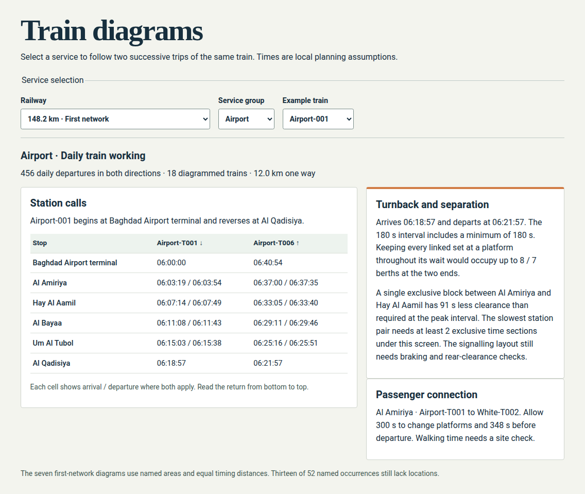
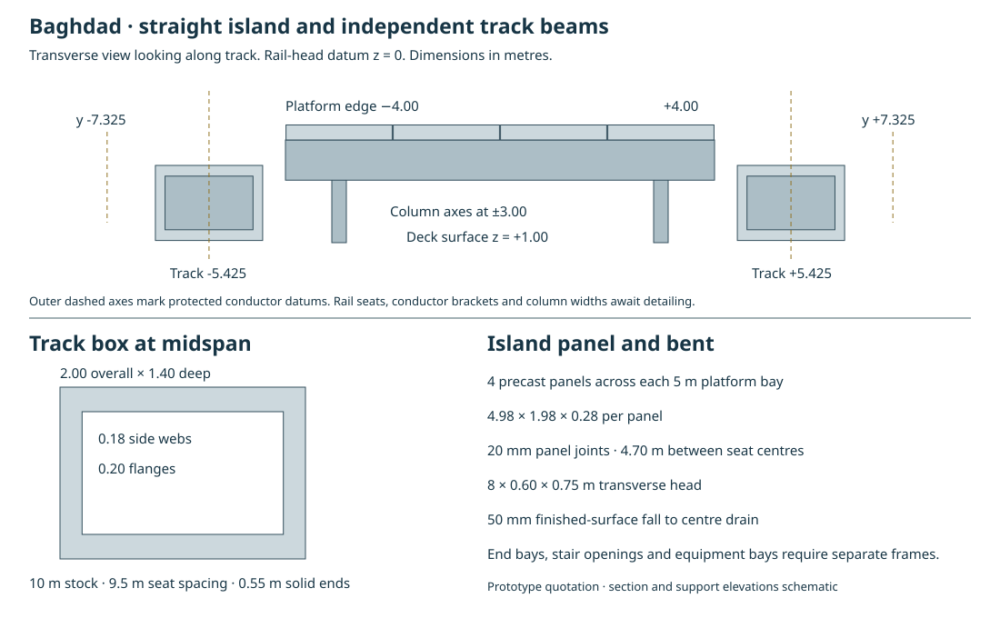
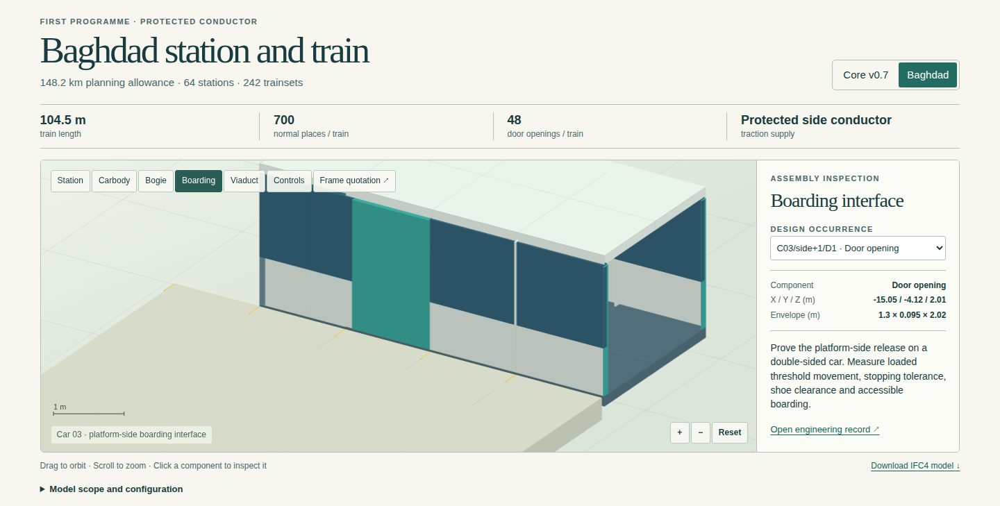
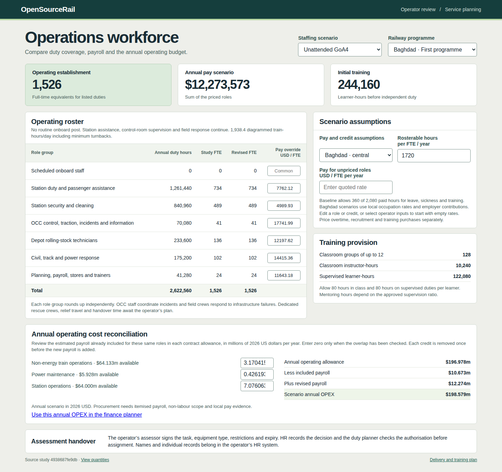

# Baghdad metropolitan railway

## Current metropolitan rail network

This is one connected planning network for Baghdad. It compares alternatives for the trunks and outer branches, and redirects route length toward densely populated areas beyond a 1.2 km street walk. It screens nearby stations for a shared site or a walking connection. The same housing-to-centre journeys with up to two changes test each layout. The Airport and central routes stay connected. Orange dots show the remaining access gaps.

<!-- current housing budget -->

**Current metropolitan budget case.** 740.3 km of mapped guideway, 1,480.5 track-km counting both running tracks, and 656 station sites. The base installed allowance is **US$41.90bn**, with planning cases of US$29.40bn to US$63.81bn. Casting, haul and erection account for 6.43 million paid hours. The six-minute operating offer and the construction schedule use this same candidate. [Quantities, labour and costs](NETWORK-DELIVERY.md) · [Housing journeys and map](NETWORK.md)

<!-- end current housing budget -->

[Full-size network map](maps/baghdad-network.png) · [Route, station and transfer GIS](maps/baghdad-network.geojson) · [Network logic, coverage and line termini](NETWORK.md)

The wider dual-ring study tests a larger inner loop and keeps the same outer alignment with at least 5 km between the rings. [Wider-ring map](maps/baghdad-wider-ring.png) · [Journey and delivery comparison](WIDER-RING.md)

The wider-ring route redesign tests a new east–west line calling at both rings and a G09 terminus at the inner ring. [Reworked network map](maps/baghdad-ring-network.png) · [Travel, coverage and cost comparison](RING-NETWORK.md)

The central-ring study tests a new inner alignment around the main central destinations, shared junction sites and parallel-route cuts. [Central-ring map](maps/baghdad-central-ring-network.png) · [1.3 km access and service comparison](CENTRAL-RING-NETWORK.md)

The generator compares shorter perimeter variants using the same housing origins, destinations and service offer. The selected design has a matching delivery workplan and installed, operating and renewal allowances. Earlier design and cost studies retain the geometry they priced.

The current [delivery workplan](NETWORK-DELIVERY.md) prices 20 m shared-pier stock and two inward launching gantries on eligible open lines. The [earlier 20 m delivery studies](engineering/mechanical/civil/rail-fed/network-delivery.md) retain the seven-corridor and 605 km alternatives for comparison.

The assembly films follow both launch fronts and show the fitted train with its cab ends, gangways, passenger saloon and service connections. The part and shift schedules identify which geometry, masses, prices and labour allowances support the illustrations. [Assembly films, renders and workplans](../../docs/assets/assembly-animations/GUIDE.md) · [Illustrated proposal](Baghdad-Metro-Proposal.pdf)

Use the **17.46 km Airport alignment study** to review the proposed route, service, power options and partial construction costs together. The 30-minute paired-supply trial completes all 72 booked trips. Survey, complete prices and physical acceptance remain open. The [metropolitan network](NETWORK.md) uses the corrected Airport approach in the citywide passenger graph.

| Decision | Open |
|---|---|
| Review the revised alignment and request budgetary prices on the matched scope | [Airport audit results](engineering/simulation/AUDIT-RESULTS.md) · [Paired-supply budgetary enquiry](engineering/simulation/audited-enquiry.zip) |
| Inspect the earlier car, station, beam and power drawings | [Prototype twin and field-return guide](engineering/prototype/README.md) · [Offline prototype drawings](engineering/prototype/airport-prototype.zip) |
| Review the historical 12 km Airport opening, its 15-minute timetable and 30-site budget | [v0.7.2 Airport opening](airport-integration.html) |
| Trace the earlier timetable and central access calculations used in the network revision | [Central access inputs](CENTRAL-ACCESS.md) · [Fourteen-route clockface trial](CITYWIDE-SERVICE.md) |
| Compare staged service, fares, debt and maintenance on the earlier seven corridors | [Phased funding schedule](../../docs/operator-review/finance/phased-first.html) |

[Proposal for Amanat Baghdad](PROPOSAL.md) · [PDF proposal](Baghdad-Metro-Proposal.pdf) · [Current delivery and budget](NETWORK-DELIVERY.md) · [Earlier cost and cash schedule](COST-AND-DELIVERY.md) · [Train and station section](VEHICLE.md) · [Map layers and sources](maps/README.md)

Baghdad is preparing fresh investment opportunities after the earlier offers failed to meet government requirements. OpenSourceRail is preparing for a late-2026 to early-2027 invitation for ideas. The timetable awaits an official notice. [Al-Mada interview with Amanat Baghdad, 25 October 2026](https://almadapaper.net/458226/) · [NINA interview with the National Investment Commission, 27 October 2026](https://ninanews.com/website/News/Details?key=1322248)

OpenSourceRail proposes an elevated, zero-tunnel railway with no overhead wires. A protected conductor beside the track supplies powered wheel bogies. The seven-corridor concept follows the Iraqi investment brief. The earlier citywide concept assigns airport, Sadr City and Jadriya branches to its service groups. The clockface trial runs to the airport and defers five access branches. The train, power supply, viaduct, fleet, operations and costs are calculated separately for each concept.

| Programme | Seven-corridor alternative | Independent citywide alternative |
|---|---:|---:|
| Costed guideway length | 148.2 km | 605.652 km |
| Assigned passenger-path length | 148.2 km | 555.553 km; 50.099 km reserved |
| Budgeted stations | 64 | 280 |
| Six-car trains, including reserve | 242 | 934 |
| Earlier construction at central Iraqi prices | **$8.37bn** | **$33.00bn** |
| Earlier construction at original comparison rates | $7.866bn | $31.018bn |

Each row compares the two programmes at the same price basis. The routes, station allowances, fleets and capital totals are separate and cannot be added as construction stages. The maps show planning corridors and city geography. Track centre lines and station sites need survey and approval.

[Operator briefing and design twins](../../docs/operator-review/README.md) · [Baghdad delivery workplan](../../docs/operator-review/WORKPLAN.md#opening-a-railway-in-baghdad) · [Compare annual funding and fares](../../docs/operator-review/finance/index.html)

**Earlier Iraqi construction budgets.** The seven corridors cost an estimated **$8.37bn** centrally, with a **$6.12bn–$12.35bn** planning range. The independent citywide alternative costs **$33.00bn** centrally, with a **$24.10bn–$48.83bn** range. The common design-rate estimates of $7.866bn and $31.018bn remain available for matching vendor returns on those scopes. At the Iraqi central prices, estimated domestic value within Iraqi-awarded contracts is **$1.84bn** and **$7.36bn**, respectively. [Earlier capital by work package and year](IRAQ-CAPITAL.md) · [Earlier operating costs, fares and debt payments](IRAQ-ESTIMATES.md)

## Earlier route and cost evidence

The 148.2 km estimate uses the National Investment Commission’s February 2024 seven-corridor brief. The 605.652 km case priced a separate earlier scheme, including 50.099 km of reserved guideway. Both are retained as cost comparators for the revised map. [NIC investment plate and source](maps/README.md#how-to-read-the-seven-corridors) · [Earlier citywide route and service inputs](CITYWIDE-SERVICE.md) · [Original civil and operating estimates](COST-AND-DELIVERY.md)

The earlier estimates retain their own Airport terminal access, Sadr City branches and Jadriya assumptions. The new map includes only complete rail paths that pass its connection check. The [route register](NETWORK.md#end-to-end-routes) lists each end-to-end service and the walking-coverage calculation identifies populated gaps for the next alignment work.

### From a named place to an accessible station

Consider an airport passenger with luggage or a wheelchair. A pin at a passenger-terminal building establishes a destination. To select the station, the airport and railway operators need to walk the landside path, measure its length and gradients, locate the security boundary, check the lift and test the route during a lift outage. At Al Bayaa the Airport, Green and Yellow services share a place name. The station register needs the entrances, platforms, walking routes and actual track conflicts before the operator can promise a connection.

The book describes a Baghdad planning trial in which two successive station edits passed through a geographic editor and back into the cost study. Apply that method to each site visit. Keep the original point, record who identified the new entrance, return the changed geometry, then compare walking access, service distance, fleet and price. A relocated entrance can change the land or lift allowance even when the track length stays fixed. The cost register has **37 point records at 27 distinct coordinates** on the seven corridors and **220 at 177 coordinates** citywide. The buyer assigns each surveyed physical station one budget slot, including every entrance at a shared interchange. [Baghdad planning example in the book](../../docs/book/45-baghdad-next.md) · [Station classes and survey returns](maps/STATION-PRICING.md)

## People and trains

Use the [operator timetable card](service-diagrams.html) and [service diagram guide](SERVICE-DIAGRAMS.md) to trace a set across both directions. The seven corridors account for 24.666 million train-km/year on these schematic diagrams. A separate citywide timetable diagrams all 14 main routes with five short access sections deferred. It needs 725 sets for 6,384 daily trips. The complete citywide budget includes the infrastructure for all five sections. At the diagrammed mileage, annual operating cost is $736.4m at central Iraqi prices or $777.932m at the original comparison rates. Both cases retain the full fleet, stations and track maintenance. The workforce planner prices unattended service, full supervised cover and partial onboard assistance against each network’s service duty. [Staffing and operating allowances](../../docs/operator-review/delivery/README.md)

| Service measure | First programme | Independent citywide |
|---|---:|---:|
| Six-car train, planning capacity | 700 places | 700 places |
| Peak interval per service | 150 seconds | 150 seconds |
| Offered places per hour per direction per service | 16,800 | 16,800 |
| Active trains | 210 | 812 |
| Fleet including reserve | 242 | 934 |
| Annual train distance, declared hourly service offer | 24.666 million km | 92.466 million km |
| Planned daily service | 18 hours | 18 hours |

The [hourly service offer](system-results.json) runs from 06:00 to midnight:
four hours at 24 trains/hour/direction, eight at 12 and six at 6 on each assigned
passenger path. It includes three minutes of layover at each terminal. Peak
cycle needs 208 and 742 trains against active fleet allowances of 210 and 812.
The 50.099 km of reserved citywide guideway has no train movement in this
estimate. The workings use assumed stopping sites and running times. Junction occupation, accessible walking times and passenger counts still need field evidence. The [mapped station screen
register](station-register.json) lists 37 named first-network access points and
220 citywide stop screens against budgets of 64 and 280 stations.

### One Airport train through its first return trip

*Airport-001 leaves the terminal area at 06:00, calls at Al Amiriya at 06:03:19 and reaches Al Qadisiya at 06:18:57. After a three-minute turn it departs at 06:21:57. The card lets an operator follow the same set back to its next outward departure.*

The Airport diagram assumes a 35-second intermediate dwell. Al Amiriya offers a possible interchange onto White-T002 at 06:14:07. Allowing five minutes for a step-free transfer leaves 5 min 48 s before that train. The timetable team needs to time that walk with passengers. At a 150-second peak interval, a three-minute turn also requires at least two terminal positions before allowing for the crossover or the rear of a departing 104.5 m train. On the most demanding Yellow line station pair, one block between stops falls 268 seconds short of the peak separation requirement. Designers must locate detection points, braking overlaps and terminal stabling on the surveyed approaches before offering that peak service. [Service diagrams and clearance checks](SERVICE-DIAGRAMS.md)

### Train, bogie and station

Each train has six 17 m cars, four double doors per side per car, step-free access and two wheelchair places per car. The selected full-load mass is **201.092 tonnes**. Twenty-four powered axles provide traction under the declared uphill and low-adhesion design duty. Independent brakes and service batteries remain available for controlled stopping and recovery. The [vehicle page](VEHICLE.md) gives the car layout, equipment envelopes, assembly approach and replaceable parts.

*Steelwork for one 17 m car and two bogie frames. The 128 pieces in the braced fabrication study weigh 5.196 t in nominal cut stock. The complete train mass used for axle loads includes passengers and installed equipment.*

A car offers 20 seats, two wheelchair places and standing space within a **700-person service cap per six-car train**. Each car has eight 1.3 m door openings. Below it, two powered bogies support the body on secondary springs. The shop can quote 4,381.6 kg of body stock and 407.3 kg per bogie frame, then itemise wheels, gears, motors, brakes, springs, welds and finishes. In the idealised gravity case the braced sidewall reduces calculated peak stress from 355.69 to 93.09 MPa. To qualify a fabrication route the body builder must still demonstrate joint strength, durability, dimensional accuracy and access for a bogie exchange. [Cut stock, loads and replacement sequence](engineering/mechanical/vehicle/README.md)

The straight platform is **125 m long and 8 m wide**. The centred train leaves 10.25 m at each end. The static horizontal gap is 75 mm at a nominal 1 m floor height above rail. Survey both track and platform under service load because their supports move independently. The trial deck uses four precast panels across each 5 m bay. Price stairs and lifts with their trimmed deck openings, drainage away from the boarding edge, passenger egress and a continuous accessible path from the street. The representative 10 m track beam uses 13.404 m³ of concrete and weighs about 34.17 t before lifting gear. The trial foundation pressure of 207.43 kPa exceeds the illustrative 150 and 200 kPa soil cases. Boreholes and site-specific foundation and lifting designs are needed for a construction price. [Station, beam, pier and foundation details](engineering/mechanical/civil/README.md)

The station pricing register carries 64 generic station allowances on the seven corridors and 280 citywide. It distinguishes a mapped entrance, a repeated place name and an approved station site. The buyer can replace individual allowances as surveyed, complete station offers arrive. [Station sites, access classes and prices](maps/STATION-PRICING.md)

An earlier Airport corridor budget priced 12 km, six stops, 21 trains and three traction supply sites on its own assumptions. Its Iraq-priced central estimate is **$813.7m**, with a **$782.9m–879.5m** range for the opening with dedicated facilities and local works. Central annual operations cost **$16.25m**. At IQD 750 and 3.69m paid journeys, fares cover $1.56m. Compare bidder returns for civil work, trains and stations on the same scope, including Iraqi value added and repair rights. [Airport opening and exclusions](AIRPORT-OPENING.md) · [Downloadable supplier enquiries](../../docs/operator-review/README.md#taking-drawings-to-a-supplier)

For the first-network train and structure, the [train weight and supply study](engineering/mechanical/vehicle/SECTION-POWER.md) checks two accelerating trains on a representative feed section. The [civil and yard comparison](engineering/mechanical/civil/SPAN-COMPARISON.md) shows the effect of longer beams on supports, cranes and cost. Both identify the measurements a supplier must return.

### Traction, doors and control-room response

Four guarded shoe assemblies collect power for 24 motorised axles. The traction study requests **5.004 MW per train** to achieve 0.6 m/s² net acceleration on a 2% rising grade. A separate 65 kWh service battery supplies essential loads during interruption. In a representative 4.94 km feed bay, two accelerating trains supplied from both ends take the calculated collector voltage to 1.344 kV, below the study’s 1.350 kV floor. The utility and electrical supplier need the timetable, site locations, return-current path and fault/isolation arrangements to price the connections and demonstrate performance. [Train and supply study](engineering/mechanical/vehicle/SECTION-POWER.md)

*The offline replay follows one train through arrival, securing, side release, closure and departure. Its inputs are simulated.*

At a stop the station identifies the train, arrival and platform side. With standstill and the independent brake holds proved, the train inhibits traction and releases the 24 openings facing the platform. While the passengers board, holding brake and traction inhibition stay active. Dispatch checks the locks on all 48 openings and the route authority, then supervises drive take-up before releasing the holds. A lost holding proof trips protection. The operator’s acceptance trial must measure effort, brake force, travel and rollback on a loaded rig. At the control desk, staff can observe alarms and investigate stale indications. Authority to move the train and proof of electrical isolation stay with the protection equipment and the local work procedure. [Boarding software, wiring and brake trial](engineering/controls/README.md)

The central Iraqi operating estimate is **$185.7m/year** on the seven corridors and **$738.7m/year** citywide. A posted fare of **IQD 750** yields an assumed **IQD 637.5** per paid journey after discounts and collection costs. The operator can test alternative boarding levels, ticket yields and borrowing terms in the funding comparison. [Iraqi costs, wages and fares](IRAQ-ESTIMATES.md) · [Electricity and supply-site prices](IRAQ-POWER.md)

## Civil works, power and factories

| Construction and operation | First programme | Independent citywide |
|---|---:|---:|
| Elevated double-track railway | 148.2 km | 605.652 km |
| Selected precast beam placements | 29,640 | 121,156 |
| Selected support positions | 29,654 | 121,208 |
| Protected conductor along both tracks | 296.4 track-km | 1,211.304 track-km |
| Traction grid sites | 30 | 100 |
| Depots / control centres | 4 / 2 | 12 / 4 |
| Beam-casting yards / erection fronts with stated ramp and availability | 6 / 6 | 10 / 10 |
| Annual delivered electricity | 524 GWh | 1,965 GWh |
| Annual operation and maintenance at original comparison rates | $196.978m | $780.495m |

The first construction family uses repeatable **10 m precast beams** on separate supports for each track. The city can compare longer spans and common piers at difficult streets, but the published price uses the 10 m family throughout. Iraqi suppliers can cast beams and piers, fabricate train bodies and interiors, assemble trains, build stations, install cable routes, and maintain the finished railway. The original common bid comparison includes **$99.280m** for tooling and local production setup in the first programme and **$282.261m** in the independent citywide network. Motors, power electronics, bearings, safety equipment and contact materials are separately procured items until local suppliers can qualify them.

| Workstream | Local work and skills | Purchase and delivery control |
|---|---|---|
| Precast yards | Steel fixing, mould preparation, casting, curing, testing and beam handling | Six first-network yards with 80% first-year productivity and 90% later availability at eight beams per productive day |
| Street and viaduct construction | Utilities, foundations, piers, lifting, track and walkways | Six first-network erection fronts on the same planning basis; citywide requires ten of each |
| Train factory | Carbody, doors, interior, cable looms, final assembly and depot repair | Imported motors, converters and safety equipment remain separately priced |
| Stations and electrical railway | Accessible entries, fit-out, protected conductor, cables and substations | Isolated power sections, inspection access and replaceable equipment |
| Railway operation | Train supervision, control, station assistance, cleaning and maintenance | Rosters and wage budgets belong in operating contracts, not extra construction capital |

### Build the fleet and erect the guideway

*One 160 × 80 m works module carries a car through body assembly, running gear, doors and interior, HVAC, wiring, and final marriage and test. The seven-corridor study requires twelve lines to deliver 1,452 cars. On the assumed cycle they can complete 1,464.*

The buyer can ask a factory to time a repeat car at each station and show how a defective unit reaches the repair road while the next body advances. A five-effective-day delay across all twelve lines consumes the twelve-car margin. At local pay assumptions the direct final-assembly labour is about $10,975 per car and $15.94m for the fleet order, within the train purchase price. For the citywide order, twenty lines have capacity for 5,840 cars against 5,604 needed. [Vehicle works plan, labour and programme](../../docs/operator-review/delivery/README.md)

One 240 × 140 m yard allows sixteen mould positions and storage for 180 released beams. The plan assumes eight releases per productive day and a month between casting and release for erection. The largest balanced month-end stock is 164 beams per yard. A contractor needs space for rejected batches and late lifts, a verified haul route and a crane chart at the actual working radius. The 20 m trial saves supports but weighs 63.74 t before rigging, exceeding the illustrative 60 t lift at 12 m. These handling limits make a difficult crossing a separate pricing package. [Beam lengths, load and erection study](engineering/mechanical/civil/SPAN-COMPARISON.md)

### Employment, commissioning and lifetime repair

| Staffing choice | Seven corridors | Full citywide service |
|---|---:|---:|
| Unattended service, all planned duties | 1,526 FTE | 6,339 FTE |
| Supervised commissioning, expressed as a full year | 1,938 FTE | 7,827 FTE |
| Passenger attendants on 25% of train-duty hours | 1,629 FTE | 6,711 FTE |

With unattended service, the first network needs 734 station duty and assistance staff, 489 security and cleaning staff, 41 control-room staff, 136 depot technicians, 102 track and power responders, and 24 planning, stores, payroll and training staff. Shift relief assumes 1,720 rosterable hours per employee per year. Central annual payroll is $12.27m, with an estimated $10.67m already in service allowances. The commissioning budget prices one initial intake at $1.29m of learner and instructor labour, with 80 classroom hours and 80 mentored hours per learner. Staff demonstrate specific duties such as wheelchair boarding during a lift outage, electrical isolation and recovery of a disabled train. Record the assessment, supervisor, restrictions and expiry in the operator’s HR system. [Wage basis, hours and initial training](../../docs/operator-review/delivery/README.md)

The book follows a door operator from its drawing to replacement. Baghdad can apply the same method to a purchased door motor and locally made bracket. At receipt, record the motor serial, supplier and incoming test. For the bracket, record the material batch, drawing revision and inspection. At assembly, record which items entered which door and where that opening sits on the car. At overhaul, link the removed unit and its test results to the replacement serial and work order. The native ERPNext pilot demonstrates this record chain on an earlier magnetic assembly. Each Baghdad operator would populate its own asset, spares and inspection records during manufacture and commissioning. [Manufacture and maintenance custody in the book](../../docs/book/42-lifecycle-custody.md)

## Installed capital and construction cash

The following table preserves the **original common bid prices**, used to compare packages on identical technical scope. The Iraqi central estimates for the same 14 scopes put the fleet at $2.228bn, elevated civil works at $1.343bn and accessible stations at $0.883bn on the seven corridors. Twelve-month cash needs also depend on the order of factory mobilisation, land access, utility diversions, fleet deliveries and opening trials. [Iraq-priced package breakdown](IRAQ-CAPITAL.md)

| Capital scope at original comparison rates, US$ million | First programme | Independent citywide |
|---|---:|---:|
| Viaduct and foundations | 1,331.238 | 5,440.396 |
| Stations and accessible entry | 832.000 | 3,640.000 |
| Track and walkways | 237.120 | 969.043 |
| Signalling and communications | 177.840 | 726.782 |
| Braking, protection and recovery | 88.920 | 363.391 |
| Protected conductor and switching | 316.920 | 1,298.469 |
| Grid supply | 240.000 | 800.000 |
| Train fleet | 2,052.160 | 7,920.320 |
| Depots and control | 260.000 | 740.000 |
| Land, utilities and disruption | 296.400 | 1,211.304 |
| Tooling and local production | 99.280 | 282.261 |
| Design and assurance | 474.550 | 1,871.357 |
| Testing and commissioning | 148.297 | 584.799 |
| Project allowance | 1,310.945 | 5,169.625 |
| **Installed total** | **7,865.670** | **31,017.749** |

The [annual cash schedule](COST-AND-DELIVERY.md#annual-construction-capital-draw) allocates first-programme construction over **2027–2031** and the independent citywide network over **2027–2035**. At the original common bid prices, its highest planned annual draw is **$2.360bn** for the first programme in 2029 and 2030, and **$5.273bn** for the independent citywide network in 2032. These are construction cash requirements before borrowing costs. Financing can combine Iraqi public capital, commercial bank facilities and export credit for eligible UK export contracts. [UKEF Buyer Credit](https://www.gov.uk/guidance/buyer-credit-facility) applies to specific contracts and lender assessments; no UKEF commitment or loan amount is included in the capital estimate.
At those same original rates, the calculated 2027 present cost, with annual construction draws followed by 30 years of full operation after completion, is **$10.567bn** for seven corridors and **$37.606bn** citywide. This uses a different time origin from the headline 30-year cost and includes no staged openings or financing charges.

| Capital source to develop | Contract scope | What must be settled |
|---|---|---|
| Iraqi public capital | Land, utilities, local civil works and buyer cash contributions | Sponsor, budget, rights and annual draw authority |
| Commercial banks | Construction and longer-term facilities | Borrower, completion support, repayment source and lender terms |
| UK Export Finance with a bank | Eligible UK export contracts for equipment and services | UK content, buyer down payment, credit review, country cover and UKEF approval |

At the original comparison rates, the 30-year present cost of the selected railway is **$12.021bn** for the first programme and **$47.394bn** for the independent citywide network, including construction, operation and scheduled renewals under the published assumptions. Fare revenue and debt service are separate financial decisions; the construction totals do not treat a loan as income.

### Fares, funding and vendor terms

For the seven corridors the central scenario pairs an IQD 750 ticket with 188.4m paid journeys a year. After concessions and collection costs the operator retains IQD 637.5 per paid journey. Annual receipts of $79.5m cover part of $185.7m in operating costs. Borrowing 50% of the $8.37bn build at 4% real over 20 years brings the first full year’s public funding need to **$414.1m**. The independent citywide case gives **$1,764.1m** on the same terms. These figures depend on trip length, transfers, occupancy and the loan available. A sponsor can vary any fare or ridership assumption before discussing payment terms with a bidder. [Opening-year assumptions and sensitive cases](IRAQ-ESTIMATES.md)

*The screen uses hypothetical returns to demonstrate how the buyer can compare the same station specification. Commercial bids would come from the invited suppliers.*

Ask each bidder to price a typical elevated kilometre, a difficult crossing and an accessible station against the same drawings. Request a cash price, a separately financed offer and an itemised account of Iraqi labour and manufacture. At central Iraqi prices, the seven-corridor case estimates $3.36bn awarded to Iraqi contractors, with $1.84bn retained domestically after imported inputs and transfers. An authority can use the open design to ask a turnkey supplier for a better price, local overhaul rights and an Iraqi-built repeat article even when it chooses that supplier’s train. Record origin evidence, warranties, rights to drawings and diagnostics, training and acceptance results against each package. [Matched bid comparison](BUYER-COMPARISON.md)

Over thirty years, the **central Iraqi present cost** is $12.33bn for seven corridors and $48.65bn citywide. This lifetime comparison takes construction at face value and discounts annual operations and the original renewal allowances at 4% real from opening. The sponsor still needs a separate annual budget for construction cash, borrowing, operations and replacement. [Cost and fare assumptions](IRAQ-ESTIMATES.md)

The [proposal](PROPOSAL.md) gives the requested city decision and delivery sequence. The [cost schedule](COST-AND-DELIVERY.md) gives rates, matched power alternatives, 30-year operation and renewal costs, civil-span comparisons and annual capital draws. The [map guide](maps/README.md) identifies the GIS sources and how to use the layers.
The [control electronics schedule](../../control-electronics/README.md) gives train, station, power-section, grid and control-room quantities and the allocations already included in the capital estimate.

The [buyer comparison schedule](BUYER-COMPARISON.md) and [financing cases](PROPOSAL.md#what-the-city-would-need-to-pay) let the city compare turnkey bids, local manufacture and buyer cash year by year. The [mechanical package](engineering/mechanical/README.md) and [controls replay](engineering/controls/README.md) develop the interfaces that suppliers would quote.

## Take the proposal to an operator and competing suppliers

Use the seven-corridor design to review a typical Baghdad station and train. The independent citywide option also has its own map, service assumptions, fleet, yards and cost schedules. The two exported station twins cover the seven-corridor design and the synthetic 30 km core railway. [Baghdad twin and frame inspection](../../docs/operator-review/twins/README.md) · [Citywide map and route gaps](maps/README.md)

*The station twin lets a reviewer select the platform edge, train or support and follow its source drawing. A station designer can compare the edge against the body envelope, then specify the loaded measurements that will settle the boarding gap.*

| Bring to the meeting | What to ask for |
|---|---|
| Local planners and passenger representatives | Mark the entrance, step-free path, bus transfer and walking barriers at a proposed stop. Record the coordinates, owner and remaining survey work. A named neighbourhood and a budgeted station are different records. [Map review](maps/README.md) |
| Operator and maintainers | Open a platform-side door in the boarding study, inspect the brake demand and trace the condition for dispatch. Price the physical trial with parking proof, independent brake feedback and local recovery. [Electronics, wiring and software trial](engineering/controls/README.md) |
| Iraqi builders and international vendors | Quote one braced body, its bogie frames, a deck bay and one cast beam. Identify imported inputs, tooling ownership, drawings, diagnostics, training and repair rights. Compare turnkey, vendor-led local build and locally integrated offers on the same service. [Buyer return schedule](BUYER-COMPARISON.md) |
| Factory managers and workforce leads | Check output for the 1,452-car seven-corridor order. Twelve proposed lines have capacity for 1,464 cars under the trial assumptions. Ask for witnessed cycle times and the cost of recovery if one cycle is lost across the lines. Confirm who trains and assesses local crews. [Factory layouts and staffing](../../docs/operator-review/delivery/README.md) |
| City finance and prospective lenders | At the central IQD 750 ticket and local pay and power rates, seven-corridor operations cost $185.7m per year. At 50% borrowing, 4% real over 20 years, the first full service year needs $414.1m after fare income. Request comparable cash and financed prices, loan currency, fees, guarantee requirements and an annual draw schedule. [Funding calculator and worked example](../../docs/operator-review/finance/README.md) |

Leave the meeting with a terminal pair to survey, a train or station interface to test and a work package to quote locally. Record the owner, date, evidence requested and the effect on service or cost. Carry those returns into the first twelve weeks of the [Baghdad delivery workplan](../../docs/operator-review/WORKPLAN.md#opening-a-railway-in-baghdad).
