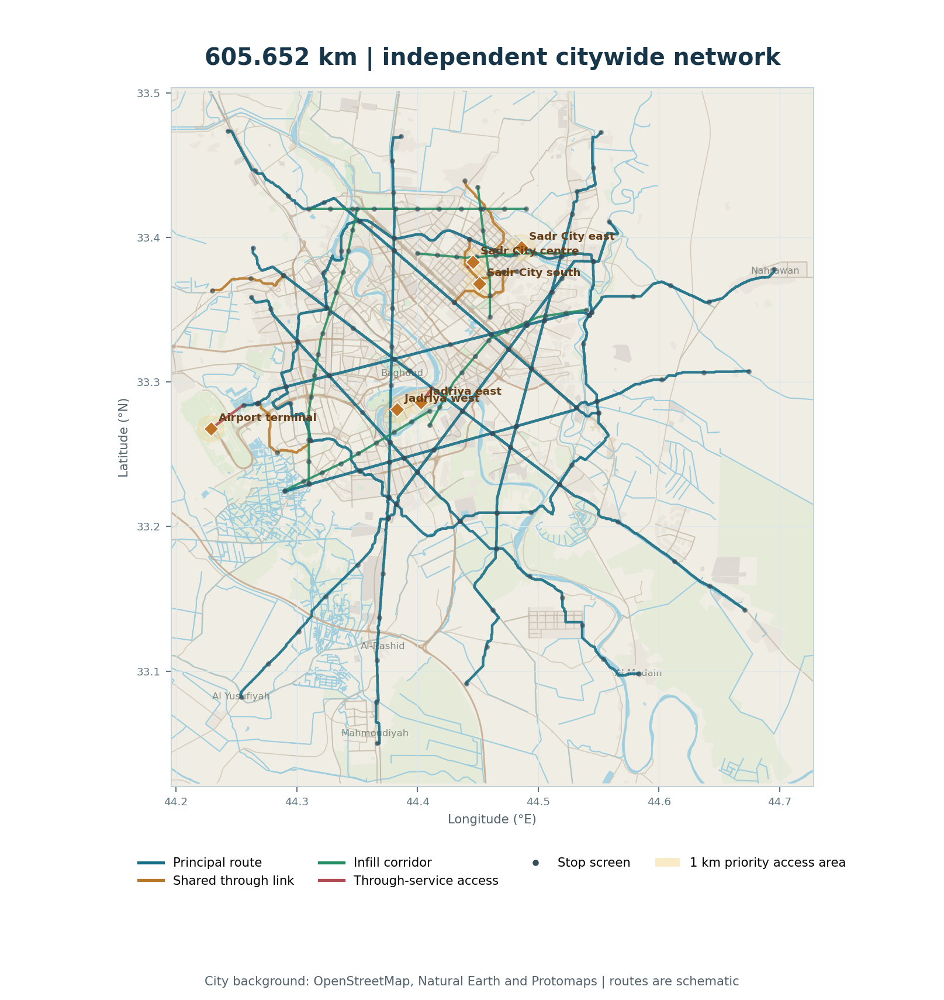

# Baghdad metropolitan railway

[Proposal for Amanat Baghdad](PROPOSAL.md) · [PDF proposal](Baghdad-Metro-Proposal.pdf) · [Cost and annual cash schedule](COST-AND-DELIVERY.md) · [Train and station section](VEHICLE.md) · [Map layers and sources](maps/README.md)

Baghdad is preparing fresh investment opportunities after the earlier offers failed to meet government requirements. OpenSourceRail is preparing for a late-2026 to early-2027 invitation for ideas. The timetable awaits an official notice. [Al-Mada interview with Amanat Baghdad, 25 October 2026](https://almadapaper.net/458226/) · [NINA interview with the National Investment Commission, 27 October 2026](https://ninanews.com/website/News/Details?key=1322248)

OpenSourceRail proposes an elevated, zero-tunnel railway with no overhead wires. A protected conductor beside the track supplies powered wheel bogies. The seven-corridor concept follows the Iraqi investment brief. The independent citywide concept serves the airport passenger-terminal area, Sadr City, Jadriya and outer districts through fourteen service groups. The train, power supply, viaduct, fleet, operations and costs are calculated separately for each concept.

| Programme | Seven-corridor alternative | Independent citywide alternative |
|---|---:|---:|
| Costed guideway length | 148.2 km | 605.652 km |
| Assigned passenger-path length | 148.2 km | 555.553 km; 50.099 km reserved |
| Budgeted stations | 64 | 280 |
| Six-car trains, including reserve | 242 | 934 |
| Installed construction capital, 2026 US dollars | **$7.866bn** | **$31.018bn** |
These are single planning estimates for each programme. The routes, station allowances, fleets and capital totals are separate and cannot be added as construction stages. The route maps show planning corridors and city geography, not surveyed track centre lines or approved station sites.

[Operator briefing and design twins](../../docs/operator-review/README.md) · [Baghdad delivery workplan](../../docs/operator-review/WORKPLAN.md#opening-a-railway-in-baghdad) · [Compare annual funding and fares](../../docs/operator-review/finance/index.html)

## City maps and routes

The seven-corridor map locates 39 of 52 named corridor occurrences and breaks the lines at unresolved names. The Red line now uses the Adhamiya quarter. The 148.2 km is the sum of the investment brief’s line allowances. The background shows Baghdad streets, water, land use and place names from the retained OpenStreetMap, Natural Earth and Protomaps city context. Coloured lines show the proposed railway. The gold circles highlight 1 km straight-line access areas around the airport terminal, three Sadr City locations and two Jadriya locations. They do not represent walking time or property access.

[Open the first map](maps/Baghdad-148km.png) · [Download the reviewed places and corridor gaps](maps/corridor-review.geojson)

| First-programme line | Route length | Principal areas |
|---|---:|---|
| Green | 19 km | Al Alawi, Mansour, Yarmouk, Bayaa, Doura |
| Red | 27.7 km | Al Alawi, Kadhimiya, Adhamiya, Mustansiriya, Maisaloun |
| Blue | 22 km | Al Shaab, Waziriya, Khallani, Tayaran, Zuafaraniya |
| Purple | 14.5 km | Tayaran, Hamza, Ur, Al Shaab, Sadr City approaches |
| Yellow | 30 km | Baladiyat, Maisaloun, Jadriya, Bayaa, Adan |
| White | 23 km | Kadhimiya, Shulah, Gazaliya, Khadhraa, Amiriya, Bayaa |
| Airport | 12 km | Passenger-terminal area, Amiriya, Aamil, Bayaa, Qadisiya |
| **Total** | **148.2 km** | **64 stations budgeted across the programme** |

The airport line is planned to reach the passenger-terminal building area. Its mapped point is a building centroid; the final platform, step-free landside route and operating/security boundary require design with the airport. The Sadr City and Jadriya access markers guide the next station-location exercise.

[Open the metropolitan map](maps/Baghdad-606km.png) · [Download its GIS layers](maps/network-606km.geojson)

The independent citywide map contains nine principal corridors, five shared links, six infill corridors and six access branches. It has fourteen service groups and a 280-station allowance. The proposal assigns the airport terminal area to M05, Sadr City anchors to M04 and M09, and Jadriya anchors to M01 and M02. Its 605.652 km is the costed length for the schematic corridors. Five shared links and the east inner arc total 50.099 km and are reserved without assigned train paths. The other 555.553 km has planning assignments. The two M04 branches are 2.323 km and 2.710 km from their assigned main line at the nearest branch ends. The proposal describes these junction gaps and the work needed to establish a timetable.

The reserve accounts for **$1.122bn within the citywide capital estimate**, and **$2.004m/year** of conductor upkeep within annual operations. The full estimate equates to **$51.214m per costed guideway kilometre** or **$55.832m per kilometre with an assigned passenger path**. See the [reserve breakdown](COST-AND-DELIVERY.md#reserved-citywide-guideway).

## People and trains

| Service measure | First programme | Independent citywide |
|---|---:|---:|
| Six-car train, planning capacity | 700 places | 700 places |
| Peak interval per service | 150 seconds | 150 seconds |
| Offered places per hour per direction per service | 16,800 | 16,800 |
| Active trains | 210 | 812 |
| Fleet including reserve | 242 | 934 |
| Annual train distance, declared hourly service offer | 24.666 million km | 92.466 million km |
| Planned daily service | 18 hours | 18 hours |

The [hourly service offer](system-results.json) runs from 06:00 to midnight:
four hours at 24 trains/hour/direction, eight at 12 and six at 6 on each assigned
passenger path. It includes three minutes of layover at each terminal. Peak
cycle needs 208 and 742 trains against active fleet allowances of 210 and 812.
The 50.099 km of reserved citywide guideway has no train movement in this
estimate. This is a costing schedule; individual stops, junction movements and
passenger demand have not been established. The [mapped station screen
register](station-register.json) lists 37 named first-network access points and
220 citywide stop screens against budgets of 64 and 280 stations.

Each train has six 17 m cars, four double doors per side per car, step-free access and two wheelchair places per car. The selected full-load mass is **201.092 tonnes**. Twenty-four powered axles provide traction under the declared uphill and low-adhesion design duty. Independent brakes and service batteries remain available for controlled stopping and recovery. The [vehicle page](VEHICLE.md) gives the car layout, equipment envelopes, assembly approach and replaceable parts.

## Civil works, power and factories

| Construction and operation | First programme | Independent citywide |
|---|---:|---:|
| Elevated double-track railway | 148.2 km | 605.652 km |
| Selected precast beam placements | 29,640 | 121,156 |
| Selected support positions | 29,654 | 121,208 |
| Protected conductor along both tracks | 296.4 track-km | 1,211.304 track-km |
| Traction grid sites | 30 | 100 |
| Depots / control centres | 4 / 2 | 12 / 4 |
| Beam-casting yards / erection fronts with stated ramp and availability | 6 / 6 | 10 / 10 |
| Annual delivered electricity | 524 GWh | 1,965 GWh |
| Annual operation and maintenance estimate | $196.978m | $780.495m |

The first construction family uses repeatable **10 m precast beams** on separate supports for each track. The city can compare longer spans and common piers at difficult streets, but the published price uses the 10 m family throughout. Iraqi suppliers can cast beams and piers, fabricate train bodies and interiors, assemble trains, build stations, install cable routes, and maintain the finished railway. The capital estimate includes **$99.280m** for tooling and local production setup in the first programme and **$282.261m** in the independent citywide network. Motors, power electronics, bearings, safety equipment and contact materials are separately procured items until local suppliers can qualify them.

| Workstream | Local work and skills | Purchase and delivery control |
|---|---|---|
| Precast yards | Steel fixing, mould preparation, casting, curing, testing and beam handling | Six first-network yards with 80% first-year productivity and 90% later availability at eight beams per productive day |
| Street and viaduct construction | Utilities, foundations, piers, lifting, track and walkways | Six first-network erection fronts on the same planning basis; citywide requires ten of each |
| Train factory | Carbody, doors, interior, cable looms, final assembly and depot repair | Imported motors, converters and safety equipment remain separately priced |
| Stations and electrical railway | Accessible entries, fit-out, protected conductor, cables and substations | Isolated power sections, inspection access and replaceable equipment |
| Railway operation | Train supervision, control, station assistance, cleaning and maintenance | Rosters and wage budgets belong in operating contracts, not extra construction capital |

## Installed capital and construction cash

| Capital scope, US$ million | First programme | Independent citywide |
|---|---:|---:|
| Viaduct and foundations | 1,331.238 | 5,440.396 |
| Stations and accessible entry | 832.000 | 3,640.000 |
| Track and walkways | 237.120 | 969.043 |
| Signalling and communications | 177.840 | 726.782 |
| Braking, protection and recovery | 88.920 | 363.391 |
| Protected conductor and switching | 316.920 | 1,298.469 |
| Grid supply | 240.000 | 800.000 |
| Train fleet | 2,052.160 | 7,920.320 |
| Depots and control | 260.000 | 740.000 |
| Land, utilities and disruption | 296.400 | 1,211.304 |
| Tooling and local production | 99.280 | 282.261 |
| Design and assurance | 474.550 | 1,871.357 |
| Testing and commissioning | 148.297 | 584.799 |
| Project allowance | 1,310.945 | 5,169.625 |
| **Installed total** | **7,865.670** | **31,017.749** |

The [annual cash schedule](COST-AND-DELIVERY.md#annual-construction-capital-draw) allocates first-programme construction over **2027–2031** and the independent citywide network over **2027–2035**. Its highest planned annual draw is **$2.360bn** for the first programme in 2029 and 2030, and **$5.273bn** for the independent citywide network in 2032. These are construction cash requirements before borrowing costs. Financing can combine Iraqi public capital, commercial bank facilities and export credit for eligible UK export contracts. [UKEF Buyer Credit](https://www.gov.uk/guidance/buyer-credit-facility) applies to specific contracts and lender assessments; no UKEF commitment or loan amount is included in the capital estimate.
The calculated 2027 present cost, with annual construction draws followed by 30 years of full operation after completion, is **$10.567bn** for seven corridors and **$37.606bn** citywide. This uses a different time origin from the headline 30-year cost and includes no staged openings or financing charges.

| Capital source to develop | Contract scope | What must be settled |
|---|---|---|
| Iraqi public capital | Land, utilities, local civil works and buyer cash contributions | Sponsor, budget, rights and annual draw authority |
| Commercial banks | Construction and longer-term facilities | Borrower, completion support, repayment source and lender terms |
| UK Export Finance with a bank | Eligible UK export contracts for equipment and services | UK content, buyer down payment, credit review, country cover and UKEF approval |

The 30-year present cost of the selected railway is **$12.021bn** for the first programme and **$47.394bn** for the independent citywide network, including construction, operation and scheduled renewals under the published assumptions. Fare revenue and debt service are separate financial decisions; the construction totals do not treat a loan as income.

The [proposal](PROPOSAL.md) gives the requested city decision and delivery sequence. The [cost schedule](COST-AND-DELIVERY.md) gives rates, matched power alternatives, 30-year operation and renewal costs, civil-span comparisons and annual capital draws. The [map guide](maps/README.md) identifies the GIS sources and how to use the layers.
The [control electronics schedule](../../control-electronics/README.md) gives train, station, power-section, grid and control-room quantities and the allocations already included in the capital estimate.

The [buyer comparison schedule](BUYER-COMPARISON.md) and [financing cases](PROPOSAL.md#what-the-city-would-need-to-pay) let the city compare turnkey bids, local manufacture and buyer cash year by year. The [mechanical package](engineering/mechanical/README.md) and [controls replay](engineering/controls/README.md) develop the interfaces that suppliers would quote.

## Take the proposal to an operator and competing suppliers

Use the seven-corridor design to review a typical Baghdad station and train. The independent citywide option also has its own map, service assumptions, fleet, yards and cost schedules. The two exported station twins cover the seven-corridor design and the synthetic 30 km core railway. [Baghdad twin and frame inspection](../../docs/operator-review/twins/README.md) · [Citywide map and route gaps](maps/README.md)

| Bring to the meeting | What to ask for |
|---|---|
| Local planners and passenger representatives | Mark the entrance, step-free path, bus transfer and walking barriers at a proposed stop. Record the coordinates, owner and remaining survey work. A named neighbourhood and a budgeted station are different records. [Map review](maps/README.md) |
| Operator and maintainers | Open a platform-side door in the boarding study, inspect the brake demand and trace the condition for dispatch. Price the physical trial with parking proof, independent brake feedback and local recovery. [Electronics, wiring and software trial](engineering/controls/README.md) |
| Iraqi builders and international vendors | Quote one braced body, its bogie frames, a deck bay and one cast beam. Identify imported inputs, tooling ownership, drawings, diagnostics, training and repair rights. Compare turnkey, vendor-led local build and locally integrated offers on the same service. [Buyer return schedule](BUYER-COMPARISON.md) |
| Factory managers and workforce leads | Check output for the 1,452-car seven-corridor order. Twelve proposed lines have capacity for 1,464 cars under the trial assumptions. Ask for witnessed cycle times and the cost of recovery if one cycle is lost across the lines. Confirm who trains and assesses local crews. [Factory layouts and staffing](../../docs/operator-review/delivery/README.md) |
| City finance and prospective lenders | At 50% borrowing the seven-corridor opening-year requirement before fares is $486.4m at 4% over 20 years and $692.1m at 7% over 12 years. Request comparable cash and financed prices, loan currency, fees, guarantee requirements and an annual draw schedule. [Funding calculator and worked example](../../docs/operator-review/finance/README.md) |

Leave the meeting with a terminal pair to survey, a train or station interface to test and a work package to quote locally. Record the owner, date, evidence requested and the effect on service or cost. Carry those returns into the first twelve weeks of the [Baghdad delivery workplan](../../docs/operator-review/WORKPLAN.md#opening-a-railway-in-baghdad).
