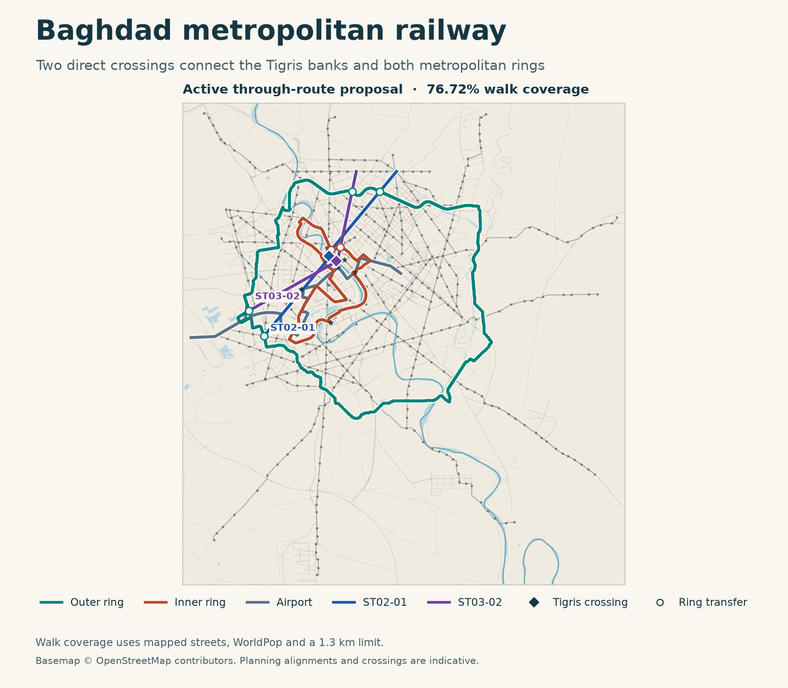

# Baghdad metropolitan railway

The active proposal is one connected, elevated metropolitan network with a central ring, an outer ring, two direct Tigris through routes and an Airport connection. The passenger study uses a 1.3 km street walk and trips with up to two changes. Route, fleet, supply, construction and cost quantities come from the same candidate.

<!-- current housing budget -->

**Current metropolitan budget case.** 784.11 km of distinct mapped guideway, 1,568.22 running-track km and 641 station sites. The base installed planning allowance is **US$43.12bn**, with low and high cases of US$30.21bn and US$65.82bn. The standard casting, haul and erection envelope uses 6.26 million paid hours. [Quantities, labour and costs](STRAIGHT-THROUGH-DELIVERY.md) · [Network study and map](STRAIGHT-THROUGH-NETWORK.md)

<!-- end current housing budget -->

[](STRAIGHT-THROUGH-NETWORK.md)

[Illustrated proposal](Baghdad-Metro-Proposal.pdf) · [Proposal source](PROPOSAL.md) · [Route and station GIS](maps/baghdad-straight-through-network.geojson) · [Suburban-ring trial and editable routes](THREE-RING-STUDY.md)

## Building and operating the railway

| Review | Live evidence |
|---|---|
| Viaduct and street works | Recurring **20 m U-girders on shared piers**. Terminal yards feed inward-moving gantries on suitable open lines. The curved-stock register identifies standard bays, short closures, paired curves and interfaces that need individual designs. [Stock, yard and procurement basis](engineering/mechanical/civil/LIVE-STOCK.md) · [Shifts and estimates](STRAIGHT-THROUGH-DELIVERY.md) |
| Train and accessible stations | Six powered-wheel cars and protected conductor collection form the costing reference. Check doors, platform gaps, propulsion, braking and evacuation against actual geometry and duty. [Vehicle and station interfaces](TRAIN-AND-STATION.md) |
| Local fabrication and repair | Price the same vehicle and civil components across suppliers. Verify installed mass, fixtures, measured cycle times, clearance, inspection and local repair. [Rapid vehicle workcells](engineering/prototype/rapid-production/README.md) · [CAD assembly films, renders and workplans](../../docs/assets/assembly-animations/GUIDE.md) |
| Service and supply | The network estimate uses a six-minute costing offer. The **17.46 km Airport** screening case has its own timetable, power alternatives and electrical duty. The paired 30-minute comparison completes 72 scheduled trips. [Airport route and power results](engineering/simulation/AUDIT-RESULTS.md) · [Digital reference and controls replay](engineering/simulation/PROJECT-REFERENCE.md) |
| Procurement and cost | Request matching scope, local content, installed prices, inspected capacity and lifecycle prices. The metropolitan estimate includes annual operation and renewals. Construction funding dates and bridge prices require project evidence. [Delivery and lifecycle accounts](STRAIGHT-THROUGH-DELIVERY.md) · [Matching supplier returns](PROCUREMENT.md) |

## Check a proposed change

The route reader accepts an edited GeoJSON. Change or withdraw any line and compare walking access, transfers, fleet and spending against the active proposal. Before publishing a changed specification, run the repository coherence check and regenerate the affected outputs.

```sh
./osr design railway baghdad-three-rings --layout revised.geojson --output build/baghdad-layout-trial
./osr coherence
```

[Map sources](maps/README.md) · [Verification and standards](../../docs/certification/README.md) · [Published releases](../../docs/releases/v0.7.2/README.md)
