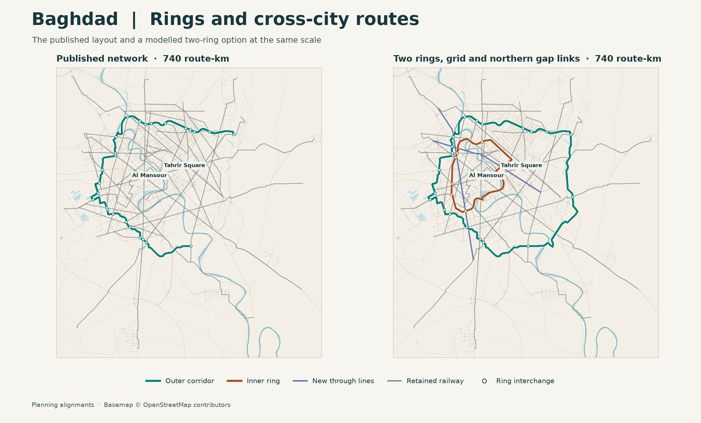

# Baghdad ring-and-grid network comparison

The displayed two-ring plan has 740.19 route-km. At the same daily running train-km, it serves **52.64%** of the modelled wide-angle outer-district trips, compared with **62.57%** on the published map. Housing-to-centre reach within two transfers changes from **73.95% to 65.74%**.

The new map is a comparison against the published network. Both rings follow mapped corridors and interchanges. Their road and river constraints produce irregular nested loops with different geometric centres. The comparison includes straight or nearly straight cross-city lines and branches needed to keep the railway connected.

Published reference commit `9623c41c81aa51298918bebccc49884b3b29c90f`. [Current metropolitan map](maps/baghdad-network.png) · [Ring-grid GIS](maps/baghdad-ring-grid.geojson) · [Model inputs and results](ring-grid.json)

## Route geometry and daily operating effort

Every passenger assignment uses the same **266,505 daily running train-km**, the same 18-hour operating day and street walks of up to 1.2 km at each end. Longer networks receive longer average intervals in this comparison. The separate delivery table prices a uniform six-minute interval for all layouts.

| Layout | Routes / closed rings | Route km | Walk ≤1.2 km | Directional interval | Close parallel pair-km |
|---|---:|---:|---:|---:|---:|
| Published network | 37 / 0 | 740.29 | 74.88% | 6.00 min | 40.85 |
| Both rings added to the published network | 38 / 2 | 810.09 | 75.23% | 6.57 min | 59.59 |
| Inner ring added to the published network | 38 / 1 | 781.42 | 75.14% | 6.33 min | 59.59 |
| Two rings and cross-city grid | 24 / 2 | 728.31 | 65.03% | 5.90 min | 67.77 |
| Two rings, grid and northern gap links | 26 / 2 | 740.19 | 66.76% | 6.00 min | 67.77 |
| Two rings and compact set of through lines | 16 / 2 | 412.12 | 48.87% | 3.34 min | 37.39 |
| Outer ring and the same grid | 25 / 1 | 699.06 | 66.39% | 5.67 min | 49.02 |

Parallel lengths count long runs for each line pair. The figure uses the displayed two-ring layout from the route-length-limited options, preferring candidates within 10% of the current route length before comparing housing-to-centre reach within two changes. The one-ring control uses the other alignments from “Two rings, grid and northern gap links” and omits the inner ring. The overlay isolates the cost and performance of adding both rings to the current layout.

| Ring in displayed plan | Route km | Station sites | Shared interchanges |
|---|---:|---:|---:|
| M09 | 97.75 | 82 | 21 |
| M15 | 41.13 | 30 | 8 |

The criss-cross paths include new through alignments that connect at a shared interchange. Their mapped line lengths and transfer records are in the GIS and machine results.

The restored outer ring includes 2 mapped wet reaches wider than the 550 m screening bound. Its crossing design and any premium over the standard civil allowance remain open. The inner ring follows mapped road corridors and named bridge reaches, with rail structures and clearances still to be designed.

## Trips between districts and to the centre

The metropolitan model weights trips between populated 2 km tiles with distance decay. The wide-angle sample requires both ends outside the central study box, in different 8 km grid districts, with at least 45 degrees of angular separation around the central box. P90 compares the same wide-angle trips served by both the candidate and the published map. The transfer count for this sample describes the assigned route. The separate housing-to-centre model enforces a maximum of two transfers to six named destinations.

| Layout | All metropolitan trips served | Wide-angle served | Wide-angle assigned ≤2 changes | Same-trip wide-angle P90, current → trial | Housing trips within 2 changes | Peak load per departure index |
|---|---:|---:|---:|---:|---:|---:|
| Published network | 68.59% | 62.57% | 47.41% | 87.2 → 87.2 min | 73.95% | 3.687 |
| Two rings and compact set of through lines | 33.37% | 25.53% | 18.28% | 82.4 → 87.6 min | 47.62% | 2.266 |
| Two rings and cross-city grid | 55.19% | 51.90% | 40.33% | 85.3 → 89.8 min | 64.99% | 4.758 |
| Two rings, grid and northern gap links | 56.39% | 52.64% | 41.05% | 85.6 → 90.0 min | 65.74% | 5.250 |
| Inner ring added to the published network | 68.59% | 62.57% | 49.35% | 87.2 → 86.3 min | 74.07% | 3.874 |
| Outer ring and the same grid | 54.17% | 51.50% | 39.28% | 85.6 → 91.2 min | 65.11% | 4.877 |
| Both rings added to the published network | 68.59% | 62.57% | 49.80% | 87.2 → 86.0 min | 74.07% | 4.061 |

Peak load is a comparison of pressure on the busiest direction of a track segment per departure under the same synthetic demand. Timetables, depot work, passenger counts, signalling and crowding require further evidence. The [machine record](ring-grid.json) also includes centre-to-outer, local and all inter-district cohorts.

## Installed and whole-life planning allowances

Costs use identical 2026 US dollar rates and the same six-minute, 18-hour service specification. Track-km count both tracks. Special rail crossings, land requirements, accessible stations, turnouts and installation remain at planning maturity.

| Layout | Track-km | Paid casting, haul and erection hours | Trainsets with spares | Installed, US$bn | Annual operation, US$bn | 30-year present cost, US$bn |
|---|---:|---:|---:|---:|---:|---:|
| Published network | 1480.50 | 6,427,544 | 573 | 41.90 | 1.14 | 64.39 |
| Both rings added to the published network | 1619.58 | 6,698,896 | 613 | 44.97 | 1.22 | 69.00 |
| Inner ring added to the published network | 1562.76 | 6,588,136 | 601 | 43.94 | 1.19 | 67.47 |
| Two rings and cross-city grid | 1454.17 | 6,026,296 | 539 | 39.99 | 1.12 | 61.96 |
| Two rings, grid and northern gap links | 1477.93 | 6,114,728 | 549 | 40.70 | 1.14 | 63.00 |
| Two rings and compact set of through lines | 823.72 | 3,122,224 | 308 | 22.77 | 0.65 | 35.45 |
| Outer ring and the same grid | 1395.67 | 5,954,136 | 524 | 38.75 | 1.09 | 60.07 |

Run `tools/automation/osr-python -m cities.Baghdad.ring_grid_comparison --check` to verify this comparison.
Supply `--baseline` with the reference packet from the pinned commit for historical reproduction.

Comparison `9cc719916a11ebdc3e5bcd6f5ab392a899fe5ec63c60243931292b8df20fa1ba`.
