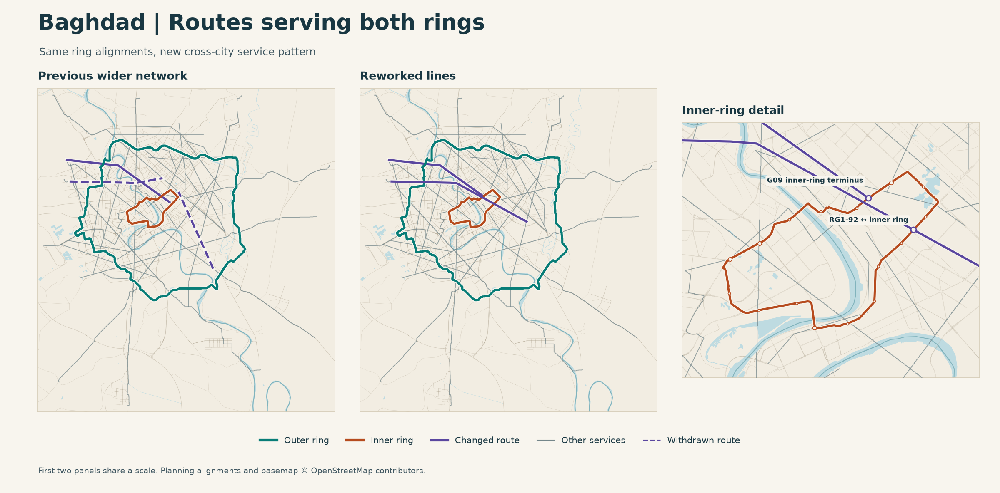

# Baghdad railway routes that serve both rings

**East–west diameter and G09 turnback** is the displayed redesign. It keeps the **22.36 km** inner ring and the same outer ring, with **5.49 km** minimum mapped clearance. Routes **C1, G09, M01, RG1-92** now call at both rings, compared with **C1, M01** in the previous wider-ring layout.

[Network and interchange GIS](maps/baghdad-ring-network.geojson) · [Machine results](ring-network.json) · [Wider-ring comparison](WIDER-RING.md) · [Published city network](NETWORK.md)

## Route changes

- **G13 is replaced in this trial.** The estimate removes 14.19 route-km and closes 10 sites served only by this line.
- **T19 is replaced in this trial.** The estimate removes 12.79 route-km and closes 8 sites served only by this line.
- **RG1-92 is a 22.00 km cross-city diameter.** It has a shared station on each of the two rings.
- **G09 terminates at M15.** The retained service still calls at M09. The new common station closes 2 former sites and removes 1.54 route-km. C1 remains on the eastern approach.

The comparison also tests the M02 pedestrian connection alone, the M04–T19 through working, and combinations of those changes. New platforms follow the affected track alignments. Walking links use the retained street network in both directions.

Two axes passed individual screening. Their combined length and shallow intersection angle held the two-line option before the shared-station check. The single east–west diameter was tested separately at the earlier guideway budget.

## Network and journey comparison

All layouts share **266,505 daily running train-km** and the same population-based trip sample. The six-centre housing measure permits up to two changes. The wider inter-district sample groups trips between different sides of central Baghdad. Route overlap counts each pair of lines at close parallel separation. The 1.2 km access measure uses the street network.

| Layout | Lines | Route km | Direct routes between rings | Close parallel pair-km | Station pairs within 280 m | Walk ≤1.2 km | Outer trips served | Housing to centre ≤2 changes |
|---|---:|---:|---:|---:|---:|---:|---:|---:|
| Published city network | 37 | 740.29 | 0 | 40.85 | 18 | 74.88% | 62.57% | 73.95% |
| Previous wider dual ring | 34 | 737.64 | 2 | 16.73 | 16 | 73.66% | 57.91% | 70.16% |
| M02 transfer to the inner ring | 34 | 737.64 | 2 | 16.73 | 17 | 73.66% | 57.91% | 70.16% |
| G09 turns back at the inner ring | 34 | 736.10 | 3 | 14.38 | 16 | 73.50% | 57.91% | 70.16% |
| M02 interchange and G09 turnback at the inner ring | 34 | 736.10 | 3 | 14.38 | 17 | 73.50% | 57.91% | 70.16% |
| West–southeast through service and two new inner-ring links | 34 | 736.10 | 3 | 16.64 | 17 | 73.50% | 57.91% | 69.98% |
| West–southeast through service at the mapped M04–T19 junction | 34 | 737.64 | 2 | 18.98 | 16 | 73.66% | 57.91% | 69.98% |
| Cross-city diameter | 33 | 732.66 | 3 | 26.58 | 16 | 73.52% | 59.70% | 70.76% |
| East–west diameter and G09 turnback | 33 | 731.12 | 4 | 22.71 | 16 | 73.51% | 59.70% | 70.76% |
| East–west diameter with the G09 and M02 ring links | 33 | 731.12 | 4 | 22.71 | 17 | 73.51% | 59.70% | 70.76% |

Displayed selection passed the **matched kilometres, route count and access** comparison tier. The matched tier allows up to 2% more route-km, the same or fewer lines, and a drop of at most 0.5 percentage points in each reach measure before ranking by housing-to-centre reach, outer-district reach, less parallel running, direct connections between the rings and transfers.

## How passengers use the rings

A journey counts toward a ring only when its assigned path rides a segment of that ring. The two-ring column counts journeys riding both. The published city control has an open M09 service. Only journeys served by both layouts enter the paired elapsed-time comparison.

| Layout | Served trips riding M09 | Served trips riding M15 | Served trips riding both | All modelled trips riding either | Outer trips assigned ≤2 changes | Paired outer P90, previous → trial |
|---|---:|---:|---:|---:|---:|---:|
| Published city network | 31.67% | 0.00% | 0.000% | 21.73% | 47.41% | 88.16 → 87.55 min |
| Previous wider dual ring | 37.33% | 5.45% | 0.247% | 26.07% | 46.19% | 88.16 → 88.16 min |
| M02 transfer to the inner ring | 37.28% | 5.26% | 0.246% | 25.92% | 46.11% | 88.16 → 88.01 min |
| G09 turns back at the inner ring | 37.30% | 4.77% | 0.236% | 25.65% | 46.21% | 88.16 → 88.14 min |
| M02 interchange and G09 turnback at the inner ring | 37.23% | 5.19% | 0.246% | 25.85% | 46.15% | 88.16 → 88.13 min |
| West–southeast through service and two new inner-ring links | 37.10% | 5.09% | 0.246% | 25.72% | 45.68% | 88.16 → 88.02 min |
| West–southeast through service at the mapped M04–T19 junction | 37.21% | 5.30% | 0.247% | 25.91% | 45.72% | 88.16 → 88.14 min |
| Cross-city diameter | 37.95% | 8.44% | 0.325% | 28.79% | 47.82% | 88.10 → 88.09 min |
| East–west diameter and G09 turnback | 37.56% | 8.49% | 0.298% | 28.59% | 47.68% | 88.10 → 88.07 min |
| East–west diameter with the G09 and M02 ring links | 37.46% | 8.93% | 0.319% | 28.79% | 47.60% | 88.10 → 88.00 min |

The operating sensitivity increases frequency by 25% on M09 and M15 and reallocates those train-kilometres from the other routes. The timetable and train capacity require further work.

| Layout with more frequent rings | Ring headway | All modelled trips riding either, uniform → priority | Outer trips assigned ≤2 changes, uniform → priority |
|---|---:|---:|---:|
| Previous wider dual ring | 4.78 min | 26.07% → 26.64% | 46.19% → 46.42% |
| East–west diameter and G09 turnback | 4.74 min | 28.59% → 29.78% | 47.68% → 47.58% |

## Construction and cost

The planning estimate prices the displayed layout and the tested physical alternative with the least parallel overlap. It uses the six-minute costing basis and 2026 rates. The programme day shows standard-deck handover from mobilisation.

| Layout | Track-km | Paid casting, haul and erection hours | Handover day | Installed US$bn | 30-year present US$bn |
|---|---:|---:|---:|---:|---:|
| Published city network | 1,480.50 | 6,427,544 | 3,384 | 41.90 | 64.39 |
| Previous wider dual ring | 1,474.68 | 6,044,112 | 3,154 | 40.87 | 62.87 |
| East–west diameter and G09 turnback | 1,461.65 | 6,005,800 | 3,154 | 40.50 | 62.34 |
| G09 turns back at the inner ring | 1,471.60 | 6,028,504 | 3,154 | 40.83 | 62.78 |

Rail curves, accessible interchange layouts, physical turnbacks, junction capacity, and dedicated river crossing structures remain open. The estimates exclude special crossing premiums.

Reproduce with `tools/automation/osr-python -m cities.Baghdad.ring_network_publication --check`.

Comparison `af5d8f7c3afb42ad24c5aeda6924dfdd9df14466aa90d7388b0aeae633682238`.
