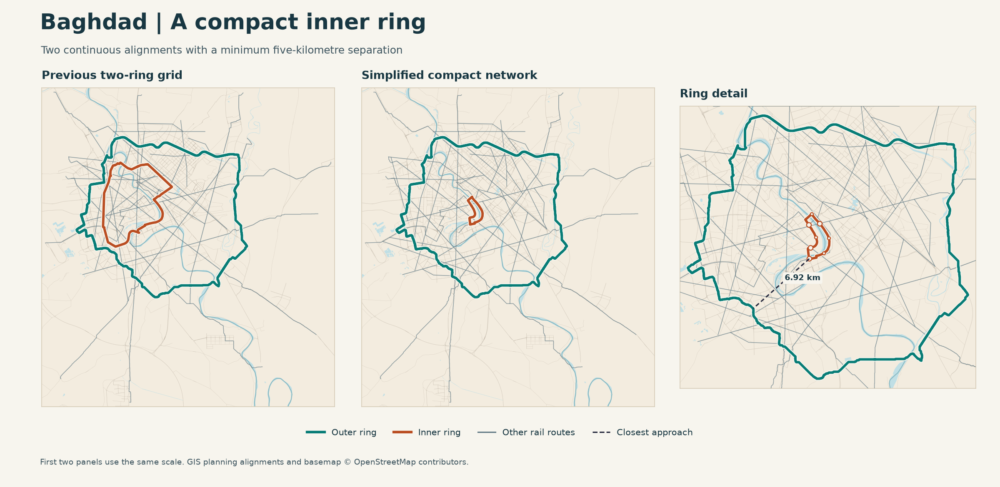

# Baghdad compact rings and through routes

A compact inner loop can maintain at least **5 km** of horizontal clearance from the outer ring. The tested loop runs **11.33 km** via the 14 July Bridge and Al-Sinak Bridge road corridors. At its closest point the rings are **6.92 km** apart, compared with **0.62 km** in the previous two-ring study.

Keep the published network as the service reference. The compact network sacrifices some of its measured access or journey reach in exchange for fewer lines and less duplication.

[Current city map](maps/baghdad-network.png) · [Previous ring-and-grid study](RING-GRID.md) · [Compact network GIS](maps/baghdad-spaced-rings.geojson) · [Machine results](spaced-rings.json)

## Route structure and station spacing

The compact inner loop has 4 interchange sites in the displayed layout. The lines joining both rings directly are C1, M02, M05. The outer ring restores 28.67 km of the former M09 alignment. The separation rule applies to the complete alignments. Stations on each ring can be spaced for local walking access.

| Layout | Lines | Route km | Distinct station sites | Site pairs within 280 m | Close parallel pair-km |
|---|---:|---:|---:|---:|---:|
| Published Baghdad network | 37 | 740.29 | 656 | 18 | 40.85 |
| Previous two-ring grid | 26 | 740.19 | 650 | 24 | 67.77 |
| Compact rings with current routes | 38 | 780.29 | 666 | 22 | 46.92 |
| Retain the northern M03 reach on a continuous M06 trunk | 34 | 736.71 | 630 | 14 | 21.15 |
| Simplified routes with outer ring only | 33 | 725.38 | 626 | 13 | 15.08 |
| Through service at compatible mapped termini | 37 | 780.29 | 661 | 16 | 46.92 |
| Withdraw the G04, G05 and T40 parallel overlays | 34 | 753.13 | 643 | 15 | 26.78 |
| Retain M03 across the east with M06 terminating at the crossing | 34 | 726.61 | 623 | 14 | 20.75 |
| Compare fewer overlay services and a shorter Airport parallel approach | 31 | 696.63 | 604 | 14 | 23.58 |
| Compare concentrating service on metropolitan spines and ring connections | 27 | 657.88 | 576 | 14 | 21.42 |

The close-parallel screen counts each pair of lines where they run for at least 2 km within 1 km of each other with similar directions. The station screen counts distinct site pairs by straight-line distance. The consolidation model preserves named centres and rail interchanges. Nearby calls are removed or moved only where the mapped alignments and a dry, short, two-way walk support the change. The machine results list every tested withdrawal, station change, retained walking connection and rejected proposal.

## Walking access and journeys

The journey comparisons use equal effort of **266,505 running train-km per day** across an 18-hour service day. Walking access follows mapped streets from WorldPop and GHSL population cells. The housing sample applies a hard maximum of two changes to six central destinations. Wide-angle trips run between outlying districts on different sides of central Baghdad.

| Layout | Walk ≤1.2 km WorldPop | Walk ≤1.2 km GHSL | All metro trips served | Wide-angle trips served | Housing to centre ≤2 changes |
|---|---:|---:|---:|---:|---:|
| Published Baghdad network | 74.88% | 75.18% | 68.59% | 62.57% | 73.95% |
| Previous two-ring grid | 66.76% | 68.63% | 56.39% | 52.64% | 65.74% |
| Compact rings with current routes | 75.10% | 75.48% | 68.59% | 62.57% | 73.95% |
| Retain the northern M03 reach on a continuous M06 trunk | 73.41% | 74.10% | 61.30% | 57.91% | 70.71% |
| Simplified routes with outer ring only | 73.33% | 73.92% | 61.30% | 57.91% | 70.71% |
| Through service at compatible mapped termini | 75.10% | 75.48% | 68.59% | 62.57% | 74.17% |
| Withdraw the G04, G05 and T40 parallel overlays | 73.96% | 74.50% | 62.08% | 58.39% | 71.19% |
| Retain M03 across the east with M06 terminating at the crossing | 73.58% | 73.94% | 61.30% | 57.91% | 70.16% |
| Compare fewer overlay services and a shorter Airport parallel approach | 71.50% | 70.61% | 59.78% | 55.01% | 68.93% |
| Compare concentrating service on metropolitan spines and ring connections | 69.38% | 67.92% | 58.13% | 53.57% | 68.09% |

On the same simplified routes, adding the inner loop changes wide-angle reach from 57.91% to 57.91% and housing-to-centre reach within two changes from 70.71% to 70.71%. For the wide-angle trips served by both the compact layout and the published map, the 90th-percentile journey time changes from 87.6 to 87.2 minutes. Trip assignments use synthetic demand. The published rail layout has been retained.

## Construction, labour and cost

Delivery estimates use the same civil rates and a uniform six-minute directional interval. Track-km count both tracks. The programme day is the last standard-deck handover day in the model, counted from mobilisation.

| Layout | Track-km | Paid casting, haul and erection hours | Deck day | Trainsets with spares | Installed US$bn | 30-year present US$bn |
|---|---:|---:|---:|---:|---:|---:|
| Published Baghdad network | 1,480.50 | 6,427,544 | 3,384 | 573 | 41.90 | 64.39 |
| Previous two-ring grid | 1,477.93 | 6,114,728 | 3,709 | 549 | 40.70 | 63.00 |
| Compact rings with current routes | 1,559.98 | 6,582,600 | 3,384 | 593 | 43.48 | 66.71 |
| Retain the northern M03 reach on a continuous M06 trunk | 1,472.83 | 6,218,136 | 3,154 | 555 | 40.86 | 62.80 |
| Simplified routes with outer ring only | 1,450.17 | 6,173,840 | 3,154 | 548 | 40.32 | 62.02 |
| Through service at compatible mapped termini | 1,559.98 | 6,596,072 | 3,337 | 592 | 43.43 | 66.57 |
| Withdraw the G04, G05 and T40 parallel overlays | 1,505.67 | 6,381,592 | 3,206 | 567 | 41.81 | 64.22 |
| Retain M03 across the east with M06 terminating at the crossing | 1,452.62 | 6,001,064 | 3,154 | 548 | 40.29 | 61.96 |
| Compare fewer overlay services and a shorter Airport parallel approach | 1,392.66 | 5,828,712 | 3,154 | 524 | 38.65 | 59.53 |
| Compare concentrating service on metropolitan spines and ring connections | 1,315.17 | 5,522,536 | 3,154 | 490 | 36.38 | 56.18 |

The inner ring follows mapped road corridors. Rail curves, grades, fit at transfer stations, and dedicated river structures require engineering. The restored outer alignment also includes 2 mapped water reaches beyond the 550 m screening bound. Special crossing premiums remain unpriced. The figures are modelled planning allowances in 2026 US dollars.

Verify with `tools/automation/osr-python -m cities.Baghdad.spaced_ring_comparison --check`. The published reference is pinned at `9623c41c81aa51298918bebccc49884b3b29c90f`.

Comparison `2583f34f952093a169470f37ad3d4be520af7c598131a0afc2b5d51ea4c9eb71`.
