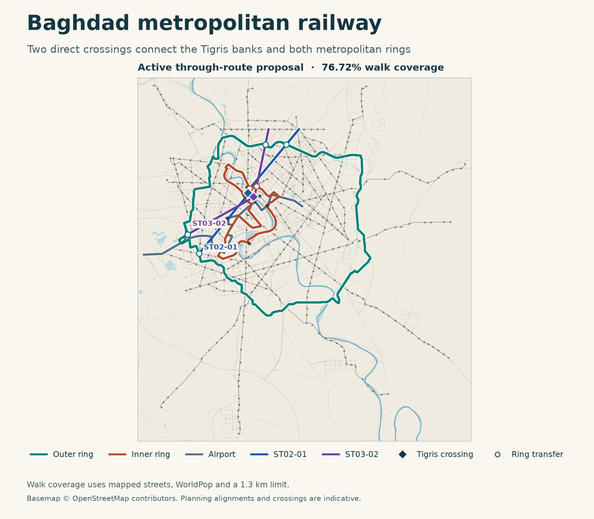

# Baghdad metropolitan railway · Rings and Tigris through services

**Two Tigris through services with retained coverage** is the current proposal. The 785.14 km passenger network serves 641 station sites on 36 connected lines. The WorldPop street model puts **76.72%** of the study population within 1.3 km of a station. **77.63%** of weighted housing-to-centre trips can be completed with up to two changes under the matched-service comparison.

[Tigris crossings and ring interchanges](maps/baghdad-through-interchanges.png) · [Side-by-side comparison](maps/baghdad-straight-through-comparison.png) · [Proposal](PROPOSAL.md) · [Delivery and planning figures](STRAIGHT-THROUGH-DELIVERY.md) · [Routes, stations and transfers in GIS](maps/baghdad-straight-through-network.geojson) · [Machine results](straight-through-network.json)

## How the layout works

The 46.91 km central ring (M15) distributes trips around the central districts. The 97.75 km outer ring (M09) connects the outer corridors. The through services approach both rings from outside, cross the Tigris at mapped bridge approaches and share station sites with the rings. C1 keeps the Airport in the same passenger network.

| Through service | End-to-end km | Length / terminal chord | Tigris approach | Inner ring shared stations | Outer ring shared stations |
|---|---:|---:|---|---|---|
| ST02-01 | 21.61 | 1.0029 | 44.37813° E, 33.33859° N → 44.38165° E, 33.34713° N | ST02-01–M15 interchange (X-ST02-01-M15-e56295ffeb) | G07–M09 interchange (X-G07-M09-6b0ccccb37), ST02-01–M09 interchange (X-ST02-01-M09-6f062d9986) |
| ST03-02 | 19.66 | 1.0952 | 44.38994° E, 33.33996° N → 44.38635° E, 33.33652° N | ST03-02–M15 interchange (X-ST03-02-M15-af5896b8ac) | Al Amriya interchange (X-C1-M09-01), ST03-02–M09 interchange (X-ST03-02-M09-0acefb89ad) |

The GIS checks bridge orientation, both river banks and actual shared station calls. Existing bridge approaches locate the railway corridors. Each new rail crossing needs its own structure and approvals.

### Deterministic selection

1. Retain both ring alignments and protect the Airport terminals. Use mapped roads, water and pedestrian paths.
2. Search mapped bridge approaches, bearings and terminal locations. Check that the line enters and leaves each ring, uses an interchange on each, and has two terminals beyond the outer ring. Reject lines over 1.10 times the terminal chord.
3. Compare retained, replacement and added corridors. Test parallel cuts and turnbacks against the same housing sample, station access and connected passenger graph. Keep a distinct transfer connection where platforms are separate.
4. Apply the prior access tolerances and keep access to all previously reached central destinations. Among new layouts that pass, reduce parallel pair-km first, then line count, then favour housing and outer-district reach.
5. Recalculate fleet, supply, civil quantities, routes and costs using the selected geometry. Run independent beam and construction-stage checks before procuring works.

| Trial | Route-km | Lines / sites | Parallel pair-km | WorldPop 1.2 / 1.3 km | GHSL 1.3 km | Housing trips ≤2 changes | Outer trips served |
|---|---:|---:|---:|---:|---:|---:|---:|
| Published city network control | 740.29 | 37 / 656 | 40.85 | 74.88% / 77.56% | 78.25% | 77.77% | 67.61% |
| Earlier central-ring comparison | 743.87 | 34 / 609 | 20.60 | 72.87% / 75.90% | 76.47% | 74.47% | 64.56% |
| New Tigris service and retained cross-city axis | 763.53 | 35 / 625 | 22.75 | 73.55% / 76.45% | 77.14% | 76.00% | 66.77% |
| Retained Tigris services with both-ring interchanges | 743.87 | 34 / 609 | 20.60 | 72.87% / 75.90% | 76.47% | 74.47% | 64.56% |
| **Two Tigris through services with retained coverage** | 785.14 | 36 / 641 | 24.98 | 73.98% / 76.72% | 77.37% | 77.63% | 69.00% |

All passenger variants use **266,505 train-km/day**, common synthetic demand and up to 1.3 km walking at each end. Coverage estimates use WorldPop 2026 and GHSL 2025 population grids and mapped street connections. These model outputs describe geographic access and relative service. They do not supply observed origin–destination demand. Six-minute capital and operating allowances use a separate fixed-service offer.

### Where the changes stop

Both terminals of each through service lie beyond the outer ring only in **Two Tigris through services with retained coverage**. The retained and mixed comparisons include lines that end at a ring station.

- Add **ST02-01**, 21.61 km.
- Add **ST03-02**, 19.66 km.

**9 retained corridors** also enter the inner ring. They remain in the map to preserve the passenger paths shown in the model. Their route-by-route dispositions are below.

| Retained service | Disposition |
|---|---|
| C1 | The dedicated airport corridor is retained to preserve airport-to-city access. |
| C2 | Existing city-centre corridor retained in the coverage comparison. |
| G02 | Existing city-centre corridor retained in the coverage comparison. |
| G07 | Existing city-centre corridor retained in the coverage comparison. |
| G09 | Existing city-centre corridor retained in the coverage comparison. |
| M01 | Existing city-centre corridor retained in the coverage comparison. |
| M02 | Existing city-centre corridor retained in the coverage comparison. |
| M08 | Existing city-centre corridor retained in the coverage comparison. |
| RG1-92 | Existing city-centre corridor retained in the coverage comparison. |

Other tested layouts were held for the following reasons.

- **retained-through-pair-turnbacks** · The tested turnbacks would remove station coverage or lack a usable interchange.
- **bridge-first-pair-turnbacks** · The retained inner-ring turnbacks would remove station coverage or lack a usable shared railway interchange.

## Central destinations and remaining coverage gaps

| Destination | Walk to M15 | Walk to a direct M15 connection |
|---|---:|---:|
| Tahrir Square | 560 m | 432 m |
| Al-Shorja market | 1,046 m | 30 m |
| Medical City area | 627 m | 361 m |
| Karkh / Haifa Street | 1,155 m | 0 m |
| Al Mansour | 2,111 m | 182 m |
| University of Baghdad approach | 827 m | 0 m |

| Central sector | Population with a ≤1.3 km walk to any station |
|---|---:|
| Southwest | 83.52% |
| South | 79.35% |
| Southeast | 91.60% |
| West | 77.83% |
| Centre | 96.55% |
| East | 92.55% |
| Northwest | 88.10% |
| North | 97.34% |
| Northeast | 89.46% |

## Development path

| Stage | Work and accountable lead | Release evidence |
|---|---|---|
| Corridor | Baghdad planning and survey teams verify both river banks, land, streets, interchange entrances and terminal turnbacks | Controlled horizontal and vertical alignment plus route observations |
| Structures | Civil and geotechnical teams use GIS screening, survey, hydraulic and borehole inputs to develop the river spans, curve radii, bearings, piers and grades | Checked geometry, design loads and worksite costs, including station and turnout interfaces |
| Service | Operations, signalling and power teams test timetables, electric duty, station transfer loads and safe stopping | Peak and degraded-service simulation and scheme-specific limitations |
| Work packages | Iraqi precasters, transporters and contractors price yard and form layouts, launch equipment, off-deck lifts and bridge access | Matched quantities, working method, crew shifts and mobilisation quotes |
| First articles | Civil and rolling-stock teams build and inspect representative assemblies and temporary load interfaces | Test results and an independently reviewed procurement package |
| Delivery and finance | Authority and funding team price common scope and agree the stage order, demand cases and financing | Cost and operating plan linked to approved design inputs |

For new city studies, the shared OpenSourceRail workflow uses the same directness, river and shared-ring transfer checks where local GIS supports them. It keeps a source-linked earlier corridor as a bounded fallback when the evidence or comparison cannot support a new layout. Existing city dossiers retain their published inputs.

Reproduce this record with `OPENBLAS_NUM_THREADS=1 ./osr design railway baghdad-network --check`.

Network candidate `baghdad-network-6a972430e7f71b41` · publication `e15099d49c8473af0fb0278743f7975546685f1cc834c1c45d2a39db60d526cd`.
