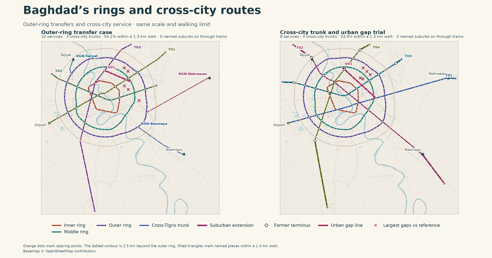

# Baghdad · Population-led rings and cross-city trunks

The central ring encloses the mapped central districts on a convex alignment. The middle and outer rings are each fitted to residential population and the mapped walking network. Their separation varies around the city. The trunk search compares direct cross-city alignments from opposite sides of the outer ring. It checks tagged bridge approaches and possible new crossings against mapped river geometry.

The two-ring reference still supplies the proposal’s budget. The three-ring comparison shows the benefits of a simpler network and the districts where its access or journeys still fall short.

[Current proposal](PROPOSAL.md) · [Two-ring reference](STRAIGHT-THROUGH-NETWORK.md) · [Editable trial GIS](maps/baghdad-three-ring-trial.geojson) · [Machine results](three-ring-study.json.gz)

## Network and access

| Layout | Rings | Services | Short standalone services | Cross-city trunks | Route-km | Station sites | Shared sites | Pairs of sites within 750 m | Parallel pair-km |
|---|---:|---:|---:|---:|---:|---:|---:|---:|---:|
| Three-ring core · M3 / O4 | 3 | 7 | 0 | 4 | 293.58 | 224 | 19 | 4 | 0.00 |
| Three rings with suburban extensions | 3 | 7 | 0 | 4 | 337.75 | 248 | 19 | 4 | 0.00 |
| Cross-city trunk and urban gap trial | 3 | 8 | 0 | 4 | 350.25 | 256 | 22 | 8 | 0.00 |
| Two-ring reference | 2 | 36 | 8 | 2 | 785.14 | 641 | 115 | 379 | 24.98 |
| Retained trunks with named connections | 3 | 9 | 0 | 3 | 305.26 | 232 | 20 | 1 | 0.00 |
| Outer-ring transfer case | 3 | 10 | 0 | 3 | 312.99 | 237 | 23 | 2 | 0.00 |
| Retained spaced core | 3 | 6 | 0 | 3 | 266.93 | 212 | 17 | 1 | 0.00 |

The passenger comparisons hold running supply at **282,650 train-km/day**. The housing test searches journeys with up to two changes. The wider metropolitan test assigns least-generalised-cost trips, then reports the share using up to two changes. Both population layers use the same retained street graph and a 1.3 km maximum walk.

| Layout | WorldPop within 1.3 km | GHSL within 1.3 km | WorldPop reached only via middle-ring sites | Housing ≤2 changes | Wider journeys ≤2 changes | Headway |
|---|---:|---:|---:|---:|---:|---:|
| Three-ring core · M3 / O4 | 49.92% | 50.11% | 1,016,257 | 32.97% | 17.69% | 2.24 min |
| Three rings with suburban extensions | 51.13% | 50.96% | 1,016,257 | 33.94% | 18.07% | 2.58 min |
| Cross-city trunk and urban gap trial | 53.52% | 52.77% | 945,041 | 38.95% | 24.07% | 2.68 min |
| Two-ring reference | 76.72% | 77.37% | 0 | 77.63% | 57.67% | 6.00 min |
| Retained trunks with named connections | 52.30% | 52.01% | 1,012,792 | 30.70% | 23.69% | 2.33 min |
| Outer-ring transfer case | 54.09% | 53.28% | 898,425 | 32.38% | 25.89% | 2.39 min |
| Retained spaced core | 50.49% | 50.55% | 1,012,792 | 28.93% | 22.10% | 2.04 min |

## Named suburban destinations

The table gives the shortest mapped street walk from each fixed anchor to a station. Nahrawan and Tajiyat use station locations retained from the earlier network. The Basmaya anchor is in the residential estate, east of the earlier M02 approach.
An em dash means the mapped walking graph did not establish a path within its search distance.

| Layout | Basmaya | Nahrawan | Tajiyat |
|---|---:|---:|---:|
| Three-ring core · M3 / O4 | 1,040 m | 39 m | 582 m |
| Three rings with suburban extensions | 1,040 m | 39 m | 582 m |
| Cross-city trunk and urban gap trial | 1,040 m | 39 m | 582 m |
| Two-ring reference | 2,382 m | 79 m | 121 m |
| Retained trunks with named connections | 534 m | 640 m | 61 m |
| Outer-ring transfer case | 534 m | 640 m | 61 m |
| Retained spaced core | — | — | — |

## Continuing suburban trains through Baghdad

The outer-ring transfer case used a separate train from each named suburb to the outer ring. It led the previous walking-coverage comparison. The through-route search moves suburban destinations onto cross-Tigris trains where geometry and station access permit. It tests additional mapped terminal sites and a limited bank approach bend when the straight route misses a named suburb.

The journey test uses the same fixed central destinations and total scheduled train-km for every layout. The three counts show how many destinations are reachable without a change, within one change and within two changes. Both walks must fit within 1.3 km. The trunk column identifies cross-Tigris services within walking distance of the suburban origin.

| Layout | Suburb | Walkable cross-Tigris trunks | Direct on those trunks | 0 / ≤1 / ≤2 changes |
|---|---|---|---:|---:|
| Two-ring reference | Basmaya | — | 0 | 0 / 0 / 0 |
| Two-ring reference | Nahrawan | — | 0 | 0 / 3 / 6 |
| Two-ring reference | Tajiyat | — | 0 | 0 / 0 / 6 |
| Outer-ring transfer case | Basmaya | — | 0 | 0 / 0 / 4 |
| Outer-ring transfer case | Nahrawan | — | 0 | 0 / 0 / 4 |
| Outer-ring transfer case | Tajiyat | — | 0 | 0 / 0 / 4 |
| Cross-city trunk and urban gap trial | Basmaya | T02 | 3 | 3 / 3 / 5 |
| Cross-city trunk and urban gap trial | Nahrawan | T01 | 0 | 0 / 0 / 5 |
| Cross-city trunk and urban gap trial | Tajiyat | T02 | 3 | 3 / 3 / 5 |

Passengers from Nahrawan can stay aboard across the Tigris. The route's stations fall outside the 1.3 km walks to the tested central destinations. Reachable trips to those destinations still require changing trains.

The illustrated through-route trial reaches **53.52%** of WorldPop and **52.77%** of GHSL residents within 1.3 km. The outer-ring transfer case reaches **54.09%** and **53.28%**, respectively. The cost table below prices each route set against the same service offer.

## One line through the largest urban gaps

**U01** adds **12.51 route-km** inside the outer ring and 8 new station sites. It shares stations with M09, T01, T04 and adds 1.3 km walking access for **206,170 WorldPop residents** and **132,541 GHSL residents** inside the outer ring. The zero-additional-line case shows the effect of the change.

## Suburban extensions on the through services

The core search limits ordinary termini to 11 km beyond the outer ring. The named suburbs and Airport can anchor services farther out. The comparison tests additional extensions into neighbourhoods outside the core's walking catchment.

The continuation search tests up to **20 km per trunk end**. It keeps the original stations and through services, screens new alignments for heading, water, station spacing and parallel duplication, and ranks the options by additional residents within a 1.3 km street walk on both population grids.

The diamonds mark former termini, which remain intermediate stops. The suburban screen checks routes running alongside each other within 5 km outside the outer ring for at least 1.5 continuous km. It checks the original approaches and added extensions together. Each trunk also crosses a contour 2.5 km beyond the ring at sites at least 5 km from those of every other trunk. This separates routes that fan out too late. The dense-city spacing checks still apply inside the ring.

The closest pair of suburban contour crossings in the extended trial is **6.41 km apart**.

The resulting package extends **7 trunk ends** by **44.17 route-km** and adds **24 station sites**. It reaches **104,082 more WorldPop residents** and **62,802 more GHSL residents** than the same core. Passengers stay on the same service to cross the river and reach the rings.

The suburban shares below use the same territory outside the three-ring outer alignment for every case.

| Layout | WorldPop suburban walk reach | GHSL suburban walk reach |
|---|---:|---:|
| Two-ring reference | 53.78% | 56.02% |
| Three-ring core · M3 / O4 | 27.52% | 28.75% |
| Three rings with suburban extensions | 30.66% | 31.10% |

| Trunk | From former terminus | New terminus (nearby mapped place) | Added km | New sites | New WorldPop reach |
|---|---|---|---:|---:|---:|
| T02 | T02-S01 | T02-X1-03 (ابوعظام حي الشهداء) | 6.05 | 3 | 34,087 |
| T01 | T01-S23 | T01-X2-01 | 1.98 | 1 | 19,374 |
| T04 | T04-S01 | T04-X1-09 (Hay Salam) | 18.44 | 9 | 23,067 |
| T02 | T02-S22 | T02-X2-06 (AL-kalsha) | 9.84 | 6 | 13,217 |
| T04 | T04-S13 | T04-X2-02 (قرية ۱ حزيران) | 2.95 | 2 | 3,534 |
| T03 | T03-S01 | T03-X1-02 (As Salmaniyat) | 3.00 | 2 | 9,695 |
| T03 | T03-S13 | T03-X2-01 (بيوت الاصلاح قرية) | 1.90 | 1 | 1,108 |

Per-extension gains are counted in selection order. The reported residents are unique across the package.

A resident is counted in the middle-ring-only column if they lose their 1.3 km access when stations exclusive to that ring are removed. Shared stations stay available in this test.

### Neighbourhoods previously served only by short routes

| Layout | Population grid | Former catchment | Still within 1.3 km | Of those, served only by middle-ring sites | Lost access |
|---|---|---:|---:|---:|---:|
| Three-ring core · M3 / O4 | worldpop-2026 | 272,311 | 135,977 | 43,816 | 136,334 |
| Three-ring core · M3 / O4 | ghsl-2025 | 216,037 | 118,246 | 27,848 | 97,791 |
| Three rings with suburban extensions | worldpop-2026 | 272,311 | 135,977 | 43,816 | 136,334 |
| Three rings with suburban extensions | ghsl-2025 | 216,037 | 118,246 | 27,848 | 97,791 |
| Cross-city trunk and urban gap trial | worldpop-2026 | 272,311 | 135,977 | 39,964 | 136,334 |
| Cross-city trunk and urban gap trial | ghsl-2025 | 216,037 | 118,246 | 25,537 | 97,791 |
| Two-ring reference | worldpop-2026 | 272,311 | 272,311 | 0 | 0 |
| Two-ring reference | ghsl-2025 | 216,037 | 216,037 | 0 | 0 |
| Retained trunks with named connections | worldpop-2026 | 272,311 | 168,067 | 36,963 | 104,244 |
| Retained trunks with named connections | ghsl-2025 | 216,037 | 125,069 | 24,517 | 90,968 |
| Outer-ring transfer case | worldpop-2026 | 272,311 | 170,055 | 35,561 | 102,256 |
| Outer-ring transfer case | ghsl-2025 | 216,037 | 125,561 | 24,310 | 90,476 |
| Retained spaced core | worldpop-2026 | 272,311 | 165,970 | 36,963 | 106,341 |
| Retained spaced core | ghsl-2025 | 216,037 | 122,656 | 24,517 | 93,381 |

The map marks the largest areas where the trial loses existing walking access. The machine record also contains overall access gains and losses, named destinations and the 1.2 km walking sensitivity.

## Geometry and station placement

| Distance from inner alignment to next ring | 10th percentile | Median | 90th percentile |
|---|---:|---:|---:|
| Central to middle | 2.92 km | 4.02 km | 4.98 km |
| Middle to outer | 2.00 km | 2.78 km | 3.63 km |

The inner ring has **0.00 km** of close non-adjacent alignment, down from **4.60 km**. The screen counts reaches within 850 m of another point at least 1.5 km away along the ring.

Shared trunk stations provide the ring connections in the illustrated layout.

The deterministic search generated 12 nested orbital combinations and built 3 complete-layout trials. For the illustrated fit, 869 cross-city alignments passed the geometric pool screens. The planner prioritised the Airport and named suburb termini, then added coverage while checking station separation and parallel running. The illustration prioritises direct cross-city access across the three named suburbs. The budget replacement criteria still apply.

| Trunk | Route-km | Route ÷ chord | Shared stations on the three rings |
|---|---:|---:|---|
| T01 | 47.07 | 1.004 | M09 (1), M15 (2), M16 (1) |
| T02 | 56.27 | 1.012 | M09 (2), M15 (1), M16 (1) |
| T03 | 35.56 | 1.086 | M09 (2), M15 (2), M16 (2) |
| T04 | 49.32 | 1.082 | M09 (2), M15 (1), M16 (2) |

Trunks serve both sides of the outer ring with one Tigris crossing each. Shared station sites are retained before adding local stops. Dedicated railway bridges, grades, junctions, accessible station entrances and operating headways require site and engineering work.

To evaluate an edited layout, change its line geometry and ordered station IDs in the trial GeoJSON. Omit any line to withdraw it. The evaluator rebuilds transfers, service and cost for the full network.

`./osr design railway baghdad-three-rings --layout revised.geojson --output build/baghdad-layout-trial`

## Like-for-like capital and service allowances

The priced cases use the same six-minute budget offer, unit rates and curved-stock method. The six-minute costing offer sets fleet and supply quantities separately from the matched train-km passenger comparison.

| Layout | Running-track km | Fleet | Standard casting, haul and erection hours | Base installed US$bn | Annual operation US$bn | 30-year present US$bn |
|---|---:|---:|---:|---:|---:|---:|
| Three-ring core · M3 / O4 | 587.15 | 194 | 2,069,808 | 14.97 | 0.42 | 23.16 |
| Three rings with suburban extensions | 675.50 | 218 | 2,719,952 | 16.88 | 0.47 | 26.13 |
| Cross-city trunk and urban gap trial | 700.51 | 227 | 2,819,784 | 17.53 | 0.49 | 27.11 |
| Two-ring reference | 1,568.22 | 581 | 6,259,184 | 43.12 | 1.16 | 65.94 |
| Retained trunks with named connections | 610.52 | 205 | 2,152,568 | 15.63 | 0.43 | 24.15 |
| Outer-ring transfer case | 625.97 | 211 | 2,211,120 | 16.08 | 0.44 | 24.80 |
| Retained spaced core | 533.87 | 181 | 1,833,192 | 13.85 | 0.39 | 21.46 |

| Layout | Concurrent yards | Last standard-stock day | Curved girder pieces | Route-km on unresolved beam or crossing forms |
|---|---:|---:|---:|---:|
| Three-ring core · M3 / O4 | 8 | 2,612 | 1,560 | 30.65 |
| Three rings with suburban extensions | 8 | 2,612 | 1,560 | 33.58 |
| Cross-city trunk and urban gap trial | 8 | 2,612 | 1,560 | 34.68 |
| Two-ring reference | 8 | 3,202 | 2,382 | 269.27 |
| Retained trunks with named connections | 8 | 2,612 | 1,562 | 31.04 |
| Outer-ring transfer case | 8 | 2,612 | 1,562 | 31.81 |
| Retained spaced core | 8 | 2,612 | 1,528 | 28.65 |

These allowances include the counted recurring stock and curved-piece premium. New bridges, station interfaces and other held structures need separate design and prices. The model leaves the project opening date open.

## Decision checks

- **Three-ring core · M3 / O4** · WorldPop walk coverage is below the two-ring reference. GHSL walk coverage is below the two-ring reference. Housing reach with up to two changes falls below the existing tolerance. At least one named central destination loses too much access. Wide outer-district journeys with up to two changes fall below the service tolerance.
- **Three rings with suburban extensions** · WorldPop walk coverage is below the two-ring reference. GHSL walk coverage is below the two-ring reference. Housing reach with up to two changes falls below the existing tolerance. At least one named central destination loses too much access. Wide outer-district journeys with up to two changes fall below the service tolerance.
- **Cross-city trunk and urban gap trial** · WorldPop walk coverage is below the two-ring reference. GHSL walk coverage is below the two-ring reference. Housing reach with up to two changes falls below the existing tolerance. At least one named central destination loses too much access. Wide outer-district journeys with up to two changes fall below the service tolerance.
- **Retained trunks with named connections** · WorldPop walk coverage is below the two-ring reference. GHSL walk coverage is below the two-ring reference. Housing reach with up to two changes falls below the existing tolerance. At least one named central destination loses too much access. Wide outer-district journeys with up to two changes fall below the service tolerance.
- **Outer-ring transfer case** · WorldPop walk coverage is below the two-ring reference. GHSL walk coverage is below the two-ring reference. Housing reach with up to two changes falls below the existing tolerance. At least one named central destination loses too much access. Wide outer-district journeys with up to two changes fall below the service tolerance.
- **Retained spaced core** · Named suburban destinations outside street walking catchment: Basmaya, Nahrawan, Tajiyat. WorldPop walk coverage is below the two-ring reference. GHSL walk coverage is below the two-ring reference. Housing reach with up to two changes falls below the existing tolerance. At least one named central destination loses too much access. Wide outer-district journeys with up to two changes fall below the service tolerance.

## Reuse in larger cities

The shared metropolitan comparison checks named destinations and walking coverage, then compares installed and whole-life cost under matched service and price assumptions. It keeps research leads visible while adoption depends on the same access and engineering requirements. A city needs its own walkable streets, population grids, destinations and crossing constraints to run this search.

[Shared metropolitan method](../../docs/design-engine/current/METROPOLITAN-NETWORKS.md)

Reproduce with `OPENBLAS_NUM_THREADS=1 ./osr design railway baghdad-three-rings --check`.

Publication `6217b3f5e30d23715d7d1ac5ee76933941c9aad77ffeba949449673cf1e0921c`.
