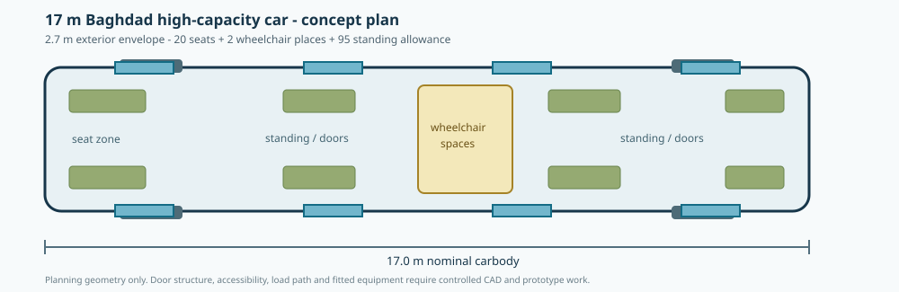
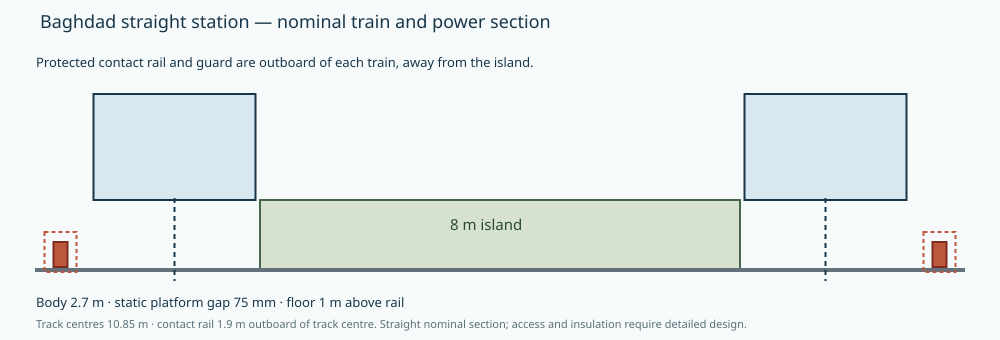

# Baghdad 700-place train

The Baghdad planning train carries 700 people in six cars and draws power from a protected conductor beside the track. The current delivery study uses paired 20 m U-girders on shared piers for standard bays. [Current delivery plan](STRAIGHT-THROUGH-DELIVERY.md) · [Vehicle calculation inputs](system.toml)

The train and straight-station dimensions in these drawings are controlled by
the [Baghdad system input](system.toml); the station section is generated from
it and the vehicle drawing is checked against its door and body dimensions.

| Interface or duty | Planning control |
|---|---:|
| Formation | Six 17 m cars, approximately 104.5 m coupled; 125 m clear platform |
| Body and doors | 2.7 m outside width; four 1.3 m clear double-leaf doors each side per car |
| Accessible passenger layout | 20 seats, two wheelchair places and up to 95 standees per car; 700 places/train service cap |
| Running gear | Two two-axle bogies/car, 24 driven axles/train, steel wheel on 60E1 rail design control |
| Installed mass | Fitout, running gear and emergency equipment remain estimates. Use the low, central and high installed-load envelopes in the vehicle audit. |
| Traction | Protected conductor shoes, sectionalised DC supply, **5.004 MW** per-train DC input sizing request at 2% grade and 0.6 m/s² net acceleration |
| Independent stop | Twelve rail-brake modules per train in the planning model. The high-load, wheel-brake-unavailable case requires 17.81 kN effective force per remaining module with one module out, at 0.6 m/s² net on a 2% downgrade. |
| Cooling | 45 kW/car installed envelope, 25 kW/car average summer budget |
| Metropolitan costing service | Six-minute directional headway and 18 hours/day. The vehicle planning speed cap is 72 km/h. |

## Train, platform and conductor interface

The train is planned for unattended **GoA4** operation. Both outer ends are part of the passenger saloon, with fixed glazing and handrails. The train retains two underfloor rescue coupling interfaces for recovery. Confirm rescue forces, access and operating procedures with the protected recovery design. [Operating configuration](train-operation.toml) · [Passenger end render](../../docs/assets/assembly-animations/train-terminal.jpg)

Use rail head as z = 0 and track centre as y = 0. For straight, level
stations, the nominal car floor is z = 1,000 mm; the platform edge is
|y| = 1,425 mm from its track centre. A 2,700 mm wide car then has a 75 mm
static edge gap. The platform has 125 m clear length against the 104.5 m
train, leaving 10.25 m nominal margin at each end when centred. An 8 m
island gives 10.85 m nominal spacing between the two straight track centres.
Curves, cant, suspension movement, wheel wear and stopping error enter the
site-specific swept and accessible boarding gap calculation.

Each 17 m car has door centres at x = -6.3, -2.1, +2.1 and +6.3 m from the
car centre on **each** side, with 1.3 m clear width. The outer opening edge
is 1.55 m from the nominal car end. Car end, coupler and articulation spaces
are outside the opening. The train controller releases only the side
confirmed by station identity, stopping position and platform detection;
door locked feedback is a departure condition. The conductor and contact
shoes remain outside the passenger reach and evacuation path, with section
isolation before track access. These nominal datums are the digital
coordination geometry for car, platform, screen and electrical design.

The [control equipment schedule](../../control-electronics/README.md) assigns
two train protection channels, two radio links, one control node per car,
one controller per opening, one brake controller per bogie and two protected
service-power units per train. The Baghdad-specific installed schedule totals **299 kg** and **3.68 kW** per train,
including contact-shoe status, inverter control and a 45 kg harness/enclosure allocation.
It fits the **0.35 t** and **6 kW** per-train reserves inside the published base mass
and auxiliary-energy budgets; its **$0.310m/train** price allocation sits inside the train price.
There are four contact-shoe sets per protected-conductor train. Shoe position,
rail clearance, insulation distance, section transition and evacuation
protection are separate electrical/track interfaces and must be demonstrated
in the same vehicle and station drawing before installation.

The protected conductor candidate carries an independent essential-services battery. The priced **65 kWh nominal allowance** supplies 52 kWh usable when new against the 50.4 kWh duty. At 80% remaining capacity its useful energy drops to 41.6 kWh, leaving an 8.8 kWh deficit. Reconcile essential loads, emergency brake and egress duty, hot-weather endurance, charging and installed mass before selecting the pack. [Emergency duty and aged-battery cases](engineering/simulation/vehicle-audit-guide.md)

## Assembly and repair

The car is divided into a corrosion-protected underframe and roof, two removable powered bogies, replaceable sidewall/door modules, two roof HVAC modules, underfloor traction cabinets, protected contact shoes and independently supplied brakes. Bogie mounts, door/platform datums, axle load, equipment envelopes, cable isolation and lift points are controlled interfaces for the first car quotation. Numbered harnesses and modular doors allow replacement without dismantling the shell. Wheel, motor, bearing, brake and contact-shoe removal paths must remain accessible in the depot layout.

Ask suppliers for installed mass and location, repeated thermal ratings, powered-off braking, door cycles, hot-weather cooling, assembly hours, spares and demonstrated equipment removal. Price the same formation and maintenance scope in every offer. [Rapid production and assembly routing](engineering/prototype/rapid-production/README.md) · [Standing procurement instructions](PROCUREMENT.md)
