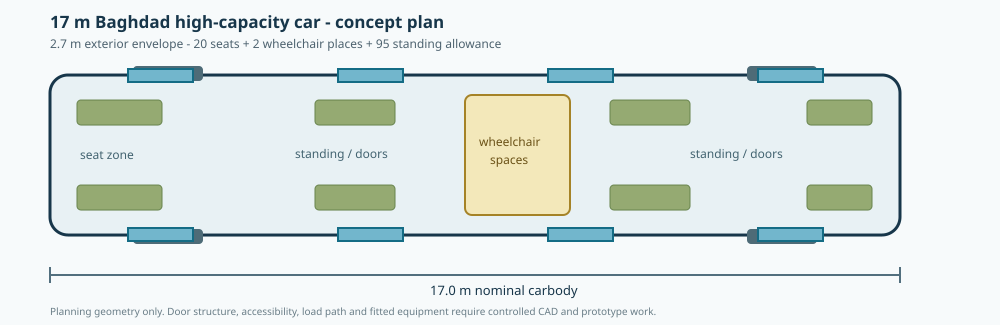

# Baghdad 700-place train concept

**Separate v0.7 planning configuration:** `osr-v07-baghdad-700-overhead-wheel-20261117`. This six-car metro train shares the open wheel-supported architecture and 10 m civil design method with the [30 km reference](../../docs/reference-v07/README.md), but its capacity, equipment rating, mass and price are independently budgeted in the [Baghdad ledger](COST-AND-DELIVERY.md).

| Controlled planning dimension or duty | Value |
|---|---:|
| Formation and platform | Six 17 m cars; approximately 104.5 m coupled length; 125 m clear platform |
| Car width / doors | 2.7 m exterior planning envelope; four 1.3 m clear double-leaf openings on each side per car |
| Passenger provision | 20 fixed seats, two wheelchair spaces and up to 95 standing places per car; 700 places is the rounded service cap per train |
| Passenger-floor arithmetic | 39 m² nominal useful floor/car, of which 10 m² seats and 3 m² wheelchair positions; 95 standees over 26 m² = 3.65/m² |
| Wheel and bogie | Two two-axle bogies/car; 24 driven axles/train; 60E1 rail design control |
| Mass | 22.7 t/car empty planning allowance; 31.5 t/car at normal service cap; 33.622 t/car retained crowd structural control |
| Maximum analytical crowd axle load | 8.406 t/axle before dynamic and unequal-load factors |
| Supply and traction request | 1.5 kV DC overhead, six collector positions/train, 5.0 MW peak DC equipment request, approximately 161 kN force at 2% grade and 0.6 m/s² net acceleration |
| Independent braking request | Twelve rail-brake modules/train; with one unavailable, at least 14.6 kN effective force at each of eleven modules for the 2% downhill crowd case |
| Cooling and energy | 45 kW/car installed cooling envelope, 25 kW/car average summer allowance; 20 kWh/train-km whole-train planning energy including traction, HVAC and auxiliaries |
| Service | 150 s peak interval, 35 s target dwell, 38 km/h assumed commercial speed for fleet and energy budget |

The 700-place cap includes planned standing, unlike the comfort reference. Four doors per side make the door/platform and emergency-egress envelope a new carbody design. The 39 m² floor is a layout allowance, not an approved CAD floor-area measurement. Accessible wheelchair positions remain available in the normal passenger count. Platform height, gap, threshold, ramp and evacuation dimensions are common controlled station interfaces; no passenger capacity is obtained by narrowing those provisions.

## Buildable assembly definition

Use one corrosion-protected structural underframe and roof, two removable powered bogies, bolted bogie cross-member interfaces, replaceable sidewall/door modules, two roof HVAC modules, protected overhead collection and equipment cabinets outside the passenger clear route. The eight door openings per car receive removable operator modules, emergency release, obstruction sensing and position interlocks. Brake modules have an independent protected supply, a positive parking state and accessible removal paths. Wiring and fluid connections use numbered, replaceable harnesses with inspection access. Local production can supply body weldments, interior panels, seats, door frames, cable looms and assembly/repair; motors, converters, collector strips, safety components and bearings are separately quoted inputs.

The first car's controlled package consists of a general arrangement, body/bogie and roof-supply datums, door/platform interface, equipment and mass register, wiring/protection diagram, manufacturing BOM, assembly route and inspection plan. The [reference vehicle production sequence](../../docs/reference-v07/vehicle/README.md) supplies the initial routing pattern; Baghdad's extra doors and cooling require a revised work-hour quotation. The **US$8.5m per trainset** planning rate in the cost ledger includes these changes and is not a transfer of the 276-place train's US$5.9m allowance.

The supplier quotation should fix motor/converter rating and repeated thermal duty, collector and return current, wet-rail traction, powered-off rail-brake force and energy, carbody bending around door apertures, installed mass/centre of gravity, accessible boarding, HVAC capacity at Baghdad design weather, and whole-car removal/repair time. Prototype measurements and independent safety review control later manufacture and passenger operation.
