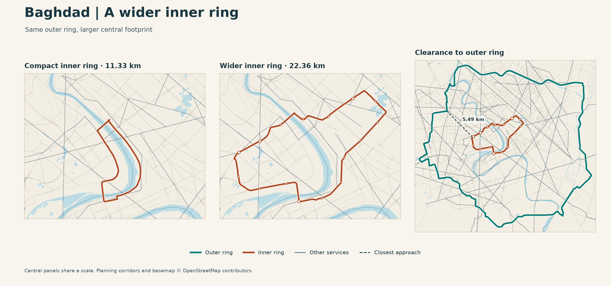

# Baghdad wider inner ring

The inner ring runs **22.36 km**, compared with **11.33 km** in the compact trial. It spans **7.8 km east–west × 5.7 km north–south**, and encloses **21.9 km²**, up from **4.6 km²**. The minimum distance to the same outer ring is **5.49 km**, measured between the complete alignments.

The widened loop crosses the Tigris at the mapped Al-Ahrar Bridge and 14 July Bridge road corridors. It has 16 station sites and 4 shared interchanges. Direct routes between the rings are C1, M01.

[Wider ring GIS and network](maps/baghdad-wider-ring.geojson) · [Compact ring study](SPACED-RINGS.md) · [Published city network](NETWORK.md) · [Full model results](wider-ring.json)

## Coverage and journeys

All journey cases use **266,505 daily running train-km** and the same synthetic demand. Access is a street walk of up to 1.2 km. The housing sample measures journeys to six central destinations with a maximum of two changes. The outer-district sample counts journeys between different sides of the city.

| Layout | Lines | Route km | Sites within 280 m, pairs | Close parallel pair-km | Walk ≤1.2 km | Outer trips served | Housing to centre ≤2 changes |
|---|---:|---:|---:|---:|---:|---:|---:|
| Published city network | 37 | 740.29 | 18 | 40.85 | 74.88% | 62.57% | 73.95% |
| Previous compact dual ring | 34 | 736.71 | 14 | 21.15 | 73.41% | 57.91% | 70.71% |
| Wider ring with the same east–south trunk pattern · footprint route | 34 | 747.74 | 16 | 17.13 | 73.46% | 57.91% | 70.71% |
| Wider ring with an eastern transfer terminus · footprint route | 34 | 737.64 | 16 | 16.73 | 73.66% | 57.91% | 70.16% |
| Wider ring with fewer radial services · footprint route | 31 | 707.66 | 16 | 19.56 | 71.58% | 55.01% | 68.93% |
| Wider ring with the same east–south trunk pattern · spokes route | 34 | 747.98 | 14 | 15.08 | 73.40% | 57.91% | 70.83% |
| Wider ring with an eastern transfer terminus · spokes route | 34 | 737.88 | 14 | 14.68 | 73.61% | 57.91% | 70.16% |

Relative to the compact ring, the displayed wider layout changes 1.2 km walk coverage by +0.25 percentage points and housing-to-centre reach by -0.55 points. The through-route trials reuse the compact study's line plans and screen station sites on the new alignment.

The footprint route favours a broad area with fewer sharp turns. The spokes route connects to more existing lines in its initial interchange screen. The displayed layout favours fewer lines, less parallel running and fewer close station pairs within 1% of the published route length where possible. Within that group the comparison favours retaining the east–south trunk pattern and reaching more central destinations.

## Delivery and planning cost

Delivery uses common 2026 unit rates and a six-minute directional service. The model schedules standard-deck handover from mobilisation. Opening also depends on stations, equipment, commissioning and special works.

| Layout | Track-km | Paid casting, haul and erection hours | Deck handover day | Trainsets with spares | Installed US$bn | 30-year present US$bn |
|---|---:|---:|---:|---:|---:|---:|
| Published city network | 1,480.50 | 6,427,544 | 3,384 | 573 | 41.90 | 64.39 |
| Previous compact dual ring | 1,472.83 | 6,218,136 | 3,154 | 555 | 40.86 | 62.80 |
| Wider ring with the same east–south trunk pattern · footprint route | 1,494.88 | 6,261,184 | 3,154 | 564 | 41.53 | 63.79 |
| Wider ring with an eastern transfer terminus · footprint route | 1,474.68 | 6,044,112 | 3,154 | 557 | 40.87 | 62.87 |
| Wider ring with fewer radial services · footprint route | 1,414.72 | 5,871,760 | 3,154 | 533 | 39.23 | 60.44 |
| Wider ring with the same east–south trunk pattern · spokes route | 1,495.37 | 6,262,128 | 3,154 | 563 | 41.54 | 63.80 |
| Wider ring with an eastern transfer terminus · spokes route | 1,475.17 | 6,045,056 | 3,154 | 556 | 40.87 | 62.84 |

The 5 km clearance is a horizontal GIS screen. Rail curves, grades, interchange layouts and dedicated river crossings require design. Outer-ring restoration still has two mapped wet reaches beyond the 550 m screen. The estimate excludes special crossing premiums.

Verify with `tools/automation/osr-python -m cities.Baghdad.wider_ring_comparison --check`.

Comparison `16bdec4725f58e59d1b50d1004ffec5391cd647055b66a2c594e25c196d4680f`.
