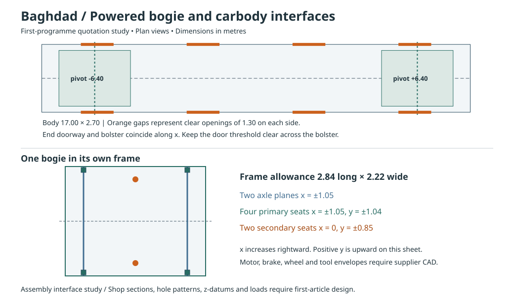

# Baghdad mechanical first article

A fabricator can quote a powered bogie jig, one four-door sidewall, a platform-edge mock-up and the bearing seats for one 10 m span using the interfaces below. The parent is the seven-line Baghdad option with a 700-place train, protected conductor and separate track supports. The study adds a preliminary wheelbase, seat positions and station framing to that parent. These additions have their own physical study identity. The separate 605.652 km network, the 276-place powered reference and the [v0.6 passive vehicle](../../../../engineering/development-baseline.toml) retain their own engineering and cost results.

[The Baghdad inputs](../../system.toml) set the car, door, bogie-pivot and platform datums. [Quotation variables](quotation.toml) define the proposed details. [The calculated schedule](schedule.json) records source digests, the parent network and evaluation IDs, the study ID, all 24 platform door centres, bearing coordinates and load results. This work adds no installed quantity or price to the Baghdad estimate. Section properties, mass, handling equipment and installed prices require bidder returns and a new integrated evaluation before adoption.

## One powered bogie and its carbody



Use x forward, y left, z up, with rail head z = 0. Straight-track car origin is its midpoint on track centre. A bogie origin is a translation of x = −6.40 or +6.40 m in that frame. The bogie yaws about its own pivot. With rotation θ, a bogie point (u,v) has car coordinates (x_p + u cos θ − v sin θ, u sin θ + v cos θ). Vertical spring travel, roll and pitch must be added when measured. Dimensions below are metres.

| Item | Quotation layout for one car | First-article return |
|---|---|---|
| Bogie frame | Two demountable assemblies each with two longitudinal members and two transoms. Gauge a 2.84 × 2.22 rectangular **frame-only** outline per bogie. Set two driven axle centre planes at u = ±1.05. Four axlebox/primary suspension interfaces at (±1.05, ±1.04). Two opposed secondary suspension interfaces at (0, ±0.85). | Supply wheel profile/gauge interface, new and worn radii, bearing cartridge, locating faces, shim stack, vertical datums, wheel-to-frame clearance, transom weld details and inspection access. Show yaw restraint, lateral stops, dampers and fail-safe retention in a separate count. |
| Drive, brake and retention | Each bogie carries two powered axle drives, four axlebox bearings, four primary positions, two secondary positions and one independently powered rail-brake module. Train has 12 bogies and four contact-shoe sets. Place the shoe carriers by section transition and electrical continuity analysis. | Return gearbox torque-link and brake reaction loads at every mount, gear oil drain access, wheelset drop path, brake stow/deploy sweep, motor cable and cooling hose motion loops and isolating couplings. Include clips, bonding, seals, connectors, drain taps, bolts, nuts, locks and captive covers. Exact fitment and hardware counts remain open. |
| Underframe | Two continuous side sills linked by two cross-bolsters at x = ±6.40 and two end crossmembers at x = ±8.50. Each bolster receives one bogie centre's two secondary seats. Quote two removable traction-link and vertical-retention interfaces per car, one assembly per bogie. | Supply sill/bolster sections, vertical mounting plane, weld access, local bearing inserts, end load introduction and corrosion drainage. Separate wheel reactions, body supports, lifting and recovery load cases. Locate mass and CG for each fitted item. |
| Sides and roof | Two sidewall frames, each with four 1.30 clear openings and eight jambs. Edges along x are [−6.95,−5.65], [−2.75,−1.45], [1.45,2.75], [5.65,6.95]. Tie jambs to continuous upper rails and underframe sills; connect each pair of opposite jambs by roof framing. Roof service mounts for two replaceable HVAC modules per car. | The outer doorway overlaps the bogie bolster longitudinally on both ends. Transfer bolster loads below the doorway. Keep stiffeners, wiring and drainage out of the threshold, wheelchair route and door pocket. Deliver a jointed cutaway, suspended-car twist/door-racking check and test jig. Include door pocket and sliding-leaf travel beyond the clear opening. |

The wheelset centre planes at x = −7.45, −5.35, +5.35 and +7.45 m constrain equipment space. The 201.092 t crowd train gives 82.17 kN mean static axle gravity. Dividing total car weight over four secondary seats or eight primary seats gives 82.17 or 41.08 kN per position as a lumped bookkeeping case. Actual spring loads exclude masses below each suspension stage. Their maxima require the component mass positions, unequal loading and dynamic travel. The 700-place operating cap and applicable crowd, emergency and accidental loads remain distinct cases.

Separate one car, isolate all energy sources and support at independently designed body lift points. Capture the bogie on a wheelset pallet before releasing retention, disconnect and cap hoses, identify cables, withdraw the bogie along the track past the nearer end, then transfer sideways clear of the lifting stands. The frame-only sweep extends 3.82 m outward from its starting pivot position before its trailing face clears the car end by 0.30 m. A 2.50 m pallet and 0.30 m each side give a 3.10 m lane. Add the pallet end projection, complete wheel/shoe/drive/hose sweep, maintenance stand feet, coupler, tool stroke and lifting beam to the 3-D shop layout. Stop the trial if the stand legs intersect this lane. An instrumented lift and a supported disconnection/reinstallation trial close the exchange sequence.

## Straight island and passenger interfaces

Take platform centre as x = y = 0, rail head as z = 0. Platform edges lie at y = ±4.00 m, track axes at ±5.425 m, outboard conductor reference lines at ±7.325 m, and the nominal boarding surface at z = +1.00 m. For the opposite direction, map car coordinates into station coordinates with a 180° rotation about z. Each track has its own outboard conductor and protective cover.

A proposed independent island frame has 25 longitudinal deck bays of 5 m and 26 transverse bent lines from x = −62.5 to +62.5 m. Two column axes per bent at y = ±3.0 m imply a 6 m transverse support spacing and 1 m deck overhang to each edge. Price 52 column positions and 26 transverse heads for the uninterrupted platform template. Stairs, lifts, concourse, foundations, platform-end arrangements and route-specific movement joints require their own quantities. Between support lines, locate service trays under removable deck access panels. Provide crossfalls to accessible drains away from the boarding edge and allow differential movement between island and track. Keep two independent egress paths, a continuous accessible route and recovery access in the surveyed layout. Set their clear widths by passenger flow, evacuation and local requirements.

With five equal 0.5 m gaps, car centres are ±8.75, ±26.25 and ±43.75 m. The complete 24-opening edge schedule assumes ±0.50 m longitudinal stopping error for a preliminary overlap check. A nominal 1.30 m opening then sweeps 2.30 m of platform edge; outer limits lie at ±51.20 m against ±62.50 m of available platform. Obtain measured stopping, train stretch, door-build and track tolerances before freezing any screen-door spacing or accessible bridge plate.

The rectangular car on two bogie pivots also gives a finite plan sweep. At illustrative radii of 150, 250 and 500 m the body midpoint moves inward 136.6, 81.9 and 41.0 mm from its nominal envelope. The external end corner moves outward 102.1, 61.8 and 31.1 mm. On a hypothetical 250 m-radius inner platform, applying the straight 75 mm edge gap would produce **6.9 mm geometric overlap** before sway, wear or construction tolerances. Use the straight platform control and assess actual curves and transitions against a surveyed alignment. Test full and empty car floor levels, boarding gap, edge deflection, stopping performance and passenger flows.

## Running beam, bearing and pier interfaces

For one 10 m stock beam use a local x origin at its end, y on track centre. The quotation layout puts bearing centres at x = 0.25 and 9.75 m, y = ±0.65 m. Ask for one fixed bearing and one bearing free transversely at the first end, one bearing free longitudinally and one free in-plane at the other end. This defines intended restraints for thermal expansion in both directions. Bearing travel, uplift, anchor arrangement, differential settlement and lateral forces require engineering. Install deck drains and protected return/conductor attachments with inspection clearance to the bearings. Set jacking seats beside the bearing points to permit replacement under possession. Prove load introduction into each diaphragm and the independent pier cap in the raised and landed states.

The seven-line baseline counts 29,640 beam placements and 29,654 separate longitudinal support positions. Four bearings per placement give **118,560 provisional bearings**. Columns for the platform above are a distinct station account. Rail fasteners, conductor guards and brackets, earth bonds, walkway joints, bearing plates and anchor sets require actual spacing, corner forces and supplier details. The default rates contain allowances for installed scope. This study's discrete counts must be reconciled against those allowances before pricing.

The sampled train translation uses the four axle planes per car above, uniform 82.17 kN vertical axle loads and two ideal supports 9.50 m apart. The governing sampled total track-beam live moment is **409.03 kNm**, with a maximum end reaction of **219.69 kN**. These occur at different train positions. The wheel loads traverse the full 10 m stock, including both 0.25 m overhangs. At the supports, live load alone can produce −20.54 kNm hogging and a −2.16 kN opposite-end reaction. The calculation excludes material self-weight, dynamic amplification, unequal car/wheel loading, torsion, braking, rail continuity and adjacent-span loading of a pier. The axle load acts on the beam as a whole. Individual pad reactions need transverse stiffness and wheel-load distribution. Concrete section, reinforcement, prestress, bearing dimensions, seat edge distances, anchorage and soil capacity remain to be sized with these load cases. The 30 km reference's FEM evidence applies to its own train and beam.

For a trial bay, survey and sign off utility clearances, foundations and pier seats. Record cast-in inserts, strand transfer, curing and as-built geometry before delivery. Confirm beam weight, rigging, crane radius and ground pressure, fit bearings and lateral restraint, land the beam, install rail and power/access assemblies, then survey the full chain from rail head to platform. Measure pad movement and support settlement at proof load. Repeat the check with one bearing isolated and the beam jacked under an engineered possession. River crossings, switches, tight streets and station transitions each need a distinct span arrangement and take-off.

## Reproduce the quotation schedule

From the repository root run:

```sh
python3 cities/Baghdad/engineering/mechanical/develop.py
python3 cities/Baghdad/engineering/mechanical/develop.py --check
python3 -m unittest discover -s cities/Baghdad/engineering/mechanical -p 'test_*.py'
```

The 10 mm train translation is a deterministic sampling interval. Stock entry and exit poses supplement the grid. At each pose bending is evaluated at both supports and every loaded axle. The program verifies the selected train, supply, civil option and station input before writing the schedule. The source fingerprints allow a later reviewer to distinguish a rerun from the earlier inputs. Prototype acceptance requires an independently reviewed load basis, drawings, instrumented tests and measured installation clearances.
