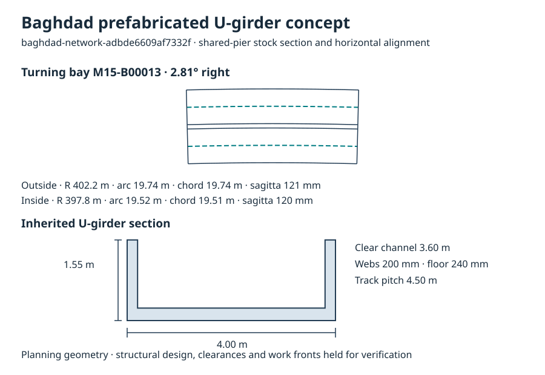

# Baghdad · Curved and straight girder fabrication programme

This chainage register divides the active double-track proposal into recurring 20 m straight U-girders, straight closures, curved inside/outside pairs and special interfaces. Each curve pair follows one circular fillet with a common centre, an inside radius and an outside radius. Where indicated, a short stock piece includes tangent leads. Part, bearing and mould quantities use the dimensions of each individual track piece.

[Editable DXF plan and section](curved-beam-families.dxf) · [Filterable bay register](curved-beam-register.csv) · [Full work orders and source records](curved-beam-register.json.gz) · [Route and delivery study](../../../STRAIGHT-THROUGH-DELIVERY.md)

The reference paired bay is **20 m** with **4.5 m track pitch**. The mapped fit uses **120 m** as its minimum inside radius, a preferred route radius of **400 m**, and up to **200 mm** sweep from a track-piece chord to its arc. The two track pieces have different lengths and mould settings. The dimensions are the concept set-out for a family of variable radii.

| Family | Paired bays / hold intervals | Pieces | Inside / outside | Route km | Concrete m³ | Bare mass t | Bearings |
|---|---:|---:|---:|---:|---:|---:|---:|
| curved ugirder | 768 | 1,536 | 768 / 768 | 11.85 | 36,378 | 92,738 | 6,144 |
| river crossing hold | 43 | 0 | 0 / 0 | 13.91 | 0 | 0 | 0 |
| shared alignment hold | 8 | 0 | 0 / 0 | 2.05 | 0 | 0 | 0 |
| sharp or constrained turn hold | 7,429 | 0 | 0 / 0 | 161.45 | 0 | 0 | 0 |
| short closure | 4,745 | 9,490 | 0 / 0 | 61.26 | 189,348 | 482,702 | 37,960 |
| short curved ugirder | 423 | 846 | 423 / 423 | 5.44 | 16,805 | 42,842 | 3,384 |
| short tangent hold | 4,293 | 0 | 0 / 0 | 11.48 | 0 | 0 | 0 |
| station interface hold | 763 | 0 | 0 / 0 | 79.01 | 0 | 0 | 0 |
| straight 20m | 21,839 | 43,678 | 0 / 0 | 436.78 | 1,330,956 | 3,392,994 | 174,712 |
| water crossing hold | 21 | 0 | 0 / 0 | 1.37 | 0 | 0 | 0 |

The quantified stock carries **224,885 t of bar allowance** and **47,616 t of strand allowance**. Stock mould time is **2,699,672 mould-hours**, including **33,272 form changeover hours**. The register totals **1,074,032 paid yard hours** and **4,546,696 paid launcher crew hours** under the two-front concept work orders. The priced standard-stock programme and the indicative geometry work orders overlap. The ring and route service lengths retain mapped chainage. Concept fillets shorten individual beam runs while the source chainage intervals still cover every metre of each mapped route.

## Fabrication and installation sequence

| Operation | Work instruction basis |
|---|---|
| Set out the mould | Use piece chainage, inside/outside arc, chord, sweep and tangent leads. Set internal forms, end blocks, bearing seats and anchor positions. |
| Assemble steel and stressing | Confirm bending, torsion, transfer and handling loads. Check curved tendon ducts, bar cages, cover, end-zone steel and stage stressing against shop design. |
| Cast, cure, inspect | Reserve 48 h in the planning mould cycle. Record release strength, dimensional survey and lift-point acceptance. |
| Load and transport | Load each piece once onto a checked cradle. Verify transport wheel loads, curve clearances, route availability, starter spans and temporary deck continuity. |
| Lift, set and release | Match lifting points, bearings, launcher positions and curve offsets. Check wet works, track extension and landing release before advancing. |

| Family | Form changes | Extra mould h | Loaded trips | Flatbed h | Assembly and track h | Base special-stock increment US$m |
|---|---:|---:|---:|---:|---:|---:|
| curved ugirder | 1,536 | 9,216.0 | 1,536 | 6,306.0 | 3,686.4 | 18.43 |
| short closure | 9,490 | 18,980.0 | 9,490 | 44,938.9 | 21,589.7 | 33.22 |
| short curved ugirder | 846 | 5,076.0 | 846 | 4,294.3 | 2,136.1 | 11.42 |
| straight 20m | 0 | 0.0 | 43,678 | 138,040.1 | 82,988.2 | 0.00 |

## Recurring piece orders by route

| Route | Straight 20 m | Straight closure | Curved | Short curved | Held mapped km |
|---|---:|---:|---:|---:|---:|
| C1 | 2,160 | 184 | 154 | 20 | 10.04 |
| C2 | 1,098 | 40 | 0 | 0 | 3.87 |
| D-1031-924-02 | 404 | 8 | 20 | 0 | 0.44 |
| D-1033-929-34 | 396 | 12 | 0 | 0 | 0.72 |
| D-1033-930-50 | 1,550 | 28 | 24 | 0 | 1.56 |
| D-1034-929-80 | 382 | 12 | 30 | 0 | 0.44 |
| D-1035-927-09 | 472 | 12 | 28 | 0 | 0.55 |
| G02 | 1,772 | 44 | 0 | 0 | 2.27 |
| G07 | 852 | 26 | 0 | 0 | 0.88 |
| G09 | 944 | 36 | 0 | 0 | 1.49 |
| G11 | 1,384 | 30 | 0 | 0 | 1.43 |
| G20 | 886 | 18 | 0 | 0 | 0.99 |
| M01 | 3,320 | 386 | 0 | 16 | 13.28 |
| M02 | 1,000 | 1,376 | 0 | 30 | 32.93 |
| M03 | 1,086 | 658 | 0 | 0 | 20.96 |
| M04 | 476 | 262 | 0 | 32 | 8.46 |
| M04-SE | 436 | 442 | 0 | 0 | 12.97 |
| M05 | 858 | 498 | 32 | 34 | 14.29 |
| M06 | 1,678 | 772 | 32 | 32 | 17.44 |
| M07 | 1,038 | 746 | 32 | 18 | 23.80 |
| M08 | 1,742 | 782 | 90 | 104 | 24.29 |
| M09 | 3,628 | 1,584 | 96 | 336 | 47.69 |
| M10 | 1,008 | 48 | 8 | 0 | 1.68 |
| M11 | 874 | 32 | 6 | 2 | 1.10 |
| M12 | 1,366 | 76 | 14 | 0 | 2.63 |
| M13 | 470 | 30 | 0 | 0 | 2.56 |
| M14 | 1,154 | 46 | 0 | 0 | 2.09 |
| M15 | 2,530 | 1,102 | 880 | 222 | 7.98 |
| RG1-92 | 1,928 | 40 | 22 | 0 | 2.27 |
| ST02-01 | 1,890 | 40 | 32 | 0 | 2.17 |
| ST03-02 | 1,694 | 52 | 36 | 0 | 2.05 |
| T01 | 544 | 16 | 0 | 0 | 0.88 |
| T02 | 706 | 20 | 0 | 0 | 1.10 |
| T13 | 394 | 4 | 0 | 0 | 0.33 |
| T20 | 400 | 8 | 0 | 0 | 0.44 |
| T23 | 1,158 | 20 | 0 | 0 | 1.21 |

## Yard and front work orders

A / B denote the two nominal route ends. For a loop they are accounting halves of the numbered chainage. Use the priced route work plan for yard pooling, road fallback and phased resource availability.

| Route | Girder pieces A / B | One-shift casting days A / B | Booked 8h launcher shifts A / B | Continuous front-day equivalent A / B |
|---|---:|---:|---:|---:|
| C1 | 1,326 / 1,192 | 168 / 151 | 1,204 / 1,107 | 401.2 / 369.0 |
| C2 | 548 / 590 | 69 / 74 | 389 / 415 | 129.5 / 138.1 |
| D-1031-924-02 | 218 / 214 | 28 / 27 | 129 / 125 | 42.9 / 41.6 |
| D-1033-929-34 | 194 / 214 | 25 / 27 | 113 / 126 | 37.6 / 41.7 |
| D-1033-930-50 | 794 / 808 | 100 / 102 | 581 / 589 | 193.4 / 196.3 |
| D-1034-929-80 | 208 / 216 | 27 / 28 | 124 / 126 | 41.2 / 42.0 |
| D-1035-927-09 | 256 / 256 | 33 / 33 | 153 / 155 | 50.7 / 51.4 |
| G02 | 904 / 912 | 114 / 115 | 686 / 694 | 228.6 / 231.2 |
| G07 | 442 / 436 | 56 / 55 | 283 / 279 | 94.2 / 92.8 |
| G09 | 504 / 476 | 64 / 60 | 333 / 314 | 110.7 / 104.5 |
| G11 | 706 / 708 | 89 / 89 | 500 / 501 | 166.3 / 166.8 |
| G20 | 462 / 442 | 58 / 56 | 298 / 285 | 99.2 / 94.9 |
| M01 | 1,802 / 1,920 | 227 / 242 | 1,979 / 2,088 | 659.5 / 695.7 |
| M02 | 1,318 / 1,088 | 169 / 140 | 1,468 / 1,226 | 489.2 / 408.4 |
| M03 | 894 / 850 | 114 / 108 | 809 / 780 | 269.4 / 259.8 |
| M04 | 384 / 386 | 50 / 49 | 291 / 282 | 97.0 / 93.7 |
| M04-SE | 420 / 458 | 54 / 59 | 326 / 360 | 108.5 / 119.9 |
| M05 | 698 / 724 | 89 / 93 | 633 / 638 | 210.8 / 212.3 |
| M06 | 1,560 / 954 | 197 / 123 | 1,532 / 928 | 510.3 / 309.1 |
| M07 | 1,118 / 716 | 143 / 92 | 1,024 / 730 | 341.2 / 243.0 |
| M08 | 1,630 / 1,088 | 209 / 139 | 1,855 / 1,187 | 618.1 / 395.4 |
| M09 | 2,856 / 2,788 | 365 / 356 | 4,525 / 4,294 | 1,508.1 / 1,431.3 |
| M10 | 552 / 512 | 70 / 65 | 372 / 343 | 123.7 / 114.2 |
| M11 | 446 / 468 | 56 / 59 | 289 / 302 | 96.2 / 100.5 |
| M12 | 752 / 704 | 95 / 89 | 545 / 514 | 181.5 / 171.2 |
| M13 | 304 / 196 | 39 / 25 | 187 / 123 | 62.3 / 40.9 |
| M14 | 590 / 610 | 74 / 77 | 411 / 421 | 136.9 / 140.1 |
| M15 | 2,364 / 2,370 | 307 / 308 | 2,619 / 2,594 | 872.9 / 864.5 |
| RG1-92 | 1,010 / 980 | 127 / 123 | 791 / 762 | 263.6 / 253.8 |
| ST02-01 | 966 / 996 | 122 / 125 | 749 / 774 | 249.5 / 257.8 |
| ST03-02 | 884 / 898 | 112 / 113 | 669 / 677 | 222.9 / 225.6 |
| T01 | 276 / 284 | 35 / 36 | 168 / 171 | 55.8 / 56.9 |
| T02 | 360 / 366 | 46 / 46 | 226 / 229 | 75.1 / 76.1 |
| T13 | 200 / 198 | 26 / 25 | 116 / 115 | 38.6 / 38.1 |
| T20 | 204 / 204 | 26 / 26 | 119 / 119 | 39.5 / 39.5 |
| T23 | 590 / 588 | 74 / 74 | 400 / 398 | 133.2 / 132.6 |

## Held interfaces

- Route plans use mapped coordinates and horizontal circular fillets. Survey, grade, cant, transitions, vehicle and structural clearance, thermal movement and wheel-rail loads require design.
- Turn fits below the trial radius or within reserved station, junction or crossing interfaces remain held. The track junction register requires actual turnout or merge data. Passenger interchanges alone do not establish track junctions.
- Exact shared edges are reserved on every mapped service trace. Shared hold kilometres in the route totals are before deduplication. The separate edge register counts each physical edge once. Check shared running and structure at both interfaces before pricing girder stock.
- Mapped water lengths and approaches reserve a new rail structure envelope. Bridge type, navigational clearance, hydraulics, scour, geotechnics, approvals and cost remain open.
- Curve and short-bay quantities inherit the straight U section and end thickening. Reinforcement, stressing, anchorage, torsion, attachment and bearing design, and verified lifting mass await calculations and supplier information.
- Paid shifts use two nominal end yards and two fronts per route. Single flatbed trips and assembly are counted serially, at distance to the nearer terminal. Curved launcher travel, axle loads, cradle, temporary track, and every intervening work front require approval.
- Yard shift and continuous work equivalents describe quantified bays. Commissioned start dates, adequate release strength, piers, storage, starters, missing crossings, programme concurrency and integration require a separate delivery schedule.
- Special-piece costs are incremental planning allowances over equivalent priced stock. Treat held works and their delivery separately. Complete project direct cost and physical completion date require those prices and designs.

Physical candidate `baghdad-network-6a972430e7f71b41` · beam evaluation `e3f30514b3c7106091fc0425570b5ec11e5003f00d05eb0cdd418a4a15b7100b`.
