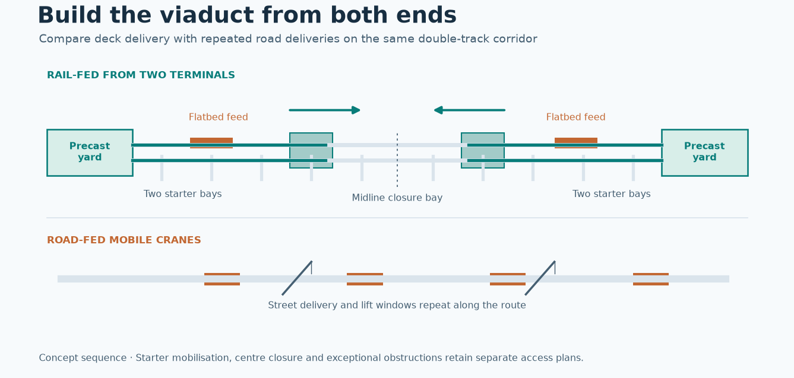
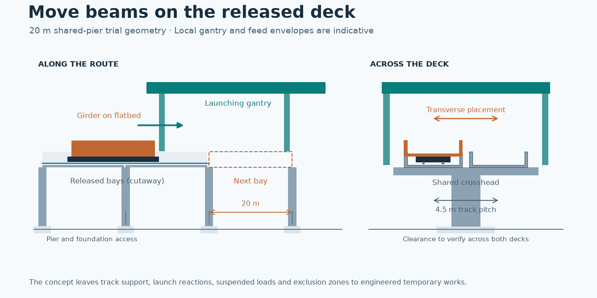

# Feed the launching gantries from the deck

Cast at both ends of a line, bring released beams forward on a construction
flatbed and place them with two launching gantries working inward. This moves
the ordinary beam delivery and repetitive lifting operation above the street.
The viaduct still needs ground access for utilities, foundations and columns,
raw materials at the yards, starter work and unusual spans. Work over traffic
can still require a protected area underneath. The comparison prices and reports
those operations separately.

[Current Baghdad network delivery and cash plan](rail-fed/network-delivery.md) ·
[Cost and programme results](rail-fed/comparison.md) ·
[Machine-readable comparison](rail-fed/comparison.json) ·
[Concept views and editable geometry](rail-fed/CONCEPT-GEOMETRY.md) ·
[Contractor return schedule](rail-fed/contractor-return.csv) ·
[Role and shift workplan](rail-fed/crew-workplan.csv) · [Length and access sensitivities](rail-fed/scenarios.csv)



## What the 12 km trial changes

The [matched results](rail-fed/comparison.md) cover 600 paired bays and 1,200
girders. With permission to staff three shifts, deck-fed erection takes
**164 days** from the start of the modelled work period. Day-shift road-crane
erection takes **220 days**, and two-shift road work takes **145 days**.
The road extended case retains the same price per booked lift and assumes
both daily windows are accessible at that rate.

The 24-hour deck-fed case lowers the **base erection allowance from $12.14m to
$8.98m**. That is about **26%** of the method budget, or **2.7%** of the
combined standard stock and erection allowance. The pair of launchers has a
combined mobilisation allowance of **$2.40m** and a break-even mobilisation
ceiling of about **$5.56m** with the other base allowances fixed. At **3 km**
the same two-end method costs more than road erection under these assumptions.

The ordinary and exceptional beam delivery count on public roads falls
from **1,200 to 70**. Booked traffic occupation for the erection scope falls
from **4,800 to 352 lane-hours**. The retained road feed covers four terminal
starter bays, the meeting bay and 30 bays assigned to road fallback. Common
under-street and terminal deliveries still need a traffic plan.

Paid hours including casting rise from **46,800 to about 95,500**. Deck feed replaces
road haul and mobile crane reliance with covered gantry, track inspection,
flatbed, terminal transfer and access posts through the full working window.
The cost falls in this scenario because the avoided haul and crane allowance
exceeds those crew and temporary works costs. [Role and shift workplan](rail-fed/crew-workplan.csv)

## How the construction plan fits together

| Work | Accountable lead | What the programme needs |
|---|---|---|
| Survey and release the alignment | Owner, civil designer and utility coordinators | Mark overhead obstructions, stations, switches and difficult spans. Identify each ground work zone and agree windows with the authority. Any crossing that interrupts the supply deck needs its own completed section, transfer route or revised launch plan. |
| Provide one production line at each terminal | Precaster | Cast, cure, inspect and store the standard girders. Size moulds for the release rate, not the pour rate. Keep both yard approaches open for steel, cement, aggregate, staff and deliveries. A site needs a stack area with safe access for the transfer equipment. |
| Start the two fronts | Temporary works and lifting contractors | Establish the transfer from each terminal yard up to the viaduct. Ground plant is included for the starter bays and handling of launch equipment. Provide a working platform, initial deck release and signed support and lifting checks before the transporter enters. |
| Feed and place the pairs | Rail transporter and erection crews | Carry one released girder on each delivery, return the flatbed and place both girders in a bay. The concept carries feed rails over a released deck and has a transverse placement envelope for the second track. Price rail installation, joint bridges, relocation, maintenance and eventual removal. |
| Control the night shifts | Construction manager and traffic authority | Staff two fronts, feed crews and independently authorised inspection or release posts. Check wind, lighting, noise, fatigue, breakdown recovery and authorised hours. Keep crew handover and inspection time within the paid shift plan. |
| Close and demobilise | Rail systems, civil and site-access leads | Agree which front works the closing bay, the available seats and survey tolerances, and how each gantry and transporter is taken out. Release a safe track, station, evacuation and maintenance interface to the next package. |



## How to read the comparison

Compare the same high-load, shared-pier **20 m U-girder** geometry throughout.
The default **12 km** case is an illustrative straight, repeatable double-track
line. Its length makes the baseline an exact number of standard bays. The
price basis comes from the Baghdad span study. Length is a scenario input and
the figures carry no station, utility or land survey. Keep any nonstandard bay,
station crossing, access interruption and route land agreement as a distinct
item when carrying the comparison into a corridor. [High-load span families](SPAN-FAMILIES.md)

The comparison uses 2026 US dollars and keeps common stock and substructure
costs visible. It compares the way the beams get from yards to bearings.
Incremental equipment, track, traffic management and working labour belong in
the method estimate. Whole-line costs also include stations, rail systems, land,
utilities, foundations, special bridges, testing and commissioning. Where a
quote includes labour, equipment or rail reuse, replace the relevant allowance
once. The cost cases are estimating assumptions. Each estimate remains open to
supplier and site evidence.

At each terminal the comparison allows 16 mould positions, a 48-hour mould
cycle and 24 released stock places. That gives up to eight releases per yard
per day before applying site constraints. The layout is **216 × 164 m**
(**3.54 ha** per terminal), with **30 × 8 m** mould cells, **26 × 7 m** stock
positions, plant, circulation and transfer. The clear working area and lease
need a site offer. [Dimensioned terminal layout](rail-fed/terminal-yard.png) Each front uses one flatbed and reserves its feed path for the
delivery and empty return. At 6 km from the yard, the reported one-girder
journey takes about 2.65 hours including transfer at the planning speeds.
Repetitive travel becomes a larger share of the cycle as the fronts advance.

The road-occupation proxy measures planned restrictions attributable to the
erection activity. A lane-hour combines the assumed number of lanes and hours
occupied. It does not estimate travel delay, queues, access loss or exposure
under a suspended load. Ground works and raw-material deliveries stay in the
workplan. They need their own link, lane and time-of-day measurement before a
city can estimate total disruption.

## How to vary capacity without rebuilding the design

The [flexibility comparison](rail-fed/flexibility.csv) tests a second flatbed
per end on two independently released feed paths. It overlaps the travelling
legs while retaining terminal and lifting conflicts. One blocked launcher can
stop its half while the other continues; a 10-day outage case shows the
programme exposure. Cast to a released stock buffer, and move a gantry pair
to the next line when overlapping programmes matter less than peak equipment
hire. The network programme retains a separate mobilisation and test allowance
per line. Quote relocation, tracks capable of carrying two occupied feed
paths, and a recovery method before treating the scenario as a commitment.

## Conditions to check before buying equipment

The studied U-girder handling unit weighs about **77.7 t**. With an illustrative
**25 t** empty flatbed, its average static load across eight axles is already
about **12.8 t per axle**. The high-load passenger study has a nominal maximum
of about **11.2 t per axle**. That comparison flags construction load as an
early design question. Peak reactions also depend on axle distribution,
wheel positions, traction equipment, speed, load sharing and the placement
of the gantry supports. [Girder and train load basis](SPAN-FAMILIES.md)

- **Transporter and deck load path.** Establish the maximum loaded axle, wheel
  and rail-seat loads, transporter metre load, braking and recovery on the steepest
  finished segment, lateral guidance in curves and tolerance over joints. Design
  for the critical eccentric and combined construction loads from gantry,
  transporter and stock. Passenger train-load compliance cannot establish
  construction-stage capacity.
- **Temporary supports and stability.** Verify gantry launch, lateral transfer
  and landing reactions, temporary bearing restraint, empty and loaded wind
  cases, and capacity of the crosshead and foundations in each stage. Obtain
  actual equipment envelope, bridge segmentation, access and recovery plans.
- **End yards and limited possessions.** Obtain terminal land and lift geometry,
  authorised noise and lighting windows, traffic and overhead exclusion plans,
  and practical crane and recovery access for starter works, special spans and
  dismantling. Confirm path continuity before relying on the modelled feed rate.
- **Compare a supplier offer on the same basis.** Require quotations for both
  launchers, transporters, terminal transfers, track and auxiliary equipment,
  operation across the specified shifts, support and spares, and clearance and
  ground planning. Price actual release capacity, measured cycle time and
  replacement arrangements if either front is blocked.

Equipment records for Riyadh Metro Line 4 describe two launchers and two
transporters delivering behind the erection front. On the Mumbai–Ahmedabad
project the owner describes establishing starter spans before putting a
transporter on the deck. Delhi Metro's construction specification calls
for launch-equipment testing and approval of traffic occupation. These
projects demonstrate the method and the need to design each temporary
installation. Their equipment capacity and cycle times apply to their
own designs and sites. [Riyadh equipment supplier](https://www.dlte.co.uk/en/projects/Riyadh.htm) ·
[Mumbai–Ahmedabad project owner](https://nhsrcl.in/en/media/press-release/mumbai-ahmedabad-high-speed-rail-corridor-picks-pace-casting-another-40-meter) ·
[Delhi Metro civil construction specification](https://backend.delhimetrorail.com/documents/8790/OUTLINE_CONSTRUCTION_SPECIFICATIONS_for_Civil_Works_Revision-R4_June_2025.pdf)

## Reproduce the comparison

```sh
./osr design railway rail-fed --route-km 12
./osr design railway rail-fed --route-km 24 --overhead-exclusion-pct 10
python3 cities/Baghdad/engineering/mechanical/civil/rail-fed/publish.py --check
```

Use the issue's [input assumptions](rail_fed_assumptions.toml) and linked
evidence when updating the comparison. The construction method remains an
alternative for quotation and stage-load verification. The project keeps the
road-fed case available when deck logistics, transfer land, or night access
cannot be established.
