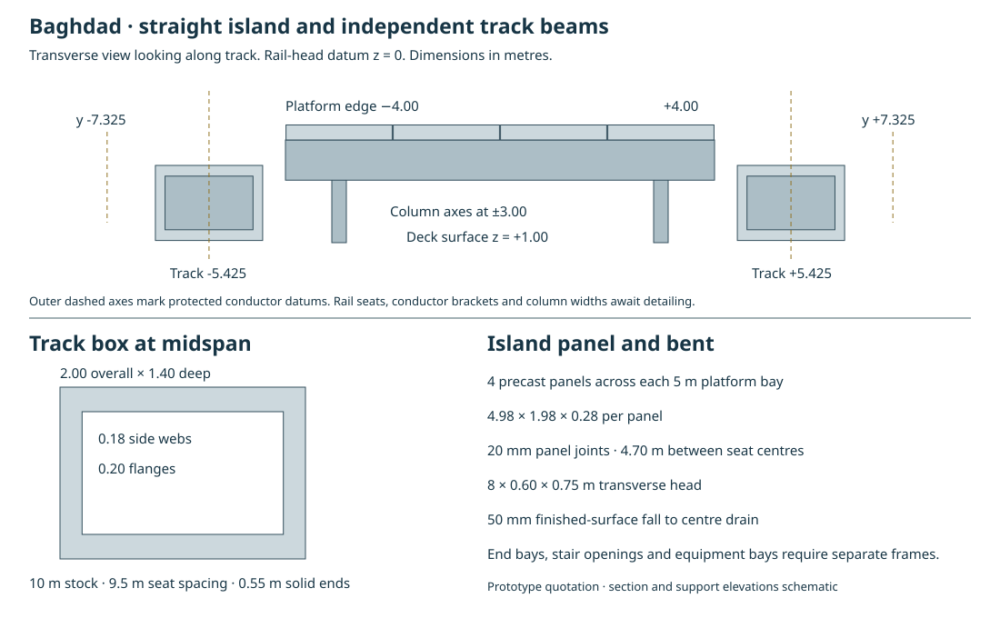

# Baghdad civil drawings and retained 10 m study

Use the [20 m shared-pier delivery programme](rail-fed/network-delivery.md)
for current standard totals, yard land, erection quantities and costs. The
drawings on this page reproduce the earlier station and 10 m stock exercise.
Station transitions to the longer-span family require a separate interface check.



The seven-line Baghdad option needs two different repetitive structures at an elevated station. The train sits on its own track beam and pier. Four precast panels across each 5 m platform bay sit on an independent transverse head. Their edges must meet the train at the same surveyed datum through settlement, load cycles and thermal movement. The quantities below apply to one straight typical module. The parent study identifies the 700-place protected-conductor candidate and supplies its moving axle loads. [Parent mechanical schedule](../schedule.json) · [Section inputs](concept.toml) · [Calculated actions and source identities](section-results.json)

## Platform deck and transverse head

Set out 25 pitches of 5 m along a 125 m island, with four panel pitches of 2 m across. One trial panel measures **4.98 × 1.98 × 0.28 m**, leaving 20 mm nominal joints. Provide separately detailed edge nosings to reach the ±4.00 m boarding datums. Each panel spans longitudinally between strip seats on the transverse heads. The seat centrelines sit 0.15 m inside each bent axis, giving a 4.70 m effective span. A typical 8.0 × 0.60 × 0.75 m transverse head runs across two columns at y = ±3 m. At internal bents each half of the head width receives the end of a separate bay. Check pad length, edge distance and anchorage against the selected hardware.

| Quotation item | Quantity or action |
| --- | ---: |
| Concrete per panel · reinforced unit weight 25 kN/m³ | 2.761 m³ · 69.02 kN |
| Bottom longitudinal bars · Ø16, ≤150 mm spacing | 14 × 4.89 m |
| Top longitudinal bars · Ø12, ≤200 mm spacing | 11 × 4.89 m |
| Transverse bars · Ø12, ≤200 mm spacing, two faces | 52 × 1.89 m |
| Straight steel subtotal with nominal 45 mm cover | 243.06 kg/panel |
| Panel dead line load / crowd line load | 16.86 / 10.00 kN/m |
| Positive panel moment upper screen / end reaction | 74.17 kNm / 67.01 kN |
| Interior head volume / reaction per column | 3.600 m³ / 313.05 kN |
| Interior head centre moment / hogging at each column | +313.05 / −39.13 kNm |

The panel model assigns 1.5 kPa to finishes and services and 5 kPa to a crowd, both quotation assumptions on the 2 m pitch. Symmetric joint loads count on the panel end reactions. The head distributes the eight panel-end reactions as a uniform load for global bending. Local pocket loads, edge crowding, asymmetric queues, screen doors, fire, plant, uplift and accidental loads require separate cases. The 100-panel template assumes uninterrupted deck. Subtract panels at each stair or lift and design the trimming frame, landing, accessible circulation and egress before pricing a station. Reinforced unit weight includes a steel allowance. The straight steel schedule excludes anchorage, laps, chairs, lifting inserts, shear connectors and local edge reinforcement. No section resistance or bar development check has been completed.

Form the boarding edge at nominal z = +1 m and fall toward a longitudinal centre gutter at a trial 1.25%, a 50 mm drop across each 4 m half-width. Shape the finish above the structural panels. Detail flush slip-resistant gutter covers, debris baskets and accessible cleanouts off the boarding line. Pipe runoff through designated risers clear of bearings, current collectors, equipment cabinets and passenger routes. Calculate outlet sizes and overflow paths using site rainfall, catchments and blockage conditions. Select movement seals and covers for wheelchair wheel loads and the full joint movement range. Test through loading and differential movement at the nominal 75 mm train-to-platform horizontal gap.

## Independent box beam, pier and foundation

For one conventional track, price a one-piece **10.00 × 2.00 × 1.40 m** box with 180 mm webs and 200 mm top and bottom flanges. Form a 1.64 × 1.00 m void over the central 8.90 m. Each end has a 550 mm solid block. Four 350 × 350 mm trial pad footprints are centred at x = 0.25 and 9.75 m from the stock end and y = ±0.65 m from the track centre. This leaves 75 mm to the end face and 175 mm to the side face. The conductor datum lies 1.90 m outboard of the track centre, beyond the 1.00 m half-width. Develop a replaceable bracket and insulation assembly and check its eccentric loads, dynamic collector interface and access before detailing inserts.

| Single-track bay | Calculated quotation case |
| --- | ---: |
| Concrete volume / reinforced stock gravity / equivalent mass | 13.404 m³ / 335.10 kN / 34.17 t |
| Dead moment at centre / dead end reaction | 360.56 kNm / 182.55 kN |
| Moving axle bending / end reaction, ×1.30 trial factor | 531.73 kNm / 285.60 kN |
| Upper positive moment / gross elastic extreme-fibre stress magnitude | 892.30 kNm / 1.95 MPa |
| Eccentric live reaction at 150 mm / highest pad mean pressure | 42.84 kNm torque / 2.18 MPa |
| No-tension effective force at 0.30 m below section centroid | 1.284 MN |
| Initial screen for midspan displacement | ≤1.05 mm under stated elastic model |

Dead load integrates the solid ends, stock overhang and a 3 kN/m rail, fastener and equipment allowance. Live gravity uses the parent study's full 10 m stock, including 0.25 m beyond each support, at equal axle loads and an illustrative dynamic multiplier. The sum of separately peaked dead and live moments bounds positive bending in that calculation. With the support-pair torque applied to the thin closed box, the median-cell shear flow is 9.81 kN/m. This estimate excludes warping, fixing loads, torsional dynamics, track curvature and section changes. Rail-seat punching, rail roll, bearing load redistribution, differential support movement and conductor alignment remain open.

The gross-section displacement screen integrates a constant upper curvature over the span, using E = 30 GPa and I = 0.32067 m⁴. It assumes uncracked, uncrept stock with level rigid supports. The effective prestress demand uses P/A + Pe/Z = M/Z. Obtain a reinforcement and tendon arrangement, concrete properties, losses, cover, anchorage and end-zone bursting design from the precaster. Check release strength, transfer and lifting stresses, camber, cracking and fatigue against the actual schedule. Do not use the force sensitivity as a tendon count or jack setting.

A trial 2.20 × 1.40 × 0.70 m cap, 1.00 m square × 6.00 m column and 2.50 m square × 1.00 m footing support **one track**. Under two neighbouring maximum vertical end reactions plus gross foundation, column and cap weight, concentric soil pressure reaches **207.43 kPa**. It exceeds illustrative 150 and 200 kPa cases by 57.43 and 7.43 kPa. At 250 kPa the arithmetic headroom is 42.57 kPa. Obtain site boreholes and settlement limits, flood and scour levels, wind, seismic and braking actions before selecting shallow or piled foundations. The neighbouring-span envelope is deliberately conservative. Moments, inclined loads, overturning, settlement and ground improvement can govern.

## Build and inspect one module

1. Survey the rail, island, pier and foundation datums, underground services and slewing envelope. At a constrained street, river, switch or station opening, issue a separately identified bay arrangement.
2. Trial-cast one box and one panel. Record as-built volume, concrete batch, reinforcement and tendon positions, stripping strength, camber, insert positions and bare weights. Hold delivery until handling points and restraints have an engineered design.
3. For the box, trial lifting lines 2.0 m from each end produce −96.90 kNm hogging at the pick and +33.60 kNm at centre under static stock gravity. Four equal sling legs at 60° above horizontal would carry 96.74 kN each. Verify the unequal sling case, local anchor capacity, rigging weight, torsional stability, transport supports and crane capacity at measured operating radius before lifting.
4. Set bearings and survey pad planes. Keep the first seated beam temporarily restrained through grout cure and until positive lateral restraint is effective. Verify rail-seat pads, fasteners, return bonds, conductor brackets and jacking/replacement access. Count rigging, braces, fixtures, cables, guards and drain fittings separately.
5. Erect island heads and panel rows, close joints, survey both platform edges, finish falls and conduct a witnessed water test. Record clearances with representative train loading, suspension movement and platform loading. Restore accessible surfaces and inspect drain outlets after the test.

Reproduce the package from this directory with `python3 develop_civil.py --check`, `python3 section_drawing.py --check` and `python3 -m unittest discover -p 'test_civil.py'`. The section study carries independent physical and evaluation identifiers. Installed reinforcement, fixtures, prices, bearing specification, fabrication approval and site acceptance remain open.

The [span comparison and yard return](SPAN-COMPARISON.md) carries this box and the Baghdad train across the 10, 20, 25 and 30 m precast options. Use its placement counts, lifting limits, casting-yard occupancy and break-even costs when requesting prices from local precasters and erection contractors.

## Deliver girders over the advancing viaduct

The [rail-fed erection comparison](RAIL-FED-ERECTION.md) evaluates two terminal
yards and two inward launching fronts against road delivery and mobile cranes
on the same span family. Use the concept drawings and workplan to inspect the
temporary load path, transit time, workforce, possessions and break-even price
before asking contractors for a matched return.

## Audit the straight-bay quotation under the heavier train

The audit carries the same girder, strand count, pickup positions and shallow-footing geometry through the central and high axle patterns. The six-car steel study loads are 198.636 t and 246.036 t. The high case places 9.29 t on each rear axle and 11.21 t on each front axle of an identically loaded car. The issued 10 m box retains its released 12 strands and fails the high-load bottom-fibre compression screen. At 200 kPa and 12 m lift radius, the deeper 20 m U-girder on shared supports leads the 12 km quotation comparison under both load cases, with 42 strands and 6.50 m square trial footings. Its base-rate standard-stock allowance is USD 110.07m for the historical-length comparison.

The calculations use the train weights and positions from the verified [Airport prototype packet](../../prototype/airport-prototype.zip), the event-based [moving axle solver](../../prototype/weights.py), and the project's [concrete, section and support assumptions](concept.toml). The trial 1.30 vertical load factor is a sensitivity. The support study combines a 1 m/s² braking allowance on a 2% grade with vertical and transverse envelopes. The lift return shows longitudinal reactions and a 60:40 transverse sensitivity. Bearing offsets stand in for the unknown lifting insert spacing. Closed boxes have a thin-wall torsional shear-flow estimate. Open sections have a gross St Venant stiffness estimate, with warping and local distortion held for a detailed model. The gross elastic rail-motion bound leaves track twist and interface clearance approval open. This Airport configuration runs on wheels.

The rate comparison covers standard bays, bearings, supports, casting, haul, erection and lifecycle work. The 12 m planning bands require a supplier's certified chart at the actual radius, measured masses and a staged erection plan. Custom end bays retain a separate quantity and price hold, even where the comparison carries a full standard-stock allowance. Material release, local stressing and anchorages, bearings, ground and settlement, transport routes, temporary stability and independent engineering approval remain open. [Iraqi civil capital rates](../../../iraq-capital.toml) · [Market inputs](../../../airport-works.toml) · [Shop rates](../../prototype/shop-rates.toml) · [Delhi Metro construction precedent, section 10](https://backend.delhimetrorail.com/documents/8790/OUTLINE_CONSTRUCTION_SPECIFICATIONS_for_Civil_Works_Revision-R4_June_2025.pdf) · [FHWA construction staging precedent](https://www.fhwa.dot.gov/bridge/pubs/07022/chap04.cfm)

Run the comparison at the explicitly chosen family and span. The JSON preserves ordered standard quantities, closure-only exclusions, support and axle forces, failing checks, source digests and physical, input and evaluation IDs.

```sh
python3 -m cities.Baghdad.engineering.mechanical.civil.family_comparison --high-load --family U --span-m 20 --json
python3 -m cities.Baghdad.engineering.mechanical.civil.family_comparison --check
python3 -m unittest cities.Baghdad.engineering.mechanical.civil.test_family_comparison
```
