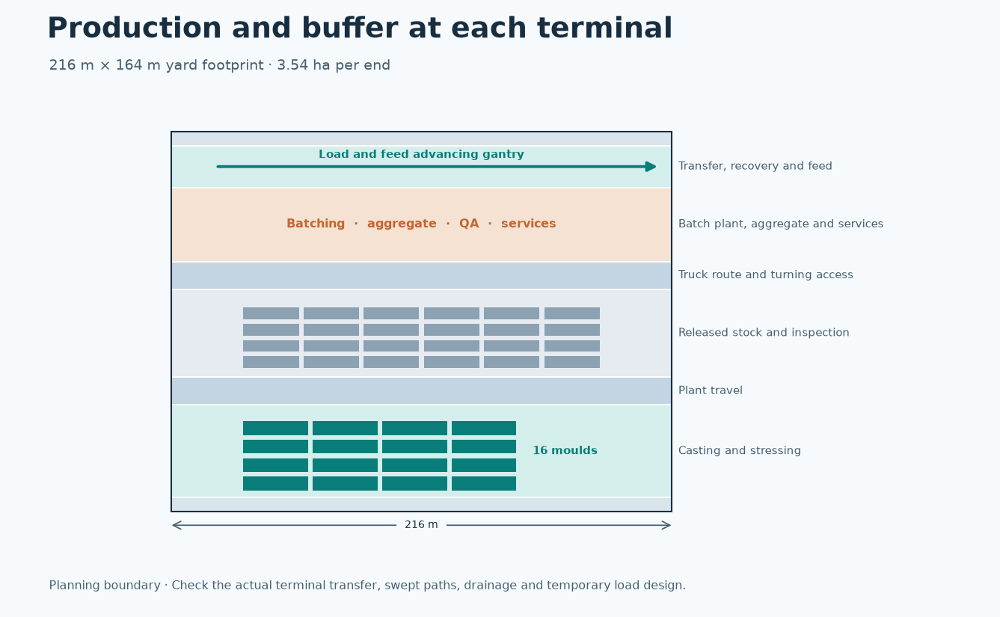

# Erection prices, programme and traffic occupation

Evaluation `853b8623498a67ac7fef1fd623fcd78cdaa8069be384d0e4d20269f8fc966cef`.

The illustrative 12 km double-track corridor uses 600 paired standard bays and 1,200 girders. Both methods carry the same permanent works and terminal casting capacity.

Each terminal uses a **216 × 164 m** preliminary envelope (**3.54 ha**), 16 working beds and 24 released-girder positions. The normal 48-hour cycle caps output at 8 girders per yard per calendar day.

## Compare the default methods

| Method and allowed daily window | Calendar days | Paid hours · erection / with casting | Loaded public-road beam trips | Erection lane-hours | Erection cost low / base / high | Standard stock + erection base |
|---|---:|---:|---:|---:|---:|---:|
| Road-crane · 8 h | 220.3 | 24,000 / 46,800 | 1,200 | 4,800 | $7.26m / $12.14m / $23.47m | $118.26m |
| Road-crane · 16 h | 145.1 | 24,000 / 46,800 | 1,200 | 4,800 | $7.23m / $12.06m / $23.26m | $118.18m |
| Deck-fed · 16 h | 218.0 | 67,672 / 90,624 | 70 | 352 | $5.07m / $9.53m / $19.25m | $115.65m |
| Deck-fed · 24 h | 164.2 | 72,512 / 95,464 | 70 | 352 | $4.80m / $8.98m / $18.05m | $115.10m |

Days cover preliminary release and the girder erection programme. Labour covers the method crews and planned casting shifts, with casting pay already in fabrication. Erection costs include the time-dependent terminal yard lease. Hardstand is common to each comparison with the same layout. Erection lane-hours exclude common substructure, utilities and station works. Rates are planning estimates in constant US dollars.

## Test route length and overhead exclusions

| Length and excluded share | Road-crane 8 h | Road-crane 16 h | Deck-fed 24 h | Base deck-fed saving vs road |
|---|---:|---:|---:|---:|
| 3 km · 5% | 76.1 d | 55.1 d | 59.3 d | $2.25m extra |
| 12 km · 5% | 220.3 d | 145.1 d | 164.2 d | $3.16m saving |
| 17.461 km · 5% | 310.1 d | 201.9 d | 243.9 d | $6.20m saving |
| 24 km · 10% | 412.6 d | 265.1 d | 354.9 d | $8.31m saving |

## Test plant and possession options on the same 12 km order

| Deck-fed scenario | Calendar days | Labour h, including casting | Base method price | Yard ha per end |
|---|---:|---:|---:|---:|
| Single feed per end | 164.2 | 95,464 | $8.98m | 3.54 |
| Two independent feeds per end | 150.2 | 93,856 | $11.99m | 3.93 |
| Single feed with 10-day outage at one front | 174.2 | 98,104 | $9.07m | 3.54 |

The two-feed scenario requires two separate approved temporary paths at each front. The second flatbed overlaps travel while terminal handoffs, placing and deck release remain serial. Repeated use of a gantry on another line requires sequential access, reconfiguration, independent review and a new booked mobilisation period.

[Read the workplan and holds](../RAIL-FED-ERECTION.md) · [Exact cost and shift detail](comparison.json)
