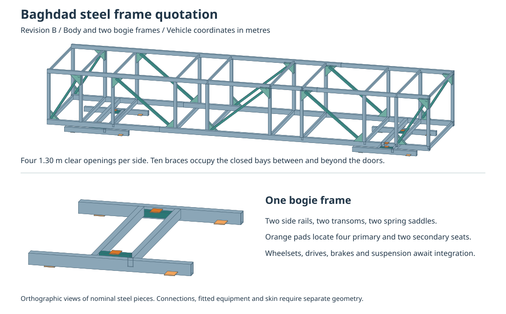

# Baghdad powered bogie and braced carbody

The steel shop can use this first-article study to price one 17 m body and two powered-bogie frames for the seven-line Baghdad design. It provides stock sizes, numbered 3-D pieces, spring and bolster datums, finished cut lengths and reactions for joint design. The 128 steel pieces in the braced revision weigh **5,196.2 kg per car** by nominal geometry. Wheelsets, gearboxes, motors, brakes, springs, doors, floor, skin, fitout, electrical equipment and weld metal require additional mass and cost accounts.



Open the [grouped mesh](braced-frame.obj) using metres, with x forward, y left and z up from rail head. Each object is a separate piece. The [cut list](cut-list.csv) gives the number of cuts per **one body** or **one bogie**, so order two sets of bogie rows per car. The `body_bracing_addition` rows apply once to the braced body. Repeated brace rows are separate bays. Gussets are right triangles and their mass includes half of a square blank per piece. Saw kerf, scrap nesting, tube corner radii, weld preparations, splice backing, shims and final machining require a shop allowance. The [stock input](stock.toml) defines nominal S355NH hollow sections. Obtain local section tables, material certificates, formed corner radii, supply lengths and actual prices for each size. A supplier's product range gives a grade reference. [Tata Steel Celsius product data](https://www.tatasteeluk.com/construction/products/tube/structural-hollow-sections/celsius)

## Assemble and inspect one body

1. Set the side planes at y = ±1.280 m. Jig the two 200 × 100 × 8 mm side sills at z = 0.870 m, and the two 160 × 80 × 6.3 mm cantrails at z = 3.120 m. Each 17 m chord uses 5 m and 12 m pieces. Sill splice planes lie at x = −3.500 m and cantrail splices at +3.500 m. Qualify these four full-strength splices, specify inspections and keep an as-built splice and distortion register.
2. Fit eight 120 × 80 × 6.3 mm door jambs and two end posts per side with 2.070 m face-to-face cuts. Jig each pair of jambs to the parent 1.300 m **clear** doorway. Fit and measure door mechanisms, linings and pockets before releasing the sidewall. The clip-on exterior and all side equipment must fit the 2.700 m body envelope.
3. Close the side frames with eight ordinary floor ties, two end ties, ten roof ties and two 200 × 150 × 10 mm bolsters. The ordinary floor ties are 160 × 80 × 6.3 mm, with their top faces at z = 0.970 m. The nominal floor surface is at 1.000 m. The bolsters at x = ±6.400 m each receive two secondary spring interfaces at y = ±0.850 m. The underframe transfers sidewall load through a 0.430 m transverse overhang to each seat. Check corner stresses, wall bearing, local diaphragms and twist around the outer door thresholds before sizing the welds.
4. Fit a single 80 × 80 × 5 mm diagonal to each closed sidewall bay, five per side. Alternate the direction of inclination. The grouped mesh gives the hand of each piece. Use paired 450 × 450 × 8 mm triangular gussets at each brace end. Check tube setback, gusset engagement, weld accessibility, door leaf and emergency-window movement in the full-size trial. These braces change glazing, lining and maintainability, which must be priced and reviewed.
5. Record four chord splices, forty post-end joints, forty-four crossmember-end joints and four upper spring seat plates per body. Revision B adds twenty brace-end connections using forty gussets. Return weld preparations, consumable mass, drain/vent holes, local reinforcement, corrosion protection and inspection access alongside the stock estimate. Survey sill straightness, paired door diagonals, bolster coplanarity and all four spring datums before and after welding.

## Assemble and exchange one bogie

Build on an independent jig at each x = ±6.400 m bogie origin. Local x is forward and the local y and z axes coincide with the body frame in the straight level pose. The primary seat planes are at local x = ±1.050 m and y = ±1.040 m. Fit two 2.840 m long, 200 × 100 × 10 mm side members centred at z = 0.490 m. Two 160 × 100 × 8 mm transoms run between them at local x = ±0.320 m and z = 0.510 m. Two 100 × 80 × 8 mm spring saddles run between the transoms at y = ±0.850 m. The six tube cuts and six seat plates give **407.3 kg per bare frame**.

Price four transom-end joints, four saddle-end joints, four primary pad attachments and two secondary pad attachments per frame. The four primary plates are 180 × 140 × 12 mm and the two secondary tops are 170 × 140 × 12 mm. A 170 × 160 × 12 mm upper plate sits under the bolster above each secondary plate. The unloaded steel layout leaves **156 mm** between lower and upper mating faces (z = 0.602 to 0.758 m). Return the actual spring, isolator, shims, restraint and travel stack with tolerances. Confirm dynamic bump/rebound and rolling or yawed clearances against wheelsets, gearcases, brake modules and collector shoes.

Provide wheel/bearing dismantling and motor/gear lifting arrangements, primary and secondary suspension retainers, travel stops and traction/brake reaction links. Their quantities, fastener patterns, hose lengths and bend radii, wiring and service loops, installed mass and repair clearances need supplier geometry. Survey the loaded and empty vehicle on each seat. Rehearse the isolated, body-supported extraction and replacement sequence in the [parent interface study](../README.md), including stands, tools, disconnected lines and the complete bogie on its pallet.

## What changed after the screens

The model applies the parent 201.092 t crowd train as six equally loaded cars under gravity. The floor load is divided into tributary longitudinal strips at jambs, ends and bolsters. Each sidewall receives one half of every strip. Each sidewall has one vertical support at each bolster and a single longitudinal restraint. The 3-D frame evaluator runs a planar linear-elastic sidewall model with rigid nodes; skin stiffness is omitted. Local transverse and bogie members use simply supported beam statics, with the body bolster treated as a beam with two overhangs. The **1.3** multiplier is an illustrative vertical sensitivity without an approved operating load basis.

| Quantity | Gravity | 1.3 × gravity |
|---|---:|---:|
| Reaction per sidewall at each bolster | 82.17 kN | 106.82 kN |
| Unbraced A, maximum end normal stress / peak nodal vertical displacement | 355.69 MPa / 61.44 mm | 462.39 MPa / 79.87 mm |
| Braced B, same quantities | 93.09 MPa / 8.61 mm | 121.01 MPa / 11.19 mm |
| Superseded ordinary floor tie, 100 × 60 × 5 mm, bending stress | 331.01 MPa | 430.32 MPa |
| Revised ordinary floor tie, 160 × 80 × 6.3 mm, bending stress | 111.53 MPa | 144.99 MPa |
| Bogie side member / saddle bending stress | 107.94 / 187.51 MPa | 140.32 / 243.77 MPa |

The unbraced sidewall exceeds the assumed 355 MPa yield in both cases. The smaller floor tie exceeds it in the higher case. Both analyses remain in the [evaluation record](result.json). The braced revision adds 584.9 kg to the bare 3,796.7 kg body. Under the higher case its most heavily utilised brace carries 103.0 kN compression against 228.9 kN for an ideal pinned Euler column. Production geometry, residual stress, local buckling, eccentric joints and fatigue require a separate check. The reported nodal deflections and relative door-header displacements need equipment-specific limits, including tolerances measured on a complete door.

The body and bogie stock subtotals use a density of 7,850 kg/m³ and ideal sharp-corner sections. Integrating the oriented piece meshes reproduces the braced cut-stock mass to 0.01 kg. Guarding, wiring, coolant, fasteners, suppliers' items and finishing remain open. The parent train mass stays a load hypothesis; a revised train budget needs the displaced stock mass and the full installed inventory before changing power, brake, civil, fleet or cost figures. Accidental, crowd redistribution, fatigue, crash, derailment, lateral, torsional, braking, motor torque, running dynamics, jacking and recovery cases remain open. The quotation quantities have no fabrication or operating release.

## Reproduce or apply the method to another vehicle

Run from the repository root with Python 3 and NumPy:

```sh
python3 cities/Baghdad/engineering/mechanical/vehicle/develop_vehicle.py
python3 cities/Baghdad/engineering/mechanical/vehicle/develop_vehicle.py --check
python3 -m unittest discover -s cities/Baghdad/engineering/mechanical/vehicle -p 'test_*.py'
```

The result lists physical IDs for the unbraced parent and braced revision, the source digests and a separate evaluation ID. If upstream geometry or the selected system evaluation changes, regenerate the parent schedule first. Reuse the project's [rigid-frame evaluator](../../../../../engineering/design_search/frame_analysis.py), the tributary-load calculation and the cut-stock/mesh reconciliation for another train. Supply that train's formation, gross mass and distribution, body and door geometry, bogie and suspension datums, propulsion/brake loads, body support conditions, section tables and functional tolerances. The passive v0.6 comfort reference has different door openings, machinery, loading and equipment interfaces and needs its own candidate and assessment.
