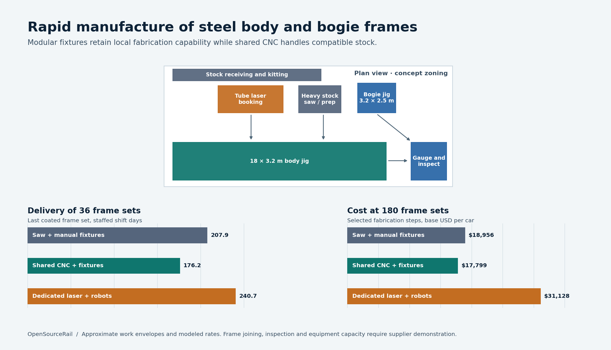

# Rapid manufacture of steel carbody and bogie frames

A shared CNC service and datum-controlled modular fixtures are the first rapid-production route to quote for the Baghdad steel frame. In the modeled 36-car order the same frame scope completes in **176.2 staffed shift days**, versus **207.9** using the local saw and manual route. Direct local shop effort falls from **4,825 to 3,795 crew-hours**. The base modeled price rises from **$22,981 to $23,355 per car** for these fabrication steps, about **$13,449** for the order. Both routes preserve local joining, inspection and repair capability. The dedicated line makes the first frame set sooner but takes **240.7 shift days** for all 36 in this equipment allocation, because it assumes one body fixture instead of two. Keep both modular routes quotable where speed, cost or local workload have different value.



[Editable workcell OBJ](workcell-envelopes.obj) · [DXF dimensions and zoning](workcell-plan.dxf) · [Volume, cost and schedule results](comparison.md) · [Source hashes, rates and resource counts](comparison.json)

## The work that moves faster

| Operation | Equipment and labour for a 36-car shared CNC order | Evidence a supplier can return |
| --- | --- | --- |
| Cut and kit 144 blanks per car | One booked CNC tube lane for 62 blanks, one local saw/prep lane for 26 heavy tubes or flat blanks, and one CNC plate booking for 56 blanks out of the same BOM | Accepted section/bar limits, proven cycle time including changes, nested yield, edge quality, heat and kerf allowance, labelled kits |
| Square, fit and join | One preparation lane, two 18 × 3.2 m body datum beds, one 3.2 × 2.5 m bogie datum bed and three manual welding/extraction sets | Datum and locator survey, access and restraint, qualified joining process, dimensional trial on release, trained crew coverage |
| Gauge and accept | One local metrology resource, one booked NDT lane, one booked bogie machining lane, and one booked coating lane | Joint inspection coverage, repeatability, machining allowance, coating system, correction or reject plan |
| Store and transfer | One controlled stock store and one shop-crane booking with handling windows | Rated rigging/load combinations, traceable parts and inspection holds, supplier turnarounds and shipping allowance |

The 36-car inputs come from the [prototype archive](../airport-prototype.zip), [factory resource routes](../factory-routes.json), [vehicle fixture descriptions](../vehicle-factory/vehicle-resources.toml), [installed arrangement](../vehicle-factory/installed-ga.json) and [CAM manifest](../cam/cam-manifest.json). The generator checks physical candidate, frame revision, order identity and archive/CAM hashes before reusing their quantities. One coated body and two coated, machined bogie frames count as one frame set. The cost boundary includes workcentre purchases or bookings, tooling, modeled direct local labour and an allowance for consumables and upkeep. It excludes raw stock purchases, transport, premises, installed equipment and final trains. Apply a supplier price to the corresponding existing activity when replacing an estimate in the factory budget. Supplier hours are outside the reported **direct local shop effort**.

The finite-capacity schedule uses one eight-hour staffed shift at 80% effective availability. The 36-car shared route budgets seven indicative direct local positions across its staffed lanes before relief and supervisory cover. Staff the actual overlapping work and the appropriate trades for each shift. The model books one resource lane per running operation, applies setup to each lane and allocates one independently guarded robot station per concurrent automated joining lane. It sizes fixture and resource counts against a 250-workday planning year. Pipeline fill and resources limited to whole lanes can extend the modeled order beyond that target. During the 36-car CNC route, first output occurs on shift day **27.5** and the mean subsequent interval is **4.25 shift days** for that allocation. At 180 cars, doubling the 7% rework allowance extends the shared route from **259.9 to 276.4 shift days** at fixed workcell capacity and raises its base rate from **$17,799 to $18,523 per car**. These illustrative rates and shift assumptions should be replaced by price offers and timed first-off operation logs. [Price input ranges](../shop-rates.toml) · [Full assumption and sensitivity record](comparison.json)

The indicative quote bands for 36 cars are **$11,282–$46,041 per car** for local saw, **$11,522–$46,926** for shared CNC and **$34,192–$106,864** for dedicated cells. These low and high price cases use coordinated estimate assumptions. At 180 and 360 cars the shared route costs **$17,799** and **$17,094 per car** at base rates, below local saw by **$1,157** and **$1,560** respectively. In the modeled first-order investment comparison, none of the three price cases crosses in favour of dedicated automation through 360 cars. A dedicated line could share capital across other work. A usable offer needs its booked capacity, crew, production commitments, capital recovery and cycle evidence specified. [Complete volume comparison](comparison.md)

## Supplier trials for the technologies

- **Tube laser with standard long-stock automation.** The optional long loader's 12.5 m length is enough for the 12 m chord, but the modeled 200 × 150 × 10 mm raw chord weighs about 622 kg, above the **370 kg** automatic raw-piece limit. The stock screen therefore admits only **2,232 of 3,168** saw blanks to a further CNC trial. Keep flat stock and heavy stock with the manual or specialist route until a trial gives full loading and unloading acceptance. A heavy-profile service using an installation in the class of the LT14 can be quoted against the same nesting and traceability requirements. Its published 100 kg/m class and long stock options warrant a trial on the actual profile and cutting process. [TRUMPF TruLaser Tube 7000](https://www.trumpf.com/en_GB/products/machines-systems/laser-tube-cutting-machines/trulaser-tube-7000/) · [BLM LT14 technical information](https://www.blmgroup.com/lasertube/lt14fiber/technical-information)
- **Robots and modular fixtures.** A travel-axis robot over a fixed or indexed body fixture merits a quote for accessible repeated seams after a fit and time study. A separate bogie cell needs its own programmed access, inspection path and loaded-fixture handling demonstration. Weld sequence, root access, penetration, adjacent clearances and distortion after clamp release determine feasibility for this candidate. Treat catalog positioner ratings as vendor configuration data applied to the combined workpiece and fixture. [FANUC / Stadler manufacturing case](https://www.fanuc.eu/~/media/corporate/customer-cases/stadlerrail/customer%20case%20pdf_stadler_rz.pdf?la=sl) · [FANUC positioner specifications](https://www.fanuc.eu/eu-en/news/launch-fanucs-h-frame-positioner-simplifies-specification-automated-arc-welding-systems)
- **Aluminium panels and friction-stir welding.** Long extruded sections, friction-stir joining and bolt-in interior modules are candidates for a separate lightweight body. Compare material and section cost, tooling, end joint repair, corrosion isolation, structure, dynamic fatigue and fire evidence against the steel route. Carry the resulting installed mass, actual structure and parts interfaces into the train, civil and economics evaluations under an independent physical candidate identity. [TWI rolling stock friction-stir weld evidence](https://www.twi-global.com/technical-knowledge/published-papers/friction-stir-weld-integrity-and-its-importance-to-the-rolling-stock-industry) · [Hitachi A-Train modular design](https://www.hitachi.com/ICSFiles/afieldfile/2004/06/08/r2001_04_101.pdf)

## CAD, CAM and embedded handoff

1. Start with the published engineering revision of the [controlled vehicle geometry](../airport-prototype.zip) and [CAM nesting and manufacturing record](../cam/CAM.md). The workcell files here show concept envelopes in metres. The machine placement is illustrative and needs the supplier's full loading area, chip and fume handling, guarding, equipment escape, fit and lift assessment.
2. Import the cut profiles to the actual machine provider's CAM or use FreeCAD's native operations where suitable. Build the stock, origins, tools, fixture, clearances and job in the machine's supported workflow. Record toolpath simulation, fixture and holder interference checks, the tested post/controller pair and first-off inspection evidence against the same CAM revision. The existing practice program is a training input using an offline exercise and its native simulation receipt. [FreeCAD CAM workflow](https://blog.freecad.org/2023/11/24/tutorial-getting-started-with-the-path-workbench-part-one/) · [Source-bound CAM project](../cam/CAM.md)
3. Scan material, part and fixture IDs into the work order. Record witnessed clamp/locator indication, operation completion, timestamps, machine job revision, metrology and hold disposition to the existing manufacturing record. A shop gateway can use OPC UA for event export. The practice validator exercises the first-article handoff offline. Installed machine safeguards and authority to unload remain with the specific cell controller and qualified commissioning workflow. [Practice controls and embedded interface](../rapid-controls/README.md) · [Siemens barcode/OPC UA application example](https://support.industry.siemens.com/cs/attachments/40603943/40603943_MV320_DM_QR_OPC_UA_S7_1200_DOC_V17_V20_en.pdf)

Candidate and source binding support quotation and controlled practice. Production release requires supplier process trials, joining and fit evidence, qualified load handling and shop acceptance. The machine schedule and estimate contain no measured cycle times or priced return from a supplier.

## Reproduce

Run from the repository root. The comparison uses the Python 3.11 standard library. The renderer uses Matplotlib.

```sh
python3 cities/Baghdad/engineering/prototype/rapid-production/compare.py
python3 cities/Baghdad/engineering/prototype/rapid-production/render.py
python3 cities/Baghdad/engineering/prototype/rapid-production/compare.py --check
python3 -m unittest discover -s cities/Baghdad/engineering/prototype/rapid-production
```
