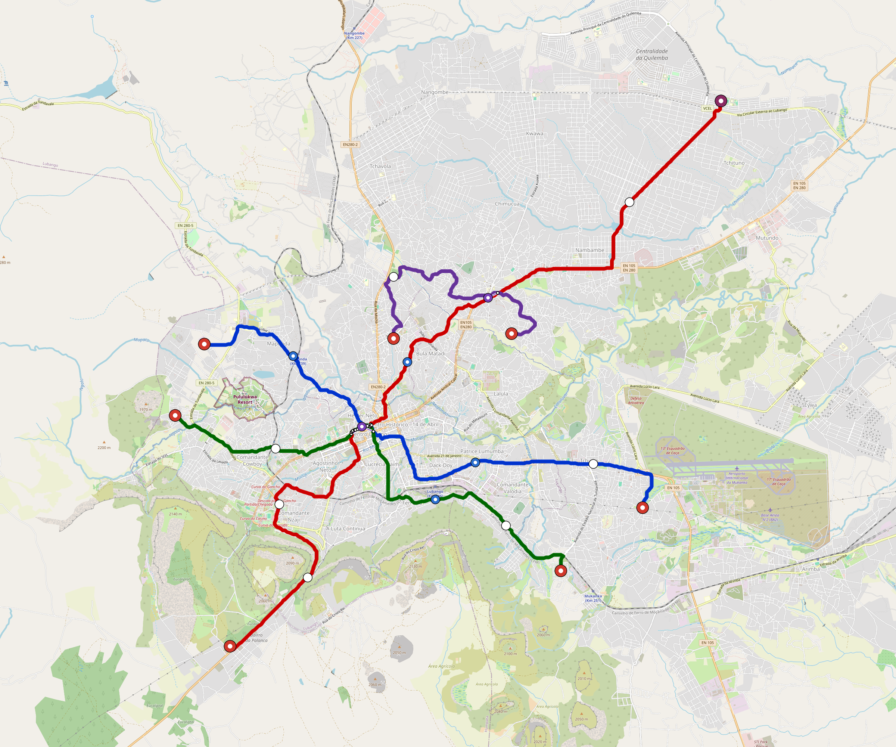

# Lubango — provisional network

**Engineering revalidation pending.** Current geometry and planning quantities are published below. The package remains incomplete; no engineering, manufacturing or physical release is claimed.

[Current design coverage and open gates](engineering/design-system/index.html) · [Exact package status](package-manifest.json).

| Current planning measure | Value |
| --- | --- |
| Lines | 4 |
| Route length | 64.4 km |
| Proposed platform records | 48 |
| Planned fleet | 223 trainsets |

[Source-bound corridor correction](engineering/alignment/network-correction.json) · [Independent geometry and transfer audit](engineering/alignment/network-topology.json).

| Line | Route km | Proposed platforms |
| --- | --- | --- |
| line-1 | 15.8 | 10 |
| line-2 | 26.2 | 18 |
| line-3 | 14.0 | 15 |
| line-4 | 8.4 | 5 |

The geometry audit checks the retained water mask, line continuity, grouped platforms and self-intersections. Walking access, levels, detailed structures and site acceptance remain open.

## Evidence awaiting revalidation

Retained operating, energy, clearance and delivery reports apply to their recorded source revisions. This page gives them no current-layout pass. The package manifest lists stale and missing evidence.

[Retained operating evidence](engineering/simulation/validation-summary.json) · [Retained energy evidence](engineering/energy/summary.json) · [Clearance evidence](engineering/clearance/README.md) · [Planning finance and its assumptions](engineering/finance/summary.json).

Planning finance uses controlled assumptions and does not establish bids, funding commitments or operating performance.
