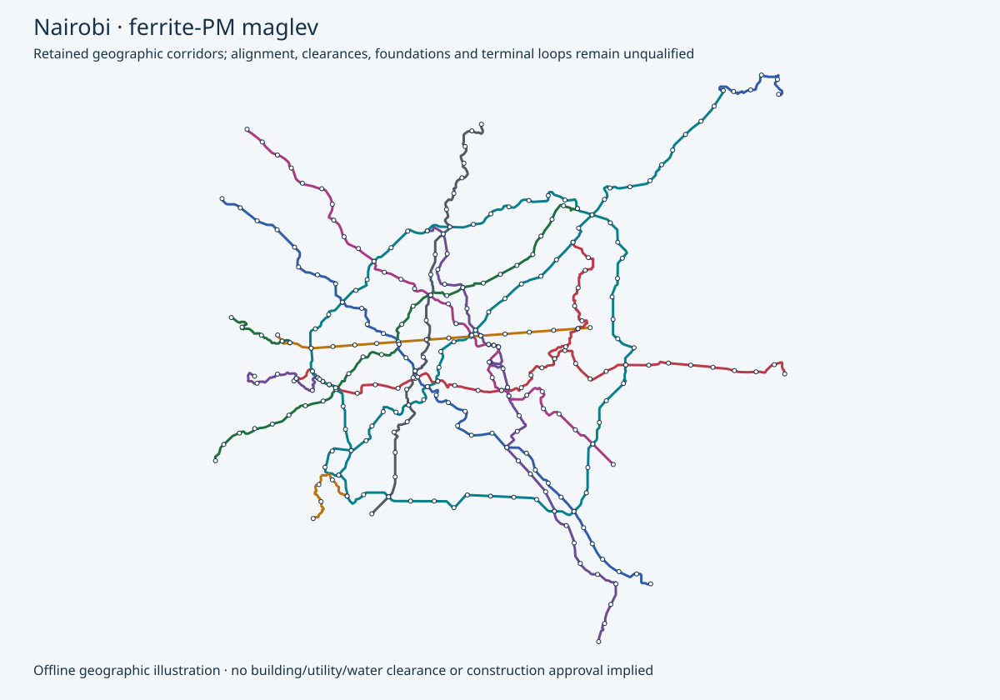

# Nairobi — comfort-first OpenSourceRail development design

OpenSourceRail seeks simple, affordable, locally maintainable transport: repeated lightweight trains, concrete beams with passive steel facings, onboard permanent magnets and suspension controls, and powered launch/receiving zones at stations. The current development default gives passengers four-abreast seating and a controlled low standing load. Transfers connect fixed lines.

**Selected for development; physical operation is not yet established.** This city uses the same six-car comfort candidate as the system default. Existing geographic corridors and stops are retained.

The retained map preserves its underlying city detail. Its older engineering annotations are historical; the current vehicle and service calculations below supersede those annotations. Route and station sites remain proposals.

| Current development basis | Result |
|---|---:|
| Formation | 6 × 17 m cars |
| Per-car accommodation | 44 seats + 2 wheelchair places; no planned standing |
| Passenger doors | Two doors on one side per car |
| Accounted tare / cap-loaded material mass per car | 17.357 / 20.807 t |
| Complete installed mass, CG and inertia | Unknown |
| Launch-speed cap / target headway / dwell | 72 km/h / 120 s / 35 s |
| Arithmetic normal capacity | 8,280 passengers/hour/direction |
| Retained 14,400 pphpd comparison | Not met by this comfort capacity |
| Lines / retained route / proposed stops | 14 / 589.5 km / 320 |
| Peak active + spare + cold reserve trainsets | 914 + 117 + 14 |
| Total trainsets / cars | 1,045 / 6,270 |
| Additional stops imposed by this default | 0 |
| Counted mainline station winding, directional | 458.7 km |
| Mainline powered coverage / overlapping intervals | 37.1% / 38 |

Fleet is recalculated from each actual coast/brake leg, retained terminal-time hypotheses, 35-second dwell, a 120-second target interval, 12% rounded-up spares and one cold reserve per line. Every reachable arrival selects the shortest full-engagement option from 350/450/600/800/900/1,000 m. These motors occupy substantial route length; each direction needs at least two independently routed train phase/current branches. Terminal motors and safe operational headway remain unqualified.

Analytical result: **conditional-analytical-survivor**; 0 lines have unreachable coasting legs and 0 lines have station-library failures. Failed cases stay in the data; their complete fleet/quantity totals remain unknown.

The selected prototype civil interface counts **865.1 tonnes of steel per directional kilometre**, before unclosed reinforcement, prestress, end blocks, bearings, piers and foundations. This heavy extrapolation is a redesign input, not an optimised viaduct or an installed bill. All current CAPEX, OPEX, debt service, imported-content and price-coverage totals remain unknown pending matched designs and quotations.

Stable multiaxis hover, a complete equipped vehicle, actual station thrust/electrical/thermal limits, fault stopping, civil acceptance and safe two-minute operation remain open. The mass ledger, energy requirements, winding layout, source hashes and failures are retained in the machine-readable record.

[Primary planning method](../../../../../../../docs/design-engine/current/README.md) · [Current calculation and source identities](summary.json) · [Historical ferrite planning package](../maglev/README.md) · [Historical city front page at the pinned source](https://github.com/modernecotech/OpenSourceRail/blob/578ee3950b872bf30fbf9e4207b2bda85951bdd7/cities/catalogue/east-africa/Kenya/Nairobi/README.md)

Candidate `957f7e4e2e0e98b575810fb0c568554968fc1eb0715fb673827a16bcf63d400b`  
Body `1eca1897b983bf62ec315cdc39aca2e2387f93ad6ab0c195bc278e14c8fb120b`  
Magnet `397ddf033ab98afaea053acaa3047249a3329f542f1f5e52a6eb1b466b9662e0`  
Selection `c76af04990ab43d9644b884eb1a7d103851aa53fcc963505bdb0b7580ae74e77`  
Evaluation `f544c2b416974b350c1ac186a17f70dc08a3b0bfbb3060c02f1c688846762bf9`

| Line | Fleet | Circuit minutes | Directional winding km | Coast failures |
|---|---:|---:|---:|---:|
| line-1 | 120 | 210.3 | 57.8 | 0 |
| line-2 | 112 | 196.9 | 52.8 | 0 |
| line-3 | 108 | 188.9 | 49.0 | 0 |
| line-4 | 59 | 100.9 | 27.0 | 0 |
| line-5 | 96 | 167.6 | 40.2 | 0 |
| line-6 | 122 | 215.6 | 55.6 | 0 |
| line-7 | 111 | 194.6 | 50.0 | 0 |
| line-8 | 90 | 157.5 | 39.4 | 0 |
| line-9 | 98 | 170.9 | 44.9 | 0 |
| line-10 | 37 | 63.5 | 12.8 | 0 |
| line-11 | 25 | 41.0 | 8.0 | 0 |
| line-12 | 22 | 35.3 | 6.4 | 0 |
| line-13 | 21 | 33.0 | 6.8 | 0 |
| line-14 | 24 | 39.2 | 8.0 | 0 |

Hotel-energy coefficient: **5,484 kWh per peak operating hour per actual kW/car**. Actual auxiliary load, conversion efficiency, terminal energy and complete operating energy remain unknown.
