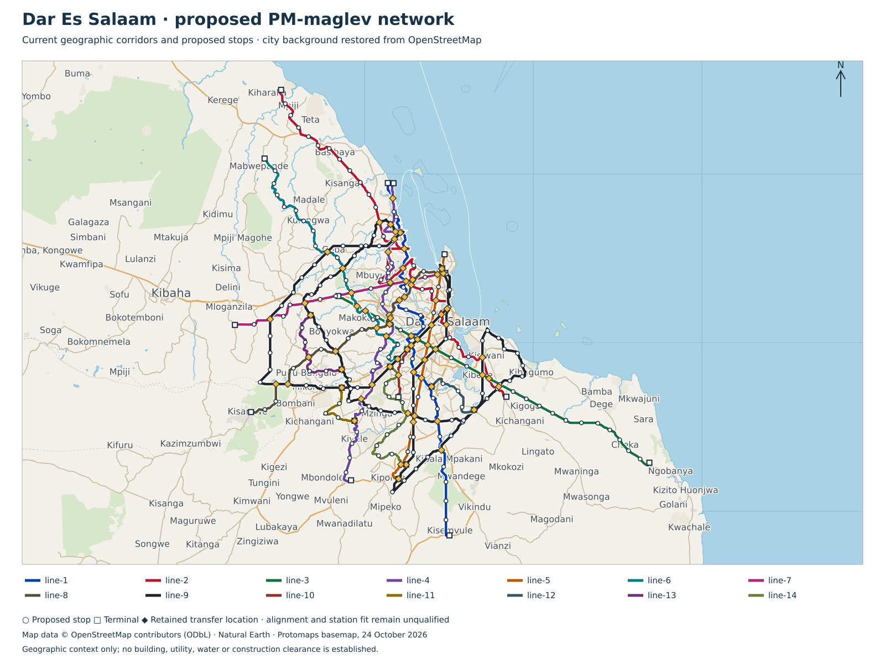

# Dar Es Salaam — v0.5 maglev city planning

Provisional planning from retained geography, station demand and service schedules. All physical and manufacturing release flags remain false.

14 lines; 404 provisional trainsets / 2424 cars; 72,720 kWh gross onboard storage.

| Line | Cars | AW2 / AW3 | Bodies / assumed overall m | Topology | Peak / total trains | Dwell s |
|---|---:|---:|---:|---|---:|---:|
| line-1 | 6 | 720 / 960 | 102 / 104.5 | fixed-terminal-loops | 34 / 39 | 365 |
| line-2 | 6 | 720 / 960 | 102 / 104.5 | fixed-terminal-loops | 41 / 47 | 315 |
| line-3 | 6 | 720 / 960 | 102 / 104.5 | fixed-terminal-loops | 21 / 25 | 359 |
| line-4 | 6 | 720 / 960 | 102 / 104.5 | fixed-terminal-loops | 43 / 49 | 332 |
| line-5 | 6 | 720 / 960 | 102 / 104.5 | fixed-terminal-loops | 18 / 21 | 307 |
| line-6 | 6 | 720 / 960 | 102 / 104.5 | fixed-terminal-loops | 24 / 28 | 284 |
| line-7 | 6 | 720 / 960 | 102 / 104.5 | fixed-terminal-loops | 15 / 18 | 322 |
| line-8 | 6 | 720 / 960 | 102 / 104.5 | fixed-terminal-loops | 34 / 39 | 351 |
| line-9 | 6 | 720 / 960 | 102 / 104.5 | two-independent-directed-circuits | 90 / 100 | 278 |
| line-10 | 6 | 720 / 960 | 102 / 104.5 | fixed-terminal-loops | 5 / 7 | 226 |
| line-11 | 6 | 720 / 960 | 102 / 104.5 | fixed-terminal-loops | 5 / 7 | 261 |
| line-12 | 6 | 720 / 960 | 102 / 104.5 | fixed-terminal-loops | 4 / 6 | 301 |
| line-13 | 6 | 720 / 960 | 102 / 104.5 | fixed-terminal-loops | 5 / 7 | 358 |
| line-14 | 6 | 720 / 960 | 102 / 104.5 | fixed-terminal-loops | 9 / 11 | 337 |

Station-powered dispatch recomputes headway from runtime,dwell and protected-zone clearance. The190s baseline and longer actual-leg bounds replace shorter source headways; fleet and capacity use the selected headway. Unpowered-coast feasibility, grade, phase/overlap and stalled-train recovery remain hard acceptance gates.

- line-1: selected headway 1023s versus source 180s; normal capacity 2,534/hour/direction; 19 held longitudinal cases.
- line-2: selected headway 857s versus source 180s; normal capacity 3,025/hour/direction; 23 held longitudinal cases.
- line-3: selected headway 1004s versus source 180s; normal capacity 2,582/hour/direction; 11 held longitudinal cases.
- line-4: selected headway 914s versus source 180s; normal capacity 2,836/hour/direction; 30 held longitudinal cases.
- line-5: selected headway 830s versus source 180s; normal capacity 3,123/hour/direction; 10 held longitudinal cases.
- line-6: selected headway 755s versus source 180s; normal capacity 3,433/hour/direction; 15 held longitudinal cases.
- line-7: selected headway 880s versus source 180s; normal capacity 2,945/hour/direction; 6 held longitudinal cases.
- line-8: selected headway 977s versus source 180s; normal capacity 2,653/hour/direction; 21 held longitudinal cases.
- line-9: selected headway 903s versus source 360s; normal capacity 2,870/hour/direction; 53 held longitudinal cases.
- line-10: selected headway 560s versus source 180s; normal capacity 4,629/hour/direction; 2 held longitudinal cases.
- line-11: selected headway 678s versus source 180s; normal capacity 3,823/hour/direction; 2 held longitudinal cases.
- line-12: selected headway 811s versus source 180s; normal capacity 3,196/hour/direction; 2 held longitudinal cases.
- line-13: selected headway 1001s versus source 180s; normal capacity 2,589/hour/direction; 2 held longitudinal cases.
- line-14: selected headway 931s versus source 180s; normal capacity 2,784/hour/direction; 5 held longitudinal cases.

Retained ring wrap distances do not close the complete geographic route. Recomputed closure adds the following distances to the input wrap values; actual closure alignment remains open: line-9 3,615.5 m.

**Integrated-beam/no-walkway target:** door-mounted evacuation is a study candidate. Continuous walkway removal is not approved. Necessary iron reaction faces, supports/foundations, joints and protection remain. 14544 onboard packs are a provisional door-count hypothesis; new mass, lifetime cost and net savings are unknown. Landing space, accessible alternatives, fire/weather/fault conditions and rescue/maintenance access must be proved along the complete route.

**Predominantly elevated strategy:** 99% mainline elevation target; all ordinary sections proposed elevated. Ordinary viaduct planning length 586.849 km includes 48.476 km converted from retained at-grade scope. Special crossings remain separate and unpriced.

Straight tangents are preferred between demand anchors. Existing geographic alignments have not been rerouted or proved clear. Buildings/air rights, road and utility clearances, piers/foundations, wildlife/water passage, station access and construction access require evidence. Elevation does not establish zero displacement or zero environmental impact.

Formation matches both planning AW2/AW3 loads. Assumed overall length includes the shared configuration’s coupling gaps; body lengths alone exclude them. Platforms are screened against assumed overall length plus 10 m; final tolerances, overhang and berthing require qualification. Fleet is recomputed from hot AW3 services duty and selected station-resource headways, with 10% spares rounded up and one cold reserve per line. Pure trajectory and fixed-winding force feasibility are separate screens; unlocated intermediate-zone hints do not clear either hold.

Radials use unlocated fixed terminal loop allowances; rings use two independent directed circuits. A 100 m radius / 20 km/h loop allowance is not approved geometry. Depot-only switches or transfer devices require separate hardware, access and recovery qualification.

Station services charging is screened at 200 kW per car, including live connected services and replacement of run/disconnected-dwell energy. Main traction is supplied by separate station LSM equipment. Dwell is extended for the worst incoming services duty and terminal allowance. Multiple berths implied by dwell/headway require a conflict-free physical layout. Losses, taper, grade, curve forces, emergency reserve and missed charging remain open. No grid/PV/storage or site release is asserted.

| Scenario | Repeat fleet allowance USD | Ordinary elevated allowance USD | Station electrical target USD | Partial subtotal USD |
|---|---:|---:|---:|---:|
| low | 357,673,320 | 1,542,751,036 | 420,240,000 | 2,320,664,356 |
| base | 476,897,760 | 2,057,001,381 | 760,140,000 | 3,294,039,141 |
| high | 715,346,640 | 3,085,502,072 | 1,205,100,000 | 5,005,948,712 |

**Complete city programme cost remains unknown.** Partial allowances price each formation by car, coupling and shared train systems, plus measured section/reaction-steel quantities and explicit process assumptions per ordinary elevated route km. Station electrical rows price unquoted repeated fixed-group equipment targets separately; actual45-second charging and supply/thermal ratings require a configured quote. They exclude site-specific conversion/clearance premiums, terminal loops, special/bridge works, station buildings/access, depots, external utility reinforcement, land, NRE/plant, EPC and other scope listed in the structured report. Rates and productivity assumptions require supplier and site validation. Complete project costs and localisation remain unknown.

Open acceptance work:

- retained-geography: Survey, utilities, land, water crossings, terrain, ground investigation and alignment reconciliation; retained mapping is geographic evidence only.
- formation-platform: Close coupling pitch, full magnetic lifting-face/guidance-arm/below-floor swept envelope, door/egress layouts, actual mass and equal AW2/AW3 qualification. The 2.65 m cabin width does not bound running gear or platform clearance.
- field-control: Obtain force/loss maps and rig correlation, six-axis stability, target timing and independent support/capture/braking protection.
- terminal-topology: Locate fixed loops/ring closure, qualify curvature, clearance and land, and provide switch-free failure recovery.
- elevated-alignment: Locate the predominantly elevated straight-tangent proposal and verify buildings/air rights, road/utility clearance, wildlife/water passage, piers, station/egress and construction access; no zero-impact claim from elevation alone.
- civil-release: Redesign guidebeam/passive rail, supports/foundations, joints/tolerances, movement, gap dynamics, evacuation and erection.
- route-duty: Run approved grade, curve, wind, hot, low-voltage, full-SOC, no-regen, missed-charge, failed-channel and rescue duty.
- fleet-timetable: Validate headway/conflicts, station berth throughput, dispatch, maintenance rotation, degraded service and reserve.
- charging-microgrid: Place charging interfaces and prove taper, power quality, PV/storage/backup sizing and adverse-weather replenishment.
- depot-access: Locate line-local storage/workshops and qualify depot-only connection/transfer, isolation, inspection, towing and recovery.
- programme-cost: Price all station/land/loop/bridge/at-grade/depot/energy/control/production/QA/NRE/spares/OPEX scope, origin-trace MBOM and apply EPC once.
- physical-release: Close G0–G5 through authenticated independent physical acceptance; planning arithmetic is insufficient.

## Manufacture and erection

Local work is proposed for repeated frames, cartridges, coils, concrete units and system integration. Input origins and local value added remain unverified. Factory capacity and programme duration require measured cycle times, cure/release criteria and site access.

- **beam**: qualify concrete and reinforcement → assemble reusable mould and cage → stress approved tendons → cast and monitor cure → verify release strength → demould and survey → install reaction faces → proof/inspect serialised element.
- **supports**: investigate utilities and ground → qualify foundation type → prefabricate cage/pier where feasible → construct foundation → erect and temporarily stabilise pier/cap → survey bearing seats.
- **vehicle**: prepare repeatable sandwich moulds and layup → infuse or light-RTM selected laminate/core → verify cure and bondline → fit sized hardpoints, doors, glazing and interior → install support/guidance coils,30kWh services pack and auxiliaries → weigh, inspect and test exact revision.
- **magnetics**: qualify ferrite and core steel → machine carriers and reaction faces → wind and insulate coils → impregnate and cure → assemble replaceable cartridges → map force/loss/temperature → calibrate independent sensing.
- **erection**: survey delivery corridor → verify lift plan and crane at radius → deliver and lift beam → locate and positively lock engineered joint → survey reaction faces → complete serial QA traveller → test integrated route section.
- **software**: build reproducible Rust control → execute oracle/fault/deadline tests → bind exact geometry and force-map revision → test isolated SBC I/O and independent trips → measure worst-case timing → perform integrated rig and route tests.
- **station-propulsion**: manufacture paired2.5m stator cassettes → verify winding R/L,insulation and polarity → assemble two fixed groups per direction → integrate independent bridges,DCbus,resistor and services charging → calibrate phase sensors → replay launch/commit/fault protocol → low-energy rig and rated duty acceptance.

UK equipment candidates are capability leads, not prices or approved purchases. Rotary coil winding and CCL prestressing have explicit UK-manufacture statements; complete configuration, ratings and origin schedules remain open. See the linked manufacturing bill for dated primary sources.

[Structured plan](summary.json) · [Preserved geography/demand records](retained-records.json) · [Quantity bills, manufacturing routes and factory equipment](manufacturing.json)

The structured plan binds current source bytes and manufacturing bills with SHA-256.

[Primary planning method](../../../../../../../engineering/ferrite_maglev/README.md)

<!-- Generated by engineering.ferrite_maglev.cities; primary planning only. -->
