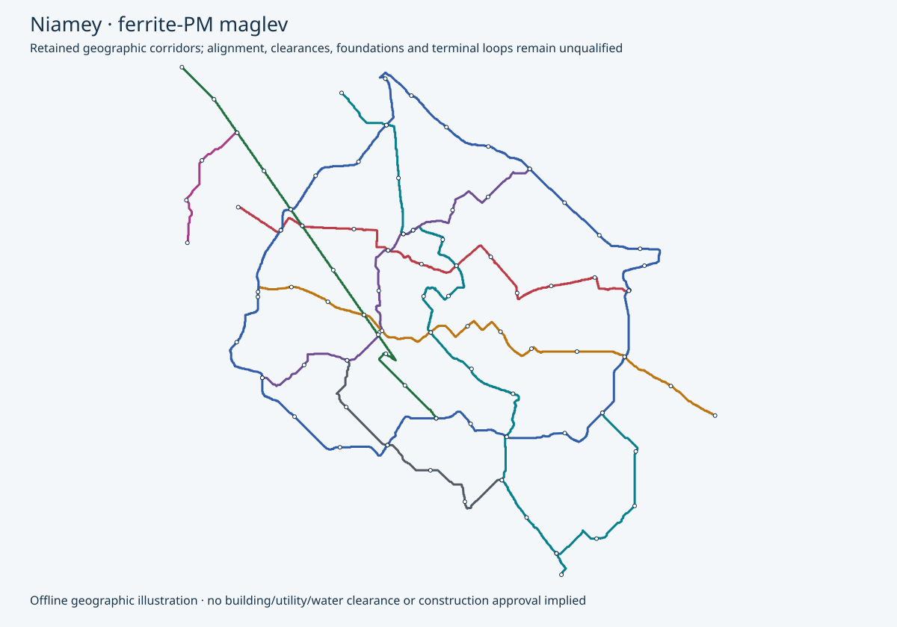

# Niamey — v0.5 maglev city planning

Provisional planning from retained geography, station demand and service schedules. All physical and manufacturing release flags remain false.

9 lines; 193 provisional trainsets / 772 cars; 23,160 kWh gross onboard storage.

| Line | Cars | AW2 / AW3 | Bodies / assumed overall m | Topology | Peak / total trains | Dwell s |
|---|---:|---:|---:|---|---:|---:|
| line-1 | 4 | 480 / 640 | 68 / 69.5 | located-tangent-terminal-loops-with-station-powered-blocks | 26 / 30 | 60 |
| line-2 | 4 | 480 / 640 | 68 / 69.5 | located-tangent-terminal-loops-with-station-powered-blocks | 19 / 22 | 60 |
| line-3 | 4 | 480 / 640 | 68 / 69.5 | located-tangent-terminal-loops-with-station-powered-blocks | 18 / 21 | 60 |
| line-4 | 4 | 480 / 640 | 68 / 69.5 | located-tangent-terminal-loops-with-station-powered-blocks | 20 / 23 | 60 |
| line-5 | 4 | 480 / 640 | 68 / 69.5 | located-tangent-terminal-loops-with-station-powered-blocks | 19 / 22 | 60 |
| line-6 | 4 | 480 / 640 | 68 / 69.5 | two-independent-directed-circuits | 34 / 39 | 60 |
| line-7 | 4 | 480 / 640 | 68 / 69.5 | located-tangent-terminal-loops-with-station-powered-blocks | 8 / 10 | 60 |
| line-8 | 4 | 480 / 640 | 68 / 69.5 | located-tangent-terminal-loops-with-station-powered-blocks | 11 / 14 | 60 |
| line-9 | 4 | 480 / 640 | 68 / 69.5 | located-tangent-terminal-loops-with-station-powered-blocks | 10 / 12 | 60 |

The requested urban plan uses a1.5km minimum and approximately2km average passenger spacing. Suburban4–5km is considered only with an explicit service classification and fixed, priced midway acceleration zones. Existing transfer nodes are retained; incompatible short gaps remain visible. The1km/88s case is a retained component benchmark. Exclusive whole-leg protection gives a conservative comparison headway; a180s sectioned or multiple-berth alternative needs its own proof and cost. No eligible full operating design is asserted.

- line-1: urban exclusive-model headway 280s versus source 180s; normal capacity 6,171/hour/direction; 0 held longitudinal cases; 2 transfer/terminal spacing conflicts.
  Proposed operating plan: 17 mainline stops versus 17 retained access records; 4 additional terminal service/motor zones. Retained capacity target met: false. Consolidated access connections and every station/loop site remain unapproved.
- line-2: urban exclusive-model headway 270s versus source 180s; normal capacity 6,400/hour/direction; 0 held longitudinal cases; 1 transfer/terminal spacing conflicts.
  Proposed operating plan: 12 mainline stops versus 10 retained access records; 4 additional terminal service/motor zones. Retained capacity target met: false. Consolidated access connections and every station/loop site remain unapproved.
- line-3: urban exclusive-model headway 260s versus source 180s; normal capacity 6,646/hour/direction; 0 held longitudinal cases; 2 transfer/terminal spacing conflicts.
  Proposed operating plan: 11 mainline stops versus 13 retained access records; 4 additional terminal service/motor zones. Retained capacity target met: false. Consolidated access connections and every station/loop site remain unapproved.
- line-4: urban exclusive-model headway 280s versus source 180s; normal capacity 6,171/hour/direction; 0 held longitudinal cases; 1 transfer/terminal spacing conflicts.
  Proposed operating plan: 13 mainline stops versus 10 retained access records; 4 additional terminal service/motor zones. Retained capacity target met: false. Consolidated access connections and every station/loop site remain unapproved.
- line-5: urban exclusive-model headway 260s versus source 180s; normal capacity 6,646/hour/direction; 0 held longitudinal cases; 2 transfer/terminal spacing conflicts.
  Proposed operating plan: 12 mainline stops versus 7 retained access records; 4 additional terminal service/motor zones. Retained capacity target met: false. Consolidated access connections and every station/loop site remain unapproved.
- line-6: urban exclusive-model headway 360s versus source 360s; normal capacity 4,800/hour/direction; 0 held longitudinal cases; 1 transfer/terminal spacing conflicts.
  Proposed operating plan: 27 mainline stops versus 19 retained access records; 0 additional terminal service/motor zones. Retained capacity target met: true. Consolidated access connections and every station/loop site remain unapproved.
- line-7: urban exclusive-model headway 230s versus source 180s; normal capacity 7,513/hour/direction; 0 held longitudinal cases; 0 transfer/terminal spacing conflicts.
  Proposed operating plan: 4 mainline stops versus 2 retained access records; 4 additional terminal service/motor zones. Retained capacity target met: false. Consolidated access connections and every station/loop site remain unapproved.
- line-8: urban exclusive-model headway 260s versus source 180s; normal capacity 6,646/hour/direction; 0 held longitudinal cases; 0 transfer/terminal spacing conflicts.
  Proposed operating plan: 6 mainline stops versus 3 retained access records; 4 additional terminal service/motor zones. Retained capacity target met: false. Consolidated access connections and every station/loop site remain unapproved.
- line-9: urban exclusive-model headway 260s versus source 180s; normal capacity 6,646/hour/direction; 0 held longitudinal cases; 0 transfer/terminal spacing conflicts.
  Proposed operating plan: 5 mainline stops versus 3 retained access records; 4 additional terminal service/motor zones. Retained capacity target met: false. Consolidated access connections and every station/loop site remain unapproved.

**Integrated-beam/no-walkway target:** door-mounted evacuation is a study candidate. Continuous walkway removal is not approved. Necessary iron reaction faces, supports/foundations, joints and protection remain. 4632 onboard packs are a provisional door-count hypothesis; new mass, lifetime cost and net savings are unknown. Landing space, accessible alternatives, fire/weather/fault conditions and rescue/maintenance access must be proved along the complete route.

**Predominantly elevated strategy:** 99% mainline elevation target; all ordinary sections proposed elevated. Ordinary viaduct planning length 184.196 km includes 12.936 km converted from retained at-grade scope. Special crossings remain separate and unpriced.

Straight tangents are preferred between demand anchors. Existing geographic alignments have not been rerouted or proved clear. Buildings/air rights, road and utility clearances, piers/foundations, wildlife/water passage, station access and construction access require evidence. Elevation does not establish zero displacement or zero environmental impact.

Formation matches both planning AW2/AW3 loads. Assumed overall length includes the shared configuration’s coupling gaps; body lengths alone exclude them. Platforms are screened against assumed overall length plus 10 m; final tolerances, overhang and berthing require qualification. Fleet is recomputed from hot AW3 services duty and selected station-resource headways, with 10% spares rounded up and one cold reserve per line. Pure trajectory and fixed-winding force feasibility are separate screens; unlocated intermediate-zone hints do not clear either hold.

Default plans retain passenger-transfer nodes between independent fixed lines and choose fewer intermediate passenger stops. Ordinary retained stops remain demand/access records. Short transfer gaps remain explicit exceptions; no train switches or junction routing are introduced. Radial terminals have tangent-connected provisional R-L-R loops, three station-powered sections, two added service/motor stops per loop and explicit 150 m winding zones. Their 25 km/h arclength and lateral-acceleration screens do not qualify six-car curve phase, guidance, clearance, land or construction. Rings retain two independent directed circuits. Depot access and recovery remain unqualified.

Charging alternatives compare240/400/600kW input per car at90% conversion, with exact connected fractions, hotel load, reserve and computed dwell. The displayed research candidate is not an eligible operating recommendation; changed50/60kWh packs require new formation confirmation. Main traction is supplied by separate station LSM equipment. Dwell is extended for the worst incoming services duty and terminal allowance. Multiple berths implied by dwell/headway require a conflict-free physical layout. Conversion loss is a declared planning allowance; taper, grade, curve forces, emergency reserve and missed charging remain open. No grid/PV/storage or site release is asserted.

| Scenario | Repeat fleet allowance USD | Ordinary elevated allowance USD | Terminal civil allowance USD | Station electrical target USD | Foundation proposal increment USD | Booster electrical/mount targets USD | Rescue kits USD | Partial subtotal USD |
|---|---:|---:|---:|---:|---:|---:|---:|---:|
| low | 114,346,710 | 504,091,005 | 21,974,317 | 227,395,000 | 52,542,819 | 23,030,258 | 56,347,057 | 999,727,166 |
| base | 152,462,280 | 672,121,341 | 29,299,089 | 411,425,000 | 70,057,093 | 40,957,010 | 75,129,409 | 1,451,451,222 |
| high | 228,693,420 | 1,008,182,011 | 43,948,634 | 655,500,000 | 105,085,639 | 64,520,515 | 112,694,113 | 2,218,624,332 |

Terminal civil allowances use actual proposed arc length, beam/support counts and ordinary section quantity equivalents; curved detailing premiums remain unpriced. Added one-way service zones conservatively carry complete two-direction electrical package targets. The primary priced subtotal includes the conditional 6.5 m foundation proposal increment once; the previous smaller-foundation subtotal is retained only as a comparison. Every fixed booster has separately priced electrical equipment and mount/cabinet stock; rescue nodes have independently priced winch/portal/foundation kits. Higher voltage/current rating premiums, ground capacity, anchorage and access remain unaccepted and unpriced where unknown.

**Complete city programme cost remains unknown.** Partial allowances price each formation by car, coupling and shared train systems, plus measured section/reaction-steel quantities and explicit process assumptions per ordinary elevated route km. Station electrical rows price unquoted repeated fixed-group equipment targets separately; actual45-second charging and supply/thermal ratings require a configured quote. They exclude site-specific conversion/clearance premiums, terminal curved-detail/land premiums, special/bridge works, station buildings/access, depots, external utility reinforcement, land, NRE/plant, EPC and other scope listed in the structured report. Rates and productivity assumptions require supplier and site validation. Complete project costs and localisation remain unknown.

Open acceptance work:

- retained-geography: Survey, utilities, land, water crossings, terrain, ground investigation and alignment reconciliation; retained mapping is geographic evidence only.
- formation-platform: Close coupling pitch, full magnetic lifting-face/guidance-arm/below-floor swept envelope, door/egress layouts, actual mass and equal AW2/AW3 qualification. The 2.65 m cabin width does not bound running gear or platform clearance.
- field-control: Obtain force/loss maps and rig correlation, six-axis stability, target timing and independent support/capture/braking protection.
- terminal-topology: Locate fixed loops/ring closure, qualify curvature, clearance and land, and provide switch-free failure recovery.
- elevated-alignment: Locate the predominantly elevated straight-tangent proposal and verify buildings/air rights, road/utility clearance, wildlife/water passage, piers, station/egress and construction access; no zero-impact claim from elevation alone.
- civil-release: Redesign guidebeam/passive rail, supports/foundations, joints/tolerances, movement, gap dynamics, evacuation and erection.
- route-duty: Run approved grade, curve, wind, hot, low-voltage, full-SOC, no-regen, missed-charge, failed-channel and rescue duty.
- fleet-timetable: Validate headway/conflicts, station berth throughput, dispatch, maintenance rotation, degraded service and reserve.
- charging-microgrid: Place charging interfaces and prove taper, power quality, PV/storage/backup sizing and adverse-weather replenishment.
- depot-access: Locate line-local storage/workshops and qualify depot-only connection/transfer, isolation, inspection, towing and recovery.
- programme-cost: Price all station/land/loop/bridge/at-grade/depot/energy/control/production/QA/NRE/spares/OPEX scope, origin-trace MBOM and apply EPC once.
- physical-release: Close G0–G5 through authenticated independent physical acceptance; planning arithmetic is insufficient.

## Manufacture and erection

Local work is proposed for repeated frames, cartridges, coils, concrete units and system integration. Input origins and local value added remain unverified. Factory capacity and programme duration require measured cycle times, cure/release criteria and site access.

- **beam**: qualify concrete and reinforcement → assemble reusable mould and cage → stress approved tendons → cast and monitor cure → verify release strength → demould and survey → install reaction faces → proof/inspect serialised element.
- **supports**: investigate utilities and ground → qualify foundation type → prefabricate cage/pier where feasible → construct foundation → erect and temporarily stabilise pier/cap → survey bearing seats.
- **vehicle**: prepare repeatable sandwich moulds and layup → infuse or light-RTM selected laminate/core → verify cure and bondline → fit sized hardpoints, doors, glazing and interior → install support/guidance coils,30kWh services pack and auxiliaries → weigh, inspect and test exact revision.
- **magnetics**: qualify ferrite and core steel → machine carriers and reaction faces → wind and insulate coils → impregnate and cure → assemble replaceable cartridges → map force/loss/temperature → calibrate independent sensing.
- **erection**: survey delivery corridor → verify lift plan and crane at radius → deliver and lift beam → locate and positively lock engineered joint → survey reaction faces → complete serial QA traveller → test integrated route section.
- **software**: build reproducible Rust control → execute oracle/fault/deadline tests → bind exact geometry and force-map revision → test isolated SBC I/O and independent trips → measure worst-case timing → perform integrated rig and route tests.
- **station-propulsion**: manufacture paired2.5m stator cassettes → verify winding R/L,insulation and polarity → assemble two fixed groups per direction → integrate independent bridges,DCbus,resistor and services charging → calibrate phase sensors → replay launch/commit/fault protocol → low-energy rig and rated duty acceptance.

UK equipment candidates are capability leads, not prices or approved purchases. Rotary coil winding and CCL prestressing have explicit UK-manufacture statements; complete configuration, ratings and origin schedules remain open. See the linked manufacturing bill for dated primary sources.

[Structured plan](summary.json) · [Preserved geography/demand records](retained-records.json) · [Quantity bills, manufacturing routes and factory equipment](manufacturing.json)

The structured plan binds current source bytes and manufacturing bills with SHA-256.

[Primary planning method](../../../../../../../engineering/ferrite_maglev/README.md)

<!-- Generated by engineering.ferrite_maglev.cities; primary planning only. -->
