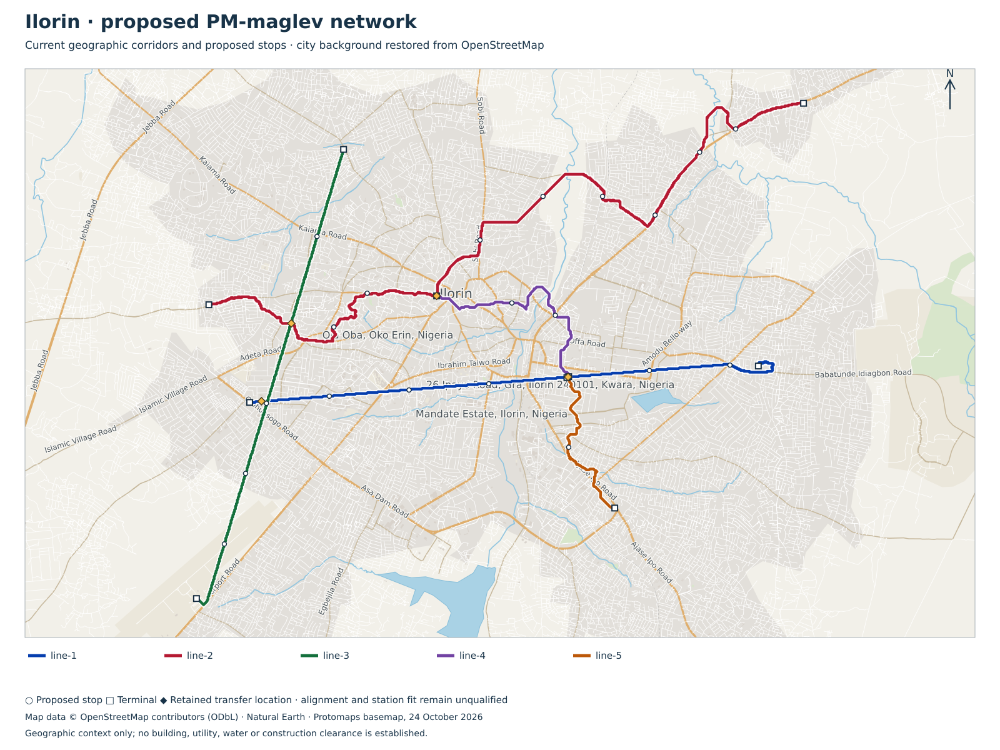

# Ilorin — v0.5 maglev city planning

Provisional planning from retained geography, station demand and service schedules. All physical and manufacturing release flags remain false.

5 lines; 74 provisional trainsets / 222 cars; 6,660 kWh gross onboard storage.

| Line | Cars | AW2 / AW3 | Bodies / assumed overall m | Topology | Peak / total trains | Dwell s |
|---|---:|---:|---:|---|---:|---:|
| line-1 | 3 | 360 / 480 | 51 / 52 | located-tangent-terminal-loops-with-station-powered-blocks | 15 / 18 | 60 |
| line-2 | 3 | 360 / 480 | 51 / 52 | located-tangent-terminal-loops-with-station-powered-blocks | 19 / 22 | 60 |
| line-3 | 3 | 360 / 480 | 51 / 52 | located-tangent-terminal-loops-with-station-powered-blocks | 12 / 15 | 60 |
| line-4 | 3 | 360 / 480 | 51 / 52 | located-tangent-terminal-loops-with-station-powered-blocks | 8 / 10 | 60 |
| line-5 | 3 | 360 / 480 | 51 / 52 | located-tangent-terminal-loops-with-station-powered-blocks | 7 / 9 | 60 |

The requested urban plan uses a1.5km minimum and approximately2km average passenger spacing. Suburban4–5km is considered only with an explicit service classification and fixed, priced midway acceleration zones. Existing transfer nodes are retained; incompatible short gaps remain visible. The1km/88s case is a retained component benchmark. Exclusive whole-leg protection gives a conservative comparison headway; a180s sectioned or multiple-berth alternative needs its own proof and cost. No eligible full operating design is asserted.

- line-1: urban exclusive-model headway 230s versus source 180s; normal capacity 5,635/hour/direction; 0 held longitudinal cases; 0 transfer/terminal spacing conflicts.
  Proposed operating plan: 8 mainline stops versus 6 retained access records; 4 additional terminal service/motor zones. Retained capacity target met: false. Consolidated access connections and every station/loop site remain unapproved.
- line-2: urban exclusive-model headway 290s versus source 180s; normal capacity 4,469/hour/direction; 0 held longitudinal cases; 0 transfer/terminal spacing conflicts.
  Proposed operating plan: 12 mainline stops versus 7 retained access records; 4 additional terminal service/motor zones. Retained capacity target met: false. Consolidated access connections and every station/loop site remain unapproved.
- line-3: urban exclusive-model headway 270s versus source 180s; normal capacity 4,800/hour/direction; 0 held longitudinal cases; 0 transfer/terminal spacing conflicts.
  Proposed operating plan: 7 mainline stops versus 4 retained access records; 4 additional terminal service/motor zones. Retained capacity target met: false. Consolidated access connections and every station/loop site remain unapproved.
- line-4: urban exclusive-model headway 250s versus source 180s; normal capacity 5,184/hour/direction; 0 held longitudinal cases; 0 transfer/terminal spacing conflicts.
  Proposed operating plan: 4 mainline stops versus 2 retained access records; 4 additional terminal service/motor zones. Retained capacity target met: false. Consolidated access connections and every station/loop site remain unapproved.
- line-5: urban exclusive-model headway 260s versus source 180s; normal capacity 4,985/hour/direction; 0 held longitudinal cases; 0 transfer/terminal spacing conflicts.
  Proposed operating plan: 3 mainline stops versus 2 retained access records; 4 additional terminal service/motor zones. Retained capacity target met: false. Consolidated access connections and every station/loop site remain unapproved.
## Why this architecture

**The main proposition is useful city-wide reach with less construction capital, operating expenditure and long-term debt repayment.** PM-maglev station-launched monorail is the means being investigated. Affordability and domestic capability must be demonstrated at equal passenger service.

| Intended advantage | Design mechanism | Evidence and cost test |
|---|---|---|
| Affordable reach | Compact repeated elevated beams, straight demand-led tangents and independent fixed lines with passenger transfers. | Compare complete CAPEX per route km and residents served; survey access, rights, ground and crossings. |
| Simpler rolling stock | Station/located-booster LSMs replace onboard main traction motors and inverters; passive ferrite bias with active support remains. | Price retained coils, drives, sensing, braking, cooling, batteries, doors and HVAC; measure mass, energy and maintenance. |
| Station-led GOA4 dispatch | Prepare receiving resources, prove doors/platform safe, commit launch, verify full-tail clearance, then consider the following departure. | Retain separation, stopping authority, receiving readiness, intrusion detection, integrity, protection and degraded recovery. |
| Domestic productive capacity | Local precast units, GFRP bodies, steel carriers, winding cassettes, wiring, Rust integration and serial QA. | Audit imported raw materials, semiconductors and machine tools; count domestic value added rather than a local supplier address. |
| Lower operating burden | Aim for less contact wear, fewer propulsion components per moving vehicle and repeatable wayside maintenance. | Include support power, launch losses, staff across shifts, rescue, maintenance, renewals and availability; no automatic saving percentage. |
| Manageable repayment | Phase useful corridors; minimise whole-life public cash and foreign-currency borrowing alongside construction cost. | Separate resource cost, borrower cash, imported procurement and debt currency; demonstrate affordable annual funding before expansion. |
| Open and repairable systems | Published hardware/process quantities, reproducible Rust tests, interchangeable interfaces and local tooling skills. | Qualify interfaces, independent assurance, spares and second sources; software licences alone do not qualify a train. |

## CAPEX, OPEX and debt repayment

**Affordability is a design objective:** maximise useful coverage and domestic capability per unit of construction capital, annual operating cash and debt repayment.

These scope-covering scenarios add explicit allowances to the existing partial quantity bill. They are unquoted budget sensitivities; the complete engineered estimate and funding offer remain open. Values are constant USD.

| Scenario | Budget CAPEX | Annual OPEX | Annual debt service | Annual OPEX + debt | 30-year operating life + construction borrower cash |
|---|---:|---:|---:|---:|---:|
| low | $536.8m | $17.1m | $17.2m | $34.3m | $1,286.1m |
| base | $1,059.9m | $52.0m | $70.0m | $122.0m | $3,592.5m |
| high | $2,319.7m | $170.2m | $259.2m | $429.4m | $10,917.5m |

The combined annual figure excludes irregular renewal payments; those are included in the full cash schedule. Construction interest and fees are paid separately. Resource cost counts CAPEX once; borrower cash counts equity and loan repayments, avoiding a second count of financed principal.

| Scenario | Debt / equity CAPEX | Foreign-currency debt | Total construction + repayment interest | Whole-life resource cost | Discounted resource cost |
|---|---:|---:|---:|---:|---:|
| low | $268.4m / $268.4m | $67.1m | $188.0m | $1,092.7m | $687.5m |
| base | $741.9m / $318.0m | $371.0m | $788.5m | $2,789.2m | $1,609.8m |
| high | $1,971.8m / $348.0m | $1,577.4m | $2,409.7m | $8,468.4m | $4,452.1m |

[Every allowance, energy component, finance assumption and yearly cash flow](summary.json) → `affordability`. Five construction years and 30 operating years are hypotheses. No fare or subsidy revenue is assumed. Complete financing must address local-currency revenue, foreign-currency debt, lender terms, resilience and renewal funding.

The same-service procurement sensitivity assumes 1.5× CAPEX and 1.1× OPEX, without changing coverage, timetable, loan rate or tenor. It illustrates the effect of procurement cost and foreign borrowing; it is not an independently priced alternative. Proven cost advantage and local-content percentages remain open.

[Whole-life appraisal reference](https://www.gov.uk/government/publications/the-green-book--2/the-green-book-2026). [UKEF Buyer Credit](https://www.gov.uk/guidance/buyer-credit-facility) can finance up to85% of an eligible export contract, subject to assessment; that does not establish85% financing of this city programme. [UK content requirements](https://www.gov.uk/government/publications/ukefs-approach-to-foreign-content/ukefs-approach-to-foreign-content) need a transaction-specific content schedule. No UKEF approval, tariff, lender commitment or economic multiplier is assumed.

## Energy and operating cost detail

| Scenario | Annual services supply GWh | Positive traction GWh | Extra fixed-zone losses GWh | Station auxiliaries GWh | Electricity USD/kWh | Annual energy cost | Annual staff cost | Annual maintenance/admin allowance |
|---|---:|---:|---:|---:|---:|---:|---:|---:|
| low | 65.0 | 22.1 | 75.3 | 3.0 | 0.06 | $9.9m | $1.8m | $5.4m |
| base | 65.0 | 22.1 | 113.0 | 7.4 | 0.12 | $24.9m | $5.9m | $21.2m |
| high | 65.0 | 22.1 | 188.4 | 14.9 | 0.25 | $72.6m | $16.4m | $81.2m |

Hot services and station auxiliary demand are conservative planning allowances, not measured consumption. Positive traction includes no regeneration credit. Additional winding/conversion losses use explicit8/12/20kWh per fixed-zone event, including separately counted boosters; these are sensitivities rather than measured route-specific loss maps. Reserve/depot movement, missed charging, wind, grade, full field maps, electrical diversity and supply resilience need further duty studies. No automatic solar or grid-independence credit is applied.

## Station-led GOA4 operation

Normal operation centres on the station: reserve a protected receiving path/berth, prove vehicle support and services ready, prove doors/platform safe, prepare and commit the finite powered launch, monitor coast/booster/arrival, then release each resource with valid train-identity and full-consist clearance evidence. A leading train leaving a station can make its berth available to the next train once its entire tail is proved clear and the following movement has protected authority. A launch command or elapsed timer alone does not release occupancy.

Fixed lines eliminate mainline route-switch choices. Wayside launch/receive equipment concentrates primary propulsion and dispatch infrastructure at known sites. Independent onboard support/guidance current control and protection continue during coasting. Receiving plant must remain protected after launch; a fault cannot be resolved by simply cancelling a coasting train.

Current city fleet/capacity calculations retain exclusive whole-leg reservation. The separate progressive-departure Rust candidate tests release behind a verified full tail, finite stopping envelopes and faults at180s headway. Local results have not qualified route-wide distributed detectors, cross-controller authority, degraded recovery or a city timetable. Driverless/GOA4 is the operating target, without operational authorisation or an assumed zero staff budget. [ORR unattended-operation principles](https://www.orr.gov.uk/sites/default/files/2024-07/railway-safety-principles-factors-for-safe-operation-of-goa4-uto.pdf) are a design reference for departure, passenger protection and degraded operation; they are not Iraqi operational approval.

**Integrated-beam/no-walkway target:** door-mounted evacuation is a study candidate. Continuous walkway removal is not approved. Necessary iron reaction faces, supports/foundations, joints and protection remain. 1332 onboard packs are a provisional door-count hypothesis; new mass, lifetime cost and net savings are unknown. Landing space, accessible alternatives, fire/weather/fault conditions and rescue/maintenance access must be proved along the complete route.

**Predominantly elevated strategy:** 99% mainline elevation target; all ordinary sections proposed elevated. Ordinary viaduct planning length 57.050 km includes 2.372 km converted from retained at-grade scope. Special crossings remain separate and unpriced.

Straight tangents are preferred between demand anchors. Existing geographic alignments have not been rerouted or proved clear. Buildings/air rights, road and utility clearances, piers/foundations, wildlife/water passage, station access and construction access require evidence. Elevation does not establish zero displacement or zero environmental impact.

Formation matches both planning AW2/AW3 loads. Assumed overall length includes the shared configuration’s coupling gaps; body lengths alone exclude them. Platforms are screened against assumed overall length plus 10 m; final tolerances, overhang and berthing require qualification. Fleet is recomputed from hot AW3 services duty and selected station-resource headways, with 10% spares rounded up and one cold reserve per line. Pure trajectory and fixed-winding force feasibility are separate screens; unlocated intermediate-zone hints do not clear either hold.

Default plans retain passenger-transfer nodes between independent fixed lines and choose fewer intermediate passenger stops. Ordinary retained stops remain demand/access records. Short transfer gaps remain explicit exceptions; no train switches or junction routing are introduced. Radial terminals have tangent-connected provisional R-L-R loops, three station-powered sections, two added service/motor stops per loop and explicit 150 m winding zones. Their 25 km/h arclength and lateral-acceleration screens do not qualify six-car curve phase, guidance, clearance, land or construction. Rings retain two independent directed circuits. Depot access and recovery remain unqualified.

Charging alternatives compare240/400/600kW input per car at90% conversion, with exact connected fractions, hotel load, reserve and computed dwell. The displayed research candidate is not an eligible operating recommendation; changed50/60kWh packs require new formation confirmation. Main traction is supplied by separate station LSM equipment. Dwell is extended for the worst incoming services duty and terminal allowance. Multiple berths implied by dwell/headway require a conflict-free physical layout. Conversion loss is a declared planning allowance; taper, grade, curve forces, emergency reserve and missed charging remain open. No grid/PV/storage or site release is asserted.

| Scenario | Repeat fleet allowance USD | Ordinary elevated allowance USD | Terminal civil allowance USD | Station electrical target USD | Foundation proposal increment USD | Booster electrical/mount targets USD | Rescue kits USD | Partial subtotal USD |
|---|---:|---:|---:|---:|---:|---:|---:|---:|
| low | 33,006,960 | 156,115,043 | 13,733,948 | 86,070,000 | 17,317,531 | 23,440,306 | 18,221,685 | 347,905,473 |
| base | 44,009,280 | 208,153,391 | 18,311,931 | 156,050,000 | 23,090,041 | 41,807,908 | 24,295,580 | 515,718,131 |
| high | 66,013,920 | 312,230,086 | 27,467,896 | 248,600,000 | 34,635,061 | 65,835,613 | 36,443,370 | 791,225,946 |

Terminal civil allowances use actual proposed arc length, beam/support counts and ordinary section quantity equivalents; curved detailing premiums remain unpriced. Added one-way service zones conservatively carry complete two-direction electrical package targets. The primary priced subtotal includes the conditional 6.5 m foundation proposal increment once; the previous smaller-foundation subtotal is retained only as a comparison. Every fixed booster has separately priced electrical equipment and mount/cabinet stock; rescue nodes have independently priced winch/portal/foundation kits. Higher voltage/current rating premiums, ground capacity, anchorage and access remain unaccepted and unpriced where unknown.

**Complete city programme cost remains unknown.** Partial allowances price each formation by car, coupling and shared train systems, plus measured section/reaction-steel quantities and explicit process assumptions per ordinary elevated route km. Station electrical rows price unquoted repeated fixed-group equipment targets separately; actual45-second charging and supply/thermal ratings require a configured quote. They exclude site-specific conversion/clearance premiums, terminal curved-detail/land premiums, special/bridge works, station buildings/access, depots, external utility reinforcement, land, NRE/plant, EPC and other scope listed in the structured report. Rates and productivity assumptions require supplier and site validation. Complete project costs and localisation remain unknown.

Open acceptance work:

- retained-geography: Survey, utilities, land, water crossings, terrain, ground investigation and alignment reconciliation; retained mapping is geographic evidence only.
- formation-platform: Close coupling pitch, full magnetic lifting-face/guidance-arm/below-floor swept envelope, door/egress layouts, actual mass and equal AW2/AW3 qualification. The 2.65 m cabin width does not bound running gear or platform clearance.
- field-control: Obtain force/loss maps and rig correlation, six-axis stability, target timing and independent support/capture/braking protection.
- terminal-topology: Locate fixed loops/ring closure, qualify curvature, clearance and land, and provide switch-free failure recovery.
- elevated-alignment: Locate the predominantly elevated straight-tangent proposal and verify buildings/air rights, road/utility clearance, wildlife/water passage, piers, station/egress and construction access; no zero-impact claim from elevation alone.
- civil-release: Redesign guidebeam/passive rail, supports/foundations, joints/tolerances, movement, gap dynamics, evacuation and erection.
- route-duty: Run approved grade, curve, wind, hot, low-voltage, full-SOC, no-regen, missed-charge, failed-channel and rescue duty.
- fleet-timetable: Validate headway/conflicts, station berth throughput, dispatch, maintenance rotation, degraded service and reserve.
- charging-microgrid: Place charging interfaces and prove taper, power quality, PV/storage/backup sizing and adverse-weather replenishment.
- depot-access: Locate line-local storage/workshops and qualify depot-only connection/transfer, isolation, inspection, towing and recovery.
- programme-cost: Price all station/land/loop/bridge/at-grade/depot/energy/control/production/QA/NRE/spares/OPEX scope, origin-trace MBOM and apply EPC once.
- physical-release: Close G0–G5 through authenticated independent physical acceptance; planning arithmetic is insufficient.

## Manufacture and erection

Local work is proposed for repeated frames, cartridges, coils, concrete units and system integration. Input origins and local value added remain unverified. Factory capacity and programme duration require measured cycle times, cure/release criteria and site access.

- **beam**: qualify concrete and reinforcement → assemble reusable mould and cage → stress approved tendons → cast and monitor cure → verify release strength → demould and survey → install reaction faces → proof/inspect serialised element.
- **supports**: investigate utilities and ground → qualify foundation type → prefabricate cage/pier where feasible → construct foundation → erect and temporarily stabilise pier/cap → survey bearing seats.
- **vehicle**: prepare repeatable sandwich moulds and layup → infuse or light-RTM selected laminate/core → verify cure and bondline → fit sized hardpoints, doors, glazing and interior → install support/guidance coils,30kWh services pack and auxiliaries → weigh, inspect and test exact revision.
- **magnetics**: qualify ferrite and core steel → machine carriers and reaction faces → wind and insulate coils → impregnate and cure → assemble replaceable cartridges → map force/loss/temperature → calibrate independent sensing.
- **erection**: survey delivery corridor → verify lift plan and crane at radius → deliver and lift beam → locate and positively lock engineered joint → survey reaction faces → complete serial QA traveller → test integrated route section.
- **software**: build reproducible Rust control → execute oracle/fault/deadline tests → bind exact geometry and force-map revision → test isolated SBC I/O and independent trips → measure worst-case timing → perform integrated rig and route tests.
- **station-propulsion**: manufacture paired2.5m stator cassettes → verify winding R/L,insulation and polarity → assemble two fixed groups per direction → integrate independent bridges,DCbus,resistor and services charging → calibrate phase sensors → replay launch/commit/fault protocol → low-energy rig and rated duty acceptance.

UK equipment candidates are capability leads, not prices or approved purchases. Rotary coil winding and CCL prestressing have explicit UK-manufacture statements; complete configuration, ratings and origin schedules remain open. See the linked manufacturing bill for dated primary sources.

[Structured plan](summary.json) · [Preserved geography/demand records](retained-records.json) · [Quantity bills, manufacturing routes and factory equipment](manufacturing.json)

The structured plan binds current source bytes and manufacturing bills with SHA-256.

[Primary planning method](../../../../../../../engineering/ferrite_maglev/README.md)

<!-- Generated by engineering.ferrite_maglev.cities; primary planning only. -->
