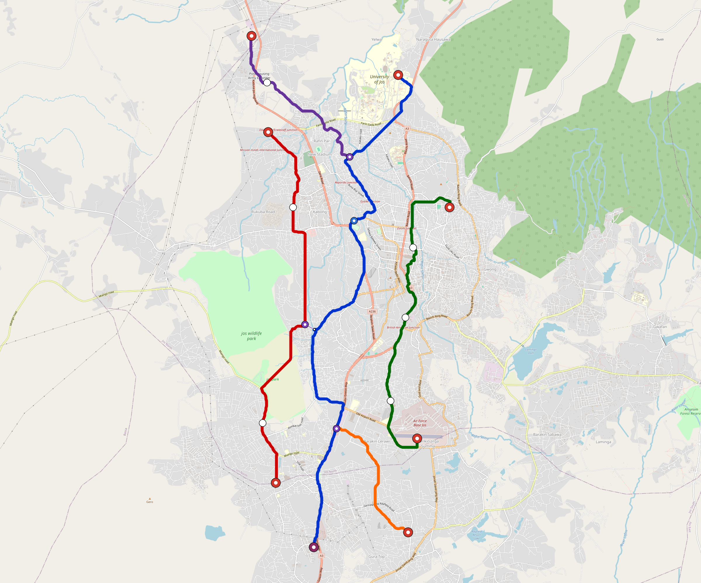

<!-- osr-maglev-primary:start -->
> **Primary v0.5 ferrite-maglev planning:** [Open the current city planning package](engineering/maglev/README.md). Formation, duty, fleet, charging, depot quantities and partial cost allowances are recomputed; physical acceptance remains open.
>
> The material below this notice is the retained v0.4 wheel/rail comparator. Its costs, fleet, geometry and acceptance do not transfer to maglev.
<!-- osr-maglev-primary:end -->

# Jos — provisional network

**Engineering revalidation pending.** Current geometry and planning quantities are published below. The package remains incomplete; no engineering, manufacturing or physical release is claimed.

[Current design coverage and open gates](engineering/design-system/index.html) · [Exact package status](package-manifest.json).

| Current planning measure | Value |
| --- | --- |
| Lines | 5 |
| Route length | 61.9 km |
| Proposed platform records | 29 |
| Planned fleet | 203 trainsets |

[Source-bound corridor correction](engineering/alignment/network-correction.json) · [Independent geometry and transfer audit](engineering/alignment/network-topology.json).

| Line | Route km | Proposed platforms |
| --- | --- | --- |
| line-1 | 22.4 | 7 |
| line-2 | 15.2 | 5 |
| line-3 | 13.2 | 8 |
| line-4 | 6.2 | 4 |
| line-5 | 4.8 | 5 |

The geometry audit checks the retained water mask, line continuity, grouped platforms and self-intersections. Walking access, levels, detailed structures and site acceptance remain open.

## Evidence awaiting revalidation

Retained operating, energy, clearance and delivery reports apply to their recorded source revisions. This page gives them no current-layout pass. The package manifest lists stale and missing evidence.

[Retained operating evidence](engineering/simulation/validation-summary.json) · [Retained energy evidence](engineering/energy/summary.json) · [Clearance evidence](engineering/clearance/README.md) · [Planning finance and its assumptions](engineering/finance/summary.json).

Planning finance uses controlled assumptions and does not establish bids, funding commitments or operating performance.
