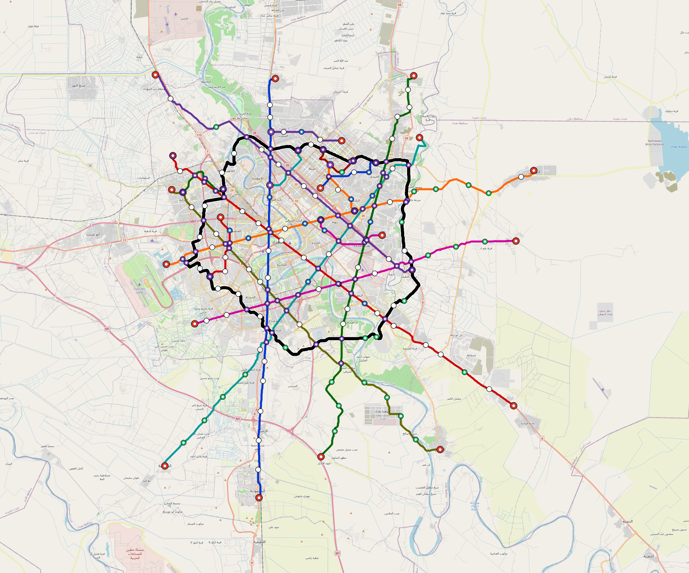
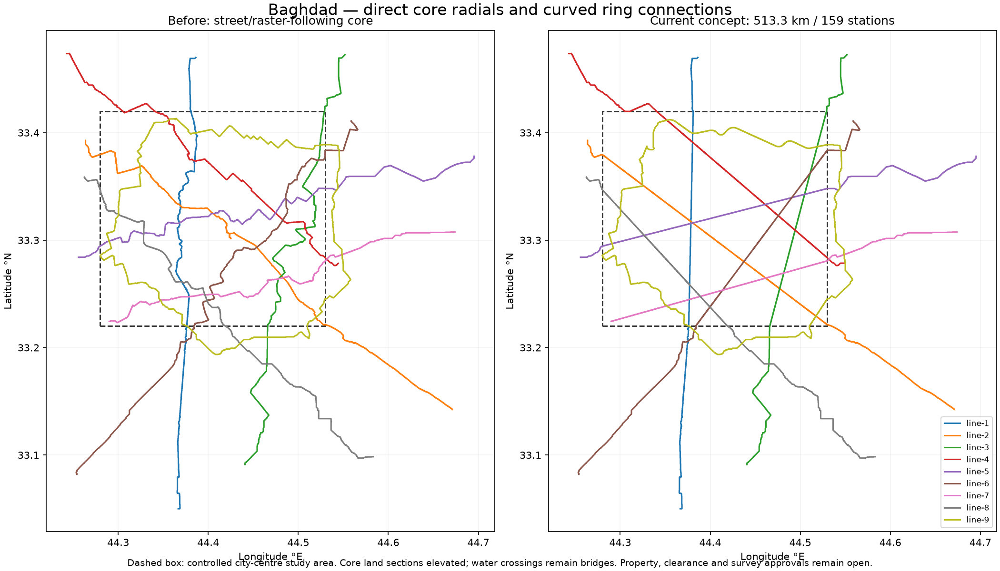
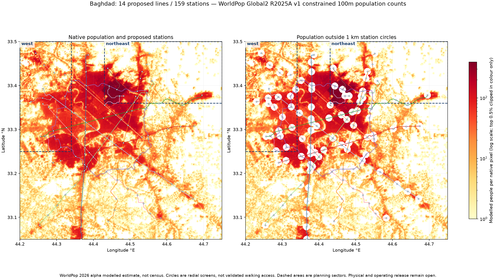

<!-- osr-maglev-primary:start -->
> **Primary v0.5 ferrite-maglev planning:** [Open the current city planning package](engineering/maglev/README.md). Formation, duty, fleet, charging, depot quantities and partial cost allowances are recomputed; physical acceptance remains open.
>
> The material below this notice is the retained v0.4 wheel/rail comparator. Its costs, fleet, geometry and acceptance do not transfer to maglev.
<!-- osr-maglev-primary:end -->

# Baghdad — Urban Rail Network

[Current design coverage, geometry and open gates](engineering/design-system/index.html) · [Placed station IFC and map](engineering/federation/index.html).

**Country:** IQ · **Population:** 9,780,429 · [Current Iraq planning basis](../NATIONAL-BRIEF.md)

**Current planning basis: 2026-10-04 [programme recalculation](engineering/programme-recalculation/README.md), `local_positive` conditional local-production case.** The main route is the reworked city-centre elevated planning alignment; service remains a capacity-led assumption. Revised scope is unquoted and uncommitted; this is not a construction design or an operating release.

[Connected construction and battery study, 2026-10-06](engineering/connected-build/README.md) now reconciles island topology, 18 launchers/two shifts, supplier/logistics constraints, equipment cash and sodium alternatives. Its full-network energy duties report service shortfalls; supplier contracts, installed-rate credits and accessible-entrance coverage remain unqualified. The financial figures below are retained comparators and do not include an accepted accelerated-build saving. Base programme planning allowance is **USD 8.667bn**, including line-local depots, final assembly and selected upstream component plants. Assumed facilities cover the modelled cash deficits; their placement is uncommitted, and the case retains **IQD 0.000tn terminal debt**. Local special/segmental structures, installed grid/charging upgrades, actual foundations, land and utilities remain unpriced. Removing search penalties establishes no realised saving. Older catalogue financial passes establish arithmetic for their own assumptions, not viability of this revised scope.

## Network

**Lines / unique stations / interchanges:** 14 / 159 / 45; **Route length:** 513.3 km double track; **Direct transfers / reachable line pairs:** 39.6% / 100.0%; **Residents within 800 m radial station catchments:** 1,129,864 (2020 raster; 18.9% of bbox).

**Service span / peak headway:** 05:30–02:00 / 3 min; **Fleet:** 809 × 6-car `metro-6car` trainsets (728 peak revenue); **Peak network throughput:** 403,200 passengers/hour; **Practical service capacity:** 3,615,840 passenger-trips/day.

**Annual paid-trip planning range:** 659.9–1055.8 M.
### Lines

| Line | Length | Stations | Trainsets | Termini |
|---|---:|---:|---:|---|
| line-1 | 49.1 km | 17 | 86 | S Outer ↔ N Outer |
| line-2 | 52.9 km | 14 | 95 | SE Outer ↔ NW Mid |
| line-3 | 49.5 km | 16 | 90 | S Outer ↔ NE Outer |
| line-4 | 41.9 km | 12 | 76 | NW Outer ↔ E Mid |
| line-5 | 47.3 km | 16 | 86 | W Mid ↔ E Outer |
| line-6 | 52.5 km | 16 | 95 | SW Outer ↔ NE Mid |
| line-7 | 40.0 km | 13 | 72 | E Outer ↔ SW Mid |
| line-8 | 48.1 km | 15 | 89 | SE Outer ↔ NW Mid |
| line-9 | 97.7 km | 26 | 45 | NW Mid ↔ NW Mid |
| line-10 |  6.8 km | 3 | 15 | N Mid ↔ NE Mid |
| line-11 |  6.9 km | 2 | 14 | N Mid ↔ N Mid |
| line-12 |  6.6 km | 3 | 15 | NW Mid ↔ NW Outer |
| line-13 |  8.0 km | 4 | 18 | W Mid ↔ W Mid |
| line-14 |  6.0 km | 2 | 13 | N Inner ↔ NE Mid |
| **Total** | **513.3 km** | **159 unique** | **809** | |

Population access uses retained native count pixels where available; radial catchments require pedestrian/feeder validation. The former demand-score resident proxy is retired. [Access and transfers](engineering/access/README.md) · [Building, support and terrain clearance](engineering/clearance/README.md).

## Energy

**Scheduled service:** 6,278 one-way journeys / 215,989 train-km/day; **Annual traction demand:** 2,043.4 GWh; **Station/depot PV / storage:** 46.4 MW / 316.0 MWh; **Aggregate charging power:** 278.0 MW.

**Dedicated solar plant:** 1,019.7 MW; **Residual grid/PPA import:** 0.0 GWh/yr; **Worst powered-stop gap:** line-6: 18.9 km / 305 kWh; **Lowest traversal charging margin:** line-11: 74 kWh.
These energy quantities describe the current regenerated scenario. Zero annual residual grid import is an accounting balance, not accepted hourly autonomy. Depot charging/grid upgrades, duty and launch conflicts remain open.

## Current capital and operating people

| Revised capital scope | USD equivalent million |
| --- | --- |
| Civil and bearing allowance | 4,058.152 |
| Stations and core elevated access | 1,269.500 |
| Rolling stock | 1,219.590 |
| Final assembly and component plants | 416.253 |
| Line-local depots | 289.645 |
| Solar and charging | 874.140 |
| Signalling and programme overhead | 539.271 |
| **Total programme** | **8,666.552** |

There are **14 depots**, one per line, with **809 storage slots** for all 111 m six-car trains plus clearance. Depot reference capital is **USD 289.645m**, replacing the old USD 8m once. Workshop bays are sized separately by workload. The current case gives no capacity credit to station stabling. Actual land, foundations, connected access, installed charging and morning launch acceptance remain open. [Depot quantities](engineering/programme-recalculation/depots.json) · [Items](engineering/programme-recalculation/depot-items.csv).

The operating establishment is **3,523 FTE**, including **1,572 station-cover FTE**. Two staff per station and two normal eight-hour shifts give 636 daily shift assignments; retained 20.5-hour service also funds late cover and weekly/leave/training/sickness relief. Loaded annual payroll is **IQD 83.415bn**, with subsequent OPEX inflation. General pay starts at **IQD 1,175,455/month**, 50% above the historical employee median indexed to 2026. Technical/supervisor/senior/director grades are separate; this is not a newly measured median. [Roles and wages](engineering/programme-recalculation/workforce.csv).
Final assembly has 1215 production and 183 support FTE; selected upstream plants add 290 production and 45 support FTE. Their 59 paid production months are separate from permanent railway jobs. [Construction crew screen](engineering/programme-recalculation/construction-workforce.json) is incomplete; contractor labour is already inside contract rates.

## Iraqi manufacture and USD capital exposure

**bogie:** 9708 (Local process option); **motor-inverter-set:** 9708 (Local process option); **battery-225kwh-pack:** 4854 (Local process option); **door-cassette:** 19416 (Local process option); **window-cassette:** 29124 (Bought component).

Imported process machinery supports the selected Iraqi fabrication and assembly options shown above. Cells/BMS, wheels/axles/bearings, inverters and other critical inputs retain imports. Products with negative Baghdad-only whole-order margins remain bought in this case. Plant readiness/qualification within 18 months is assumed, not demonstrated. [Make/buy appraisal](engineering/programme-recalculation/component-make-buy.csv).

Compared with the matched bought-component case, capital changes from USD 8.795bn to USD 8.667bn; imported invoice exposure changes from USD 2.358bn (26.82%) to USD 2.016bn (**23.27%**). The historical 148 km / USD 18bn proposal has a different scope and assumed all-USD funding; it is not a matched tender saving.

## Current funding and cashflows

Government capital is exactly **25%**. Imports use **50% government USD cash / 50% proposed Chinese USD credit**. Only Chinese debt is USD; the rest of government cash, bonds, bank/gap credit and mezzanine is IQD. Government invoice downpayments are scheduled within the total 25% contribution. FX is the historical planning anchor of IQD 1,300/USD.

| Capital-only source | Currency | Native amount |
| --- | --- | --- |
| Government import cash | USD | 1,008,216,375 |
| Government local cash | IQD | 1,505,948,192,086 |
| Chinese capital credit | USD | 1,008,216,375 |
| Ordinary capital bonds | IQD | 4,182,186,517,697 |
| Green capital bonds | IQD | 1,147,843,845,665 |
| Senior bank capital credit | IQD | 1,776,676,787,787 |
| Conditional climate grant | IQD | 32,500,000,000 |

Interest/fees, reserve cash, OPEX and gap facilities are additional cashflows, not capital added twice. Fares, kiosks, advertising, additional receipts and fare/OPEX indexation are included. Green/grant/rights terms and concessional gap credit remain uncommitted. Conditional first/full line revenue is month **40 / 81**; physical and financing gates are open.

The tested IQD mezzanine leaves 81 defaulted draw vintages and increases terminal debt to IQD 0.000tn. It does not establish sustainable repayment. [Monthly cashflow](engineering/programme-recalculation/local_positive-monthly.csv) · [Six-month bond/loan placements](engineering/programme-recalculation/local_positive-semiannual.csv) · [All 13 cases](engineering/programme-recalculation/README.md) · [Cost and demand review](../../../../../docs/baghdad-cost-and-demand-review-2026-10-05.md).

## City-centre elevated alignment

The main design uses straight core radial tangents and broad curved ring connections where the retained water evidence permits them, inside the explicit 33.22–33.42°N / 44.28–44.53°E study area. Shoreline detours retain their separate curve and structure review gates. Land sections there are elevated; water crossings remain bridges. The final water-constrained core routes change from **301.670 km to 286.225 km**. The main network is **513.336 route km**, with **56.73% elevated** across the whole system. Maps, station placement, fleet, civil quantities, staff and finance use that reworked design. [Analytical controls and limitations](engineering/alignment/core-realignment.json).

Property/air rights, obstacles, protected sites, surveyed heights, utilities, piers, foundations, transition curves and vertical alignment remain open. Existing outer approaches retain street/raster bends; exceptional geometry still requires realignment or special products. Additional outer grade-separation sensitivities add 7.924 km and retain current dates; they are not the adopted core geometry or an achieved routing-penalty saving.

## Neighbourhood population and mapping sources

Native WorldPop 2026 counts guide the compact corridor additions, with separate GHSL 2025 and retained WorldPop 2020 comparisons. The 2026 epoch is an alpha modelled projection using older population inputs, not the 2024 census. Planning sectors are explicit rectangles, not administrative boundaries.

| Sector | Modelled native population | Within 1 km of emitted stations | Outside station circles |
|---|---:|---:|---:|
| northeast | 2,197,150 | 38.4% | 1,353,322 |
| west | 1,459,449 | 29.6% | 1,027,430 |

Measured Baghdad traffic counts, speeds and OD demand remain unavailable. Pedestrian topology is screened on a dated OSM graph; station entrances, snap connections, sidewalks and accessible paths remain unverified. Station circles are potential radial access, not validated walking coverage or paid trips. [Source comparisons, licences and neighbourhood gaps](engineering/mapping/README.md).

## Evidence and regeneration

[Complete proposal PDF](Baghdad-Proposal.pdf) · [Editable proposal](BAGHDAD-PROPOSAL.md) · [Supporting data](Baghdad-Proposal-Supporting-Data.zip) · [Planning-only ERP drafts](engineering/programme-recalculation/erp-planning-drafts.json) · [Original catalogue finance](engineering/finance/FUNDING-MODEL.md) · [Original depot/stabling screen](engineering/depot-scope/README.md). Simulation, energy and asset evidence uses the current reworked geometry; the new staffing/depot/factory plans do not create accepted sites, appointed employees or operational assets.

Auto-planned by the OpenSourceRail design pipeline. Shared assumptions are in the [deployment planning reference](../../../../../docs/deployment-planning-reference.md). Inputs: [design](design.toml), [scenario](baghdad.toml), [map](baghdad-network-map.png), [package evidence](package-manifest.json). City-local [simulation](engineering/simulation/validation-summary.json), [energy](engineering/energy/summary.json), [GIS](engineering/gis/summary.json), [operations](operations/acceptance-evidence-report.md) and [delivery](engineering/delivery/README.md) retain their recorded planning/release gates. For presentation-only updates, run `.venv/bin/python tools/automation/publish-city-summary.py`; add `--check` to detect drift. The city regeneration pipeline uses this publisher. A stale scope study stops publication rather than silently restoring the original cost headline. Publication provenance is in [publication-manifest.json](publication-manifest.json).
