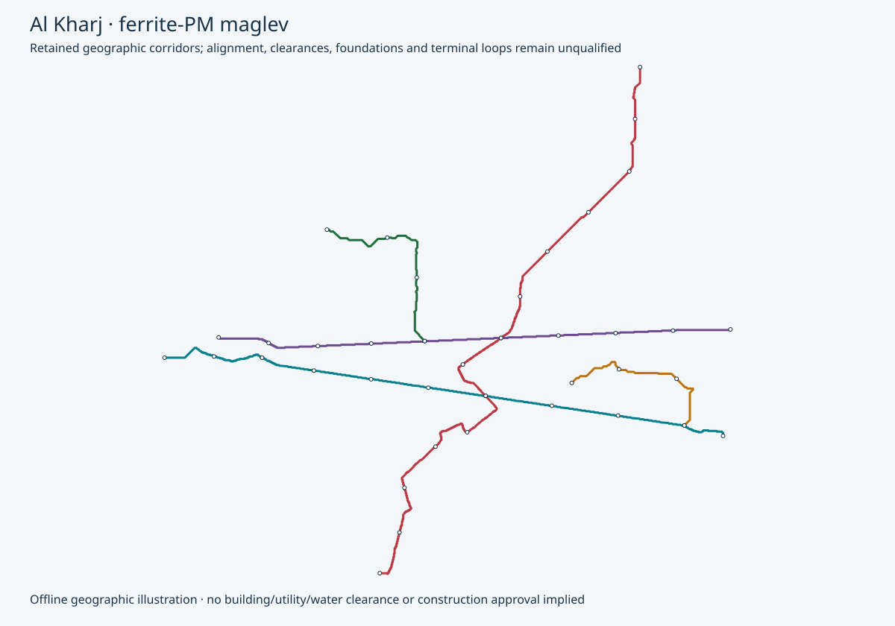

<!-- osr-maglev-primary:start -->
# Al Kharj — PM-maglev station-launched monorail

**Country:** SA · **Retained population input:** 400,000

**Design objective: broad urban access with low CAPEX, low OPEX and affordable debt repayment, while building domestic manufacturing and maintenance capacity.**

This brief restores network, service, energy, funding and local-production detail for the current PM-maglev city inputs. Old wheel/rail fleet, coverage, energy and savings figures are not transferred. Physical and manufacturing acceptance remain open.

| City planning measure | Current result |
|---|---:|
| Fixed lines / mapped transfer junctions | 5 / 4 |
| Measured corridor route length | 75.3 km, two directional guideways |
| Proposed mainline line-stop packages | 43 |
| Original station access records retained | 28 |
| Additional terminal motor zones / midway boosters | 20 / 21 |
| Provisional fleet / cars | 88 / 264 |
| Equivalent scheduled train-km/day incl. loops | 32,269 |
| Capacity-shortfall lines / transfer-spacing conflicts | 5 / 0 |
| Accepted engineering / physical releases | 0 |

Line-stop packages count platforms on independent lines separately, not unique station buildings. Retained population is a planning input, not a measured catchment. Walking catchments, coverage, accessibility and paid-trip forecasts need regeneration against proposed sparse stops; no old coverage percentage is inherited.

## Lines and service

| Line | Route km | Stops | Cars / AW2 passengers | Peak / total trains | Headway s | AW2 passengers/h/direction | Service hours/day |
|---|---:|---:|---:|---:|---:|---:|---:|
| line-1 | 20.3 | 11 | 3 / 360 | 19 / 22 | 270 | 4,800 | 20.5 |
| line-2 | 24.9 | 14 | 3 / 360 | 23 / 27 | 260 | 4,985 | 20.5 |
| line-3 | 17.2 | 10 | 3 / 360 | 16 / 19 | 280 | 4,629 | 20.5 |
| line-4 | 6.0 | 4 | 3 / 360 | 8 / 10 | 260 | 4,985 | 20.5 |
| line-5 | 6.9 | 4 | 3 / 360 | 8 / 10 | 270 | 4,800 | 20.5 |

Headways are the current exclusive protected-resource comparison, not an accepted timetable. Urban stops target1.5km minimum/about2km average; classified suburban legs target4–5km with located acceleration where needed. Junctions transfer passengers between fixed lines. Close transfer nodes, terminal loops and capacity shortfalls remain explicit design work.

## Why this architecture

**The main proposition is useful city-wide reach with less construction capital, operating expenditure and long-term debt repayment.** PM-maglev station-launched monorail is the means being investigated. Affordability and domestic capability must be demonstrated at equal passenger service.

| Intended advantage | Design mechanism | Evidence and cost test |
|---|---|---|
| Affordable reach | Compact repeated elevated beams, straight demand-led tangents and independent fixed lines with passenger transfers. | Compare complete CAPEX per route km and residents served; survey access, rights, ground and crossings. |
| Simpler rolling stock | Station/located-booster LSMs replace onboard main traction motors and inverters; passive ferrite bias with active support remains. | Price retained coils, drives, sensing, braking, cooling, batteries, doors and HVAC; measure mass, energy and maintenance. |
| Station-led GOA4 dispatch | Prepare receiving resources, prove doors/platform safe, commit launch, verify full-tail clearance, then consider the following departure. | Retain separation, stopping authority, receiving readiness, intrusion detection, integrity, protection and degraded recovery. |
| Domestic productive capacity | Local precast units, GFRP bodies, steel carriers, winding cassettes, wiring, Rust integration and serial QA. | Audit imported raw materials, semiconductors and machine tools; count domestic value added rather than a local supplier address. |
| Lower operating burden | Aim for less contact wear, fewer propulsion components per moving vehicle and repeatable wayside maintenance. | Include support power, launch losses, staff across shifts, rescue, maintenance, renewals and availability; no automatic saving percentage. |
| Manageable repayment | Phase useful corridors; minimise whole-life public cash and foreign-currency borrowing alongside construction cost. | Separate resource cost, borrower cash, imported procurement and debt currency; demonstrate affordable annual funding before expansion. |
| Open and repairable systems | Published hardware/process quantities, reproducible Rust tests, interchangeable interfaces and local tooling skills. | Qualify interfaces, independent assurance, spares and second sources; software licences alone do not qualify a train. |

## CAPEX, OPEX and debt repayment

**Affordability is a design objective:** maximise useful coverage and domestic capability per unit of construction capital, annual operating cash and debt repayment.

These scope-covering scenarios add explicit allowances to the existing partial quantity bill. They are unquoted budget sensitivities; the complete engineered estimate and funding offer remain open. Values are constant USD.

| Scenario | Budget CAPEX | Annual OPEX | Annual debt service | Annual OPEX + debt | 30-year operating life + construction borrower cash |
|---|---:|---:|---:|---:|---:|
| low | $659.6m | $20.7m | $21.1m | $41.8m | $1,571.8m |
| base | $1,290.9m | $62.7m | $85.3m | $148.0m | $4,356.0m |
| high | $2,822.3m | $204.7m | $315.4m | $520.1m | $13,214.2m |

The combined annual figure excludes irregular renewal payments; those are included in the full cash schedule. Construction interest and fees are paid separately. Resource cost counts CAPEX once; borrower cash counts equity and loan repayments, avoiding a second count of financed principal.

| Scenario | Debt / equity CAPEX | Foreign-currency debt | Total construction + repayment interest | Whole-life resource cost | Discounted resource cost |
|---|---:|---:|---:|---:|---:|
| low | $329.8m / $329.8m | $82.4m | $231.0m | $1,334.2m | $841.3m |
| base | $903.7m / $387.3m | $451.8m | $960.5m | $3,377.5m | $1,952.8m |
| high | $2,399.0m / $423.3m | $1,919.2m | $2,931.8m | $10,234.5m | $5,389.1m |

[Every allowance, energy component, finance assumption and yearly cash flow](engineering/maglev/summary.json) → `affordability`. Five construction years and 30 operating years are hypotheses. No fare or subsidy revenue is assumed. Complete financing must address local-currency revenue, foreign-currency debt, lender terms, resilience and renewal funding.

The same-service procurement sensitivity assumes 1.5× CAPEX and 1.1× OPEX, without changing coverage, timetable, loan rate or tenor. It illustrates the effect of procurement cost and foreign borrowing; it is not an independently priced alternative. Proven cost advantage and local-content percentages remain open.

[Whole-life appraisal reference](https://www.gov.uk/government/publications/the-green-book--2/the-green-book-2026). [UKEF Buyer Credit](https://www.gov.uk/guidance/buyer-credit-facility) can finance up to85% of an eligible export contract, subject to assessment; that does not establish85% financing of this city programme. [UK content requirements](https://www.gov.uk/government/publications/ukefs-approach-to-foreign-content/ukefs-approach-to-foreign-content) need a transaction-specific content schedule. No UKEF approval, tariff, lender commitment or economic multiplier is assumed.

## Energy and operating cost detail

| Scenario | Annual services supply GWh | Positive traction GWh | Extra fixed-zone losses GWh | Station auxiliaries GWh | Electricity USD/kWh | Annual energy cost | Annual staff cost | Annual maintenance/admin allowance |
|---|---:|---:|---:|---:|---:|---:|---:|---:|
| low | 79.8 | 28.4 | 88.4 | 3.8 | 0.06 | $12.0m | $2.1m | $6.6m |
| base | 79.8 | 28.4 | 132.5 | 9.4 | 0.12 | $30.0m | $6.8m | $25.8m |
| high | 79.8 | 28.4 | 220.9 | 18.8 | 0.25 | $87.0m | $19.0m | $98.8m |

Hot services and station auxiliary demand are conservative planning allowances, not measured consumption. Positive traction includes no regeneration credit. Additional winding/conversion losses use explicit8/12/20kWh per fixed-zone event, including separately counted boosters; these are sensitivities rather than measured route-specific loss maps. Reserve/depot movement, missed charging, wind, grade, full field maps, electrical diversity and supply resilience need further duty studies. No automatic solar or grid-independence credit is applied.

## Station-led GOA4 operation

Normal operation centres on the station: reserve a protected receiving path/berth, prove vehicle support and services ready, prove doors/platform safe, prepare and commit the finite powered launch, monitor coast/booster/arrival, then release each resource with valid train-identity and full-consist clearance evidence. A leading train leaving a station can make its berth available to the next train once its entire tail is proved clear and the following movement has protected authority. A launch command or elapsed timer alone does not release occupancy.

Fixed lines eliminate mainline route-switch choices. Wayside launch/receive equipment concentrates primary propulsion and dispatch infrastructure at known sites. Independent onboard support/guidance current control and protection continue during coasting. Receiving plant must remain protected after launch; a fault cannot be resolved by simply cancelling a coasting train.

Current city fleet/capacity calculations retain exclusive whole-leg reservation. The separate progressive-departure Rust candidate tests release behind a verified full tail, finite stopping envelopes and faults at180s headway. Local results have not qualified route-wide distributed detectors, cross-controller authority, degraded recovery or a city timetable. Driverless/GOA4 is the operating target, without operational authorisation or an assumed zero staff budget. [ORR unattended-operation principles](https://www.orr.gov.uk/sites/default/files/2024-07/railway-safety-principles-factors-for-safe-operation-of-goa4-uto.pdf) are a design reference for departure, passenger protection and degraded operation; they are not Iraqi operational approval.

## Energy and local delivery

Energy uses daily service windows capped by current resource headways, hot full-load services duty, positive traction without regeneration credit, charging conversion, additional fixed-zone losses and station auxiliaries. Each affordability case exposes its tariff and loss assumptions. PV, storage, backup, depot movements and electrical diversity need site sizing; no zero-grid-import promise is inherited.

Factory routes cover precast mould/cage/cast/cure/survey, GFRP layup/cure/hardpoints, iron/carrier fabrication, ferrite cartridge assembly, coil winding/impregnation, LSM cassette and power-cabinet assembly, software/IO tests and serial QA. Erection requires surveyed access, crane-at-radius checks, temporary stability, positively locked connections and final alignment. Quantities, equipment leads and process steps are in the manufacturing bill.

Prioritise machinery verified as made in Britain when UK capability is needed, and maximise qualified local manufacture/repair in the destination country. Imported inputs, machine tools, electronics and specialist services need order-specific origin and price records. Local-content percentages, jobs and economic multipliers remain unquantified.

## Phased realisation and evidence

Start with a useful connected corridor, its depot/energy/rescue access and the factory capacity it needs. Prove that service before committing the next production batch. Phase boundaries, minimum useful network, demand, procurement, lender terms and annual affordability require a city business case; the five-year drawdown is a sensitivity rather than an approved programme.

[Full city design, limitations and open gates](engineering/maglev/README.md) · [Structured service, CAPEX/OPEX and annual debt cash flows](engineering/maglev/summary.json) · [Manufacturing bills and UK equipment leads](engineering/maglev/manufacturing.json) · [Preserved geography and demand](engineering/maglev/retained-records.json)

Regenerate with `./osr city al-kharj`. The same detailed template and whole-life arithmetic apply across the catalogue.
<!-- osr-maglev-primary:end -->
