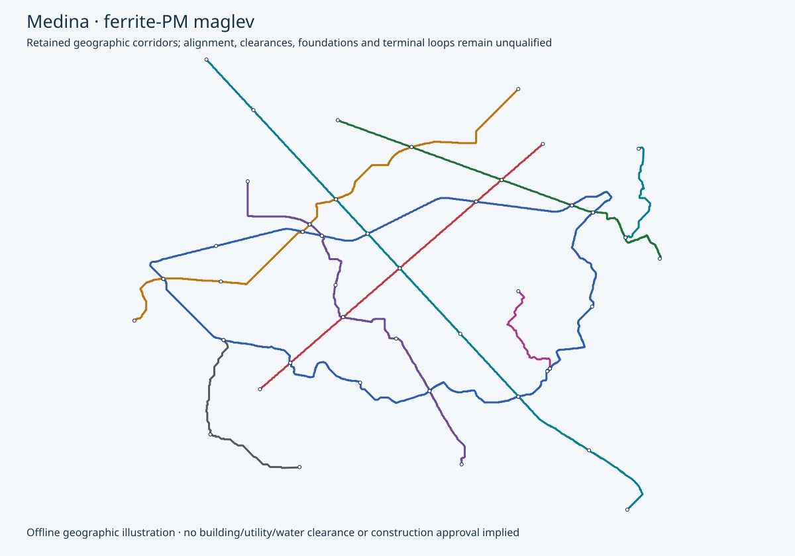

# Medina — v0.5 maglev city planning

Provisional planning from retained geography, station demand and service schedules. All physical and manufacturing release flags remain false.

9 lines; 208 provisional trainsets / 832 cars; 187,200 kWh gross onboard storage.

| Line | Cars | AW2 / AW3 | Body length m | Topology | Peak / total trains | Dwell s |
|---|---:|---:|---:|---|---:|---:|
| line-1 | 4 | 480 / 640 | 68 | fixed-terminal-loops | 32 / 37 | 131 |
| line-2 | 4 | 480 / 640 | 68 | fixed-terminal-loops | 21 / 25 | 119 |
| line-3 | 4 | 480 / 640 | 68 | fixed-terminal-loops | 24 / 28 | 115 |
| line-4 | 4 | 480 / 640 | 68 | fixed-terminal-loops | 27 / 31 | 134 |
| line-5 | 4 | 480 / 640 | 68 | fixed-terminal-loops | 21 / 25 | 115 |
| line-6 | 4 | 480 / 640 | 68 | two-independent-directed-circuits | 28 / 32 | 110 |
| line-7 | 4 | 480 / 640 | 68 | fixed-terminal-loops | 8 / 10 | 124 |
| line-8 | 4 | 480 / 640 | 68 | fixed-terminal-loops | 10 / 12 | 116 |
| line-9 | 4 | 480 / 640 | 68 | fixed-terminal-loops | 6 / 8 | 124 |

Retained ring wrap distances do not close the complete geographic route. Recomputed closure adds the following distances to the input wrap values; actual closure alignment remains open: line-6 1,140.7 m.

**Integrated-beam/no-walkway target:** door-mounted evacuation is a study candidate. Continuous walkway removal is not approved. Necessary iron reaction faces, supports/foundations, joints and protection remain. 4992 onboard packs are a provisional door-count hypothesis; new mass, lifetime cost and net savings are unknown. Landing space, accessible alternatives, fire/weather/fault conditions and rescue/maintenance access must be proved along the complete route.

**Predominantly elevated strategy:** 99% mainline elevation target; all ordinary sections proposed elevated. Ordinary viaduct planning length 198.938 km includes 24.728 km converted from retained at-grade scope. Special crossings remain separate and unpriced.

Straight tangents are preferred between demand anchors. Existing geographic alignments have not been rerouted or proved clear. Buildings/air rights, road and utility clearances, piers/foundations, wildlife/water passage, station access and construction access require evidence. Elevation does not establish zero displacement or zero environmental impact.

Formation matches both retained AW2/AW3 loads. Body lengths exclude unresolved couplings/overhang; platform allowance is a planning screen. Fleet is recomputed from hot AW3, no-regen straight/level duty and retained peak headways, with 10% spares rounded up and one cold reserve per line.

Radials use unlocated fixed terminal loop allowances; rings use two independent directed circuits. A 100 m radius / 20 km/h loop allowance is not approved geometry. Depot-only switches or transfer devices require separate hardware, access and recovery qualification.

Station charging is screened at 600 kW per car, with dwell extended to cover the worst incoming hot/no-regen leg and terminal loop. Multiple berths implied by dwell/headway require a conflict-free physical layout. Losses, taper, grade, curve forces, emergency reserve and missed charging remain open. No grid/PV/storage or site release is asserted.

| Scenario | Repeat fleet allowance USD | Ordinary elevated allowance USD | Partial subtotal USD |
|---|---:|---:|---:|
| low | 140,755,680 | 663,695,507 | 804,451,187 |
| base | 187,674,240 | 884,927,343 | 1,072,601,583 |
| high | 281,511,360 | 1,327,391,015 | 1,608,902,375 |

**Complete city programme cost remains unknown.** Partial allowances price each formation by car, coupling and shared train systems, plus measured section/reaction-steel quantities and explicit process assumptions per ordinary elevated route km. They exclude site-specific conversion/clearance premiums, terminal loops, special/bridge works, stations, depots, energy, controls, land, NRE/plant, EPC and other scope listed in the structured report. Rates and productivity assumptions require supplier and site validation. Complete project costs and localisation remain unknown.

Open acceptance work:

- retained-geography: Survey, utilities, land, water crossings, terrain, ground investigation and alignment reconciliation; retained mapping is geographic evidence only.
- formation-platform: Close coupling pitch, full magnetic lifting-face/guidance-arm/below-floor swept envelope, door/egress layouts, actual mass and equal AW2/AW3 qualification. The 2.65 m cabin width does not bound running gear or platform clearance.
- field-control: Obtain force/loss maps and rig correlation, six-axis stability, target timing and independent support/capture/braking protection.
- terminal-topology: Locate fixed loops/ring closure, qualify curvature, clearance and land, and provide switch-free failure recovery.
- elevated-alignment: Locate the predominantly elevated straight-tangent proposal and verify buildings/air rights, road/utility clearance, wildlife/water passage, piers, station/egress and construction access; no zero-impact claim from elevation alone.
- civil-release: Redesign guidebeam/passive rail, supports/foundations, joints/tolerances, movement, gap dynamics, evacuation and erection.
- route-duty: Run approved grade, curve, wind, hot, low-voltage, full-SOC, no-regen, missed-charge, failed-channel and rescue duty.
- fleet-timetable: Validate headway/conflicts, station berth throughput, dispatch, maintenance rotation, degraded service and reserve.
- charging-microgrid: Place charging interfaces and prove taper, power quality, PV/storage/backup sizing and adverse-weather replenishment.
- depot-access: Locate line-local storage/workshops and qualify depot-only connection/transfer, isolation, inspection, towing and recovery.
- programme-cost: Price all station/land/loop/bridge/at-grade/depot/energy/control/production/QA/NRE/spares/OPEX scope, origin-trace MBOM and apply EPC once.
- physical-release: Close G0–G5 through authenticated independent physical acceptance; planning arithmetic is insufficient.

## Manufacture and erection

Local work is proposed for repeated frames, cartridges, coils, concrete units and system integration. Input origins and local value added remain unverified. Factory capacity and programme duration require measured cycle times, cure/release criteria and site access.

- **beam**: qualify concrete and reinforcement → assemble reusable mould and cage → stress approved tendons → cast and monitor cure → verify release strength → demould and survey → install reaction faces → proof/inspect serialised element.
- **supports**: investigate utilities and ground → qualify foundation type → prefabricate cage/pier where feasible → construct foundation → erect and temporarily stabilise pier/cap → survey bearing seats.
- **vehicle**: cut and form simple repeat panels/members → join on dimensional fixtures → inspect joints → install doors, glazing and interior → integrate batteries, HVAC and safety systems → weigh and survey finished car.
- **magnetics**: qualify ferrite and core steel → machine carriers and reaction faces → wind and insulate coils → impregnate and cure → assemble replaceable cartridges → map force/loss/temperature → calibrate independent sensing.
- **erection**: survey delivery corridor → verify lift plan and crane at radius → deliver and lift beam → locate and positively lock engineered joint → survey reaction faces → complete serial QA traveller → test integrated route section.
- **software**: build reproducible Rust control → execute oracle/fault/deadline tests → bind exact geometry and force-map revision → test isolated SBC I/O and independent trips → measure worst-case timing → perform integrated rig and route tests.

UK equipment candidates are capability leads, not prices or approved purchases. Rotary coil winding and CCL prestressing have explicit UK-manufacture statements; complete configuration, ratings and origin schedules remain open. See the linked manufacturing bill for dated primary sources.

[Structured plan](summary.json) · [Preserved geography/demand records](retained-records.json) · [Quantity bills, manufacturing routes and factory equipment](manufacturing.json)

The structured plan binds current source bytes and manufacturing bills with SHA-256.

[Primary planning method](../../../../../../../engineering/ferrite_maglev/README.md)

<!-- Generated by engineering.ferrite_maglev.cities; primary planning only. -->
