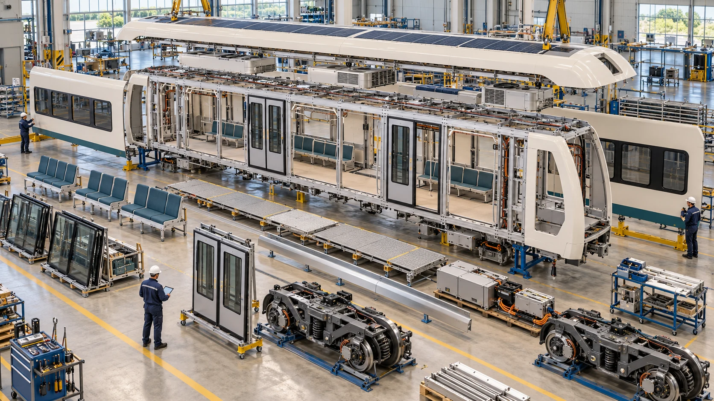

# Why build an open railway

Urban transport shapes where people can live, study and work. A new railway
can shorten journeys and make a city more accessible, but it also commits the
city to decades of structures, vehicles, energy use, staffing, renewal and
repairs. OpenSourceRail starts from that lifetime commitment. Its aim is an
affordable railway that carries useful numbers of passengers in ordinary
service and leaves the owner able to understand and improve what it has built.

The project joins three products. The first is an open set of design and
delivery tools: city planning, engineering models, quantities, prices,
manufacturing plans and maintenance records. The second is the railway and its
industrial system: trains, stations, guideways, workshops, tools and repair
methods. The third is open control software, researched for train protection,
supervision and faults. The software can be developed and tested before there
is a railway; it cannot authorize movement of an unqualified train.

## Local capability is part of the design

Local manufacture is more than a final assembly address. A workshop needs
drawings, materials, process knowledge, inspection methods, fixtures, replacement
parts and the authority to revise a design. Concrete precasting, structural
fabrication, interiors, wiring, winding, assembly and routine maintenance may
offer different opportunities in different places. Specialist bearings,
electronic devices, cells or safety equipment may still come from outside the
country. The origin and value added of each item should be recorded honestly.

Repairability changes engineering choices from the start. A removable panel
needs accessible fasteners and space for a tool. A door mechanism needs a route
out of the car. A bogie needs lifting points, service clearances and a realistic
replacement sequence. A beam or bearing must be inspectable after installation.
These details may add a little material or a manufacturing step, yet reduce
years of downtime and dependence on one supplier.

*Concept illustration. The body, bogies, doors, glazing and interior appear as
separable assemblies; their actual workshop methods and tolerances require
controlled design work.*

## Compare complete systems

Transport concepts are often compared using one attractive number: a vehicle
weight, a top speed or the price of a beam. A useful decision needs a common
passenger service and a complete system boundary. A light vehicle may require
more expensive propulsion equipment. A shorter station may need more trains.
A low initial price may increase energy, maintenance or renewal costs. The
design tools therefore carry the same candidate through vehicle, civil,
electrical, service and economic accounts before ranking alternatives.

Some inputs can be calculated early, while others require a survey, a supplier
or a physical test. The early estimate should show that difference. Unknown
ground conditions do not become free foundations; unlocated equipment does not
become a zero-mass vehicle. This makes the design more useful to a city even
when it is incomplete, because the next decision and the cost of uncertainty
are visible.

Open design knowledge also makes independent challenge possible. Another
engineer can inspect an assumption, repeat a calculation, propose a different
material or test a different train. A failed option remains valuable if it
shows which constraint matters. OpenSourceRail's long-term value is therefore
not one claimed winning configuration. It is a method for creating, checking
and improving practical railway choices while retaining public knowledge of
why each choice was made.
