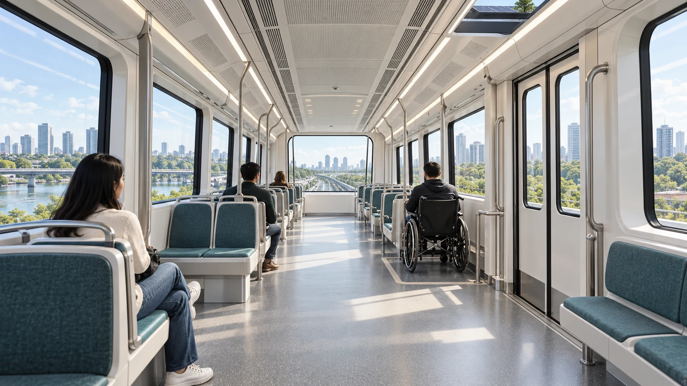

# The passenger journey

A railway starts as a promise to people: reach the station, enter it, board
safely, travel comfortably, make a connection and leave without unreasonable
delay. The physical design should be judged against that journey. A drawing of
a fast train says little about walking distance, crowding, step-free access or
what happens when the service is disrupted.

## Access before speed

Station spacing changes the balance between access and travel time. More stops
can shorten the walk but add dwell, braking and acceleration. Fewer stops can
speed a train while moving the benefit away from people who need it. A city
proposal must therefore consider housing, work, schools, public space,
transfers, barriers and the safe routes between them. The exact station point
also affects utilities, property, foundations, entrances and rescue access.

The six-car reference places two doors on one side of each 17-metre car. It
plans 44 fixed seats and two wheelchair places per car, with no planned
standing. Across the train that is 264 fixed seats and 12 wheelchair places.
The seating policy is a comfort decision, not permission to ignore crowd,
evacuation or accidental-load cases. One retained structural control considers
160 people per car; it remains a separate load case even though routine service
is planned for a smaller occupancy.

*Concept illustration. Door positions, boarding gaps, wheelchair circulation,
restraints, fire performance and all installed clearances still need measured
and controlled engineering.*

## A service is more than a timetable

The familiar two-minute interval is a named comparison case. With 276 planned
places per train it yields 8,280 places per hour in one direction by arithmetic.
It does not establish that train protection, dwell, terminal turnback, power or
fleet availability can deliver such a service. A different formation or
headway could be better for a specific city. An earlier 120-person train and
14,400-place comparison remains available for research, but its occupancy and
service assumptions cannot be substituted for those of the current reference.

A credible timetable needs the route geometry, gradients and curves; the
available traction force rather than only the required force; independent
braking under adverse adhesion; station dwell and platform exchange; protected
separation; terminal operation; and recovery from a failed train. Energy and
crew requirements follow from the same timetable. OpenSourceRail retains a
72 km/h launch cap in one stopped-network proposal, but the final speed is a
candidate and corridor decision.

## Ordinary days and difficult days

Passenger protection is most visible when a system fails. The railway must
consider a train stopped between stations, a door fault, loss of wayside
power, a hot day, a wet rail, a closed platform or a blocked evacuation route.
Service batteries support lights, ventilation, communication, doors and
protection where required; they are not traction batteries in the reference
train. Independent brakes and rescue arrangements remain necessary even if a
station propulsion system can recover energy in normal operation.

Accessibility reaches beyond the train floor. It includes station entrance,
lift or ramp reliability, the platform and train interface, wayfinding,
wheelchair and mobility-device space, sensory access and assisted evacuation.
Each proposed station and vehicle change should preserve that complete path.
The images in this chapter show an intention to make travel comfortable and
inclusive. The actual result will depend on tested geometry, operations and
feedback from the people who use it.
