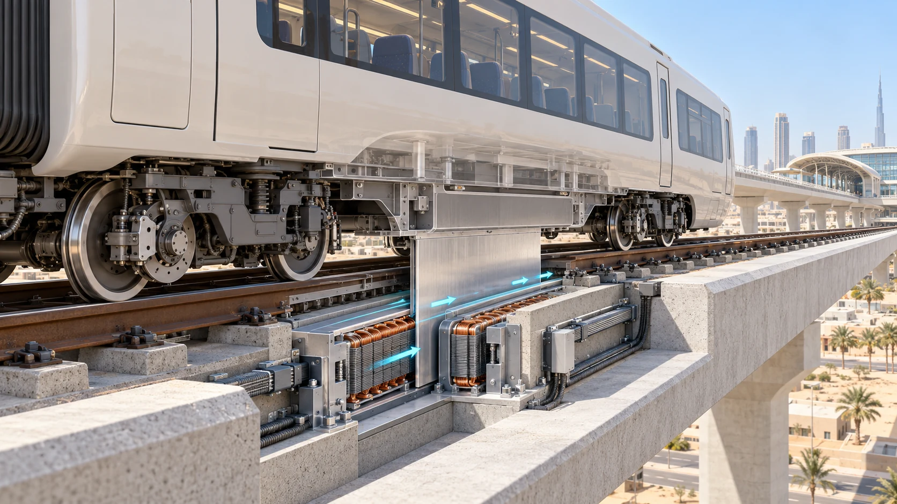

# A reference, with room to explore

The development reference gives the project a common starting point: six
17-metre cars on passive two-axle steel-wheel bogies, running on conventional
rails carried by concrete. The vehicle has no normal-service traction motors,
traction batteries or levitation magnets. A passive aluminium secondary is
retained as an interface for comparing station linear-motor propulsion. It is
an interface choice, not a decision that linear motors have been installed.

This starting point simplifies some questions. A wheel-supported train can
use familiar rail and running-gear principles. Removing normal-service
traction equipment from the vehicle may make a car simpler to maintain, but
puts more work into station equipment and its interfaces. Those system effects
must be counted. Service batteries, independent brakes, protection, HVAC and
rescue equipment still belong on or around the train.

*Concept cutaway. Wheels carry the vehicle; a passive fin sits between
station-side motor primaries. Motor geometry, powered length and repeated-duty
performance are not selected by this image.*

## Change the whole candidate

Research is permitted to challenge the reference. Powered wheels, onboard
recovery, different station drives, alternate bogies, shorter cars, different
formations and civil sections can all be explored. A change is meaningful only
if its consequences are followed through the complete railway. A powered
bogie, for example, adds motors, gearing, converters, cooling, wiring,
protection, mass, maintenance tasks and perhaps different axle loads. It may
remove or reduce wayside propulsion equipment. A fair comparison accounts for
both changes and provides the same passenger service.

The project distinguishes the *physical candidate* from an *evaluation* of
that candidate. If the geometry is unchanged but a new material property or
magnetic-field hypothesis is tested, the physical train has not changed; the
calculation has. A *selection* then records why one candidate is preferred for
a particular purpose. These distinctions keep a favourable result from one
model from being attached to another train without an explicit new evaluation.

| Design question | What must travel with an alternative |
|---|---|
| Vehicle formation | Platform length, seats, fleet, mass, coupling, rescue and construction effects |
| Propulsion | Installed force, power, thermal duty, equipment, protection and maintenance |
| Running gear | Axle loads, wear, noise, bearings, brakes, access and inspection |
| Civil form | Load paths, bearings, foundations, erection, access and renewal |
| Service | Demand, dwell, frequency, energy, operating staff and spare fleet |

There is no mandatory 900-metre or 100-metre powered installation. Those
lengths appear in retained comparisons, and future designs can choose other
arrangements. Nor does a short journey calculated from a prescribed
acceleration prove that a motor can supply it. The railway must close force,
current, heat, deformation and clearance together over actual operating
conditions.

The older permanent-magnet maglev work remains an important historical research
family, with its own source records and lessons. It is not the wheel-supported
development reference. Preserving alternatives makes the project more open;
keeping their evidence separate makes that openness technically credible.
