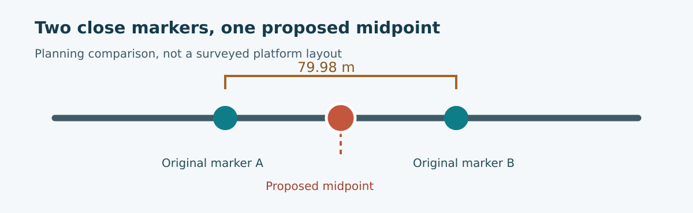

# Samawah: one edit through the system

Samawah provides a concrete example of why railway decisions must remain
connected. Two raw station markers on the selected line are about 79.98 metres
apart, while the planning case assumes a 120-metre platform. A station merge
was proposed to resolve the apparent conflict. The important question is not
whether one marker can be deleted from a map. It is what the edit changes for
passengers, vehicles, structures and cost, and what it still cannot establish.

The v0.7 comparison replaces the two markers with one midpoint marker without
changing the line's route coordinates. The published example had already
grouped the pair into one operational station complex. The raw marker count
therefore falls from 26 to 25, while the operational count remains 25. The
route stays about 57.87 km and the modelled fleet stays at 81 trainsets.
Neither outcome means the platforms or walking routes have been surveyed.

*Schematic only. The separation is from the planning record; platform and
pedestrian geometry have not been surveyed or approved.*

| Measure in the planning comparison | Before | Midpoint proposal |
|---|---:|---:|
| Raw station markers | 26 | 25 |
| Operational complexes | 25 | 25 |
| Modelled trainsets | 81 | 81 |
| Base installed capital | about $1.141491 billion | about $1.141481 billion |
| Base whole-life present cost | about $2.258426 billion | about $2.258656 billion |

The model's installed capital falls by roughly $10,000, yet its whole-life
present cost rises by roughly $230,000. The selected line's one-way time grows
by about 1.5 seconds. Most of the whole-life increase comes from the energy
account. The access allowance also changes: one notional repair length is
replaced by a shorter midpoint access hypothesis with a separate risk
allowance. Those figures are useful because they show the direction and scope
of the model response. They are not a local construction quotation, a walking
survey or proof that the station is feasible.

## What stayed the same matters too

The other four lines were not redrawn. The vehicle and manufacturing reference
did not change. The civil quantity identity was preserved because this
particular edit did not revise the modelled guideway. All fourteen cost scopes
were compared, including scopes with zero change. Reusing unaffected results
keeps the study focused and makes it easier to understand why a cost moved.

The comparison also keeps its adverse findings. A line-1 coast-reach question,
actual propulsion and braking evidence, transferred prices, platform fit,
catchment and walking access still need work. A separate compact-drive research
case once examined a similar midpoint idea with a different body candidate.
Its fleet or cost result is not transferred into this passive-wheel comparison.

## The next on-site decision

The midpoint should be tested against the real pedestrian network, frontage,
crossings, utilities, station entrance and platform geometry. A suitable
station might be placed at the midpoint, at one original marker or elsewhere;
the model alone does not decide. The value of the software journey is that each
new proposal can be carried through the same service and cost questions, while
the unresolved site evidence stays visible to the people making the decision.
