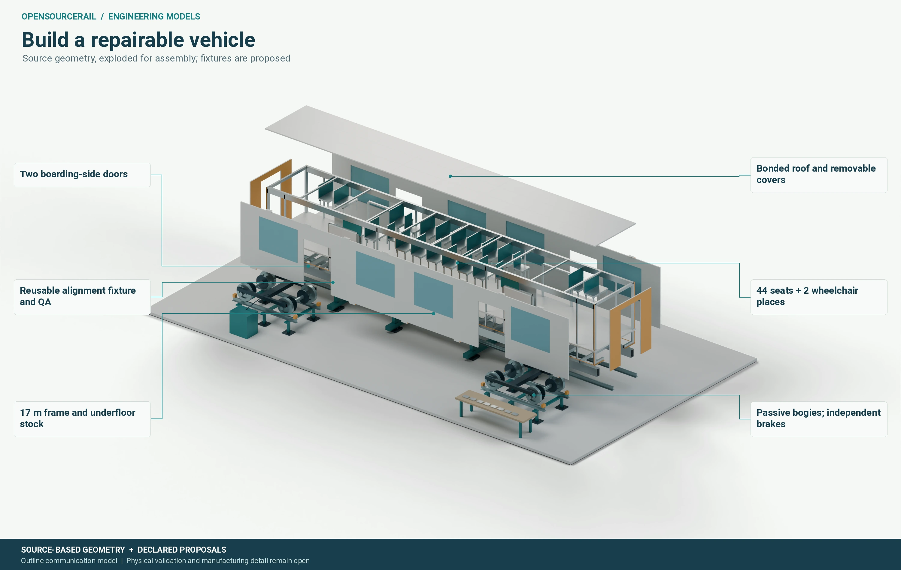

# Vehicle and running gear

The reference train has six 17-metre cars. A passive two-axle bogie supports
each end of each car, giving twelve bogies, 24 wheelsets and 48 axleboxes for
the formation. Steel wheels run on conventional rails carried by the concrete
guideway. Motors and gearboxes are absent from this reference running gear;
springs, damping, bearings, brakes, monitoring and emergency support still
have to be installed, inspected and maintained.

*Engineering communication model. It separates major assemblies and shows
their proposed relationship; it is not a complete installed-mass or approved
manufacturing drawing.*

## Design the car as an installed system

A carbody is not just a shell. Its floor, sides, roof and joints must carry
passengers, equipment, bogie reactions and accident loads while leaving room
for doors, windows, ventilation, cables, batteries, seating and maintenance
access. A material can appear light in a small structural test and still
require heavy joints or reinforcement around openings. The project therefore
compares body families with their complete load paths rather than treating a
single beam stiffness result as a qualified car.

The proposed manufacturing breakdown names 605 leaf-part types in 40
assemblies across the six-car train. It counts major structural stock,
wheelsets, bearings, doors, seats, batteries, HVAC, lighting, wiring, service
equipment and many fasteners. This is a substantial outline inventory, but
the list is not a measured installed train. Gross stock and assumed bought
equipment masses must be reconciled with actual fitted parts, centre of
gravity, inertia and available space.

One detailed proposal estimates 78.49 to 106.60 tonnes across the train from
stock and component allowances, with 89.81 tonnes as its base subtotal. These
are bounds within that particular proposal, not an approved tare or proof of
a weight saving over another candidate. Unlocated equipment, overlapping
reserves and supplier internals must be resolved before an installed mass can
be stated. Those quantities matter to axle load, braking, energy, beam design
and fleet cost, so an optimistic assumption cannot remain isolated in the
vehicle chapter.

## Formation and interfaces

The six cars need five inter-car mechanical couplers and separate passenger
gangways. A gangway gives people a route between cars; it does not replace a
load-bearing coupling or an emergency rescue connection. Air, signals,
lighting and other essential services also cross the joint. Their bending,
movement, fatigue and removal paths have to fit the operating curves and the
workshop process.

A revised manufacturing proposal increases the inter-car gap from 500 to 650
millimetres, taking its body-plus-gap envelope from 104.50 to 105.25 metres.
The extra space may ease certain interfaces, but platform margins, coupler
projection and stopping tolerance must be checked on the same candidate. A
formation change cannot quietly inherit the parent platform or fleet result.

The bogies themselves present a similar trade-off. A familiar wheel-and-rail
interface offers an established body of engineering knowledge, but wheel wear,
rail contact, noise, bearing service, wheel-slide protection and wet-weather
braking remain real tasks. The project needs dynamic and physical checks, not
only a visual fit of wheels beneath a CAD body.
