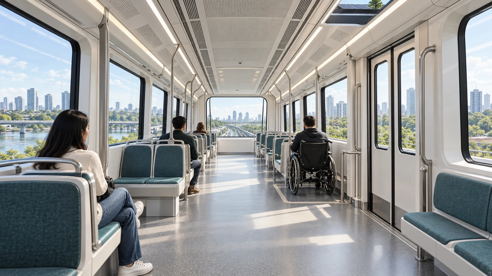

# Doors, cabin and access

The proposed train has twelve one-sided passenger door openings, two per car.
Doors are a small part of the vehicle's visible area but a large part of its
daily reliability and passenger protection. They must open and close without
striking the body or platform, detect an obstruction, remain secure in motion,
allow emergency release and be repairable without dismantling the car.

## One opening as a representative module

The current door study counts 74 mechanical and electrical part types and 694
individual pieces for one opening. The make-or-buy proposal assigns 97 pieces
to local fabrication, 568 to standard purchase and 29 to purchase subject to
qualification. It includes the header, rails, carriage, belt and pulley,
drive, leaves, glazing, sensors, seals, wiring, fixings and inspection items.
These counts help expose the work hidden by a simple animation of two moving
leaves. They do not mean the door is ready for manufacture.

The next design step is to establish mating datums: where the header attaches
to the body, how the rail and carriage align, how the belt and drive meet,
where sensors sit, and how the assembly can be lifted out. Several proposed
operator parts still occupy a generic central header zone instead of fully
resolved fitted positions. A two-metre removal sketch does not represent the
full 2.9-metre guide stock. These are specific reasons to keep installation
and maintenance open, even though the inventory is detailed.

## A cabin that works in service

Each car's 44 fixed seats and two wheelchair places provide a clear normal
accommodation policy. Their location must still allow boarding, circulation,
evacuation, cleaning and access to service equipment. Windows, seat fixings,
handholds, lighting, ventilation and interior panels must meet their own
fire, impact and maintainability requirements. A bright concept interior is
an invitation to test the layout with passengers, not a substitute for those
tests.

*The accessible interior is a design intention. Actual circulation, doorway,
platform gap and emergency arrangements remain engineering tasks.*

The lighting proposal uses replaceable LED modules in two rows per car, with
separate protected circuits and independent emergency fixtures. The counted
normal lighting demand is modest relative to propulsion, but the design must
still establish illumination, glare, electrical protection, electromagnetic
compatibility and hot-weather performance. The same principle applies to
HVAC: a catalogue load or a CAD envelope is a starting point, while real
airflow, pressure, temperature and service access must be verified.

The door operator is chosen as the v0.7 representative manufacturing and
maintenance module because it forces mechanical, electrical, body and
passenger questions to meet. A controlled package should show dimensions,
tolerances, materials, assembly sequence, tooling, QA limits, removal path and
replacement record for one exact vehicle candidate. A business-system record
can then follow the physical module through receipt, inspection, fitting,
service and eventual replacement.
