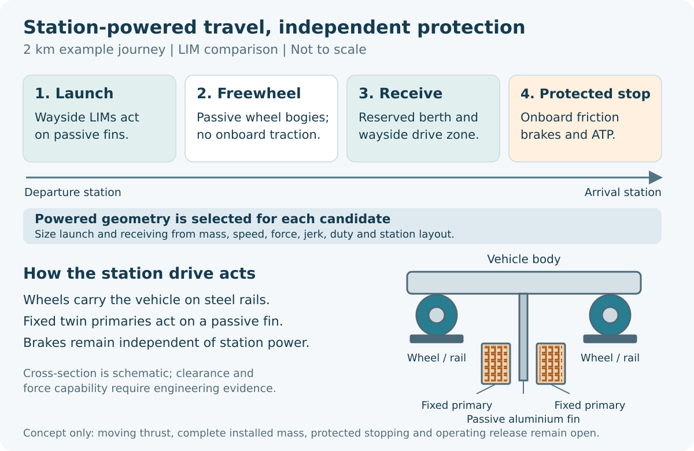

# Propulsion, power and braking

The wheel-supported reference separates carrying the train from driving it.
Wheels and rails bear the load. Station-side equipment is being compared for
launch and arrival, with a passive aluminium interface on the vehicle for
linear-motor research. Other candidates may use mechanical launch equipment,
powered wheels or different recovery arrangements. None is selected as an
installed system merely because a schematic looks simple.

*The diagram explains one operating idea. The actual force, powered length,
energy transfer and protected braking distance depend on the chosen candidate
and route.*

## What a station drive must achieve

A station-powered train could receive its main acceleration near departure,
coast through much of the interstation distance and be received at the next
station. This may reduce train-borne traction hardware. It also concentrates
power and thermal duty at stations and introduces equipment gaps between
stations. On an uphill route, a coasting train may not reach its destination
within the proposed speed limits. On a downhill route, it may need additional
speed control. A failed station or an unexpectedly stopped train makes rescue
and independent stopping essential.

A linear motor needs an attainable force map across speed, current, voltage,
air gap and temperature. A model that matches an ideal travelling field is a
useful method check, but it does not include every slot, end effect, inverter
or moving support of a manufactured motor. The passive fin, its mounting,
thermal expansion and wheel/rail movement must fit the same clearance
envelope. Powered length is consequently a result of design, not a fixed
100-metre or 900-metre prescription.

Mechanical capture and release is another research family. It asks whether a
station can recover some arriving kinetic energy, store it briefly and help
launch the next train. The physical mechanism would need contact geometry,
energy storage, losses, guards, fault handling, maintenance and a reset
sequence. Energy recovered in a calculation does not automatically become
available to the next departure. Powered-wheel alternatives must likewise
carry their added motors, gearboxes, converters, cooling and bogie changes.

## Independent stopping and service power

The reference train requires onboard service, emergency and parking brakes
that do not depend on station power. Stopping must be checked at low adhesion,
on gradients, under crowd loading and after relevant faults. One retained
adverse calculation from 20 m/s uses a low adhesion assumption and a downhill
grade; it gives a stopping distance of roughly 700 metres including response.
That is a sensitivity, not a validated wet-rail brake curve or an approved
separation distance. Wheel-slide protection, thermal duty and degraded
operation need their own evidence.

Service batteries support HVAC, lighting, doors, communications and
protection. A retained 82.8-kWh-per-car pack is a sizing hypothesis, not a
qualified installation. Heat can dominate the design: a cell with a 45°C
ambient limit cannot be kept below that limit in 50°C surroundings by a
radiator alone. Cooling, enclosure, charging, emergency endurance, fire
isolation and replacement access must be designed and tested together.

The main question is not which drive sounds most elegant. It is which
candidate supplies the required service with credible force, safe stopping,
bounded heat, repairable equipment and the lowest justified whole-life cost.
